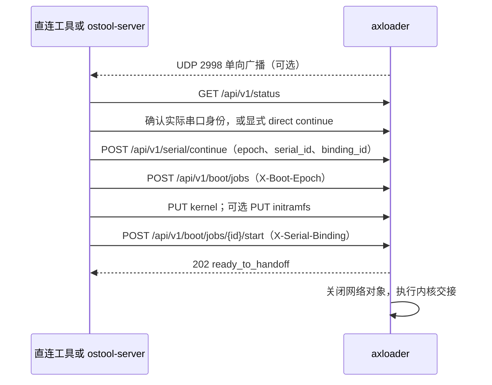
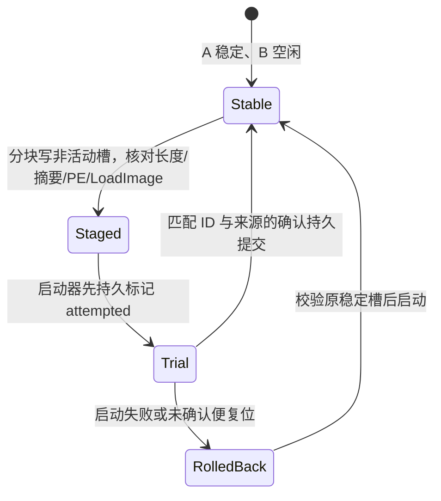

# axloader

## 1. 网络控制

### 1.1 设备接口

axloader 在同一网卡使用 UEFI SNP、IP4、UDP4 与 TCP4，向 UDP `2998` 广播自身
MAC、架构名称、`boot_epoch` 和 HTTP 端口，并在 TCP `2999` 提供设备接口。它不再
发现 ostool-server、轮询任务或通过 HTTP 下载镜像；串口在启动前输出本次身份帧和诊断，并在交接后
供目标系统使用。`network::NetworkInterface::select()` 选择网卡，
`network::Announcer` 广播，`direct::Listener` 接受请求。调用方可以直接按设备 IP
操作，ostool-server 也调用同一组接口。

每次启动创建新的 `boot_epoch`。所有 boot、serial 和 OTA mutation 均需
`X-Axloader-Protocol-Version: 7` 与 `X-Boot-Epoch`；GET 状态查询可省略版本头。
错误代次返回 `409 boot_epoch_mismatch`。v7 是唯一协议，不维护 v2–v6 运行分支、
旧 discovery/poll 路由或 arch/format/entry 请求字段。以下接口由
`boot_server::BootServer` 和 `axloader::ota::OtaController` 共享监听器：

| 接口 | 作用 |
| --- | --- |
| `GET /api/v1/status` | 读取启动代次、MAC、实际 UART 参数、绑定/错误、硬件、启动事务与 OTA 状态 |
| `POST /api/v1/serial/continue` | 当前 epoch、serial_id、binding_id、bound/direct；相同请求幂等 |
| `DELETE /api/v1/serial/bindings/{binding_id}` | 撤销当前匹配令牌，恢复身份帧 |
| `POST /api/v1/boot/jobs` | 提交启动 ID、内核和可选归档的长度、SHA-256、命令行；不传 arch、image format 或入口 |
| `GET /api/v1/boot/jobs/{id}` | 查询 receiving/ready/failed 及首个错误，failed 仍返回 200 |
| `PUT /api/v1/boot/jobs/{id}/kernel` | 定长上传内核，要求匹配 `X-Image-Sha256` |
| `PUT /api/v1/boot/jobs/{id}/initramfs` | 定长上传可选归档，要求匹配摘要 |
| `POST /api/v1/boot/jobs/{id}/start` | 核对 `X-Serial-Binding` 后装载、回复 `202`，释放 UART 和固件网络后交接 |
| `DELETE /api/v1/boot/jobs/{id}` | 取消尚未启动的事务 |
| `GET /api/v1/ota/status` | 读取 ESP 稳定槽和待试槽状态 |
| `PUT /api/v1/ota/image` | 定长上传 EFI，写入非活动槽后回复 `202` 并重启 |
| `POST /api/v1/ota/confirm` | 用升级 ID 和来源确认当前待试槽 |

v7 设备必须与发送 v7 头和 `X-Serial-Binding` 的 ostool CLI/server 配套使用，
板卡 ESP/U 盘中的 `axloader.efi` 也要更新到同一版本。
不需要串口隧道时仍须显式发送 `direct` continue；启动返回 `409 serial_binding_required`
时，先检查服务端/loader 版本是否配套，再检查串口身份是否完成绑定。

启动文件暂存内存，每个文件上限 256 MiB，EFI 上限 32 MiB，请求头上限
4 KiB。只接受定长请求体，连接空闲 30 秒后取消，SHA-256 不符时不发布文件。
上传时 `direct::Connection::wait()` 仍推进广播；同一时间只处理一个上传事务。
`BootServer::create()` 允许同 ID、同清单重试，其他并发事务返回冲突。upload 只在
move 后核对一次长度和摘要，任务只向 backend 借用不可变文件切片。start 每次从内存
读取并在 `ElfImage::parse(image, target)` 中解析一次；machine 不匹配、缺少/不可执行
本地 EFI 符号、坏段或 handoff 准备失败会记录首个错误、释放上传缓冲并返回 422。
只有文件和 handoff 准备成功、`202 ready_to_handoff` 完整写出后，才停止控制面并
进入内核；202 写失败会析构本次 execution，原 ready 事务仍可再次 start。

两个 frontend 的顺序固定为版本、epoch/trial、当前 ID/failed、长度/摘要、body
读取与分配，最后才进入 route。旧 epoch 不因 failed 事务改成 422；当前 failed
PUT/start 则在检查新长度或分配恢复缓冲前重放首错。真实 QEMU 构建启用默认关闭的
`qemu-fail-202-write` feature，只对固定测试 boot ID 的首次真实提交注入一次错误；
生产构建不保留注入分支，HTTP 也没有开关。测试要求同 ID 重试；x86_64 与
LoongArch64 还跑错误 machine、缺符号、
不可执行入口和坏段矩阵。
HTTP `CloseToken` 只做有界等待；超时后用 `Configure(NULL)` 按 Tcp4 reset 契约中止
并重置实例，不能把 Close token 传给 `Cancel()`。监听 Accept token 可在有界等待中
使用合法 `Cancel()`，之后同样以 `Configure(NULL)` 完成 reset。固件无法确认 token
已出队时 loader 冷复位，不释放可能仍被固件引用的 token；receive/transmit 超时取消
也遵循同一有界 reset 契约。交接路径一次性输出
`handoff_stage: http_close_start/http_closed/listener_closed/resources_closed/target_enter`。

`cmdline` 与 `initramfs` 相互独立且都可省略。设备端固定 `TargetSpec` 决定 ELF
machine、EFI 入口符号和装载约束，状态里的 `arch` 只是开放字符串诊断值；当前只实现
x86_64 UEFI 和 LoongArch64 UEFI/arceos-efi，不声称有 RISC-V axloader backend。
axloader 把命令行编码成带 NUL
结尾的 UCS-2，临时安装到自身 `EFI_LOADED_IMAGE_PROTOCOL.LoadOptions`；没有
命令行时显式安装空 LoadOptions，避免把 axloader 自身参数传给内核。归档存在时，
axloader 注册 Linux EFI initrd 约定的 `EFI_LOAD_FILE2_PROTOCOL` 提供者和
`MEDIA/VENDOR` 设备路径；EFI 入口异常返回时会恢复
原 LoadOptions，并释放本次事务持有的命令行与归档。

### 1.2 启动流程

调用方无需提供 ostool-server 地址。宿主可查询设备 IP，直接提交启动事务；
ostool-server 在实验网收到广播后先 GET 状态，再依据板卡 MAC 和 Session 决定是否上传。



同一 Session 设备复位后得到新启动代次，服务端可以按旧 `boot_id` 重新推送。
待试 EFI 槽必须先收到对应来源的确认，才接受启动事务。TCP4 被动监听不可用
时仅显示诊断；完全切换后的网络启动需要固件提供该协议。

## 2. 自动串口

`loader::serial::SerialBeacon` 从固件 `ConOut` 设备路径匹配唯一 UART，读取 `Serial::io_mode()`
的生效波特率、数据位、校验、停止位和硬件流控。无法读取线路参数时状态保持
`ready=false`，HTTP 状态和 ConOut 诊断记录具体原因；不得用固定的 115200 参数伪造
一个可绑定的 UART。无法唯一选择 UART 或没有 SerialIo 时同样明确报告自动绑定不可用。
身份帧会先应用有效参数写出，再恢复固件原设置。不以 USB SN 或 SMBIOS serial 作为启动身份。

### 2.1 本次身份与门禁

每次启动的 `serial_id` 是独立 128 位 ID。两个原生 UEFI 目标都优先使用 UEFI RNG，
缺失时使用固件单调计数和运行时信息派生控制面身份。
`SerialBeacon::progress()` 每 250 ms 启动 ASCII 身份帧发送，以最多 4 字节的部分写入推进。
`BootServer` 状态与 UDP 公告关联同一 serial_id 和 epoch；网络确认后停止身份帧。

```text
\r\nAXLOADER-SERIAL/1 <32位小写十六进制 serial_id>\r\n
```

`bound` 对应宿主 UART 身份匹配；`direct` 由不需要隧道的客户端显式放行，不能显示为串口已绑定。
启动需当前 epoch 和绑定令牌；上传、查询、OTA 不受 UART 门禁影响。撤销当前令牌后恢复发送。
设备重启后任何旧 ID 和绑定均无效。

### 2.2 固件借用与退出

现有 console driver 保持连接。每次参数读取或写入使用短期非独占 `GetProtocol` guard，
在 `TPL_CALLBACK` 阻止竞争回调，先关闭 guard 再恢复 TPL；没有协议引用跨越网络轮询。
写入暂用 5 ms 超时并恢复原属性，无事件回调保留 Rust 上下文。
`efi_main` 在 OTA reset 和内核交接前显式析构 TCP/UDP 对象与 beacon 计时器。
约束依据 [UEFI Boot Services](https://uefi.org/specs/UEFI/2.10/07_Services_Boot_Services.html)
和 [Serial IO](https://uefi.org/specs/UEFI/2.11/12_Protocols_Console_Support.html#efi-serial-io-protocol-write)。

## Hardware identity

The permanent SNP MAC is preferred. If it is empty, the current link MAC is
used. Only six-byte Ethernet addresses are accepted.

SMBIOS 3 is preferred and SMBIOS 2 is the fallback. The loader reports only
Type 1 manufacturer, product, version, and serial through HTTP. Parsing checks
entry-point checksums, structure bounds, string termination and string indexes,
and rejects tables larger than 1 MiB.

## Supported targets

| Architecture | Rust UEFI target | EFI boot filename |
| --- | --- | --- |
| `x86_64` | `x86_64-unknown-uefi` | `BOOTX64.EFI` |
| `loongarch64` | `loongarch64-unknown-uefi` | `BOOTLOONGARCH64.EFI` |

x86_64 and LoongArch64 use the same native UEFI loader code, firmware network
protocols, HTTP v7/OTA transaction, serial identity and ELF handoff. The device
target selects the ELF machine, local EFI entry symbol and load/link contract;
QEMU still selects its firmware architecture and boot filename. x86_64 accepts
`__x86_64_efi_pe_entry`; LoongArch accepts ELF64 `EM_LOONGARCH` with
`efi_pe_entry`. The maximum uploaded target is 256 MiB.

The native loader keeps UEFI Boot Services active. Target LoadOptions and the
Linux EFI `LoadFile2` initramfs provider are published through
`someboot::handoff::PreparedHandoff`; the target kernel installs its own
execution environment and calls `ExitBootServices`. The loader never enters
LoongArch inherited-handoff mode and never runs ArceOS as loader internals. A
target uploaded over HTTP is ordinary ELF and must
complete its own EFI-entry relocation and handoff.

Both native entries disable the firmware watchdog immediately after UEFI
helper initialization and before OTA, network or SerialIO waits. Firmware BDS
normally starts a five-minute watchdog around `StartImage`; an unattended
loader must explicitly cancel it with zero timeout and a non-reserved
application `WatchdogCode` (`>= 0x10000`). A failed `SetWatchdogTimer` call is
reported and fails initialization. This does not call `ExitBootServices`; the
target still owns that transition. The Loongson `V00011003` event from
`WatchdogTimerDxe` is a watchdog expiry, not a LoongArch CPU exception.

One firmware controller must expose SNP, IP4Config2, UDP4 service binding and
TCP4 service binding; broadcast does not prove this bundle. Automatic serial
identity requires a uniquely selectable UEFI SerialIo device associated with
ConOut. Missing protocols are reported through ConOut as
`loader_net_controller[...]`, `loader_tcp4_listen_failed`,
`loader_serial_probe` and `loader_serial_unavailable`; absence of SerialIo is
never replaced with a synthetic 115200 identity.

`boot-resources` 可独立于网络、OTA 和交接生产端使用；`efi-handoff` 组合 EFI 与
资源能力，替代已经删除的 `efi-loader`。普通 EFI 内核消费交接始终随 `cfg(efi)`，
无需开启生产端。原生 `target_os = "uefi"` 依赖只编译公共能力和固件适配，不带入
someboot 内核入口、分页或 SMP。模块、协议与所有权依据见
[启动资源设计](../../docs/design/someboot-boot-resources.md)。

## Build and test

Use the project task runner:

```bash
rustup target add x86_64-unknown-uefi
cargo xtask axloader build --target x86_64-unknown-uefi --release
cargo xtask axloader build --target loongarch64-unknown-uefi --release
cargo xtask clippy --package axloader
cargo xtask axloader test qemu --target x86_64-unknown-uefi
cargo xtask axloader test qemu --target loongarch64-unknown-uefi
cargo xtask axloader test qemu --target loongarch64-unknown-uefi \
  --firmware-code /path/to/code.fd --firmware-vars /path/to/vars.fd
```

The outputs are:

```text
target/x86_64-unknown-uefi/release/axloader.efi
target/x86_64-unknown-uefi/release/axloader-launcher.efi
target/loongarch64-unknown-uefi/release/axloader.efi
target/loongarch64-unknown-uefi/release/axloader-launcher.efi
```

### Native QEMU verification

`test qemu` uses the same real FAT/OTA/HTTP transaction for both native targets.
The Loong profile selects `qemu-system-loongarch64`, `virt`, `la464`, Loong
UEFI firmware, `BOOTLOONGARCH64.EFI`, and the local LoongArch `TargetSpec`
whose EFI symbol is `efi_pe_entry`. Its ArceOS smoke target must print `HOST_CMDLINE` and
`HOST_INITRAMFS_PASSED`; `ready_to_handoff` alone is not success. The QEMU
test uses SLiRP host forwarding and proves HTTP, not real UDP broadcast
discovery. UDP discovery still requires an isolated TAP network or a physical
board.

The default LoongArch run validates the native loader, HTTP v7, OTA, and
direct ArceOS handoff scenarios with standard QEMU. The target is an ordinary
ArceOS ELF whose `efi_pe_entry` calls `ExitBootServices`; no AxVisor host or
virtual machine is involved.

`--firmware-code` and `--firmware-vars` must be supplied together and override
only the test invocation's firmware pair. Loong QEMU copies both files into the
run directory and pads short copies to 16 MiB without modifying the source.
The Loong profile adds `virtio-rng-pci` and disables the virtio-net/rng option
ROM lookup because the firmware supplies the network drivers. RNG is required
by `DxeNetLib`; TCP4 additionally requires a firmware `Hash2DxeCrypto`
producer. The stock debug firmware may still lack Hash2, which must be reported
as a firmware dependency rather than worked around with a loader network stack.
The native Loong EFI build is available through
`cargo xtask axloader build --target loongarch64-unknown-uefi --release`; this
command is not currently run as a separate CI step. The existing
`loong-qemu-smoke.py` CI gate covers the legacy axstd backend. The full native
Loong QEMU command remains a release/board validation entry that must be given a
firmware pair containing Hash2.

Native Loong QEMU coverage is not evidence that physical LoongArch firmware,
USB installation, network protocols and SerialIO have been accepted on
hardware. The physical-board entry boots the same native loader directly into
the ArceOS Hello image:

```bash
cargo xtask arceos test board \
  --board loongson-3a6000-ll --test-case http-boot
```

## x86_64 OTA 布局与状态

安装后，ESP 中的 `EFI/BOOT/BOOTX64.EFI` 是独立构建的
`axloader-launcher.efi`；`EFI/AXLOADER/A.EFI`、`B.EFI` 是可升级装载器。
全新安装时 A、B 初始使用同一份新装载器，A 为稳定槽且没有待试升级；迁移安装时
A 保存旧装载器，B 使用新装载器。`STATE0.BIN` 与 `STATE1.BIN` 分别存放 256 字节
`State::encode()` 记录。记录包含代次、稳定槽、待试槽、两槽 SHA-256、
升级 ID、来源、试运行标志、上次结果和记录校验和。`OtaDisk::load()` 只选择
校验通过且代次较新的记录，`OtaDisk::commit()` 只写另一份，Flush 后读回
核对。FAT 不是事务性文件系统；两份记录都不可用时启动器停止并显示诊断。



`launcher::launch()` 从同一 ESP 的完整设备路径调用 `LoadImage`／`StartImage`；
只信任状态记录中对应的文件摘要。待试槽在接收服务端确认指令或直连方确认前
不会接收内核启动命令。待试装载器宕机或断电，下一次启动先回滚。旧稳定槽
也无法核对时，必须使用外部介质修复；回滚会清除未确认槽的可信摘要，
防止它在稳定槽随后损坏时被提升为稳定槽。普通升级只写非活动槽；32 MiB 是
镜像上限。

`loader::direct::Listener` 同时处理上述启动和升级路由。直连上传不依赖
ostool-server；上传方在重启后先核对运行摘要与升级 ID，再用当前启动代次
确认。服务端指派传入 `X-Update-Source: server` 和 `X-Update-Id`，只在再次
发现匹配升级 ID 与运行摘要的待试槽后发送同来源确认。直连任务无法由服务端
误确认；确认状态写入并 Flush 成功后才接收内核启动事务。

仅在可信隔离实验网使用：SHA-256 检查传输一致性，不认证上传者或服务器，
MAC 也不是身份认证。若以后要求内核验签，须先让 A/B 都执行同一验签策略并
验证拒绝路径，再允许回滚；旧槽可能恢复旧的内核认证缺口。

## Install to removable media

脚本支持 x86_64 与 LoongArch64 的全新安装和旧布局迁移。全新安装适用于已经格式化但没有
可用架构 launcher 的可写 FAT ESP，不需要旧装载器：

```bash
./bootloader/axloader/scripts/build-install-efi.sh \
  --fresh --device /dev/sdb1
./bootloader/axloader/scripts/build-install-efi.sh \
  --fresh --device /dev/sdb1 --target loongarch64-unknown-uefi
```

全新安装会把新装载器复制到 A、B，生成稳定状态记录，再写入 launcher。
如果 ESP 原先有 `BOOTX64.EFI`，脚本会把它保存为
`EFI/AXLOADER/BOOTX64.PREVIOUS.EFI`，但不会把它作为回滚槽使用。首次启动不需要
确认；后续 OTA 从非活动槽开始试运行。首次替换 launcher 仍有断电窗口，必须保留
外部恢复介质。

迁移已有系统时，保留旧版 `BOOTX64.EFI` 并省略 `--fresh`：

```bash
./bootloader/axloader/scripts/build-install-efi.sh
./bootloader/axloader/scripts/build-install-efi.sh --device /dev/sdb1
```

默认按 `OSTOOLBOOT` 查找分区。脚本会按 `--target` 构建并校验两个同架构 PE 映像、
检查空闲空间、写入 A/B 和双状态记录、同步并逐项核对，最后替换
`BOOTX64.EFI` 或 `BOOTLOONGARCH64.EFI`。迁移模式还会把旧文件保存为同名的
`.ORIGINAL.EFI`，B 首次作为直连待试槽，
安装命令打印升级 ID，上传方须在首次启动后核对摘要并调用确认接口。两种模式都
会拒绝已有 `EFI/AXLOADER` 文件的 ESP，避免覆盖未知状态；请先离线恢复或清理。

从 legacy ArceOS LoongArch loader 切换到 native loader 时使用 `--fresh`。该模式
把 A、B 都写成 native loader，旧 `BOOTLOONGARCH64.EFI` 只保存为
`BOOTLOONGARCH64.PREVIOUS.EFI` 备份，不进入 OTA 回滚槽，避免静默回退到旧
ArceOS loader。

`cargo xtask axloader test qemu --target x86_64-unknown-uefi` 使用同一块真实
FAT 映像跨多次启动，检查 `hostfwd` 上的直连、错误摘要、短请求、待试复位、
持久确认及旧槽恢复。宿主需要 `qemu-system-x86_64`、KVM、`mkfs.vfat`、
`mcopy`、`mmd` 和 `python3`。完整的本地服务端联调以隔离配置和 loopback
管理端口运行，不安装 systemd 服务，也不修改 runner。

LoongArch native uses the same installer and QEMU flow. For that target the
launcher is `BOOTLOONGARCH64.EFI`, the PE machine must be LoongArch64, and the
installer accepts only the matching boot filename. The Loong QEMU command
requires `qemu-system-loongarch64` plus Loong UEFI CODE/VARS firmware; it does
not require an ArceOS loader configuration. Physical 3A6000 validation uses
the ArceOS board case above rather than an AxVisor host shell.

## Troubleshooting

`loader_tcp4_unavailable` 表示同一网卡没有 SNP/IP4/UDP4/TCP4 协议束；
`loader_tcp4_listen_failed` 表示固件未能在端口 `2999` 创建被动 TCP4 实例。
`loader_broadcast_error` 仅影响自动发现；有设备 IP 的直连调用仍可用。
返回 `409 boot_epoch_mismatch` 时重新 GET 状态，使用新的启动代次发起请求。
`ready_to_handoff` 后出现交接错误，应核对 ELF/归档入口和 UEFI 退出路径。


LoongArch 交接的资源容量与存活对象分开管理。等待下载的 axloader 继续保有声明容量；
普通目标没有资源计划时，只保留当前镜像、未消费归档及显式存活分配。旧镜像、栈、
页表和逐核区在目标安装自身执行环境并绑定 CPU-local 后才回收，随后才初始化普通分配器。
`PreparedHandoff::seal` 在运行时停稳后的无分配窗口发布最终快照，生成可进入的 `SealedHandoff`。
initramfs 解包借用结束后通过唯一所有者归还完整页；冻结的平台 map 不再修改。
机制、内存分类与失败边界见[启动内存回收设计](../../docs/design/someboot-boot-resources.md#4-启动内存回收)。
