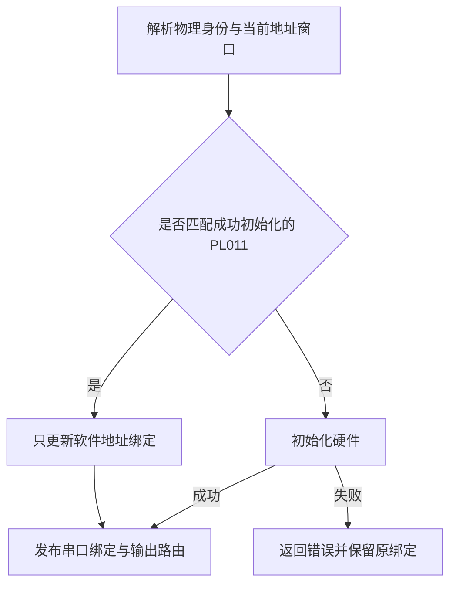

# Axvisor AArch64 客户机启动前进性

## 1. 启动契约

客户机启动不能以输出到达物理串口的时间代替执行进度。`someboot` 的分页入口、AxVM 的 vCPU 执行边界和 Axvisor 的控制台是三个不同的所有者，诊断与修复必须区分它们。本文补充 [AArch64 通用定时器设计](../docs/design/axvisor-aarch64-generic-timer.md)，不改变其 world-switch、PPI 退休或 WFI 唤醒契约。

### 1.1 客户机执行

`platforms/someboot/src/arch/aarch64/paging/mod.rs` 拥有启动映射与分页交接，`ax_cpu::boot` 和 `ax_cpu::mmu` 提供体系结构操作。`Setting up table registers...` 与 `MMU Entry point...` 都在开启 MMU 之前打印；实际重定位后，`prime_entry()` 还会重建 early console 的地址绑定。输出到达终端的时间不能代替这些执行阶段。

开启 `SCTLR.M` 与跳入重定位入口之间不得访问串口。该窗口的观测只能使用当前阶段有效的内存和地址；不得通过新增串口输出改变地址转换契约。符号定位必须使用正在执行的精确 ELF，并区分链接地址、物理装载地址与重定位后的地址。

### 1.2 串口地址重绑

首次选择 PL011 时，启动层负责初始化硬件。此后同一启动所有者仅因 MMU 或重定位改变而重新绑定同一 PL011 时，只能更新软件寄存器地址，不得再次 `open()`、等待发送排空、禁用 UART、清空 FIFO 或改写线路配置。`fdt::setup_earlycon()` 的 stdout-path 与 `console::set_earlycon_by_cmdline()` 的 PL011 选择必须遵守相同规则；首次初始化失败不得被伪装为已经完成的接管。

`console::bind_earlycon_pl011()` 是两条选择路径的共同入口，`EarlyconState` 与当前串口一起保存成功初始化的物理身份。持有 early-console 访问许可时，绑定决定由该 owner 完成；新设备初始化失败会保留原绑定，而不是发布半初始化的控制台。

软件窗口可以因地址转换改变而不同，物理设备身份却不随之改变。是否跳过初始化因此不能仅依据 MMU 当前是否开启，也不能依据“曾经存在任意串口”判断。

该边界与运行期接管一致：已经工作的串口不是一个需要重新启动的设备。已有 #2670 的 drain-before-disable 修复继续保护真正的初始化和重配置，但地址重绑本身不应依赖发送完成。在宿主输出背压下，虚拟 PL011 可以合法保留未发送字节；重新绑定地址不得把这些字节变成启动条件。

本次不改变 NS16550、ACPI/SPCR 或体系结构专用控制台的选择与初始化契约，不引入新的公开配置、硬件能力或运行期所有者。

### 1.3 宿主执行

`axvm::runtime::vcpus` 的任务独占可变 vCPU backend。硬件绑定期间，客户机状态、宿主 CPU pin、IRQ 与抢占保护必须成对安装和撤销；任何需要休眠的退出处理必须在卸载后进行。客户机自己的 IRQ 屏蔽不能被当作允许长期屏蔽宿主调度事件的依据。

`ax-task` 的调度状态和 `ax-runtime` 的物理 clockevent 分别拥有任务选择与硬件期限。调试时必须分别确认任务是否可运行、是否得到 CPU、是否已经进入客户机，以及宿主定时事件是否仍能被确认和服务，不得仅凭客户机串口停顿推断调度饥饿。

### 1.4 输出进展

虚拟 UART 的发送状态、Axvisor 的有序输出队列和物理串口完成状态不能合并成一个完成条件。客户机已提交字节、后端已接收字节与用户已看到完整行是不同事件；背压不得静默变成成功，也不得以原子上下文中的休眠输出消除背压。

排查停顿时，先将 guest PC、vCPU entry/exit 与 UART/队列状态对应起来。若 guest 已推进而物理输出滞留，应由输出所有者解释；若 guest 未执行，应继续检查宿主任务与中断状态；若停在体系结构指令，则检查该指令及模拟器的实际执行现场。

## 2. 证据与验收

[#2672](https://github.com/rcore-os/tgoskits/issues/2672) 的两份原始 CI 记录只证实 VM2 的相邻输出间有约 305 秒空洞。网络初始化在空洞之后，不能据此把 DHCP 超时当作原因，也不能把一次相同负载通过解释成根因已经修复。

### 2.1 停顿承载者

一次有效归因必须把同次运行的实际 CPU 状态与执行代码对应起来。至少记录精确 host/guest ELF 身份、QEMU 参数、guest PC、宿主 entry/exit 或任务状态，以及与候选原因有关的定时器或 UART 进度。Linux 对照需要记录源码版本与提交，只作为语义依据，不能替代本项目的运行时证据。

在议题失败提交 `f2b74b2991f6fa0638f44d26a4c28f42e4bc7b6f` 的原负载上，观测到重定位后 `someboot::fdt::earlycon::setup_earlycon()` 再次调用 `some_serial::pl011::Pl011::open()`。保存的 guest PC 位于 `open()` 的 FR BUSY 检查，FR 为 `0x39`，同时包含 BUSY、TXFF、RXFE 和 CTS；该 guest 的 entry/exit 计数在两次快照间持续增加。精确 ELF 的反汇编显示，旧 `open()` 已先清除 UARTEN，再执行最多 `1 << 20` 次 BUSY 轮询。虚拟 PL011 在禁用时不排空保留 FIFO，因而只能等预算耗尽后恢复原 CR，期间已经提交的启动输出也无法完整显示。

这解释了“最后看到 early-MMU 文字、约 300 秒后继续”的形状，不支持把空洞归因于 MMU 指令、DHCP 或未获得宿主 CPU。Linux v7.1 `8cd9520d35a6c38db6567e97dd93b1f11f185dc6` 的 `drivers/tty/serial/amba-pl011.c` 将 early console 输出与运行期配置分离；`pl011_putc()` 在发送使能状态下等待 BUSY 清除，不通过关闭发送器等待其排空。

临时断点、内存探针及 QEMU 调试参数不属于正式接口；确认原因后删除。完整原始运行日志、寄存器快照与 ELF 身份保存在本次任务证据中，不在长期设计中固定会话路径。

### 2.2 原始负载

`apps/arceos/virtio-net-peer/run.sh --vcpus` 构建四台客户机、合计五个 vCPU，并通过 `os/axvisor/configs/qemu/qemu-aarch64-vcpus.toml` 在两宿主 CPU 上运行。该用例的完整心跳规则是启动、SMP 和跨 VM 通信的端到端验收，不是精确停顿位置的探针。

修复不得改变 guest 数量、CPU 亲和性、启动顺序、非 EFI 启动、shell 步骤、心跳判据或 360 秒 deadline。窄回归必须在真实错误实现上因预期原因失败，再在修复后通过；原命令随后仍须满足全部原始判据。连续重跑、扩大超时和放宽标记不构成根因修复。
