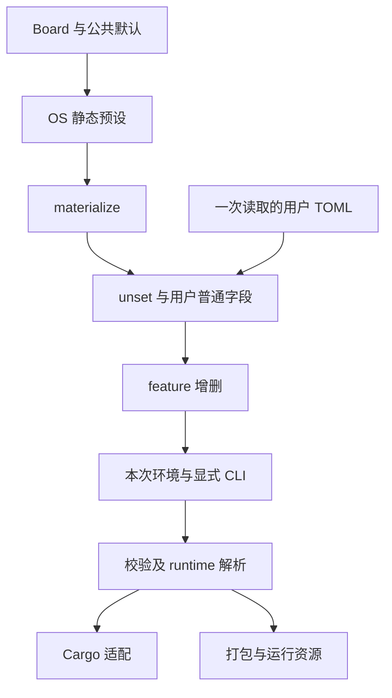

# 三 OS 分层构建配置

## 1. 配置所有权

本设计落实 [议题 #2777](https://github.com/rcore-os/tgoskits/issues/2777) 的公共配置和静态预设契约。配置属于一次构建请求，完成解析和校验后，Cargo、镜像打包与运行入口消费同一个结果。宿主侧的 `ax-config` 拥有数据和纯规则，`axbuild` 拥有工作区、选择器、Cargo 和资源装配；目标内核只消费构建脚本生成的常量。

### 1.1 数据边界

`CommonConfig` 拥有 `target`、`features`、`rustflags`、确定性 `env`、`log`、`max_cpu_num` 和 `runtime`。默认配置不指定 target 和 CPU 上限，日志为 Warn，列表与环境为空。`RuntimeOptions` 中的缺省字段保持 `None`，不在反序列化时填入有效数值。

`ArceosConfig` 组合公共配置与 package、to_bin、freestanding、app-c；`StarryConfig` 组合公共配置与 fit_its，package 固定为 starryos；`AxvisorConfig` 组合公共配置与 vm_configs，package 固定为 axvisor。仅在最外层 flatten 公共字段，末尾私有 extra 表收集并拒绝未知键。runtime 子表独立拒绝未知字段。输入 Schema 使用真实配置类型和 `OverlayControls`，隐藏 extra，限制根未知键，同时允许任意合法字符串环境键。

### 1.2 依赖边界

`components/ax-config` 是宿主 std 库，默认功能为空。Serde 和 thiserror 属于基本模型；可选 toml 功能启用工作区 TOML 与 Figment 0.10.19，可选 schema 功能启用工作区 Schemars。Figment 禁用默认功能和内置文件、环境 provider，由私有适配器提供已读取的原始 TOML 表。公开接口不暴露 Figment。

axbuild 启用 toml 与 schema。runtime/HAL 只通过 build-dependencies 使用基本 runtime helper，不向目标侧增加 TOML、Figment 或预设注册表。Cargo metadata、特性求解、MMU 和链接参数继续属于 axbuild 的自由函数，不在基础库复制。

## 2. 输入装配

静态配方与用户稀疏覆盖具有不同职责。`Board` 只拥有跨 OS 共享的身份和 target；`CommonPreset` 组合公共默认与静态片段，各 OS 的预设保存自己的策略和资源。唯一 `materialize()` 将借用数据展开为本次请求的 owned 值，不解析内嵌 TOML。

公共 `boards/` 与三 OS 的 `config/presets/` 都以 `mod.rs` 为统一入口，每块物理板卡独立一个同名 Rust 文件，QEMU 按目标架构分别存放。OS 的同板用途变体放在该板文件中，例如 `qemu_aarch64.rs` 同时维护普通、vCPU 和 VirtIO 用途，不另复制公共板卡身份。`mod.rs` 统一声明模块、维护唯一有序 registry、查找及默认 QEMU 映射；不再使用集中全部配方的 `entries.rs`。确有复用的驱动片段单独放在 `boards/features.rs`，不混入某块板卡策略，也不保留只转发旧布局的空壳模块。

### 2.1 合并顺序

解析入口只读取一份用户文件一次。没有用户文件时，直接使用静态展开对象；有文件时先提取 preset、features_add、features_remove、unset 控制键，再将普通字段交给 Figment 的普通 merge。最终 OS 对象只解码一次，随后应用本次环境 FEATURES 和显式 CLI，再校验。

数据流中的每层仅拥有其声明的优先级。

普通表递归覆盖，普通数组整体替换，空数组清空，空表不清除已有子键。false、零和空字符串是显式值，交给字段规则校验，不当缺省处理。禁止字符串数字自动转换。feature 增删冲突报错，添加稳定去重，删除不存在项无操作；不能通过删除显式列表反向取消 Cargo 默认或依赖特性。

### 2.2 清除和错误

`unset` 只允许 max_cpu_num、runtime 两项、env 或 env.KEY，以及 ArceOS 的 app-c、Starry 的 fit_its。合法但不存在的路径无操作，其余路径报错。清空 VM 使用空数组。导出的最终 TOML 不保留控制键。

所有显式文件缺失、读取失败、TOML 语法错误、类型错误、未知键、预设不存在和选择器冲突均传播到调用方。错误携带来源和可确定的字段路径，语法错误保留解析器位置；不伪造已丢失的逐字段行列。旧 std、plat_dyn 和保留 env 参数给迁移提示，不静默回退。

## 3. 请求和资源

`ConfigSource` 区分内置预设、用户文件与无文件自定义输入。context 的已解析请求携带完整 OS 配置和 `RuntimeValues`；供 ostool 使用的配置路径为 Option，内置配置没有伪造文件。构建不隐式写 TOML。

`ConfigSource::Preset` 保存内置名称，`File` 保存绝对文件路径及可选预设名称，`Custom` 表示无文件的自定义选择。请求通过 `config_path()` 从来源派生可选路径，不再并列保存可独立修改的路径副本。`load_config_input()` 读取文件并调用 `parse_config_input()`，保留预设目标约束和 `app-c` 字段来源所需的最少信息，随后丢弃原始覆盖表。测试组切换使用 `replace_config_input()` 同时更换配置、来源及 runtime，不能只修改路径。

Starry 应用发现器将 `ConfigInput<StarryConfig>` 随用例传给构建入口，不把已解析输入退化为待重读的文件路径。应用 dispatcher 在发现前通过 `RequestEnvironment::capture()` 捕获环境，再交给 `prepare_starry_request_from_input()`；该入口复用环境和输入，不再次读取二者。

ArceOS 板测同样在发现前捕获环境，`ArceosBoardTestGroup` 保留 `ConfigInput<ArceosConfig>`，通过 `prepare_arceos_request_from_input()` 形成请求。发现后构建输入不再从路径重新读取，也不能将旧 package/target 当作新 CLI 覆盖；分组身份取已保存来源，不要求源文件在发现后仍存在。板卡缺少 target 时返回带文件上下文的错误，不能假设尚未发生的校验并 panic。

测试或应用切换构建输入时，必须替换完整 typed 配置，并使用原请求捕获的环境重新解析 runtime；仅修改路径不能改变已确认对象。构建分组可以复用同一内核 Cargo 身份，但每个用例仍持有自己的 VM 打包输入。客户机准备入口要求源文件显式声明 package 和 target；`ConfigInput::file_fields` 保留这两个键及 `app-c` 的最少字段存在信息。guest 在默认值及快照补齐前检查原文件键，不能通过展开后字段非空推断来源，也不能让文件 preset 的展开值代替显式声明。

### 3.1 选择与快照

CLI 和文件 preset 必须一致，预设的 target 约束 CLI target、arch 与文件 target。无预设时保留 CLI target 优先于文件 target 的能力，并校验显式 arch。默认 target 为 ArceOS/Axvisor AArch64、Starry RISC-V。标准 QEMU 预设由显式映射选择，不依赖名字排序。

显式更换 preset、config、arch、target 或 ArceOS package 时，不继承旧 target、SMP、VM 或运行配置。无新选择器时才恢复同 OS 的快照选择；快照不作为覆盖默认层。只有原本支持的裸 ArceOS qemu 自动使用 Hello World，显式应用不会套用其板卡策略。

文件来源的有效 preset 与 CLI 选择不同：`ConfigInput::selection_preset` 只保存显式 CLI（含恢复的 CLI 选择）或 source-free 默认预设，文件自身的 preset 控制键随本次文件内容重新读取。快照不能将上次文件控制键提升为额外 CLI 约束，否则编辑同一文件选择另一个 preset 会产生伪冲突；显式 CLI preset 与新文件冲突时仍必须拒绝。

`prepare_arceos_qemu_request()` 是允许无应用选择时使用 Hello World 的入口，仍先尝试恢复未被新选择器切断的快照；普通构建和 `config show` 使用 `prepare_arceos_request()`，缺少应用时明确报错。StarryOS 与 Axvisor 的无文件输入通过各自明确的标准 QEMU 映射选择预设。三个 resolver 都只返回待提交的快照，展示命令不保存它。

OS 专属特性禁令也是请求有效性的一部分。Axvisor 的运行时 VMX/SVM 选择规则由同一校验器拒绝对应 Cargo 特性；依赖工作区 metadata 的平台特性限制也必须在 resolver 完成前执行，不能只在 Cargo 适配中才拒绝，否则 show 与 build 会不一致，失败输入还会抢先覆盖快照。

`config ls/show` 不构建、不写快照；show 使用与构建相同的 resolver，TOML 主体保留 Option 语义，有效 runtime 值作为说明输出。Axvisor resolver 将有效的 CLI 或恢复快照 VM 覆盖同步到最终 `config.vm_configs`，使展示结果重新读取后仍选择同一有序 VM 列表；不读取 VM 文件或将其加入内核 Cargo 身份。旧快照指向已删除模板时给出 preset/defconfig 迁移方法。

三个 OS 的 `write_defconfig()` 共用 `export_config_with_snapshot()`，将展开配置和新选择作为一次失败可回滚的操作：先完成两份 TOML 的序列化、同目录临时文件写入与同步，并保存原配置的回滚副本，再替换配置、最后原子替换快照。提交快照失败时恢复原配置；目标原先不存在时移除新配置。普通快照保存同样使用临时文件原子替换，不截断旧快照。解析、校验或暂存失败不修改原文件与旧选择；回滚自身失败时保留恢复副本，并报告原提交错误、回滚错误和副本路径，不能声称原状态已恢复。此保证针对单个命令的普通 I/O 失败，不提供跨文件的崩溃、断电原子性，也不协调并发写入命令。

### 3.2 路径与打包

`app-c` 来自用户原始覆盖键时相对源目录，否则相对工作区根；resolver 转成绝对路径，defconfig 同样导出绝对路径。VM 与 fit_its 固定相对工作区根，绝对路径照旧；env 值原样传递。运行工具 TOML、DTB/DTS/ITS 与 VM TOML 保留原所属协议。

Starry 三个 SG2002 预设显式持有各自 ITS。mkimage 只消费 fit_its，资源缺失或打包失败必须报错；不再改配置扩展名猜测模板。旧用户文件旁存在同名 ITS、最终未指定 fit_its 且没有显式 unset 时，拒绝歧义输入并要求迁移。Axvisor VM 列表只影响打包，不进入 Cargo 编译身份或公共板卡数据。

## 4. 运行参数

`RuntimeEnv` 捕获相关原始环境一次，`resolve_runtime()` 对每项只解析胜出的来源，`RuntimeValues` 保存已验证结果。容量与实际在线 CPU 数不同：前者决定固定容量结构，后者继续由 HAL/固件发现并受容量限制。

### 4.1 默认和验证

CPU、任务栈、tick 的优先级为 typed 值大于进程环境大于公共默认。唯一默认为 16、0x40000 字节、10 毫秒。CPU Option 保持原值，只有显式大于 1 才参与现有 SMP feature 派生；环境 SMP 不凭空改变 Option。

CPU 必须非零；任务栈非零且 16 字节对齐，页取整和保护页计算 checked，并通过 Layout 的 isize 边界；tick 非零且转换纳秒不溢出、不超过 i64::MAX。`RuntimeValues` 保留公开数据字段；其 `scheduler_tick_interval_nanos()` 返回 `Result<u64, ConfigError>`，直接构造或修改对象后调用也必须执行同一受检换算，不能依赖调用方曾经过 resolver 的假设。`resolve_runtime()` 复用该换算规则，构建脚本向外传播错误，不截断、回绕或改用默认值。环境数字保留十进制、十六进制和下划线，非 Unicode 输入报编码错误。用户 env 禁止 SMP、AX_LOG、AX_TASK_STACK_SIZE、AX_SCHEDULER_TICK_MS，使用对应 typed 字段替代。

### 4.2 消费与失效

axbuild 只向本次 Cargo 子进程 env map 写入有效 SMP、栈、tick 和日志，不使用 set_var 修改父进程。`load_build_env()` 复用纯解析规则，并为三项 runtime 环境输出 rerun-if-env-changed。runtime/HAL 共用该 helper。

执行边界由 `AppContext::build()`、`qemu()`、`uboot()` 和 `board()` 保持：`Cargo.env` 交给 ostool 的子进程命令，不先安装到 axbuild 进程中，也不让独立的构建前置命令误继承本次 Cargo 覆盖。三 OS 的 Cargo 适配已通过 `disable_someboot_build_config` 关闭 ostool 的重复探测，不能再为旧探测保留全局环境暂存和恢复封装。

TASK_STACK_SIZE 无条件生成，任务栈 getter 的 fs 与无 fs 路径使用同一值。`ax_api::config::TASK_STACK_SIZE` 与 `ax_posix_api::config::TASK_STACK_SIZE` 同样引用 runtime getter，使 axstd、空属性 `pthread_create()` 与直接 runtime 线程的默认任务栈保持一致。显式 pthread 属性的栈大小不受默认值覆盖；`RLIMIT_STACK` 报告同一默认任务栈大小，不引入可修改资源限制。tick 同时用于 clockevent 和任务系统 balance interval。启动栈仍属于 someboot，不合并到任务栈。无消费者的 axplat-dyn `__SMP` 定义及解析链删除；Axvisor host facts 使用 runtime 容量，shell 使用实际 CPU 数，平台名使用 HAL。

## 5. 迁移和交付

迁移按两个可独立验证的 PR 组织。PR 1 将公共数据、统一解析、typed runtime 和所有消费者同步接通，旧板卡 TOML 暂为唯一正式预设数据。PR 2 才同时切换静态 registry、CLI/context、资源和全仓调用方，并删除旧编译模板。

PR 1 的旧同名 ITS 关联仅在用户覆盖前装入 Starry 文件基值，随后由普通覆盖与 unset 决定最终 fit_its；打包阶段不能再次猜测，否则会撤销显式清除。PR 2 将这一有限过渡替换为静态资源关联与旧歧义输入拒绝。构建请求在 CLI 合并后执行值域及 OS 校验，文件读取阶段只拒绝未知键和类型错误，不能提前拒绝已被 CLI 覆盖的数值。

### 5.1 行为保持

删除前对照 36 个旧预设与新静态展开结果，保留 target、feature、log、env、rustflags 顺序、CPU Option、OS 字段和资源关联。基础板卡只定义共享身份，场景保留独立预设名称。一次性对照留作 PR 证据，不永久维护旧模板或生产名单镜像。

测试使用公开解析入口和真实 resolver 验证覆盖、严格拒绝、Schema、连续选择与失败保持；runtime 边界由公共 helper 验证，真实容量、栈和 tick 由现有运行入口验证。ax-config 的 toml+schema profile 与 ax-posix-api 的 host-test profile 必须进入标准库测试发现且非零执行。POSIX 的 host-test 仅启用依赖已有的宿主后端，用于属性解码等纯逻辑；非默认任务栈环境下检查空属性与 runtime getter 同源，不以该测试代替真实线程运行。四架构三 OS 构建及代表性运行、ITS 实际打包、VM Cargo 身份隔离按议题验收。

### 5.2 回滚和审查

文档、技能、应用、测试、脚本和工作流引用随所属 PR 同步。高风险容量与消费变化提供给领域维护者审查，不能以构建通过代替语义审查；实体板卡未测项如实记录。

回滚通过回退代码及相应配置提交完成，没有持久数据库迁移。新导出 TOML 和快照可能不适用于旧版本，回退后使用对应版本重新 defconfig。失败不启动静默后备配置，不重写用户输入。
