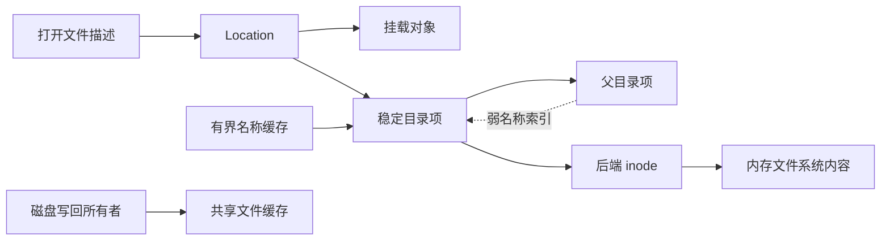
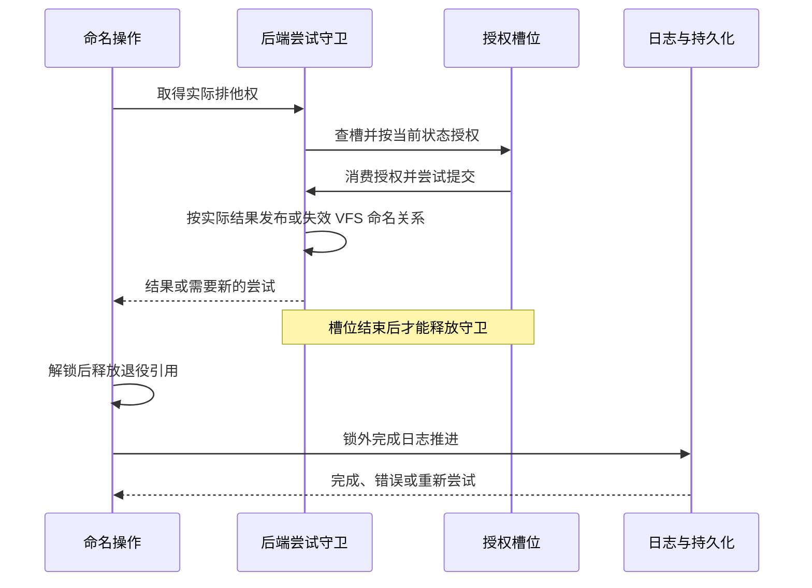
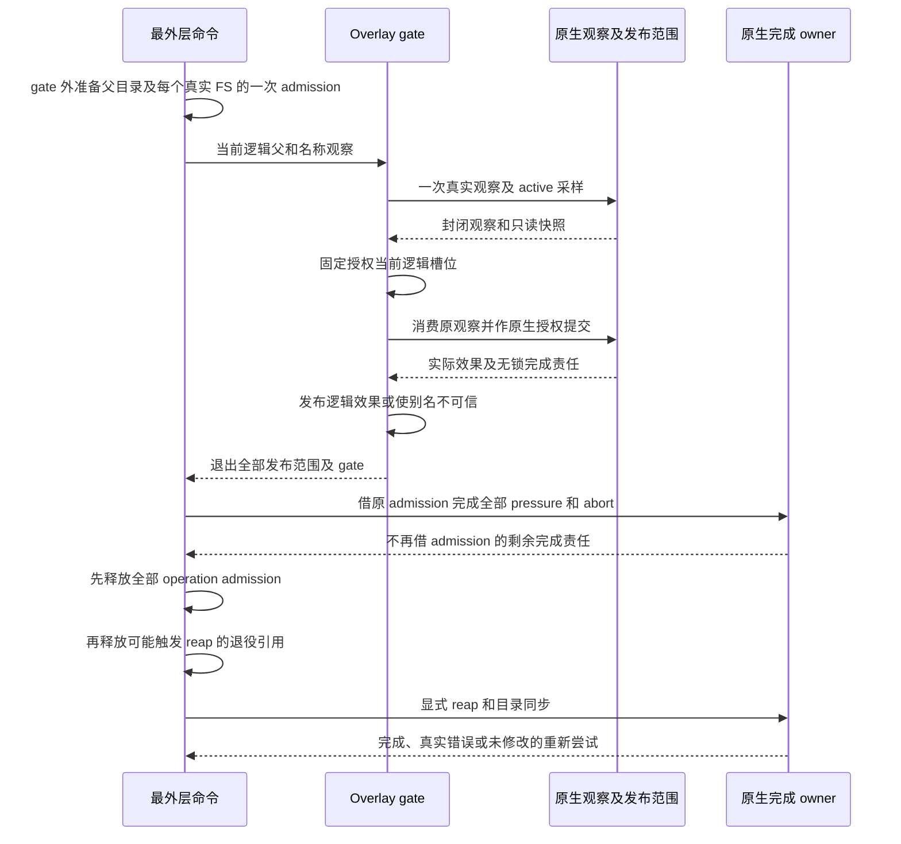
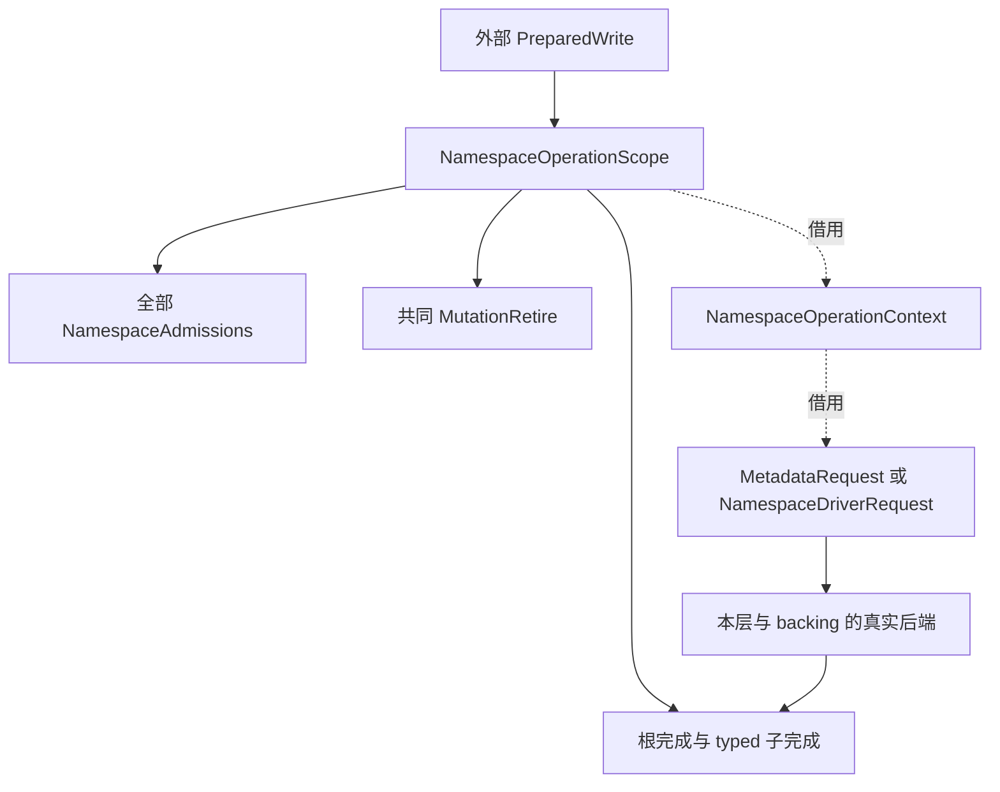

# 文件系统查找与命名操作的所有权

本设计约束路径解析、目录项身份和命名提交的共同状态，以少量拥有真实资源的
Rust 类型减少跨阶段状态丢失。实现遵循 Linux 可观察语义，并将资源释放与
可能失败的存储提交明确分开。

## 1. 行为目标

路径查找把调用者提供的名字转换为文件对象。它同时决定搜索权限、符号链接、
挂载跨越、进程根和临时查找边界，不能拆成几次独立查找后拼接结果。
本设计用于从最新主线修复 PR #2481 涉及的文件系统问题，基准是 Linux v7.1
提交 `8cd9520d35a6c38db6567e97dd93b1f11f185dc6`。
本文是批准方案的实现契约，不表示实现或验证已经完成。

### 1.1 现有边界

`fs/ax-fs-ng/src/fs_core/context.rs` 的 `FsContext` 保存进程根、当前目录与
dirfd 搜索起点；`fs/axfs-ng-vfs/src/mount/mod.rs` 的 `Location` 保存挂载与
目录项身份。这两个边界继续保留，不能以绝对路径字符串或 inode 号代替。
`fs/ax-fs-ng/src/file/open.rs` 的普通打开和 Starry 的 `sys_openat2` 接入同一
查找核心，删除分段重新初始化计数以及按 proc 路径前缀分流的实现。

修复范围包括命名关系、查找约束、对象型链接、创建授权与 inode 元数据更新。
已有同点 `pivot_root(".", ".")` 和挂载堆叠机制复用主线。不恢复原 PR 的
eBPF、网络和 IPC 身份分配、OOM、starttime、ELF 或 Docker 工具链改动。

### 1.2 类型保证与运行时证明

Rust 所有权用于限制能力的构造、借用和消费；Linux 兼容性和多线程线性化仍由
实现和测试证明。`#[must_use]` 是诊断，不是强制完成协议；
生命周期不是命名空间版本，`Arc` 保活也不等于对象仍处于同一挂载关系中。

| 不变量 | 接口约束 | 仍需运行时证明 |
| --- | --- | --- |
| 单次查找共享预算 | 会话与续走不可复制，辅助函数借用同一会话 | 每种展开和创建续走都正确收费 |
| 授权不能跨尝试复用 | 槽位实际借用尝试守卫，提交消费授权槽 | 所有别名与修改者遵守共同锁域 |
| 查找不跨作用域 | 根策略互斥，跳转经过统一检查 | rename、挂载变化及祖先关系重验证 |
| 缓存模式不回退慢路径 | 专用视图不暴露一般后端能力 | 缓存、权限和拓扑观察的有效性 |
| 资源成对释放 | 租约和锁由守卫拥有 | 析构顺序、失败发布和后端持久化结果 |

类型不得只包装裸值而保留原有无检查旁路。具体实现优先使用安全 Rust 和项目已有
同步原语，不引入通用类型状态框架，也不通过延长生命周期或增加不成立的
`Send`、`Sync` 绕过借用规则。

## 2. 对象身份

文件实体、名称别名、挂载路径和打开文件描述具有不同生命周期。
`NodeOps` 的后端 inode 继续拥有权威数据；`DirEntry` 表示名称别名；
`Location` 将别名与挂载配对；打开文件描述继续拥有偏移、标志和写入租约。

### 2.1 稳定目录项

`DirEntry` 的引用身份在 rename 前后不变。原来不可变的 `Reference` 改为受保护的
命名状态，保存 parent、name 和链接状态。读取返回一个一致的 `NameSnapshot`，
不能从可变名字返回脱离守卫的 `&str`，也不能分别读取 parent、name 后组合。

命名状态区分根、已链接、已脱链和不能信任的关系。脱链不是根；需要保留的原位置
和祖先引用用于已删除对象的显示与 Linux 允许的旧句柄操作，但不能据此允许在
已删除目录创建对象。后端部分失败导致命名结果不确定时，缓存失效并重新验证，
不能继续把旧父链作为安全证明。

rename 移动源目录项的命名关系，不重新 lookup 一个新身份再搬迁 `TypeMap`。
普通覆盖让原目标脱链；其旧 fd 仍引用原目标 inode。
硬链接是不同目录项共享同一 inode，不能合并名称身份。
`RENAME_EXCHANGE` 同时更新双方位置；无操作重命名不得错误断开任一别名。

### 2.2 引用与缓存

活跃子目录项强持父链，名称索引弱持子项，避免父子强引用环。
正项缓存的留存与树边分别管理：有界缓存保留引用用于热查找，
而不是依赖环使目录项永远存活。缓存持有者不能通过后端或挂载反向引用形成新环。
回收缓存不能使仍活跃的深层 dirfd 丢失祖先链。

同名并发 lookup 在发布时规范化为一个活跃目录项。索引身份由父项、名字及后端
对象验证共同确定；动态 proc 条目不能因为索引存在就省略重新验证或授权。
移除弱索引使用身份校验，不能由旧对象析构删除后来复用同名槽的新对象。

动态后端显式提供语义身份，不使用每次 `SimpleFsNode::new` 新分配的 inode 验证
是否为同一条目。proc 进程/线程目录的身份关联实际任务身份、procfs 实例及视图，
而不是 PID 文本；fd 与 namespace 链接的条目身份还包含槽号或链接种类。
每次访问仍重新检查任务有效性并取得当前目标，不能缓存旧目标和旧授权。
挂载保留的动态目标须能以同一语义身份被后续查找重新发现，PID 复用不得复活旧条目。

下图区分查找引用与内容保活责任。虚线索引不拥有目录项，缓存保留可回收的引用；
数据不能仅存放在一个随名称回收的对象里。

已有 `CachedFileRegistry` 强持磁盘共享缓存，回收复核关闭和干净状态；
tmpfs、ramfs 已有 inode 自有 `user_data` 和不回收内容的规则。迁移复用这些所有者，
验证硬链接与缓存回收后的数据一致，不重写页缓存算法或增加第二份文件数据登记表。
移除对象的最后一个强引用可能触发后端清理，必须在相关自旋锁、目录锁和拓扑锁外释放。

当前磁盘强登记受 `vfs` 功能控制，不能直接作为所有组合的迁移依据。
将现有登记的内容保活职责与 `vfs` 下的压力回收/后台运行职责分离：
任何启用磁盘缓存、允许目录项淘汰的组合都必须具有独立于目录项的强所有者，
包括 `host-test+ext4` 和不含 `vfs` 的 FAT。先落实并证明该前提，再弱化名称索引；
不允许通过强制启用 `vfs`、淘汰时隐式写盘或丢弃脏页解决。

### 2.3 挂载索引

`Mountpoint::children` 的键改为稳定目录项身份，不再使用可变 parent/name，
也不只使用允许硬链接共享的 inode 号。挂载位置保留目标目录项引用，
使索引身份在挂载有效期间不会复用。

`Location::ptr_eq` 继续同时比较挂载与目录项。向下进入挂载、从挂载根向上、
绝对链接跳根和对象链接跳转是显式查找事件。父关系读取不得隐藏跳过被覆盖根的动作；
在越过任何被覆盖位置之前先检查本次查找根与 `NO_XDEV`。

### 2.4 后端名称与对象复用

通用目录索引不得假定所有后端逐字节区分名称。后端负责名称等价规则，
并在权威查找后给出条目的规范名称或等价键；VFS 用该结果规范化活跃对象。
FAT 的长名、短名和大小写别名不得因不同调用拼写生成不同活跃文件实体。
精确匹配后端保持原语义，不能把通用查找统一转小写。

FAT 目前每次 lookup 分配新逻辑 inode，目录项淘汰后仅有强数据登记仍不能重发现
原缓存。复用现有逻辑 inode 分配边界建立活跃后端对象索引，以实际父对象与
权威名称关联共享状态；索引弱持对象，打开引用和缓存 backing 保活实体。
同一实体在仍有引用或脏缓存期间重开必须得到相同逻辑身份与共享内容，
父对象身份也必须在子实体需要它时保活。不能新增一份文件数据缓存解决重发现。

rename 在同一后端提交中迁移名称关联并保留源实体身份，覆盖对象独立脱链；
FAT 底层 file/editor 若绑定磁盘目录槽，必须同步重绑定共享后端状态，
不能只保留逻辑 inode 号却继续写旧槽。派生别名在删除、覆盖、rename 和错误失效时
一并处理，槽复用具有独立代际，旧引用不能指向新建文件。
这些是弱化索引的前提，不能在尚未成立时先切换到可淘汰名称缓存。

本次不私自修改、发布或供应另一份第三方 `starry-fatfs`。适配层利用共享句柄和
显式刷新/重绑定落实该依赖确实能完成的操作；依赖未提供的脱链 editor、
延迟释放簇链或目录父项更新能力不能被虚构。对无法安全完成的具体路径，
必须在任何删除或名称修改前明确返回不支持，并保留原对象与数据；
不能先删目标再失败，也不能以禁用整个 FAT 或全部拒绝 rename 代替适配。
FAT 后端支持边界和被拒绝路径在交付证据中单独记录，不宣称其具有完整 Linux 存储语义。

FAT 的根目录不能通过 `root_dir → DirEntry → FatInode → FatFilesystem` 保留自身。
文件系统只弱索引根目录项与根 holder；根逻辑 inode 的保留责任属于文件系统本身，
不在一个短命根 holder 析构时释放或重新分配。根引用消失后，`root_dir()` 可从仍存活的
文件系统重建并规范化发布同一根身份；活跃 holder 和子项继续强持实际 backend 所有者。
候选构造与最终引用释放在根索引自旋锁外完成，不能在升级失败时把文件系统误判为无根。
这复用已有弱根重发现模式，不以额外永久强登记或仅调用 flush 掩盖根引用环。

现有 `FsRef::borrow_mut` 从共享所有者引用返回可变引用，不能继续作为健全性依据。
共享句柄访问改为借用实际文件系统守卫，写访问需要独占借用该守卫，
返回引用同时受句柄和守卫生命周期约束，并核对具体所有者身份。
同一守卫不能同时派生相互别名的可变引用，其他文件系统的守卫不能解锁此对象。
既有生命周期延长与 `Send/Sync` 逐项重新证明，保留资源销毁在底层文件系统仍存活时
执行的顺序；不得靠增加 `allow` 或继续返回裸可变引用维持编译。

### 2.5 简单文件系统的实体寿命

`SimpleFs::root` 当前强持根目录项，普通根的 `SimpleFsNode.fs` 又强持
`SimpleFs`；`CgroupDir.fs` 的自定义根也有相同返回边。静态目录 maker、
静态文件和动态 ops 还可能经捕获的 FS 形成额外环。仅把 root 改弱会在
`new_with()` 返回前失去唯一根引用；把节点 FS 改弱又不能满足
`NodeOps::filesystem() -> &dyn FilesystemOps` 的借用和存活要求。
因此采用“无反向 FS 的实体状态与构造配方，强持实际 FS 的活跃包装”分层，
不增加全局属性表、永久强缓存或卸载时猜测断环的补丁。

#### 2.5.1 分配域与实体状态

`SimpleFsCore` 保存不可变的实例配置与原 inode 分配域，不实现
`FilesystemOps`，也不持有根、目录项、文件包装或构造配方。
`SimpleFsContext` 只强持该 core，供 builder 和底层 ops 分配实体、取得实例身份，
不是实际 FS receiver，不能取得 root、mount、admission 或写入能力。
`SimpleFs::new_with` 的 builder 改接收这份 context，不再接收完整 FS 的 Arc。

普通实体由 `Arc<SimpleInode>` 唯一拥有编号与 `RawSpinLock<Metadata>`；
编号的释放责任跟随该实体，而不是跟随某一次路径包装。它只保留分配域，
不反持完整 `SimpleFs`。core 的 slab 继续记录分配占位，不同时强持所有 inode，
避免 `core → inode → core` 成为新的环。编号溢出或耗尽明确失败，不借裸地址
登记第二份可变状态；不同实例身份不能因当下 inode 数值相同而合并。

基础分配入口固定为 `SimpleFsContext::allocate_inode(&self, node_type: NodeType,
mode: NodePermission) -> VfsResult<Arc<SimpleInode>>`。先在分配域锁内核对空槽键
到 `u64` 的转换与加一，再插入占位；编号无法表达时返回 `VfsError::NoMemory`，
失败不消费槽位。唯一 lease 私有地保留原 core 与编号，最后实体释放才归还一次；
配方和包装只共享实体，不各自承担归还责任。本契约不把已有 `Arc`/集合的
分配器终止策略改成全仓可恢复 OOM，也不以 `unwrap` 吞掉可报告的编号错误。

实例身份取仍由 context/实体保活的 core 拥有身份，不取两个 slab 中相同的编号。
已有 proc 身份的实例前缀相应迁到该域；它与实际 admission receiver 仍是不同概念。
只要活跃 dentry、包装或配方还会参与身份比较，就必须保留原实体或相应 context；
没有这些持有者后才允许复用 slab 槽。不新增裸标识跨实体死亡继续比较的入口，
也不因本次重构新增业务 ID 或全局属性登记。

`SimpleFsNode` 是活跃适配，强持实际 `SimpleFsOwner` 与原 `Arc<SimpleInode>`。
它的 `filesystem()` 仍返回该实际 receiver 的借用，不返回 core 或临时 Weak 升级值。
不同包装引用同一个实体的属性锁，不复制 Metadata；现有字段参与和大小投影
不因这次分层顺带改写。外部真实内核对象可继续持有自己的稳定属性 owner，
不要求为了统一形式把 Cgroup 或消息队列状态复制进普通 `SimpleInode`。

#### 2.5.2 根与构造配方

完整 `SimpleFs` 强持 core、根构造配方和必要的根实体状态，只弱索引根目录项；
配方及其传递拥有的 ops、静态子项和内容闭包不得反持同一完整 FS、
其 Location、Mountpoint 或已物化包装。构造配方不是重跑原先有副作用的
一次性 builder：builder 只执行一次，生成保留真实实体与业务输入的配方。

具体工厂固定为 `SimpleFs::new_with(name: String, fs_type: u32, builder:
impl FnOnce(SimpleFsContext) -> VfsResult<DirMaker>) -> VfsResult<SimpleFsOwner>`。
它先建 core、执行 builder 并校验根配方属于该 core，全部可恢复准备成功后才
以私有 `Arc::new_cyclic` 构造实际 FS。实际 FS 只保存非拥有的 self-Weak，
供原分配中的 `&self` 在根物化时取得临时持有，不在构造回调中升级它。
`SimpleFsOwner` 的 Arc 字段和构造器仅在 FS 实现模块内可见；它可克隆，
只借出 `&SimpleFs` 并以 `as_filesystem(&self) -> Filesystem` 建立通用句柄。
不返回具体 Arc、可变引用、可拆出的内部值或原始指针，不实现到 Arc 的 Deref、
`into_inner`、`get_mut` 等逃逸；`SimpleFs` 也不提供可按值克隆或另行构造的入口。
因此调用方不能用 `Arc::try_unwrap/make_mut` 在安全接口中搬走实际 FS，
而不是仅约定它不得这样做。通用句柄内部只接收擦除类型后的原 Arc，
不增加可取回具体 Arc 的 downcast。私有根物化将升级结果重新包成同一持有句柄。
Object 工厂从具体结果保留这个 owner，不把完整 FS 偷塞回 context。
各可挂载工厂返回 `VfsResult<Filesystem>` 并向原 mount/初始化调用者传播错误；
永久对象 FS 的一次性初始化失败才可在其既有致命初始化边界显式终止。

`DirMaker` 不再是可任意调用的 Fn 别名，而是字段私有的可共享配方。
`SimpleDir::new_maker(context: SimpleFsContext, ops: Arc<O>) -> VfsResult<DirMaker>`
在建立时完成一次可失败实体分配。`DirMaker::prepare(&self, fs: SimpleFsOwner)
-> VfsResult<PreparedDir>` 核对配方 core 与实际 receiver 的 core 一致；
错配返回 `VfsError::BadState`，不分配替代实体或改变 receiver。
`PreparedDir::materialize(self, this: WeakDirEntry) -> Arc<dyn DirNodeOps>`
消费准备值，只组装已准备的实体、ops 与实际 FS。
这里才显式接收 `WeakDirEntry`，不得在 `DirEntry::new_dir` 的循环构造回调中
升级尚未发布的 this，也不得调用可能失败的业务初始化。

`FileMaker::prepare(&self, fs: SimpleFsOwner) -> VfsResult<PreparedFile>` 使用相同
域校验；`PreparedFile::materialize(self) -> Arc<dyn FileNodeOps>` 同样消费准备值。
两个 Prepared 类型不可克隆、不导出可替换 receiver 的 setter，准备失败不产生
半初始化包装。目录 lookup 的准备在 `DirEntry::new_dir` 之外完成，根的全部
可恢复准备在 FS 发布前完成，因此不改变通用无 Result 的 `root_dir()` 和
`DirEntry::new_dir`。私有根物化只使用构造时已验证的根配方与自身 core。
持实际 FS 的 Prepared 值只活在调用栈或外部操作中，不存回 FS、配方或 backing；
否则会重新形成 `FS → Prepared → FS`。配方可以反复准备、物化，
消费约束仅表示每个绑定准备值最多使用一次，不把一个实体限制为只准有一个包装。
动态 `DirMapping::add_dynamic` 回调改为 `Fn() -> VfsResult<NodeOpsMux>`，
真实分配错误向外传播；链式目录仍只有 `NotFound` 才查另一来源。

这些配方不再靠捕获强 FS 取得 receiver。普通静态目录在建立 maker 时分配一次实体；
每次物化只建 `SimpleDir` 包装，并复用该实体与原 ops。静态文件同样由
`FileMaker` 保留无反向 FS 的 backing，在实际 lookup 时接收 receiver 并建立
`SimpleFile`、`Device` 或 `SpecialFsFile` 包装。`NodeOpsMux` 保存这些配方，
不把强持完整 FS 的现成包装存回 FS 自有目录树。

普通文件和设备的 backing 分别保留其真实属性实体、原内容/设备 ops 与身份；
包装只负责把该 backing 接到实际 FS 和 VFS 接口。外部打开描述或真实对象
仍可强持活跃包装，这种外部保活不是 FS 自有环。`ObjectInode` 的弱 dentry
规范化及真实对象保活继续复用；永久 pipefs/sockfs/nsfs 的外部根持有与
“所有外部持有均释放后可销毁”的验证分别记录。

`root_dir()` 从仍由 FS 拥有的根实体和配方重建包装，不能重新分配 inode 或
恢复默认属性。候选构造、业务回调和败选候选的最后 Drop 在根索引锁外执行；
锁内只升级、比较与发布弱索引。活跃根仍规范化为同一目录项。Mountpoint 和
MountUse 已有的强根保活继续使用，不给通用 `Filesystem` 新增一份重复根缓存，
也不把初次挂载前的构造空档推给 mount lease 处理。

#### 2.5.3 不同实体的保留责任

静态目录和静态文件由其配方保留属性，缓存驱逐后仍取原实体。动态 proc 实体
则保留 Linux 的可回收 inode 寿命：同一有效父名和语义身份的活跃 dentry 可复用，
但不建立按 task 永久合并所有路径属性的全局 owner。重新验证按相应 proc 类别
刷新允许刷新的字段，不能把所有权限和时间都重置，也不能把全部 proc 属性改为只读。
这部分 setter 与刷新顺序须在元数据适配契约中逐类明确，生命周期分层不授权猜测。
通用 VFS 规范化当前可能丢弃新候选而保留旧 dentry，因此只更新新候选不构成
对旧 fd 的刷新。领域契约必须明确被保留的真实 owner 如何在原刷新/提交锁域中
观察任务状态并保留未参与字段，不能用候选的整份 Metadata 覆盖旧 owner。

devpts 的数字表须保留真实设备 backing，而不是每次 lookup 复制属性；
删除从表中取出后，在表锁外释放。ptmx 是实例内持久实体，lookup 不重置 chmod，
其属性 owner 与 per-open master I/O 状态分开。配方不得经
`instance → ptmx backing → Ptmx → instance` 新建另一条强环。
当前 Legacy 共享表可能保存另一实际 FS 的 Device，不能机械把它换成当前
lookup receiver，也不能在 Weak FS 升级失败时把仍有实体的设备说成已消失。
迁移这部分前必须同时明确新 mount 的私有实例、bind 保留原实例及现有内置
devfs 视图的归属；不能混用新 backing 与未处理的旧跨实例共享。

mqueue 的路径、mqd 和后续权限检查须读写同一 `MessageQueue` 属性 owner，
不保留 `status_line` 包装中的属性副本。资源计费创建者与可修改文件属主必须分离，
不能 chown 后向新属主退还原创建者的 charge；不新增业务 ID、队列命名或 namespace
身份。真实 owner 的迁移及 mqd 属性入口另受元数据契约约束，不能仅靠配方分层
宣称已经接通。Cgroup 配方只保留组件节点，在物化时取得当前视图 FS；
其实际 receiver 校验、同 hierarchy guard 和节点属性所有权不变。

#### 2.5.4 迁移与验收

先完成 core、实体与配方的闭合引用图，再同一可审查序列迁移所有普通
SimpleFS builder、静态文件/设备、动态 ops 及 Cgroup 自定义根；
不留“有些根仍强持完整 FS 配方”的永久双轨。proc/sysfs、dev/debug/tracepoint、
usbfs 和可选硬件设备构造路径都属于真实消费者，不能只核默认 feature。
devpts 跨 receiver、mqueue 真实 owner 和 proc 字段策略的未决接点必须先由根
形成明确契约；这三类受影响迁移不凭普通包装的通用更新入口先行。

UVC 等动态设备 slot 也必须改存 FS-free backing；在原 slot 锁内只取出淘汰项，
失败候选和最后 backing 在锁外释放，不把驱动清理带进索引锁。
trace、SeqObject 等有状态内容 ops 保留原 producer 的创建时机与共享范围，
不能把每次打开的状态全局合并，也不能在每次路径物化时重置原静态共享状态。
内容、设备 I/O、动态长度及可睡眠读取仍在属性锁外，File 的已有时间维护入口
最终必须接同一真实 owner，不给 Drop 伪造一次用户授权。

验证分别证明实体保留与包装释放：在真实实现中修改静态目录/文件属性，回收
全部路径包装后从仍存活 FS 重发现，核相同实体与原属性；释放 FS、mount、
描述及可清理缓存后，核实体和 core 的最终释放发生且不在索引或属性锁内。
保持一个旧描述时应继续保活，重新物化不复制文件描述偏移；候选竞争败选也要锁外释放。
这些判定优先并入既有完整身份/生命周期旅程，不以只检查 Arc 数量或访问器回读代替。

本节是下一单元的分层设计，不是已实现或已验收声明。Starry 当前受 Overlay
编译阻塞时，不能绕过模块建立假装配或把组件模型当作系统通过；完成领域接点
和独立设计核对后再派发生产迁移，后续仍须真实系统入口及受影响目标的证据。

## 3. 查找会话

`LookupSession` 负责一次操作的完整解析，不把父遍历与最终打开变成独立操作。
普通解析、记录搜索过程和 `openat2` 只改变策略或最终意图，共用一个核心。

### 3.1 上下文快照

Starry 的路径读取入口在短持锁区取得 `FsView`，其中保留 root、cwd、
mount namespace、dirfd 起点和当前调用凭据的引用。释放任务文件系统上下文锁后，
才调用后端和 proc 对象目标获取，避免 `/proc/self/cwd`、`root` 回调重入同一把锁。

普通绝对路径忽略 dirfd；相对路径从 cwd 或 dirfd 开始。
dirfd 是搜索起点，不自动成为进程根。`IN_ROOT` 将本次起点设为临时根，
`BENEATH` 则拒绝越界。chroot 不自动更换 cwd 或撤销既有 dirfd；
修改 root、cwd、namespace 的操作仍通过原状态所有者显式提交，不修改只读快照。

快照和会话采用 `MountUseGuard` 一类实际使用租约保护选中的根、起点、当前路径和
待恢复的链接路径；只有 `Arc<Mountpoint>` 不足以参加普通卸载的忙碌判定。
转换路径时先取得新使用权再释放旧权利，并与普通卸载提交互斥，不能从已经普通卸载的
挂载重新获得使用权。`MNT_DETACH` 仍允许现有引用继续使用，不因此变成普通卸载。
卸载自身的目标解析租约通过专用消费式目标/计划转换处理，只排除该操作确实拥有的
临时使用权，不能提供跳过任意忙碌检查的布尔开关。只读快照不登记为可被 pivot 改写的
另一个任务 `FsContext`，也不要求已开始的操作追随后来的 cwd/root 修改。

### 3.2 状态与续走

会话私有字段包括当前 `Location`、本次根策略、剩余路径栈、
末组件类型、尾斜杠目录要求、搜索记录、链接总预算和拓扑观察。
`LinkBudget`、`LookupSession` 和 `Continuation` 不实现 `Copy`、`Clone`，
不提供公开重置接口。辅助操作只借用 `&mut LookupSession`。

父解析返回的 `Continuation` 拥有原会话；`finish(self, intent)` 消费续走，
继续处理末组件、链接和必要创建。普通 `NotFound` 不是创建许可；
只有解析到真实末名的空槽才能进入创建分支。链接目标不存在时继续推进原会话，
不从错误处理分支重新调用顶层 open。

根策略采用互斥枚举表示普通进程根、`BENEATH` 与 `IN_ROOT`；
正交限制使用受检位集合。末组件以普通名、根、`.`、`..` 和目录要求区分，
不依赖词法归一化之后重新猜测路径原有含义。ABI 标志保持运行时输入，
不为每个组合生成一套泛型解析器。

### 3.3 链接与末组件

一次解析共用 Linux `MAXSYMLINKS = 40` 的总预算。
父路径、末链接和悬空创建的继续解析均收费，失败路径也不恢复旧预算。
绝对链接按本次根策略重新选根；相对目标从链接所在目录继续，并保留未处理后缀。

尾斜杠和链接目标自身的目录要求在续走中保留。`O_CREAT|O_EXCL` 的存在性、
末链接不跟随、`O_PATH|O_NOFOLLOW` 句柄和目录错误按 Linux 7.1 的
`build_open_flags`、`lookup_fast_for_open`、`open_last_lookups` 与 `do_open` 决定。
创建、打开和截断是不同阶段，失败请求不得提前创建错误对象或截断未授权目标。

### 3.4 范围与竞争

`BENEATH` 从边界向上或遇绝对输入/绝对链接返回 `EXDEV`；
`IN_ROOT` 的根处 `..` 钳制在该根。`NO_XDEV` 比较挂载身份，不比较设备号。
Linux v7.1 的对象链接跳转在 scoped 查找下返回 `EXDEV`，
不能自行放宽为“目标看起来仍在子树中就允许”。

命名拓扑与挂载拓扑分别由真实写入协议发布在途状态与完成版本。
只在写后递增的计数不足以排除半完成观察；多个写者也不能用奇偶相互抵消。
读侧取得可验证的观察，逐步转换后和最终返回前重验证；
scoped 向上过程中不能证明没有竞争时返回 `EAGAIN`，
确定越界返回 `EXDEV`，不得静默关闭限制重试。

最终创建必须在槽位实际排他范围内完成必要的作用域重验证。
普通查找不长期持有全局写锁，缓存专用查找不能等待慢路径来修复观察。

### 3.5 调用身份与能力范围

文件系统调用的身份不仅是 `Cred` 中的 UID/GID 和 effective capability 位，
还包含解释这些能力的用户命名空间。当前 `task::Cred` 没有 namespace 字段，
真实身份在 `NsProxy::user_ns`；因此 Starry 在任务层引入拥有引用的
`FsCredentialsSnapshot`，成对保存 `Arc<Cred>` 与
`Arc<RawSpinLock<UserNamespace>>`，不把后者补成显示 ID 或映射完成布尔值。
这不是另一份可修改的凭据库，两个字段都引用现有权威所有者。

`FsCredentialsSnapshot::capture` 在调用线程所属
`ProcessData::namespace_update` 发布边界内取得这两个引用，复用
`task::proc_access::ProcReadCredentials::snapshot` 已有的成对读取方式。
取得顺序为发布边界、线程凭据锁、namespace aggregate 的短时快照；
在调用任务 FS 上下文、路径解析、写入 admission、后端或 proc 回调前释放这些锁。
已发布 `Cred` 按现有写时复制方式保持不可变；namespace Arc 固定对象身份，
不声称冻结该对象以后可能改变的映射状态。

Starry 的 `syscall::fs::mutation_credentials` 改为借用该拥有型快照，
按下述已支持范围生成短寿命 `MutationCredentials`，groups 仍借自快照内的 `Cred`。
VFS 不依赖 Starry 的任务或 namespace 类型，也不根据 uid 0 推导能力。
同一次查找、续走和修改使用同一调用身份；重新进入一个后端尝试仍须针对当前
inode 重新授权，身份快照不能代替槽位和 inode 的当前观察。

Linux 各能力的目标范围并不相同。以下区分决定本次适配可以生成哪些事实，
不能把 `Cred::has_cap` 的裸位或 proc READ_FSCREDS 的专用 ptrace 判断当成通用授权。

| 使用位置 | 固定 Linux 规则 | 本次 Starry 适配边界 |
| --- | --- | --- |
| 普通字符/块设备创建 | `capable(CAP_MKNOD)` 检查 initial user namespace | 仅快照的 namespace 与 `ROOT_USER_NS` 真实 Arc 相同且 effective MKNOD 位存在时生成 `cap_mknod=true`；whiteout 例外仍按第 4.11 节处理 |
| DAC 能力放行 | `capable_wrt_inode_uidgid` 检查调用者当前 user namespace，并要求 inode UID/GID 经 mount idmap 后在该 namespace 中有映射 | 现有扁平、非 idmapped 身份域仅在调用者处于 initial namespace 时生成相应 DAC 能力事实 |
| owner 的 FOWNER 例外 | `inode_owner_or_capable` 先比较映射后的 owner 与 fsuid，能力分支检查当前 namespace 及 UID 映射；sticky 删除另按其实际 Linux 检查处理 | initial namespace 中可解释 effective FOWNER；非 initial namespace 不从裸位生成特权例外，普通 owner 判断仍在当前 inode 上执行 |
| chown 与 chmod 的保留 SGID 例外 | CHOWN 及 `in_group_or_capable` 的 FSETID 要求相应当前 namespace 和 inode 映射；chown 的无效映射还有 `s_user_ns` 特例 | `cap_chown`、元数据用途的 `cap_fsetid` 仅在 initial namespace 中生成；不伪造不存在的映射或 `s_user_ns` |
| 普通文件写入剥除 setid 的例外 | `setattr_should_drop_suidgid` 另用 initial-namespace `capable(CAP_FSETID)` | 不把元数据用途的 FSETID 布尔值推广成未来所有 FSETID 用途的通用证明 |

当前 `UserNamespace::{uid_mapped,gid_mapped,is_root}` 只有简化状态，
`pseudofs::proc` 的 map 写入甚至直接改写 `Cred` 数值，不保存可核验的映射区间；
`Filesystem`、`FilesystemMountState` 和 `Mountpoint` 也没有 mount idmap 或权限
creator-userns 数据。这些事实不足以证明子 namespace 中的 inode 映射，
`is_root` 可在子 namespace 中改变，不能作为 initial namespace 判断。
本次不重做该子系统：非 initial namespace 的上述 capability 放行事实均为 false，
仍执行普通 owner/group/mode 与已有数值身份规则，不把整个操作统一拒绝，
也不把该保守处理宣称为完整 Linux user-namespace 隔离或兼容。
特别是现有数值映射的 owner 别名问题没有因此消失，最终兼容性记录须保留此限制。

与继续复制裸位相比，这个边界不会把未知映射解释成已获特权；与新增完整映射系统相比，
它不扩大本次批准范围。未来加入真实映射时，能力必须在当前 inode 观察上结合目标映射
解释，并按用途拆分必要事实，不能仅把非 initial 的布尔值重新打开。
启动和测试中没有用户任务的初始化继续使用显式初始化身份，不提供 syscall 的 root 兜底。

## 4. 命名事务

VFS 统一授权与提交协议，真实排他权由文件系统状态所有者落实。
同一 inode 的目录别名共享锁域；目录权限更新也要与受它授权的创建协调。
名称缓存自旋锁只保护短时索引发布，不能覆盖文件系统 I/O 或日志推进。

### 4.1 尝试与槽位

一次 `MutationGuard` 代表实际持锁尝试。
`ParentSlot<'attempt>` 借用该守卫，包含被观察的名称槽；
授权消费该槽并返回 `AuthorizedSlot`，只有后者提供消费式 `commit`。
提交通过原守卫执行，不接受由其他事务提供的替代守卫。
rename 由同一尝试产生源/目标槽对，不拼接来自两次观察的令牌。

同一事务内，查找当前目标、搜索/父目录写权限、sticky、只读挂载、
目标类型、排他创建等检查必须针对实际提交对象。
父目录 mode 更新、unlink 与创建不能绕过共同排他边界。
公开的受控操作不遗留供系统调用绕开的未检查修改入口。

公开边界传递 `NamespaceMutation` 数据命令及凭据、挂载写入权利，不传任意生产
`Fn/FnMut`。后端继续拥有真实锁和重试循环，每轮把私有的持锁 attempt 借给
VFS 的固定执行入口；`MutationGuard` 在该入口内部构造，实际借用
`&mut dyn LockedAttempt`。后者只提供本轮查槽、读取当前元数据、检查真实祖先、
保留实体及执行已授权命令所需的窄能力，不提供普通 `Location` 慢操作。
生命周期只限制借用，具体后端仍负责证明其 attempt 确实持有正确所有者的锁。

`ParentSlot` 借用栈上的 `MutationGuard`，`AuthorizedSlot` 接管这条借用；
`commit(self)` 使用内部原守卫，不接受另一个守卫参数。rename 的两端作为一个
槽对取得，避免同时借出两个独占守卫或拼接不同轮次的观察。权限策略从既有
`MutationCredentials` 提取为对当前元数据的纯数据判断，不在持锁阶段调用
`FsContext::check_permission`、普通 lookup、metadata 或任意节点回调。

目录成环检查属于同一次 locked attempt：普通移动拒绝把源目录移入自身或后代，
exchange 对两侧分别检查，所有比较使用实际 backend owner 与实体身份。
同名和同 inode 的合法无操作按 Linux 的顺序保留，不能统一当成循环拒绝。
检查之后到后端修改和 VFS 命名发布之前不释放排他权；仅在 `Location` 外层作一次
`is_ancestor_of` 或收窄一个公开方法，均不能解决并发成环。

同对象无操作的顺序由 Linux `vfs_rename` 决定：取得实际 mount 写权利、完成当前
搜索与存在性及适用的选项检查后，先在锁内判定源和目标是否为同一实体，
再执行删除/创建需要的父目录写权限、sticky 与目录自身写权限检查。
`NOREPLACE` 的已存在目标仍先返回 `EEXIST`；不能由 `FsContext` 的锁外父写检查
提前拒绝本应成功的 no-op，也不能在锁外提前成功。
`WHITEOUT` 不排除同对象 no-op；确定未改动时返回 `Noop/Unchanged`，
不向 VFS 发布 `Move`、移动名称或使任一别名脱链。这不赋予后端真实 whiteout 能力。

跨父目录的修改会更新目录的 `..`，因此除了两个父目录的删除/创建权限，
还须在同一尝试内检查源目录自身当前 `MAY_WRITE`；`EXCHANGE` 时对被交换的
目标目录也作对称检查。实际父实体相同或合法 no-op 不需要这项更新权限；
不能仅通过父目录可写就授权修改只读目录的 `..`。

### 4.2 后端重试

Ext4 当前 `InodeLifetime::mutate_namespace` 在每次尝试中持有命名空间权利，
随后释放锁进行 `finish_mutation_attempt`。新授权必须进入每次真实尝试，
不能在调用该循环前只检查一次。释放权利后旧槽位不可继续提交。
FAT、内存文件系统和可变伪文件系统提供相同语义，不把 Ext4 的能力假定为所有后端已有。

实际时序必须让日志等待发生在槽位生命周期之外。下面的失败分支表示重新授权，
不是重放一个已消费的授权令牌。

可失败结果使用 `Result` 传播。后端已经修改命名空间后持久化失败时，
受影响缓存必须失效并保留真实错误，不能伪造未发生修改。
只有确定未发布的暂存才可直接丢弃；不声称 Rust 析构能够回滚磁盘事务。

后端尝试结果须区分未修改、需要新尝试、已修改及修改结果不确定，
并保留实际源/目标对象、无操作或覆盖事实。VFS 受控操作先根据该结果完成目录项
发布或标记关系不可信，再把最终错误交给调用者；不能在发布之前对一个普通 `Err`
直接使用 `?` 丢失已发生的修改。基础目录项发布与后续授权使用同一结果协议，
不另建相互竞争的提交状态机。

固定入口在后端排他权结束前处理现有 `NamespaceOutcome`：`Applied` 即使带最终
错误也先按实际对象发布，`Uncertain` 先失效，`Unchanged` 不虚构修改。
每轮产生的 completion 不含槽位或守卫借用，请求只保留操作输入，不保存旧授权。
只有明确可重试且未发生用户可见命名修改的结果才能重新执行命令；
日志错误本身不是重放已经 `Applied` 的理由。

### 4.3 析构边界

守卫拥有锁、admission、pin 与在途权利，`Drop` 完成不失败的释放。
可失败操作显式返回提交结果，不在析构中提交、fsync 或隐藏错误。
移除的目录项、旧父引用和后端对象集中延迟到解锁后释放；
不通过目录项析构重新加父锁执行复杂树修改。

`mem::forget`、引用环、abort、内核崩溃和掉电都可能阻止析构。
漏释放只能保守保留权利或使观察失效，不能让读者信任未完成状态或越权提交。
异常展开自动解锁也不表示部分发布数据已经有效；项目的非中毒 Mutex 不提供这种保证。

本节约束新增命名事务守卫，不宣称已消除所有既有后端清理中的可失败工作。
既有 Ext4 orphan reap 和挂载租约的缓存退休保留其权威失败/重试所有者；
迁移时不得将这些错误伪装成新守卫可保证的回滚。若本轮改变其调用或引用释放路径，
必须同时核对锁外清理、错误留存与重试责任。

尝试使用一个在实际锁之前建立、在解锁后销毁的退役集合，覆盖提前返回和展开路径。
集合接收旧 `NameSnapshot`、替换或移出的缓存项、规范化落败候选、`NameChange`
保留项以及后端暂存实体。`DirEntry::move_to`、`exchange_names`、
`DirNode::publish_rename` 和 `DirectoryCache::retain` 的持锁版本只移交引用，
不能在内部释放最后一个强引用；全局有界保留队列淘汰的对象可能属于另一文件系统，
不能只 pin 本次源、目标来声称安全。

发布阶段只使用本轮已确定的身份和缓存策略，不调用 `is_cacheable_child` 等未知实现。
先完成短时 VFS 命名锁内发布，再退出全部 slot/guard 借用和后端锁，最后释放退役集合。
清理回调、reap、prune、通知、同步策略读取和可失败持久化都不放进这段发布临界区。
真实 attempt 保持项目守卫的线程归属，不增加 `Send/Sync` 超特征，不跨线程或异步挂起。

### 4.4 后端锁域

各后端复用已有权威状态而不是在 VFS 添加全局命名大锁。下列锁域同时覆盖
命名观察、会改变授权结果的元数据修改和该次 VFS 发布；普通路径 lookup
仍使用原有读取路径及命名在途观察，不为每个分量取得全局排他权。

| 后端 | 实际尝试及内部能力 | 锁外责任 |
| --- | --- | --- |
| Ext4 | operation admission 跨循环；每轮 namespace 权利与 state guard；直接以 `state.ext4` 查槽/读 inode，并在该轮 `retain_inode` | 退出 state 与 namespace 后释放退役引用，再作 `finish_mutation_attempt`、reap 和同步 |
| FAT | 同一个 `FatFilesystemGuard`；`find`、holder 查找、当前元数据及 parent holder 祖先链均借它 | 复用 guard 先解锁再释放 retained 的顺序，并接收 VFS 退役项 |
| MemoryFs | 每实例可睡眠 mutation gate；在 gate 内逐步短持 entries/slab/metadata 锁，发布前释放这些自旋锁 | inode 引用回收、最后 Arc 析构不取得可睡眠 gate |
| 可变伪文件系统 | 实际数据所有者的命名/元数据协调边界；拒绝的操作直接返回既有不支持错误 | 通知与失去引用的目标在 owner 锁外释放 |

Ext4 不能在尝试内重新调用 `InodeLifetime::lookup`、普通 metadata 或 admission
`enter()`；除递归锁外，reconfigure 的 pause/drain 也可能造成互等。
权限相关 inode 内容锁与 namespace 权利沿实际调用链统一顺序；若需要当前未锁住的
目标 inode，先保留对象、退出观察，再按既有顺序重新取得并重验证，不能锁内倒序补锁。
FAT 不借接口迁移扩大第 2.4 节的支持边界，尤其不把未实现的 chmod 写入伪装成成功。

MemoryFs 的 create、symlink、link、unlink/rmdir、rename 及所有相关 mode/uid/gid
更新都参加同一 gate，包括 sticky 所依赖的目标 owner；不能只锁 rename。
gate 不用于 `root_dir()`、初始未发布 root 构造或 atomic inode 回收。
实际启动命名修改在 `axruntime::bootstrap` 发布 scheduler、释放 bootstrap preemption
后执行；如有更早消费者，应迁移到发布前私有构造，不引入可从运行期调用的免锁开关。

### 4.5 挂载写入权利

挂载使用权与写入权分别保护普通卸载和只读切换。当前 `MountUseGuard` 的
`active_uses`、Ext4 admission、`CachedWriteGuard` 都不能替代 mount-local 与
`FilesystemMountState` 的只读写入协议。Linux v7.1 的 `mnt_hold_writers`、
`mnt_make_readonly` 和 `sb_prepare_remount_readonly` 在有活跃写者时返回 `EBUSY`，
不是必须等待所有写者退出。

VFS 在原 mount-local 和 shared FS 状态中维护只读标志与写者计数，不增设另一份
挂载登记表。`MountWriteGuard` 同时拥有所选挂载及 shared FS 的一次计数，
取得时在同一受控 admission 内检查两层只读状态；两端命名操作核对挂载边界并持有
所需权利，不能从一个可写别名借权利修改只读别名。后端 attempt 只借用这份权利，
不能提前 drop 它后继续提交；重试、最终发布及操作完成之前持续保留。

每个 shared FS 使用可睡眠 reconfiguration mutex 串行化写权利取得的短阶段与配置者。
普通写者取得 mutex 后，只在短状态锁内检查并增加 shared/local 计数，随后释放 mutex
才进入后端；并不在整个写操作中持有此 mutex。释放计数只需短状态锁，
对象最终引用在锁外释放。统一顺序为 reconfiguration mutex、shared 状态、
按稳定 mount 身份排序的 local 状态；后端锁不反向取得 reconfiguration mutex。
分层命令在进入最外层后端 gate 前，先从已经绑定的 backing 引用取得本次所需的
全部写入权利；进入 gate 后只借这些现有权利，不在 upper 子命令中递归取得配置锁。
部分取得失败只释放已得租约，尚未开始命名修改；不同 FS 的 admission 不同时持锁。

配置者保持该 mutex，先比较原状态与请求方向。只有从可写切换为只读、
实际撤销写权限时，才检查受影响写者计数；非零则返回 `EBUSY` 且不改 flags。
bind remount 只在 local 的 RW→RO 转换检查本 mount，普通 remount 在 shared 的
RW→RO 转换检查 shared 计数，并在成功后更新 shared 与目标 local 状态。
保持原状态的请求不因已有 writer 失败；shared 已可写时，普通 remount-RW
清除另一别名的 local 只读也不因该 FS 其他别名的 writer 而失败。
真正把 shared 只读改为可写前，仍须先完成 native `remount_read_write`；
失败保留旧 VFS flags。bind 仅放宽 local 限制不提升 native/shared 能力，
不能因本次请求可写而绕过仍生效的 shared 只读。
配置期间新写权利取得者等待 mutex，不能绕过检查，也不把内部忙碌映射成用户 `EAGAIN`。
同步/重配置内部的写回走既有内部权利，不递归取得用户写入权利。

普通 writable regular-file open 在暴露描述前取得写入租约并与既有 `WriteAccess`
一起保留；dup 和共享映射延长原租约，独立 reopen 取得新租约。
创建、命名修改、元数据变更及临时截断使用操作期权利；只读打开、`O_PATH` 和
不修改挂载内容的 pipe/socket I/O 不应错误计为 regular-file writer。
原来的裸 readonly setters 改为受控可失败重配置；未发布对象的初始 flags
通过构造参数设置，不让早期 root 构造为了设置初值取得可睡眠锁。

### 4.6 分层后端与入口迁移

`DirNode`、`Location`、创建式 open 和 `FsContext` 的全部命名修改统一进入数据命令。
原生后端的 raw 修改只留在私有 locked helper，不保留永久无凭据兼容入口。
initramfs、bundle 和 `root::ensure_mountpoint_dir_result` 等启动调用显式传入内核
初始化身份，仍遵守真实尝试和只读限制；该身份不成为运行期 syscall 的默认提权回退。
`SimpleDir`、合成挂载目录及只读测试后端不因适配 trait 而获得写能力。

Starry 的 `pseudofs/overlay.rs` 是复合后端，不是单次 upper rename 的透明转发。
每个 OverlayFs 拥有自己的 mutation gate，覆盖合并视图的观察、授权、copy-up、
whiteout、目录物化、元数据变更及 overlay VFS 发布。
外层使用调用者凭据授权，底层内部操作使用挂载时核准并保存的 backend 凭据和
明确 upper/work 引用；内部权利只由 overlay owner 的持锁 attempt 派生，
不接受任意目标或绕过 upper 的真实写入 admission、重试及发布。

每次 upper 命令仍形成自己的真实槽位，不把来自 lower/upper 的观察拼成一个原生槽位，
也不把第一次用户授权令牌传给后续原生尝试。锁顺序从 overlay owner 向其 backing
层下降，不允许 backing 回调反取 overlay gate；循环分层在建立 backing 关系时拒绝。
内部命令借用预先取得的 upper/work 写权利，但每轮重新取得原生 backend attempt。
退役集合归最外层命令所有，并贯穿所有嵌套调用；仅释放 upper 锁不足以开始析构，
必须连同外层 overlay gate 也退出后再释放，避免跨层、跨 FS 的析构锁反转。
普通 upper 操作已应用但后续 whiteout/metadata 失败时，保留实际副作用并使合并命名
关系不可信，返回原错误，不伪造全步骤原子成功或用 Drop 回滚磁盘。
既有 lower-backed directory、exchange/whiteout 等不支持边界不在此次迁移中扩大。
直接并发修改已挂载 overlay 的底层目录不作为受保证用法，不能据此宣称跨文件系统事务。

`pseudofs/cgroup.rs` 的 create/remove 及目录元数据更新参加实际 cgroup owner 的共同
协调边界，不能只给临时 vnode 加锁。接口迁移和测试 mock 适配在同一可审查序列完成；
跨包消费者未迁移前不得声称基础能力已全部交付。

### 4.7 分层操作结果

分层后端必须能知道一次内部命令是否已经改变状态，单独的 `VfsResult<()>`
不足以表达这种差别。原生命名子命令通过 `NamespaceOperationContext` 交回
`NamespaceObservation<NamespaceEffect>`，同时把完成责任留在同一 Scope；
最外层 `NamespaceOperationScope::finish` 才交出保留状态、实际观察和最终错误的
`NamespaceOutcome`。只有最外层便捷入口在发布或失效及全部完成责任结束后，才消费为
普通 `VfsResult`。非原生 fallback 的 `DirNodeOps::mutate_namespace` 也保留 typed
结果，但不能作为原生分层命令绕过 Scope 的入口。

`RenameRequest::execute` 仍在真实后端锁内授权及发布，并形成
`NamespaceOutcome<RenameEffect>`；后端退出锁后的持久化错误只改变 completion，
不丢失已经发布的状态。这是一条结果链，不另建“已执行”布尔值或第二套事务登记。
其他命令沿同一泛型协议携带各自的实际对象，尚未迁移的 create/restore 等入口不能
被当作分层提交能力；无凭据的公开 raw 修改入口在消费者迁移中删除，
不以 `Unchanged(Unsupported)` 代替已有真实写能力。

Overlay 的结果使用 Overlay 逻辑实体，不能直接转发 upper 的 inode/effect。
外层当前槽位授权后，每个内部命令独立形成原生 attempt。内部 `Unchanged` 且此前
无副作用时，外层才能保持 `Unchanged`；明确未应用的 `Retry` 才能重新观察授权。
内部已经 `Applied` 后发生日志错误、源 whiteout 失败或目录标记失败时，
根据已知的合并命名关系返回实际 `Applied`，不能证明最终关系时返回 `Uncertain`，
保留最初的错误并在 outer gate 内失效受影响别名。不得自动重放整个复合操作。
仅完成 copy-up 而未改源/目标名称，也要保留实体已切换 upper 的事实；
不能用一个 rename 的 `Unchanged` 擦除此前的 copy-up。

`MutationRetire` 从最外层传入并贯穿内部命令，分层结果中的观察与失败候选也移交它。
普通 `?` 只用于仍能证明未修改的准备步骤；首次可能修改之后必须先合并实际结果，
再决定传播错误。通知以实际已提交事实为依据，在全部相关锁外发送。
主动清理也受这条边界约束：现有 Ext4 `run_namespace` 的
`prune_cached_files()` 可能释放其他 FS 的最后 backing 引用，不能原样带入 outer gate。
清理移到最外层取得 gate 之前，或由既有缓存退休入口把实际待释放对象移交
`MutationRetire`；不另建全局延迟队列，不在 inner 解锁后立即清空它。

### 4.8 Overlay 实体与别名

Overlay 的名称别名继续由 VFS `DirEntry::name_snapshot` 管理；
`OverlayDir::path`、`OverlayFile::parent_path/name` 不再成为运行期定位依据。
一个别名的 wrapper 持有稳定的 `Arc<OverlayInode>`，其逻辑 inode 和
`NodeIdentity` 在 copy-up、rename、unlink 及替换之后不改变。
实体保存实际 upper/lower 的强 `Location`，metadata 从当前 backing 读取，
不复制一份 uid/gid/mode 权威状态。copy-up 只改变该实体的 backing 选择；
旧文件句柄不按旧文件名重新 lookup，也不因同名新建而改指新对象。

每个 `OverlayFs` 以弱实体索引归并当前活跃的 backing 身份，并在成功 copy-up
时把 upper 身份关联到同一实体。键包含真实 FS owner 及实体身份/代际；
不能仅用 inode 号，也不能把一个名称当作 inode 身份。实体持有真实 backing，
保证活跃键对应的对象不能被回收重用；死亡弱项及时移除，不把历史名称强留到卸载。
真实 upper 硬链接及通过 Overlay 创建的硬链接共享实体，但各自仍有独立 dentry。
当前挂载仅支持 `index=off`：可写 Overlay 中 lower 非目录且 nlink 大于 1 时，
按 Linux `ovl_hash_bylower` 的边界保留每个 lower 别名独立的逻辑实体，
不按 lower inode 把它们归并。该别名的键采用被强引用保活的真实 lower dentry 身份，
不采用可被重命名的字符串。copy-up 一个别名不使另一个仅有 lower 名称的别名
临时改读其 upper；不能让该行为取决于弱索引是否仍活跃。只读 lower-only 视图
没有 copy-up，可按真实 lower 实体共享。此次不增加持久化 lower→upper index。
合并查找仍重新验证存在性、
whiteout 和 opaque；提供 `NodeIdentity` 只使活跃别名规范化，不把动态查找变成永久正项。

对外 `Metadata.inode/device` 投影为选定 Overlay 实体及本实例设备身份，
不能把 backing metadata 的 inode/device 原样返回而使 stat 与内部稳定身份分离。
其他权限、时间和内容字段仍来自实际 backing。稳定指活跃实体在 copy-up、
rename 和脱链中保持身份；不承诺没有 index 时跨卸载或全部引用回收后保留逻辑编号。

需要物化 upper 父目录时，在 outer gate 内沿本别名的一致 VFS 快照取得当前父链，
并使用各父实体已经保存的 backing；不从 FS root 重新解释一份旧字符串路径。
同一 gate 覆盖 Overlay 命名修改和相关元数据修改，因此这条链的观察和实际安装之间
不能被另一次 Overlay rename 改写。无链接别名不能重新占用其旧名称；
需要写入而尚无 upper 的脱链实体，使用 work 中不可见的暂存及原生孤儿对象保活协议。
后端不具备所需 unlink/保活能力时，在安装或修改可见名称前明确返回不支持。

root 也遵守无强引用环的规则。`OverlayFs` 保留 root 实体，root dentry 索引为弱引用；
wrapper 持 FS，实体不反向强持 FS。`root_dir()` 可在禁止抢占的 mount 路径调用，
因此重建 root wrapper 只使用已准备状态与短锁，不取得 mutation gate 或执行 backing I/O。
实体索引的短锁不跨 backing 回调，落败候选、旧 backing 与最后一个 FS 引用锁外释放。

### 4.9 固定 backing 与写入准备

用户选定 lower/upper/work root 时使用普通路径解析；绑定之后，内部单名查找固定在
所选 mount 与 backend dentry 视图内，不跟随该 mount namespace 后来挂入的子挂载。
这与 Linux `clone_private_mount` 配合 `lookup_one_unlocked` 的 layer 语义一致：
被子挂载覆盖的原 backing 目录仍可见，不是先跳入子挂载再返回 `EXDEV`。
merged Overlay 上用户显式挂载的子 FS 仍由普通用户路径 walker 处理，两者不能混同。
这里复用的是内部查找语义，仍保留本项目 exact mount 的写权利与生命周期；
没有照搬 private clone 的独立 local flags，也不宣称两者只读切换完全等价。

VFS 为此提供明确的单组件 backing 查找能力：校验普通末名后以相同 mount 包装
实际 backend 子项，不执行 `resolve_mountpoint`，不处理 `.`、`..`、多组件路径或
文本链接跳转。Overlay 的 lookup、read_dir 后续探测、物化、copy-up、
whiteout、opaque 全部使用同一能力。它不是 `CachedLookup` 的出口。
初始化时 root 以上的搜索与凭据检查不能因内部不跨 mount 而省略。

固定查找使用两个有明确调用环境的入口。`Location::lookup_backing(name)` 用于没有
外层 operation admission 的普通后备读取；它复用目录项查找及缓存规则，但不调用
`resolve_mountpoint`。该入口只在没有后端 gate/driver 的独立读取或准备阶段使用，
不是在持锁期间绕过 admitted 查询的捷径。
`NamespaceAdmission::lookup_backing(parent, name, retired)`
用于调用者已经持有目标 FS admission 的读取；它经现有
`NamespaceQuery::Lookup` 执行，不重新 enter，也不从普通查找回退取得 admission。
两个入口都返回包在原 parent 精确 mount 中的 `Location`，不跟随末尾文本或对象链接。
它们不是路径解析器，不代替调用方的搜索权限、root 边界或 mounter 身份检查。

末名统一复用 `path::verify_entry_name`：空名、`.`、`..`、斜杠和 NUL 返回
`InvalidInput`，超过 `MAX_NAME_LEN` 的字节长度返回 `NameTooLong`，合法但不存在的
单组件返回 `NotFound`。目录类型、后端读取等错误保留原值；成功子项必须属于
parent 的真实 FS owner，否则返回 `CrossesDevices`，不能把外来子项硬包成原 mount。
普通入口先校验末名再访问目录；admitted 入口先保活完整 parent `Location` 并校验
admission owner，再按既有 query 顺序校验末名。它仍受 query 的原生 driver/gate
调用约束，不授予新的持锁查询或跨层反向进入许可。

admitted 入口把完整 parent、成功返回的候选子项及后端查询产生的临时 owner 留在
同一个最外层 `MutationRetire` 中，包括 owner、名称、结果形状或候选 FS 校验失败的
出口。`NamespaceRead::Entry(None)` 解释为 `NotFound`；其它非 Entry 响应为
`BadState`，不伪造位置。取得的结果只是本轮查找，不授权随后修改，也不保证名称
持续存在。全部 admissions 退出后才释放退役集合，不能让失败候选在 outer gate
内触发最后析构。

这两个入口不改变 `lookup_no_follow` 的用户路径语义，不成为 `CachedLookup`
取得慢路径的出口，也不负责分层读依赖枚举、双层授权或完成回交。
admitted 变体要求调用者确实已有匹配权利，不能把尚未准备的 lower 当作已 admitted。
回归使用真实文件系统与子挂载，对照普通查找进入覆盖挂载而固定查找仍见原后备，
并核对 exact mount、错误及资源释放；Overlay 整体的挂载与 I/O 证据另行取得。

upper 与 work 必须是同一个精确 mount，且不相同、彼此不包含；不只比较设备或
shared FS。lower、upper、work 的根重叠和回到本实例的 trap 在构造时检查，
冲突在发布文件系统前报错。backing 关系构造后不可变，所有层声明自己的
`stack_depth`：原生为 0，Overlay 为所有 backing 最大值加 1，最大为 2，
超限 `EINVAL`。内部下降只允许严格较小深度，不以普通 namespace 祖先指针遍历
代替 backing 图；不添加按业务名称登记的全局图。多个实例同时直接修改同一
upper/work 不属于保证用法，不声称仅凭这组检查提供跨实例事务。

`FilesystemOps` 以既有 `write_backing_roots()` 和新增的
`read_backing_roots() -> &[Location]` 分别声明写入与只读依赖，原生默认都为空。
两组位置及 `stack_depth` 都是构造后不变、无 I/O 和 backend gate 的描述，
不能在遍历时解析新路径或临时取得另一份权限。只读依赖的目的，是让操作提前
保住其实际 mount/FS 并取得读查询所需的 operation admission，不是使它变成可写。

`PreparedWrite` 仍表示一次写操作的完整准备：可见目标和写角色的后备取得真实
exact-mount `MountWriteGuard`；只读角色仅保存强 `Location`，不调用
`acquire_write`，也不因该 mount 只读而拒绝整个准备。写角色递归时，子项按其声明的
读写角色继续；只读角色递归时，该 FS 的两组 backing 都按只读角色遍历。
因此读取作为 lower 的另一层 Overlay，不会顺带为它的 upper/work 取得写租约。
同一 exact mount 从只读升级为写角色时，还须按写角色继续准备其子依赖，
不能只给当前 mount 补租约便跳过已经按只读角色访问过的子图。
所有边都在去重之前校验深度不超过 2 且严格下降，只读边不能隐藏循环或超深声明。

去重仍使用真实 exact mount 身份，而非 inode、设备号或 FS 名称。同一个 mount
被多个角色引用时，存在写需求就必须取得写租约；不能因为先前已保存一个只读引用
而跳过写准备。`write_for` 只查询真实写租约集合，不能从只读引用合成写权利，
只按只读角色使用的 exact mount 仍返回 `CrossesDevices`。若另一条写依赖已经为
同一 exact mount 取得租约，`write_for` 可以找到它，但这不授权 Overlay 写入 lower：
私有 backing 适配器仍须核对目标属于已绑定的可写 roots，不能只凭整个 mount 可写。

`PreparedWrite::filesystems` 枚举写租约及只读引用中的实际 FS receiver；
`NamespaceAdmissions::acquire` 在第一次 enter 之前完整收集、排序、按真实 receiver
去重，两种角色共享同一个 FS 时只 enter 一次。`for_location` 因而可以为已准备的
只读 backing 借出匹配 admission，供固定查询使用，不要求也不隐式补写租约。
admission 只保证操作存活，不代替目录搜索权限、mounter 身份、后端可读能力或
具体修改所需的 `write_for` 检查。

全部依赖准备均在任何 backend gate 之前完成，不同时持不同 FS 的配置 mutex。
准备失败没有命名副作用，已取写租约和只读引用在锁外释放；enter 部分失败时，
先退出全部已取 admissions，再释放准备对象。只读引用保活到整个操作结束，
包括取消、查询失败、压力和显式完成；`NamespaceDeferred` 不借用准备对象，
调用者须让准备对象活过全部 `finish()`，不能以 admission 借用结束代替操作结束。
强 `Location` 只保证对象保活，不是 `MountUseGuard`，不保证阻止卸载或关闭。
不在 gate 内重新发现或补入依赖。
只读依赖准备不改变内部 atime、后台写回等维护权利，也不声称读依赖
永远不会发生后端内部 I/O。普通原生操作的空读依赖不分配引用数组，但新增描述查询
及准备对象开销仍须纳入最终同环境性能比较，不能据空列表断言没有性能回退。

操作期间 `PreparedWrite` 只借出已拥有的 exact-mount 权利，不能临时补 admission，
也不放宽 `MountWriteGuard::check_location`。Overlay 私有的 backing 命令适配器还核对
目标来自本实例绑定 roots 及受控物化结果；不向 syscall 导出“任意目标 + mounter
凭据”的修改入口。外层 gate 到 backing gate 按深度下降，最后释放退役集合时所有层
的 gate 均已退出。backing 查找不得重新进入上层 Overlay。

### 4.10 分层打开与元数据

Overlay 挂载入口保存第 3.5 节成对取得的真实创建者 `FsCredentialsSnapshot`，
包含凭据和用户命名空间的拥有型引用，每次内部操作临时借用转换为
`MutationCredentials`；不能仅保存不含 namespace 的 `Arc<Cred>`。
不保存借用 groups 的长寿命快照，不在操作时读取创建者的新凭据或新 namespace，
也不使用 `MutationCredentials::root()` 兜底。当前唯一生产创建点为同步 `sys_mount`，
取得时点就是构造本实例之前、进入 backing 解析和准备之前；
未来增加其他 mount API 时必须明确对应取得时点。
对外使用当前访问者凭据检查 Overlay 实体，对内使用已保存身份检查所选 backing。
两个身份分别遵守第 3.5 节的能力范围，不以挂载成功代替 backing 操作授权。
本次不宣称新增 Linux quota、LSM 或尚未实现的 user namespace 映射保证。

所有 writable regular-file open 在返回描述前完成 copy-up；`O_PATH` 和普通只读打开
不物化 upper。分层打开借用预先准备的权利，不能在 gate 内调用会重新
`acquire_write` 的 `open_loc`。`WriteAccess` 保留实际准备对象并继续维护现有执行互斥；
dup/映射延长同一描述权利，独立 reopen 执行新的打开检查和 admission。
内部打开需要保留同一准备对象的所有权或真实借用，不能用无关联的栈变量作证明。

`FileBackend` 到 `FileNodeOps` 的可变文件操作把准备权利和外层退役集合继续传下去，
覆盖 write、append、truncate、range 操作及 copy-up 数据复制。原生默认适配仍执行
自身实现；Overlay 只使用 locked helper 与已有权利，不由回调偷偷再准备一次。
缓存写入和 writeback 沿既有所有权路径处理，不能为绕过接口改成 raw I/O，
破坏页缓存一致性或执行文件写保护。数据读取取得稳定 backing 快照后可释放 gate；
向用户或未知 sink 的回调也在 gate 外执行。
`poll`、注册和不允许睡眠的 flags/identity 查询只读已经准备的实体/backing 快照，
不得为了取快照取得可睡眠 gate 或执行物化。

缓存端点在建立时沿有限层级解析到稳定的原生 backing，`CachedFileShared::backing`
不保存仍会 copy-up 或重新 admission 的 Overlay wrapper。普通读描述符仍持有
稳定 Overlay 实体，每轮 I/O 选择其当前 backing，copy-up 后后续读取可以切换 upper，
不永久绑定打开时的 lower。单轮 I/O 的原生缓存端点与已建立的映射保持所选 backing；
可写打开与共享可写映射先完成必要 copy-up，并保持准备对象及既有
`WriteAccess`。对外路径仍保留 Overlay 别名，内容缓存复用原生 backing 的既有
inode/cache owner。后台写回不借已经结束的调用栈或退役集合，继续使用原生内部
写回权利；这只改变端点的所有权连接，不重写页缓存算法，也不新增一层内容缓存。

copy-up 在 work 的暂存对象准备数据、元数据和已有 xattr，完成后才安装到目标名称，
并在 owner gate 内切换逻辑实体的 upper。已有后备写回与孤儿保活负责内容和资源，
不新增内容镜像。需要为 I/O 释放 gate 时，本轮槽位与授权结束；
重新进入后重查名称、实体、权限及暂存位置，只有新授权能安装。
嵌套层需要退出其调用方 gate 时，将准备工作返回到最外层协调，结束全部相关尝试后
再做 I/O；不能只释放 inner gate 却沿用仍存活的 outer 授权。重入后若另一轮已经为
原实体安装 upper，采用获胜状态并显式清理本轮暂存，不用旧副本覆盖新的 backing。
暂存清理显式返回结果，失败保留诊断与原始错误，不把 Drop 当作磁盘回滚。
已安装后出现错误按第 4.7 节传播真实状态。

`syscall/fs/xattr.rs` 不再获取 raw upper 后在 gate 外复制和修改 xattr。
copy-up 的属性迁移及最终 set/remove 由 Overlay owner 内的同一领域命令完成；
普通 xattr 入口仍负责用户内存、名称、flag 和 ABI 检查。`MetadataChange` 也进入同一
owner gate，在当前 backing inode 锁内完成实际授权与更新，而非整体回写旧 metadata。
rename 暂不扩大 lower-backed 目录移动、真实 exchange/whiteout 等存储能力边界；
合法 no-op 和本来支持的 upper 修改仍按第 4.1 节处理。

### 4.11 其余命名命令

创建、硬链接与删除复用 `NamespaceMutation` 的数据命令边界，不另建绕过授权的
`DirNodeOps::create/link/unlink` 长期通道。命令扩展为 `Create`、`Link`、
`Unlink` 和既有 `Rename`；symlink 是带文本载荷的创建，rmdir 是要求目录的删除，
不为每个系统调用号建立一套事务。各请求由 `Location` 的受控入口私有构造，
借用显式调用凭据、同一个写入准备结果和最外层 `MutationRetire`。
确实修改名称的分支必须借用成功的 `PreparedWrite`；创建式 open 的既存分支
按下述规则保留准备错误，不伪造可写能力。

命名 hook 的结果扩展为 `NamespaceOutcome<NamespaceEffect>`，
`NamespaceEffect` 按命令区分创建、链接、删除和既有 `RenameEffect`。
创建结果保留实际 `DirEntry`、规范名称与本次是否创建；链接保留新别名及共享实体；
删除保留实际移出的实体身份，不重新探测旧名称，也不临时分配一个 inode 数值
冒充已删除实体。各载荷包含本轮已确定的缓存策略，发布时不调用未知 backend 回调。
已有 generic outcome 的状态和第一错误规则不变，不复制第二份完成状态。

`LockedAttempt` 扩展为对命令的本轮观察和已授权提交；观察使用与命令相匹配的
枚举载荷，包含实际父元数据、当前名称槽与必要源实体，不使用未检查的字段组合。
`AuthorizedMutation` 的构造仍私有，消费当前槽位并借原 guard，
后端只能通过对应授权提交。rename 仍在同一观察内取得两槽、检查真实祖先，
其既有锁序、no-op 和发布规则不因扩展而改变。

创建只在当前父目录可搜索、可写且名称状态允许时提交；创建 owner 按后端在
本轮观察中选定的 `CreateOwnerPolicy` 决定。普通 Unix 后端采用 `ParentSetgid`，
在当前父元数据上处理 SGID；cgroup/kernfs 的两阶段规则见第 4.13 节。
该策略由真实 backend attempt 提供，不能成为用户请求中的 owner 覆盖开关。
请求中的新对象 uid/gid 不是调用者身份。
普通用户创建不能借指定 owner 字段给自己提权；归档恢复使用显式初始化身份，
后续恢复元数据也经过第 6 节的受控入口。mknod 的 rdev 和 symlink 文本在节点
可见前完整初始化，不先公布一个零设备号或未初始化链接再补写。
创建普通字符/块设备在本轮 `may_create` 等价的名称与父权限检查后，
还须检查调用者按固定 Linux `capable(CAP_MKNOD)` 语义得到的能力事实，
失败 `EPERM`；父可写或 `CAP_FOWNER` 不能替代。凭据快照显式携带
`cap_mknod`，不能用 uid 0 或未经解释的其他用户命名空间同名能力位代替。
字符设备 `rdev=0:0` 按 Linux `vfs_mknod` 的 whiteout 例外处理，
但仍需其余创建检查和后端能力；该例外不意味着支持 rename whiteout。

完整初始化数据必须跨越任务适配层和路径上下文，不能只在叶级接口提供正确能力。
`FsContext::create_node` 改为接收 `CreateAttributes` 与显式调用凭据，
替换分散的类型、权限及已不代表所有权授权的 uid/gid 参数；
完成原有父路径搜索和边界检查后，将同一数据交给 `Location::create_initialized`。
Starry `sys_mknodat` 将真实字符/块设备号放入 `CreateContent::Node`，
不再先经普通 `Location::create` 生成默认 `0:0`，再用 `MetadataUpdate::rdev` 补写。
whiteout 例外必须针对真实请求设备判断，不能针对中途丢失参数后产生的默认值。
普通文件、FIFO 和 socket 创建忽略 mknod 的 dev 参数，初始化 rdev 为零；
syscall 的 dev 按固定 Linux `unsigned int` ABI 解释，不能把寄存器高 32 位带入设备号。

创建式 open 使用同一个 `Create` 命令表达排他创建或“已有则打开”的意图。
后端在锁内返回实际对象与 created 状态；非排他竞争遇到已有名称时，对该轮当前对象
完成所需授权，不能把外层旧 `ENOENT` 变成跳过文件检查的理由。
写权利仍在 gate 前尝试准备，但其结果以
`CreationWrite::Ready(&PreparedWrite)` 或 `Denied(VfsError)` 保留，
不在观察名称之前统一返回准备错误。当前槽位已存在时，排他请求先给 `EEXIST`，
非排他请求按该对象的打开意图检查；只读打开不需要创建权利，也不要求父写权限。
只有当前槽位缺失、确实需要创建时才使用保存的准备错误；
`Denied` 不能构造任何可修改槽位的授权能力。
若既存对象后续需要写入或截断，仍须在退出观察后取得相应完整权利并重验证，
不能持 gate 临时补 admission，也不能因创建分支被取消而省略这些检查。
open 后续截断仍有自己的写权利与实际对象检查，不把描述符租约倒推成此前创建
已获授权。末链接和悬空目标继续沿第 3 节原会话消费，不重新顶层 open。

链接在当前父目录、实际源实体和调用凭据上检查跨 mount、目标不存在、目录类型与
保护硬链接规则。删除在本轮同时检查父写权限、sticky、实际目标类型、目录为空和
挂载忙碌边界。范围与路径搜索预检保留错误顺序，但不能充当槽位授权；
`FsContext` 不以锁外探测代替当前提交结果。拒绝操作的伪文件系统保留原错误，
不会因默认适配获得新写能力。

MemoryFs 在现有 mutation gate 内完成观察、权限、修改与发布，移出 inode 交外层
退役集合，不再在局部函数返回时提前释放。Ext4 的每轮真实 namespace/state
尝试读取当前槽和权限，日志推进后重新观察授权；创建或链接实际应用之后的
`finish_directory_change` 错误必须保留对象与状态。FAT 同一 FS guard 内观察和提交，
保留已有不支持边界，创建之后 find/holder 失败不能伪称 `Unchanged`。
对外的便利入口仅在发布或失效完成后取出命令对应载荷；应用后错误仍向用户返回错误。

这些接口迁移覆盖 `FsContext`、创建式 open、initramfs、挂载目录恢复、
ArceOS API、Starry 伪文件系统和测试后端。只为迁移保留的旧命名入口有明确删除点，
不得在最终交付中留下永久无凭据路径。新增命名结果持有的引用也受第 4.3 节约束，
在 outer gate 内丢弃结果时移交实际 owner，不能让返回载荷形成新的析构反入点。

### 4.12 原生删除的引用准备

FAT 目前不能安全删除仍有活跃原生 holder 的对象。这个存储边界必须保留，
但本轮为锁外析构增加的 `NameChange::affected`、观察结果和 `MutationRetire`
不能自行把本来没有使用者的对象变成“活跃”。原生删除因此分为 gate 外的引用准备，
以及同一真实 backend guard 内的当前观察、授权、提交和发布；准备不是一次提前授权。

`Location::prepare_unlink` 生成最窄的 `PreparedUnlink`，绑定 exact mount、
稳定父目录和请求末名，字段由 VFS 私有构造。它不持待删目标的强引用，
不保存目标存在性、metadata、权限、inode 身份或 active 为零的结论。
`unlink_with_write` 仅接受与本请求匹配的既有准备，并将其移交本次 `UnlinkRequest`，
同时保留原来的显式凭据、`PreparedWrite` 和最外层退役集合。
普通 `Location::unlink` 在任何 backend gate 之前完成准备；
借写权利的入口只核对和使用既有准备，不能在 gate 内补做。

一份准备只服务一次外层删除。`PreparedUnlink` 不实现 `Copy` 或 `Clone`，
由受控入口消费进本次私有构造的 `UnlinkRequest`；后端的明确未应用重试只借用
同一请求，并重新观察授权，不复制准备用于另一次操作。请求完成后独立的删除必须
重新准备。匹配使用 exact mount、稳定父 dentry 身份和请求末名的原始字节，
不以 inode 相等或准备时提前规范化 FAT 名称代替。

准备先短持父目录缓存锁，从弱规范索引收集当前直接子项，随后退出缓存锁，
复用 `release_retained` 的算法撤出这些子项的全局正项保留，
并在进入下一步前实际释放全部临时 Vec、探测引用和被撤出的引用。
按目录的直接子项处理可覆盖 FAT 大小写和短名别名，
不需要按用户拼写慢 lookup，也不删除弱索引、清除 `valid`、递归清理后代
或把活跃 dentry 改成 `Untrusted`。准备不会用一次提前的查找错误覆盖实际尝试的错误顺序。

VFS 引用释放完成后，才调用 backend 的固定 `prepare_unlink` 准备 hook；
原生默认不做额外工作，FAT 在这里调用现有 `prune_cached_files`，
使符合原有条件的 clean、已持久化、registry-only cache 真正释放其 backing。
顺序不能只写成“native prune 后释放 VFS 引用”：正项 dentry 的 `user_data`
可能强持 `CachedFileShared`，它又强持 `FatInode`，必须先解除这条引用再做最终 prune。
该 hook 不是任意闭包，不修改请求的命名状态，不发放提交能力。
旧 prune 是有界的尽力扫描，准备完成不保证所有 cache 被回收，更不保证 active 为零；
真实 fd、活跃路径/目录项、脏缓存和其他仍需保留的 owner 不被强制移除。

FAT 的尝试取得真实 FS guard 后，在构造本轮 holder 之前观察当前 active 状态，
再读取当前目标并形成观察。这个采样不能晚于 `NameChange` 对弱项的强升级，
也不能在本轮 `FatInode::get`、guard retain 或候选发布之后重新按裸计数解释。
采样为活跃时保留原有不支持边界；为非活跃时，新出现的纯本轮观察引用
由本次受控操作保留，不被重新误判为外部使用者。

固定单名命令的顺序应为：先执行 backend 的当前观察，
随后在首次 `canonicalize_locked` 发布该观察之前建立 `NameChange` 在途边界，
然后完成规范化、当前授权、提交和锁内发布。不能只把 `NameChange` 移到授权之后：
当前 `CommandGuard::slot` 会在授权前公开正项，
若公开时没有 writer 边界，另一个缓存快路径读取者可在 active 采样之后取得新引用。
在途边界必须使这样的读取转入需要真实 backend guard 的路径，
直到本轮发布结束。既有 rename 的成对协议不因本节调整。

成功删除还须撤出实际已移除别名的全局正项保留，并把这些引用交给外层退役集合。
仅调用 `remove_cache_after_mutation` 删除弱名称索引并标记 `Unlinked` 不够：
留下的全局正项仍可通过已删子项的强父链或 `FatName::parent` 保活父目录，
使随后删除父目录再次误遇 active。这里撤出的对象必须匹配实际提交结果，
不以先前 probe 的名称或对象代替，也不在锁内销毁它们。

本节冻结的是原生单层删除协议。分层调用同样不能在 inner guard 退出后清空外层退役袋；
需要重新准备时，最外层 owner 先结束全部旧槽位和授权、退出全部 gate，
再实际释放旧的临时目标、结果及退役 owner，之后准备下一阶段并重新观察授权。
已经 `Applied` 或 `Uncertain` 的步骤不因阶段切换重放。
`PreparedUnlink` 不是证明不存在外层 gate 的类型魔法，调用方仍须遵守并验证上述顺序。

**强 backing 的分层删除另有尚未闭合的能力边界，不能由本节外推。**
现有 Overlay 的局部 `upper: Location`，以及稳定逻辑实体持有的原生 backing，
都会使 FAT active 为真；如果每轮 outer observation 都重建同一个临时 backing pin，
退出 gate 再准备也不会自动产生进展。不得无限重试、减去猜测的 Arc 数量，
也不得把自身临时 pin 解释成真实外部使用者而统一拒绝 FAT upper 删除。
分层删除的原观察续走与锁外完成协议在第 4.14 节单独约束，实施前须独立核对该设计。
不得照搬旧 `lookup_visible_upper_child` 后持目标调用 unlink 的路径，
原生实现和验收可以独立完成，但不代表该分层场景已经实现或通过。

### 4.13 控制组文件系统的真实所有者

`pseudofs/cgroup.rs` 目前在每次包装目录或控制文件时创建私有
`SimpleFsNode` 属性，chmod/chown 的结果会随 wrapper 或挂载视图改变。
`CgroupNode::remove_child` 的 children、members 和 pins 检查也没有阻止保留的
节点引用在脱链后再次创建、迁入或成为 namespace root。本节把属性与业务活性
放回真实组件所有者，不以修正 trait 签名或统一返回不支持代替这些行为。

#### 4.13.1 持久属性与初始化

采用组件节点持有中立属性的方案：`ax-cgroup` 中的 `CgroupNode` 强持有其目录
及已创建控制文件的 `CgroupFsAttributes`，每个目标各有独立 uid、gid、mode、
atime、mtime、ctime 和稳定 inode 标识。组件不依赖 VFS、任务凭据类型、
`Location`、`PreparedWrite` 或 Starry `FileLike`。Starry wrapper 只持节点、
文件种类和现有文件系统视图引用；metadata 和 `MetadataChange` 均访问这份
真实状态，不能继续继承 `SimpleFsNode` 的私有属性写入。

目录和七类控制文件用 `CgroupFileKind` 区分，不把目录属性复制成所有文件的
共同属性。稳定语义身份包含 hierarchy、节点代际和文件种类；inode 标识在实体
创建时分配并保留，不能由每次 lookup、mount 或临时 wrapper 分配，不能溢出回绕。
同一节点的别名和不同挂载视图共享属性；视图自身的 root、mount 使用权和路径授权
仍各自保留。节点强持有属性，wrapper 强持有节点，没有反向强持有 wrapper 的边，
也不另建按裸地址或弱缓存登记的属性表。

`CgroupFsInit` 表达待安装目录的最终 uid、gid、mode 和时间，不再混称调用者凭据。
运行期创建另以 `CgroupFsCreate` 同时保存该最终目录初始化值与原创建者的
`creator: (uid, gid)`；这两个 owner 可以不同，不能从目录最终 owner 反推创建者。
运行期 `create_child` 改为接收这份记录，原调用者在同一迁移中显式提供两者；
不提供把 `CgroupFsInit` 自动转成记录、暗取目录 owner 充作 creator 的兼容入口。
启动根由 Starry 初始化入口提供明确上下文；运行期 mkdir 和 `+pids` 使用执行操作时
的成对文件系统凭据快照，不使用首次 lookup 的读取者、opener 或隐式 root。
初始化、子项安装和首次可见性属于同一 mutation attempt；失败前不公布半初始化
对象。目录增删的现有时间策略与本轮边界见第 6.17 节；chmod/chown 按第 6 节更新其
命令涉及的字段和 ctime，不顺带重写 atime/mtime 或其它控制文件。

固定 Linux 的 `cgroup_create` 虽向 kernfs 传入 `current_fsuid/fsgid`，
[`kernfs_new_node`](https://github.com/torvalds/linux/blob/8cd9520d35a6c38db6567e97dd93b1f11f185dc6/fs/kernfs/dir.c#L729-L755)
还会处理父目录 SGID，不能在前一层截断调用链就认定无继承。
VFS 以 `CreateOwnerPolicy::Kernfs { parent_has_explicit_attrs: bool }`
替代旧 `Caller` 变体；普通 Unix 后端的 `ParentSetgid` 不变。
Kernfs 策略先将请求目录 mode 限为 `01777`，剔除用户请求的 SUID/SGID，
再在当前父目录有 SGID 时给新目录补 SGID；只有父目录的逻辑显式属性已建立，
才同时把新目录 GID 选为父 GID，否则仍用创建者 fsgid。UID 始终取创建者 fsuid。
布尔值由 backend 在同一真实 hierarchy guard 下从节点所有者取得，
不是用户参数，也不能从当前 uid/gid/mode 猜测。
组件只增加 `CgroupMutationGuard::directory_has_explicit_attrs(&self, node: &CgroupNode)
-> CgroupResult<bool>` 这一只读接点，核对实际 domain，不测试 live，
不暴露可变状态字段，也不提供会自行重新加锁的普通节点 getter。
固定授权器生成 `AuthorizedCreate` 时完成 mode 和目录 owner 选择，
并以只读 `creator_owner()` 返回原请求凭据中的 fsuid/fsgid；
该 getter 不返回写权利、可替换凭据或新的 admission。
`AuthorizedCreate` 仍由固定当前授权器产生，策略不绕过父搜索、写权限、名称、
只读 admission 或 backend 能力检查；不得在 commit 阶段忽略已经选定的属性策略。

组件以原 `CgroupFsState` 中的目录逻辑状态区分显式属性是否已建立，不新增属性镜像
或按地址登记表。新目录最终 owner 非 `0:0` 时建立该状态；最终为 `0:0` 时保持默认，
即使它已经继承 SGID。成功的非空目录属性更新，包括显式同值 chmod/chown、
ctime-only chown，都会建立状态；只读观察、子项安装、空更新和失败请求不建立。
这模拟受支持操作中会影响后续 GID 的 kernfs 条件，不要求实际惰性分配内存。
`CgroupFsInit` 的最终目录 mode 校验允许 `03777`，接受内核继承的 SGID，
但不把这当成允许用户绕过 VFS 保留 SUID/SGID 的入口。

初始控制文件以 `CgroupFsCreate.creator` 作为 UID/GID 候选，再依据新目录自身的
SGID 和显式属性状态决定是否覆盖 GID；文件 mode 仍按 kind 的读写能力确定，
不采用 mkdir mode，也不自动继承 SGID 位。于是 SGID 祖先下创建的 `0:0`
默认目录，其初始文件仍可能使用原创建者的非零 fsgid，不能复用目录最终 owner。
根初始化没有父继承，初始文件创建者由同一次明确根初始化身份给出。

当前 controller 仍只支持已有的 `+pids`，本次不增加 disable 或其它 controller。
普通节点入口采用 `write_subtree_control(&self, data: &str, creator: (u32, u32),
now: Duration) -> CgroupResult<()>`；已持锁的 `CgroupMutationGuard` 入口另接收
目标 `node: &CgroupNode`，其余参数和语义相同。`creator` 是实际写入者的
fsuid/fsgid，`now` 是本次安装时间；两者不借用 `CgroupFsInit`，也不从目标目录
的最终属性反推。Starry 在取得 gate 前取得成对凭据快照并准备时间值。
给现有子目录启用 pids 时，在启用操作的同一 owner gate 内，为这些子目录
首次安装四个 pids 文件属性，UID/GID 候选取实际启用者的上下文，再针对每个 child
自身的 SGID 和显式属性状态选择 GID；不能取写入所在父目录的组。之后新建子目录在创建
时初始化已启用的接口。重复 `+pids` 不重置已有属性。可见性不能先由原子布尔值
公布、再由 lookup 懒补属性；若未来支持移除和重建接口，必须另设实体代际，
不能把仍由旧 fd 保留的属性改造成新文件。

这保留了现有组件边界并扩展真实 owner。仅在 Starry 建稳定关联 owner 仍须改动
组件的共同锁协议，还增加关联生命周期；只给 wrapper 加锁或用弱索引保存属性
既不能保证保留，也不能约束组件直改路径，因而不采用。

#### 4.13.2 真实守卫与锁顺序

每个 hierarchy 由根节点建立并向后代共享一个 `CgroupMutationDomain`。
其不可睡眠 gate 覆盖该 hierarchy 的目录状态、属性、live/dead、成员发布、
首次 pin 和 fork 存活预留；不是覆盖所有 VFS 查找的全局锁。
`CgroupMutationGuard` 实际持有这把锁，并借用 domain；guard 方法核对目标
节点确属同一 domain，才允许观察或修改。不得以空生命周期标记代替持锁，
不得导出可在 guard 外直接改属性、children、成员或 pins 的入口。

Starry 的 cgroup `LockedAttempt` 拥有该 guard，在其中完成当前属性及名称观察、
固定 VFS 授权、组件提交和命名缓存发布。组件 guard 提供领域操作，不运行任意
外部闭包；不调用普通 lookup、任务/fd/proc 回调或底层文件系统 I/O。
目录 create/remove、`+pids` 文件安装及目录和控制文件的元数据写均参与同一
domain。普通组件入口内部取得 guard，已持 guard 的适配使用专门的 locked 方法，
不能嵌套重取 gate。lookup/metadata 读取需取得与其有效性匹配的短快照。
目录项构造会读取 `identity/filesystem/inode`；这些身份从不可变实体字段或本轮
受控快照取得，不经普通 metadata 入口重取 domain。发布及退役所需的分配须核实
在该不可睡眠上下文合法；不能因无 I/O 就默认不睡眠。需准备的容量先在 gate 外
取得，再于当前 attempt 消费，不能在锁内调用可能阻塞的分配路径。

锁顺序保留现有进程成员事务向组件下降的方向：
进程 membership mutex → 成员账本 `membership::STATE` → hierarchy gate →
节点局部 children/members/属性锁 → VFS 命名与缓存短锁。没有成员账本需要的
目录和属性操作直接从 gate 开始；gate 内不能反取 `STATE`、进程 membership、
namespace 发布锁或任务注册表。namespace 发布前先取得节点 pin，
取得与安装分离但 pin 覆盖间隙；不能持 namespace 发布锁再执行可重入的 FS 回调。

现有节点短锁可以保留内部数据访问职责，但都在共同 gate 之下，不能据它们
声称整个尝试已原子。所有可能成为最后 owner 的移除项、临时 vnode 和结果
归最外层 `MutationRetire` 或组件的显式外层退役值；先释放 gate、局部锁和
`STATE`，再析构。不得在锁内丢弃 pin 后通过 Drop 再次进入同一 gate。

#### 4.13.3 活性与存活权利

`Arc<CgroupNode>` 只证明内存仍在。节点有不可逆的 `Live → Dead` 状态；
成功 rmdir 在共同 gate 内检查无子组、无成员、无 namespace/mount pin、
无在途 fork 存活预留，然后标记 Dead 并从父项脱链。普通打开目录描述不凭
Arc 数量阻止 rmdir，但保留该描述不能使节点重新变成 Live。
固定控制文件不是阻止 rmdir 的子组，不能因目录中存在这些接口就判为非空。
Dead 节点的新创建、迁入、显式 fork 准备和首次 pin 均拒绝；
仍被引用的属性可读取，不能把所有针对旧 fd 的操作机械改成同一错误。

新增成员的迁移、初始 attach、fork publish 及回滚继续使用现有 `STATE` 事务，
并按上一节顺序在 gate 内核对活性和更新成员。`CgroupForkGuard` 从准备成功起
保留一份 `CgroupReservation`；它是删除可见的非复制存活权利，不跨调度持锁，
不替代现有 pids charge、pending/task 账本或回滚。提交时先发布成员，再释放
预留；失败、取消及 Drop 先完成已有账本和 charge 撤销，再释放预留。
因此成功准备与 rmdir 有确定先后，不能在空目标已被删除后无条件 publish。

首次 pin 改为检查 Live 后取得的可失败操作；`CgroupNamespace::new` 及其调用者
传播失败。已有 `CgroupPin` 可创建独立 pin，因为原 pin 已阻止删除，
不把它降为裸 Arc 再凭运气重取。pin/reservation 的 Drop 只释放本地存活权利，
不提交目录操作或回滚磁盘。普通继承 fork、namespace root 与 mount 的既有
强引用和计数职责继续复用，不以新预留改变 pids 控制算法。

组件错误明确区分“名称不存在”与“实体已删除”；后者不能仍用 `add_member`
的 bool 或宽泛忙碌错误隐藏，但不能全局直接映射为同一个用户错误。
成功 rmdir 后，Linux 将目录 inode 标为 `S_DEAD`；路径查找和
`may_create_dentry` 的 dead 父检查可先返回 `ENOENT`，后者先于父写/搜索 DAC。
保留 dirfd 下创建必须保留这层前置拒绝，不因组件返回 Removed 就改成 `ENODEV`。

已经进入 kernfs mkdir/rmdir 入口时，取得 active reference 失败才是 `ENODEV`；
cgroup rmdir 回调中的 live 获取失败则返回零，不能混同外层错误或据此把普通
查无名称的 rmdir 伪装成成功。`cgroup.procs` 先检查目标 live，再解析 PID；
`CLONE_INTO_CGROUP` 的 dead 检查先于 `cgroup_may_write`。
这些顺序分别由对应适配入口保持，不能统一前置或后置所有权限/参数检查。
成员、pin 或预留阻止删除仍按当前组件边界给出 `EBUSY`，不据此宣称预留等待
与 Linux 持有 cgroup mutex 跨 fork 的调度行为完全等价。
身份分配耗尽明确失败，不回绕标识。

#### 4.13.4 迁移与验收边界

本节先迁移组件 owner、guard 和存活权利，再迁移 Starry cgroup 目录/文件属性、
命名命令、`+pids` 上下文，以及 namespace、mount、clone 和成员适配。所有直改
入口与错误映射在同一可审查序列替换，不保留永久无 guard 双轨；组件不反依赖
VFS。cgroup 的 link、symlink 和 rename 仍保持原本不支持，不把全部 create、
remove 或元数据写统一降成不支持以消除编译错误。

复用组件成员/删除测试增强存活预留与实际脱链后的拒绝，复用 cgroup 系统用例
证明多次 lookup、两个挂载视图与保留 fd 的属性共享，目录和控制文件属性互不
覆盖，普通用户当前 owner 授权及 `+pids` 实际创建者。受控交错证明撤权后拒绝、
迁入/pin/fork 预留与 rmdir 的先后和失败无错误副作用；同一回归先在错误行为
上确定失败，再取得修后绿。Clippy 或组件模型不代替真实 syscall 装配证据。

gate 增加的代价限定在 cgroup owner 域，不给普通 open 添加全局串行路径；
检查短临界区、批量接口安装和最后 owner 锁外释放，复用原成员账本与计数，
不新建后台任务、全局属性注册表或磁盘格式。代码提交可回滚，回滚不依赖 Drop
恢复已删除状态。固定 Linux 的
[kernfs 属性链](https://github.com/torvalds/linux/blob/8cd9520d35a6c38db6567e97dd93b1f11f185dc6/fs/kernfs/inode.c#L67-L209)、
[活性入口](https://github.com/torvalds/linux/blob/8cd9520d35a6c38db6567e97dd93b1f11f185dc6/fs/kernfs/dir.c#L1292-L1327)、
[控制文件凭据](https://github.com/torvalds/linux/blob/8cd9520d35a6c38db6567e97dd93b1f11f185dc6/kernel/cgroup/cgroup.c#L4380-L4394)、
[目录创建](https://github.com/torvalds/linux/blob/8cd9520d35a6c38db6567e97dd93b1f11f185dc6/kernel/cgroup/cgroup.c#L5816-L5837)、
[删除](https://github.com/torvalds/linux/blob/8cd9520d35a6c38db6567e97dd93b1f11f185dc6/kernel/cgroup/cgroup.c#L6170-L6204)和
[显式 fork](https://github.com/torvalds/linux/blob/8cd9520d35a6c38db6567e97dd93b1f11f185dc6/kernel/cgroup/cgroup.c#L6720-L6763)
分别决定真实属性 owner、活性检查、创建上下文和提交边界。

### 4.14 分层删除的原观察续走

本节细化第 4.12 节留下的临时引用问题，不改变 FAT 的存储能力。FAT 的
`FatAttempt::observe` 在同一个 `FatFilesystemGuard` 内先检查 active 弱表中是否有
存活 holder，再取得本轮目标 holder；`commit` 只允许删除此前没有 holder 的目标。
`starry-fatfs::Dir::remove` 会立即释放簇链，故不能让仍持有旧原生文件句柄的对象继续
访问被删除的数据。本节约束后续实现，不是已取得的运行结论。

#### 4.14.1 准备与引用分类

分层删除先准备父目录，不先查出要删除的目标。最外层命令在所有 backend gate
之外退出本次父目录可枚举的正项保留，并实际销毁临时集合；随后对所选 backing
父目录做同样准备，最后才进入 outer gate 和下降的真实 attempt。outer 和 native
正项由不同 dentry 指针登记，不能用一次 outer 准备冒充 native 已准备。

准备只产生绑定 exact mount、父 dentry 和原始名称的 `PreparedUnlink`，不保存目标、
权限结果或 active 结论。尚需物化 upper 父目录时，先按第 4.10 节完成该独立阶段，
结束旧观察和授权、退出全部 gate 并释放退役引用，再准备已安装的实际父目录。
重新进入后核对所选父实体与准备绑定；不能在 gate 内临时 prune，或因名称未变就
沿用另一个父对象的准备。阶段推进以真实物化结果为依据，不通过反复创建和丢弃同一
目标 wrapper 取得进展，也不以无限重试等待 active 消失。

引用分类决定哪些 owner 可以退出，而不是由猜测的 `Arc::strong_count` 决定。
这里的“已有 holder”既可能属于外部使用者，也可能属于尚未退出的内部缓存。

| 引用类别 | 准备及删除的约束 |
| --- | --- |
| 当前父弱索引可达的全局正项 | gate 外撤出并实际释放；不清除活跃弱身份索引 |
| 仅 registry 保留、clean、已持久化的文件缓存 | 复用既有有界、尽力 prune；返回不表示一次清空全部缓存 |
| fd、路径句柄、映射、进行中 I/O、脏页或未完成写回 | 保留真实 owner；不能清 dirty、强拆 handle 或降为弱 backing |
| 其他别名正项、ELF 装载器 LRU 等独立内部 owner | 不宣称通用准备能退出；若仍持原生 holder，保持原生 FAT 相同的拒绝边界 |
| 本轮真实原生观察之后才创建的逻辑 wrapper | 不重新采样 active；只能随原观察一次消费续走 |

`mm/loader.rs::ElfCacheEntry` 的 LRU 已经可以保留原生 `CachedFile`，不仅限于 Overlay。
本次不修改 ELF 解析、装载、LRU 策略或为删除新增 ELF 清理入口；不把这一内部 owner
称为外部 fd，也不承诺 POSIX 式的 FAT 活跃文件脱链。必须实现并证明的新增进展是：
没有此前 holder、或既有准备已实际退出 holder 时，不能被本轮观察自己新造的引用拒绝。
这保留原生能力限制，不允许据此统一拒绝所有 FAT upper 删除。

#### 4.14.2 封闭的观察结果

VFS 增加仅用于这条实际分层调用的 `ObservedUnlink`：它拥有未消费的删除输入、
本轮真实原生 driver、父和目标快照及未结束的命名发布范围。Overlay 只能读取该观察
并消费 `resume(self)` 或取消，不能取出 `&mut dyn LockedAttempt`，不能替换观察、
凭据、父对象、原始名称或 commit 实现。普通原生删除与续走复用同一固定授权、
规范化和发布核心，不复制第二份 unlink 算法。

原生 factory 在固定 backing root 所属的 `FilesystemOps` owner 上取得 guard；
该 root 在 Overlay 实例中不可变，guard 借用这个外部 owner，不借用栈上临时
downcast 的 `Arc`。driver 自己拥有已经核过同 FS 的父节点 `Arc`。删除输入拥有
父 `Location`、名称和已消费的准备，凭据视图按值保存且只借用仍被 mounter 快照
保活的 groups；不得保存指向临时 `MutationCredentials` 变量的引用。
`PreparedWrite`、第 4.14.3 节的原生 admission 借用及最外层退役集合贯穿续走，
不伪造 `'static`。带借用的输入、driver 或 completion 不放进要求 `Any` 的
`MutationRetire`；只把其中拥有型的 inode、dentry、父对象及候选引用移交退役集合。

私有命名发布范围持有父 dentry owner，而不是借用同一个结构体内部的父字段，
以免把 `NameChange` 改造成自引用对象。driver 的 guard 也不借用自身拥有的父 `Arc`。
命名发布范围的 `affected`、取消时升级的别名及不确定关系也必须锁外退役。
这些连接不新增 owned-lock unsafe 封装、不泄漏对象、不要求 guard 为 `Send/Sync`。
暂存对象只在同一同步调用栈使用，不能排入任务、跨线程或跨异步挂起点。

执行顺序保持一次真实观察。FAT 在取得本轮目标前完成 active 采样；之后 VFS
立即建立该原生父目录的 `NameChange`，再向 outer 交出观察。返回观察之前不发布
目标正项，但也不留下可从旧正项不经 backend 排他权获取新 holder 的缓存窗口。
随后 Overlay 使用已取得的 metadata、identity 和目标引用构造逻辑观察，不在仍持
原生锁时调用普通 lookup、metadata、read_dir 或反向取得其他 backing 的锁。

原观察由 opaque owner 保留。外层固定授权通过后，`resume(self)` 在原生固定授权器
内消费原来的父和目标快照，按已保存 mounter 身份及已有写权利授权，并通过原 driver
提交、规范化发布或失效。它不调用 `NamespaceMutation::execute` 重新 observe，
不接收外层生成的 `AuthorizedUnlink`，也不允许用任意 wrapper 伪造 parents/observe
后把授权转交给真实原生 commit。外层拒绝时取消原生观察，不提交命名修改。

下降与返回遵守第 4.9 节的有限 backing 深度。需要多个源/目标的命令仍须成对使用
一个真实 attempt，本节不提供把多个单目标观察拼成 rename 的接口。需要读取 lower
或其他 backing 的准备在取得待续走的原生锁前完成；不能持有一个 native guard
再重入同一个 FS 查询 lower。无法满足该锁序时返回到最外层分阶段协调，而非增加递归锁。

#### 4.14.3 最外层完成责任

Ext4 的真实完成流程并不都在 `LockedAttempt` 内。现有
`fs/namespace/rename.rs::run_namespace` 还负责 `MutationAttempt::Staging`、
typed `Ext4Error` 的日志压力或 abort 处理、`ReapClaim`、operation admission 退出，
以及目录同步策略。因此单独返回一个 boxed attempt 或 `NamespaceOutcome` 不构成
可用的分层完成协议；不能只移动锁而丢失这些责任。

最外层在全部 gate 之外，从本轮写操作已固定的完整 backing 图（含只读依赖）
准备 `NamespaceAdmissions`，
按真实 FS owner 去重，每个需要 admission 的 FS 只进入一次；这与按 exact mount
保留的 `PreparedWrite` 不同，二者不能相互替代。该对象只持已有的原生 operation
guard，不新增计数或全局登记。guard 借用仍在栈外被稳定 root 保活的 FS receiver，
不借用该集合自己的字段；取得期间不持其他 FS 的配置 mutex 或 backend gate。

在取得第一份原生 admission 前，先枚举并校验全部 receiver、按真实 owner 去重，
再以所有调用方一致的 owner 全序逐一取得。全序使用被这些稳定 root 保活的实际
`FilesystemOps` 数据地址；强 owner 在本次准备期间不退出，因此地址不会被回收复用。
不按 backing 图遍历顺序取得，也不另建全局编号表。部分取得失败时，先释放全部已取得
admission，再退出准备引用，均在 gate 外进行；去重不能代替一致顺序。这是通用
多 FS 合同，不宣称当前受限 Overlay 写图已经证明可到达多个原生可暂停 FS。

VFS 固定 factory 绑定每个 admission 的真实 FS 身份，不公开可填任意 owner 的
构造器。driver 与内部后续 whiteout、创建、元数据步骤只能借用已核同 FS 的原有
admission，不能再次 `enter()`，不能在 gate 内补一项缺失的 admission。它不代替
mounter 授权或原生 namespace guard。原生普通入口拥有单 FS 的同一上下文，仍使用
同一受控核心；不让分层路径绕回会自行重新 admission 的普通入口。

原生 admission 存活期间也不能调用会隐式重新 admission 的普通 read、lookup、
metadata、xattr 或 I/O。实际所需的查询使用同一个受控借用和 locked helper，或在
取得这些 admission 前完成准备；需要独立 I/O 阶段时先按第 4.10 节退出并收束。
特别是旧 `is_whiteout`、`is_opaque` 及 unlink 后再查询 lower 的调用不能原样搬入。
这避免“旧 completion 保留 admission、下一步等待暂停恢复、暂停者等待旧 admission”
的环，也不靠在 upper 删除与 whiteout 之间无条件释放 outer gate 暴露暂态。

driver 结束时同时移交无锁的 `NamespaceCompletion`，由原生 owner 保留 typed
完成状态，不在 VFS 把它压成一个 `bool` 或提前映射掉可重试原因。返回形状须覆盖
尚未产生观察的 `Staging`、观察失败及正常观察，不能只是
`Result<ObservedUnlink, VfsError>`。锁内提取实际 `NamespaceState`、观察或效果、
typed 原始错误、唯一 `ReapClaim` 及供同步策略使用的父 inode owner；不能锁外按编号重猜。

completion 不持 slot、授权、命名发布范围或 backend guard。它在第一阶段借用
`NamespaceAdmissions` 完成既有 pressure/abort 处理，返回不再借用 admission 的
剩余完成对象；后者持有 reap、同步所需的真实 FS 和 inode owner，不提供命名 commit
能力。一个复合操作的完成责任沿原结果链归最外层，不另建全局队列、后台任务或事务登记表。

操作的分层状态与锁外工作按下图交接。只有已知未修改的 journal-pressure 分支可以
要求下一轮观察；已经产生的效果先发布或失效，再退出所有层。

最外层固定按四段收束：先结束全部层的观察、授权、发布范围和 gate；再保留原
admission 完成全部 typed pressure/abort；然后释放所有 FS 的原 admission；
最后才释放可能进入 admission 的退役 owner，并执行显式 reap、同步和锁外通知。
必须先释放全部 admission，不能只释放当前 completion 的一份后，就析构可能重入另一
FS 的对象。`InodeLifetime::drop` 本身可触发重新 admission 的 reap，因此退役集合
的销毁不是可以任意提前的无害步骤。

上述顺序适用于成功、拒绝、取消和错误出口；即使日志完成失败，也先保留错误，
安全释放全部 admission，再退出退役 owner。进入下一轮前所有旧槽位与授权均已结束，
native `Retry` 不能在仍持 outer gate 时自行循环。typed journal-progress 原因与
确知未改命名状态共同决定是否可重试，不以普通 `Err` 猜测。

内部命令已经 `Applied` 后，后续 whiteout、metadata 或完成工作失败仍按第 4.7 节合并
实际状态并保留原始错误；不得重放此前步骤。重试后一步也不能重用此前的逻辑授权。
完成错误只补充原有结果，不将 `Applied` 改写成 `Unchanged`。全部观察、临时候选、
取消时的目标及旧父 owner 移到最外层 `MutationRetire`，不能在 inner guard 退出后
立即析构它们。新 driver 与 completion 的 Drop 只释放自身权利、转交引用或保留权威
失败，不隐式提交、日志推进、prune、reap、同步或回滚；既有 inode 最后析构中的 reap
只允许在上述第四段发生，不把它声称为新完成对象的保证。忘记完成最多保守保留资源
或权威失败，不得制造成功或新的提交权限。

#### 4.14.4 迁移与证明

先抽取 VFS 原有 unlink 观察后的固定核心，再实现封闭续走和原生 owner 的完成交接，
最后接 Overlay。原生普通入口仍立即消费同一核心；不保留公开 raw attempt factory
或供 syscall 绕开授权的 commit。Memory、FAT、Ext4 及实际分层消费者在同一可审查
序列接通；未迁移消费者不以统一 `Unsupported` 消除编译错误。若可返回的 guard
或输入无法按第 4.14.2 节形成非自引用借用，停止该实现并回到设计，不以 unsafe 越过。

复用原生生命周期回归和真实 Overlay/FAT fixture，证明 closed/cached 对象可删除、
本轮观察引用不自造 active、已有活跃 holder 仍拒绝且无副作用，并控制另一个缓存
读取者在观察到续走之间尝试访问。取消、外层撤权及完成错误归入同一完整删除行为；
Ext4 复用既有日志重试/撤权与 Applied completion 用例，证明退出全部层后才完成，
下一轮重新观察授权、typed abort 不丢失，并覆盖暂停已发布时的后续 whiteout 与
退役 inode 析构，证明复用 admission 不等待自身、reap/sync 前全部原 admission 已释放。
编译失败契约只证明重复消费和真实 guard 借用，不用缺导入或接口不可见制造假证明。

性能开销限于需要交出真实观察的分层修改：持有 driver 和一次观察，不在普通路径查找
新增全局锁、目标计数或重复 lookup。回归之外核对最后 owner 的锁外释放、有限深度
和源/目标原生能力边界；只读或原生测试绿色不代替分层运行证据。无磁盘格式变更，
可按代码提交回滚，但不能依赖 Drop 恢复已提交的命名修改。

### 4.15 跨层操作上下文

只读依赖准备解决了“哪些真实文件系统必须提前存活”，没有解决“后端如何借用另一层
已有的准入”和“所有层的完成责任交给谁”。`MetadataRequest` 与
`NamespaceDriverRequest` 当前各借一份 admission；`NamespaceCompletion::bind`
当前只记录一个 owner。不能把 backing completion 直接当成逻辑层 completion 返回，
再覆盖其 owner，也不能只留下最后一步的错误。这里扩展既有四阶段边界，不另建全局
队列、事务登记表、后台执行器或第二份元数据权威。

#### 4.15.1 操作所有者与借用视图

最外层使用 VFS crate 定义、字段私有的 `NamespaceOperationScope` 拥有本轮
`NamespaceAdmissions`、`MutationRetire`、根完成对象及所有已登记的子完成对象。
它借用外部具名 `PreparedWrite`，创建式打开另可借用第 4.16 节的 `PreparedCreation`；
不把借用自身字段的视图存回自己，也不延长任何借用为静态寿命。准备对象仍由最外层
保留到 scope 的全部显式完成之后。
合法的跨软件包最外层调用者可通过受控 factory 取得这个拥有者，以保留单次尝试及
显式完成的验证入口；后端请求拿到的借用 context 不因此取得 scope 的所有权。

后端请求只借用私有构造的 `NamespaceOperationContext`。该视图可选择已经准备的
真实 FS admission，执行固定 backing 查询，借用实际写租约及最外层退役袋，并发起
受控的 backing 命令；不暴露整个 `NamespaceAdmissions`、可消费的 scope 或执行
pressure/finish 的入口。不能在其中补 admission、重新 `enter`，也不能从 Read
角色合成写权利。它不授予 mounter 凭据，不替代 Overlay 私有适配器的可写 roots
核验；逻辑授权到 backing 授权的投影仍按第 4.10 节单独落实。
`RenameRequest` 等后端可见命令只在私有字段中保留固定授权所需的准备引用，不提供
取回整份 `PreparedWrite` 的 getter；否则后端可借公开 factory 另建准入或 Scope，
绕过这条借用边界。后端查询已有租约与发起子命令仍统一通过请求的 context。

scope 与请求的关系是操作所有者向内借出能力，而非每层各自创建一次操作。关系图中的
完成集合属于这一轮栈上操作；真实后端的压力对象仍拥有自己的 FS、inode 与 typed 原因。

Context 的内部分配登记状态不跨线程共享；不为方便新增 `Send`、`Sync` 或一把覆盖
后端调用的锁。取得登记状态的短借用必须在调用任意后端之前结束，允许下一层沿同一
context 继续调用。普通原生操作也使用同一 scope，不能为分层保留一套不同的完成算法。
正常出口必须显式完成；意外丢弃 scope 时也须先退出全部 admissions，再释放退役和
待完成对象的 owner。这个释放顺序不代表已执行 pressure 或 finish，不把 Drop 当作成功。

#### 4.15.2 子操作的责任登记

命名与元数据子操作分别保留 `NamespaceCompletion<NamespaceEffect>` 和
`NamespaceCompletion<Metadata>`，不经 `Any`、裸 errno 或伪造的观察统一类型。
VFS 的固定分派器绑定每个实际 receiver，并在向调用层返回观察前，把完成对象移交
同一 scope。返回的是拥有型只读观察，不是可被调用层提前 pressure、finish、改绑
或遗忘的 backing completion。观察可复制，写租约、授权、driver 和完成责任不能复制。

登记容量必须在进入该次后端调用、产生其副作用之前准备好。内部使用不可复制的登记
预留权利，递归调用各自保留尚未兑现的预留；不能假定外层的一次 `reserve` 不会被
内层消费。登记本身不再分配。预留失败在该子操作尚未开始时返回 `NoMemory`；
上层仍保留此前全部效果与完成责任，不回退成“整轮未修改”。不以固定全局条数上限
替代资源失败，也不在已有完成对象之后因插入失败而丢弃它。

子入口在第一个可失败的登记预留之前，已把本次传入的完整位置保留到共同退役袋：
Create 的 parent、非空元数据命令的 target、Link 的 parent/source、Rename 的两侧
parent，以及 Unlink 的 `PreparedUnlink` 所持完整 parent。准备图只保住记录的 roots 或 mount，
不能代替任意非根目录项的保活。预留失败不启动后端、不留下 reservation 或不完整
标记，但位置仍在全部 admissions 退出后释放；不能在 gate 内把最后析构交回调用方。
双 Keep 时间命令仍在准备、分配和元数据观察前短路，不因这个规则引入退役分配。

封闭观察句柄继续借用真实 driver，只能消费式 `resume` 或 `cancel`，得到的完成责任
也直接登记到 scope，再返回只读观察。丢弃未消费观察只释放 gate、退役已知 owner，
不伪造已完成结果；缺失根完成对象不能使 scope 成功结束。已登记的子责任不随某一层
的拒绝、取消或错误返回而消失。Drop 不执行 pressure、同步、回滚或新的命名提交。
登记预留的释放须区分“尚未开始调用”和“调用已开始却没有交回完成”。后一种情况
留下不可清除的不完整标记；即使根已登记、未兑现计数归零也不能返回成功或自动重试。
仍须安全完成所有已知责任，再以 `BadState` 收束，保留已有根效果和首真错；缺失根
观察时保守返回无观察的 `Uncertain`。显式 `cancel` 交回完成不是这个不完整分支。

#### 4.15.3 统一完成与错误顺序

`NamespaceOperationScope` 的显式完成先验证根与两种子集合的全部实际 owner，
确认都在原 admissions 中，再消费任何 pressure。某项错配时整体保留所有未消费
完成责任及上下文，不把坏项重绑成一个已有 owner，不只返回 errno。此时没有任何
集合已经推进，也不需要靠第二个集合的 `?` 恢复第一组已消费对象。

验证成功后，按子完成登记顺序处理所有子 pressure，最后处理根 pressure；只有它们
全部结束后，才退出全部 admissions、释放退役袋并执行所有子 finish，最后执行根
finish。一个 pressure 或 finish 失败都不能短路剩余责任。各步骤保留原 typed 状态、
观察和后端原因，原有 `NamespaceCompletion`、`NamespaceDeferred` 与静态拥有型
`NamespacePressure` 继续承担各自阶段；不把请求、slot、授权、gate 或 admission
借用装进压力对象。

登记顺序是实际交回完成的全序，不是预留先后或预占槽下标：外层 A 先预留、内层 B
先交回完成时，顺序为 B、A。两种 typed 责任共享这个局部全序。转入 Deferred 时
同样不能因新增存储分配、提前返回或一个处理中的对象析构而丢失责任。

根的初始状态和逻辑观察由持有逻辑 gate 的适配器根据实际步骤决定，scope 不从物理
子操作的 `Applied` 自动推断逻辑可见状态。例如未安装的 work 暂存与已经发布的 upper
效果不同。逻辑可见前缀已经生效后，后一步失败或 Retry 不得把根标成可重放的 Retry；
必须保留实际逻辑效果或使其不可信。组件完成汇总不能代替这项 Overlay 语义证明。

根在第一阶段已保留的首个真实错误优先；其后按上述完成执行顺序保留第一个真实完成
错误，同时执行剩余责任。只有 `state == Retry` 的 `WouldBlock` 是控制占位；
`Applied` 中同值错误仍是真错。子操作原有拒绝与状态必须在逻辑适配器决定根结果时
被观察，不能等完成阶段才猜发生了什么。真实完成错误通过既有 `with_completion`
规则终止根 Retry，但不抹去根的 Applied、Uncertain 或实际观察。隐藏的子完成错误
不能因为根本身没有 pressure 而被忽略。

阶段错误必须在与单对象旧错误合并之前独立可见。压力回调以
`NamespacePressureResult` 分别交出本阶段 `VfsResult<()>` 和可选的 finish owner；
后端不再先用 `with_completion` 隐去这个阶段的新错。通用完成桥接也须保留每次
finish 的原始结果，scope 按真实执行时点记录，不能从最终子 Outcome 的 errno
反推或按子对象顺序重新选错。根的既有结果与本次完成错误分别保留，最后按上述
优先级合并；不能让根自己的较晚完成错误先写进结果，再遮住更早的子完成错误。
例如 A pressure 成功、B pressure 报 `NoMemory`、A finish 报 `Io`，根原本成功时
必须返回 `NoMemory`，并继续完成 B 和根；子操作第一阶段已有的错误不冒充阶段新错。

本轮分离既有可返回的阶段错误，不顺带扩展 Ext4 abort 持久化的错误 API。
`finish_mutation_attempt` 对非 journal-progress 原错误调用 `persist_latched_abort`
后回送的仍是原尝试错误，不能把这个 Err 填进新的阶段通道；须按 typed attempt
分支区分，不按 errno 相同与否去重。abort 准备或持久化当前仅记录日志的新失败，
仍保留其既有日志与后端权威失败语义，不声称已通过 `NamespacePressureResult`
完整传播。Staging 或 typed journal-progress 的 `sync_core(LogPressure)` 真实失败
则属于本轮可返回的阶段新错。这个范围不允许逻辑适配器忽略原操作的真实失败，
也不改变后台 abort 记录、失败锁定及原调用者保留首个原因的规则。

原生的 Staging 或确知发布前 typed journal-progress 必须在向逻辑调用层返回只读
观察之前分类为 Retry。phase-two 保留原 typed 原因并执行推进或 abort，真实失败
终止 Retry；不能到 phase-two 才把调用层已经观察为普通失败的状态改成 Retry。
这使适配器能在退出自身 gate 前形成正确根状态，又不授权它提前循环或重用授权。
这个分类位置调整与阶段结果桥接须同时迁移真实 Ext4 路径，不能只修改容器或探针。

#### 4.15.4 迁移与验证边界

先把普通元数据与原生 unlink 的最外层收束迁到 scope，再让其请求借用 context；
原生后端仍首次绑定自己的完成对象，不转发另一层的已绑定对象。旧的可提前消费子完成
出口在同一可审查迁移序列中收回，底层查询与原生 locked helper 复用。Create、Link、
Rename、existing-open、restore 和 Overlay 消费者继续按实际差异逐一迁移，不用
`Unsupported` 或只补参数冒充接通。

创建式打开必须保留 `CreationWrite::Denied` 下先观察已存在对象的顺序；已有对象的
合法打开不能因为新 scope 无条件要求成功写准备而提前变成只读错误。第 4.16 节补齐
只读准备和真正创建时才兑现写权利的接头，不把 exclusive-create 入口直接作为
existing-open 或恢复完整属性的替代。

复用 `completion_pressure_preserves_typed_results_and_mismatched_owners` 和现有
admission、退役探针，增强完整跨层交回功能：至少两个真实 owner、两种 typed 子责任，
全部 pressure 先于全部 admission 退出与退役，所有 finish 不因首错短路，错配不消费，
根 Applied 前缀及首真错不丢失，递归登记预留不会互相占用。受控错误实现须产生真实
行为失败；编译错误不算红。随后用真实 Ext4 证明接头没有改变日志推进、回收与重新
授权，再用实际 Overlay 证明逻辑可见状态与不重放；探针不冒真实暂停调度或系统证明。

这一步不新增磁盘格式或后台工作，可按代码提交回滚；普通原生操作新增的 scope、
登记存储与观察复制成本纳入最终同环境性能比较，不能宣称零分配或零退化。未完成
上下文、完成交回或任一消费者迁移时，不把本节设计或组件通过当作整体 Overlay 完成。

### 4.16 创建式打开的准备

创建式打开在同一受保护名称观察中决定“选择已有对象”或“新建对象”，因此写准备
失败不等于整个操作必须立即失败。当前 `Location::open_file_with_status` 已用
`CreationWrite::Denied` 保留这种区别，但仍经旧 `run_create` 完成；直接换成只接受
成功 `PreparedWrite` 的 scope 会破坏已有只读打开。这里扩展已有准备和操作所有者，
不另建只读事务、后端回退或完成队列；本节在独立设计核对通过后实施。

#### 4.16.1 名称观察与错误顺序

Linux v7.1 的
[`open_last_lookups` 与 `lookup_open`](https://github.com/torvalds/linux/blob/8cd9520d35a6c38db6567e97dd93b1f11f185dc6/fs/namei.c#L4413-L4630)
先尝试挂载写权利，失败后仍在最后组件的同一打开流程中观察名称，避免先查存在性再
另行创建的竞争。VFS 的 `CommandGuard::observe`、`CommandSlot::authorize` 和
`CommandAuthorization::Existing` 保留这一语义分流，而非把所有 `O_CREAT` 都视为写入。

在已经完成父路径搜索、末名及父类型校验的前提下，创建命令按下表处理当前槽位。
表中的准备错误仅指保存的创建写权利错误，不包括读准备、准入或真实后端观察失败。

| 当前槽位与意图 | 本轮授权和结果 | 写准备错误的作用 |
| --- | --- | --- |
| 已有，排他创建 | `AlreadyExists`，不提交 | 不覆盖该结果 |
| 已有，非排他打开 | 在真实当前对象上检查所需访问权限，返回 `created: false` | 不要求创建权或父目录写权限 |
| 缺失，需要创建 | 先要求对应真实写准备，再检查当前父目录创建权限和节点类型等条件 | 无写准备时返回保存的原错误，不产生授权提交能力 |
| 父目录不可搜索或观察失败 | 保留本轮真实错误 | 不提前覆盖搜索或观察错误 |

已有对象的独立写打开、截断及文件类型检查仍由后续打开流程负责；本节不让只读
准备通过这些检查，也不重写链接跟随、尾斜杠、受限解析或 protected-sticky 规则。
`Location::create_initialized`、`restore_create` 原本在观察前要求成功写准备的边界
保持不变，不能把创建式打开的延迟规则不加区分地扩到这些入口并宣称 ABI 已对齐。

#### 4.16.2 完整准备与只读依赖

VFS 新增字段私有的领域对象 `PreparedCreation`，专门拥有创建式打开的一次准备结果。
`PreparedCreation::acquire(parent)` 在任何准入或 backend gate 之前尝试现有完整
`PreparedWrite::acquire`。成功则拥有该写准备；失败则先完整释放部分写准备，再保存
原错误并仅以只读角色准备可见 parent 及其全部不可变 backing 图。不能只保存错误、
保住外层 parent 就假定 lower/upper/work 已经准入。

两种状态在私有枚举中互斥，不能由调用者拼装。它们共享现有准备代码的私有 backing
存储和遍历规则，不新增公开“角色参数”、准备 trait、可变图或一份重复登记表。

| 准备状态 | 拥有的资源 | 可以向命令借出的创建权利 |
| --- | --- | --- |
| 写准备成功 | 原 `PreparedWrite` 的真实 exact-mount 写租约及只读依赖 | `CreationWrite::Ready` |
| 写准备失败、读准备成功 | 保存的原写错误及全部只读强 `Location` | `CreationWrite::Denied` |
| 读准备也失败 | 无可发布的准备对象，局部资源在锁外释放 | 无 |

只读准备从可见 parent 开始，把每层两组 backing 都降为 Read，不调用 `acquire_write`。
每条边在去重前验证深度不超过 2 且严格下降，按 exact mount 去重；FS admission 则
按真实 receiver 排序去重。与第 4.9 节一样，强引用不是 `MountUseGuard`，不保证阻止
卸载或关闭，也不承诺没有后端内部 I/O。完整写准备失败后不能保留一部分写租约，
更不能在只读状态下按需升级某条边。

读准备的分配、图声明校验和准入可能失败，这些是真正无法继续观察的错误，应直接
返回，不伪造一个“无准入也能打开”的兜底。只有读准备成功后，原写错误才延迟到
当前槽位确实缺失时兑现。此区别不把资源耗尽或畸形 backend 声明误写为 Linux
普通只读挂载场景。准备对象没有公开字段、整体写准备 getter 或读转写入口。

#### 4.16.3 同一操作所有者

`NamespaceOperationScope::acquire_creation(&PreparedCreation)` 复用现有 scope 状态、
登记存储、owner 预检和四阶段处理。`NamespaceAdmissions` 的内部收集逻辑只扩展输入
为已完成的准备视图；正常 `acquire(&PreparedWrite)` 及其合法最外层调用不变。
scope 与 context 只借用外部具名准备，不能拥有它之后再保存指向自身字段的借用。

只有 VFS 私有准备视图知道成功写准备或保存的创建拒绝。`Context::write_for` 仍只
返回真正已有的 exact-mount 写租约：纯读状态不能返回租约，无匹配权利为
`CrossesDevices`。创建命令另经私有选择方法取得 Ready/Denied，并校验目标 exact
mount 确实在准备图内、实际 FS 有匹配 admission；不允许从同 FS 的另一 mount
冒借准备。`CreateRequest` 保持私有构造和私有权利字段，不重新暴露整份准备对象。
原来无条件返回 `&PreparedWrite` 的私有 `Context::write` 改为可失败的选择，
供 Link、Unlink、Rename 等必须写入的接头使用；纯读状态不能以 panic、重新准备或
从 pins 构造假写准备满足旧签名。

已有 `NamespaceOperationContext` 增加受控 `create` 子命令及对应 scope 根入口。
请求用小型 `CreateIntent::{Exclusive, Open(ExistingOpen)}` 区分排他创建和已有对象
打开；不把 restore-owner 或任意元数据补丁放进这个普通意图。`CreateRequest` 可以
公开意图的只读值供分层后端解释，但不能让后端替换原请求的目标、凭据或权利。
入口先退役完整 parent `Location`，校验目标、名称和已有准入；在任何副作用前取得
与其他子命令相同的不可复制登记预留。已有对象观察也必须登记其 typed 完成责任，
不能因 `Unchanged` 或 `created: false` 而丢掉真实 pressure、finish 或退役资源。

目标检查还须复用旧 `DirNode::mutate_namespace` 的父目录命名状态门禁：
`ensure_linked` 对 `NameState::Unlinked` 返回 `NotFound`，对 `Untrusted` 返回
`WouldBlock`，不把后者改成 typed `Retry` 或自动重新播放。后端 inode 仍链接的检查
不代替这个 VFS 别名可信性检查；不能因新入口绕过旧包装层而丢失原错误边界。

原生命令仍走 `start_command → begin_namespace → command.execute → driver.finish
→ request.complete`。Create 不返回延迟 Unlink 观察，也不把普通 `Location::create`
当成借用 context 内的子操作；后者会重新准入。子命令返回的仍是已登记后的只读
`NamespaceObservation<NamespaceEffect>`，而不是可由内层提前完成的对象。禁止在
现有 gate 内重新准备、补准入、取得 mounter 身份或通过错误码推断可重放。

#### 4.16.4 入口迁移与证明

普通 native `create_initialized`、创建式 `open_file_with_status` 和归档
`restore_create` 都通过同一个 processor 完成本轮责任；前两种普通意图使用相同
Create 接头，归档创建仅在 VFS 私有入口保留原显式 `TrustedInitialization` 和初始
owner 语义，不把它作为 Overlay copy-up 或 syscall 授权失败的回退。完整属性、
xattr 恢复和 mounter 双身份授权仍需单独落实，迁移归档创建不等于完成它们。

每轮使用新的 scope、context、请求、观察和授权；保留同一外部准备直到该操作的所有
显式完成结束。只有最终 typed outcome 为 `Retry` 且结果允许重试，才能重新观察；
释放 gate 已结束旧授权。`Applied`、`Uncertain`、既存对象选择以及真实 pressure
或 finish 错误不能按 errno 自动重放。Create 的 selected entry、实际 created 标记、
规范名称、exact mount 和首真错在最终完成后才交给便利入口；不能取到 observation
就先以成功返回。异常 scope Drop 及 owner 错配沿用第 4.15 节，不另开完成协议。

没有外部调用者的公开 `create_with_write` 在迁移中收回。旧 `run_create` 仅作为非
native 的私有 fallback，并断言不能用于 native 后端；不留声称“已准入”却仍自行
运行 pressure/finish 的公开旁路。非 native 既有拒绝和能力不扩，不以统一
`Unsupported` 消除未迁移后端；也不更换 inode owner、格式或缓存权威。

组件证明优先增强现有 `readonly_reconfiguration_preserves_writers_until_description_and_mapping_release`
及 scope 完成交回测试，而非为每个 errno 新增测试。真实只读 mount 上的已有对象、
排他和缺失分流须保留 identity、内容、created 标记及无写租约/无名称副作用；补充
只读 backing 的真实 receiver 准入、只读角色不升级和最终全部释放。增强现有 Ext4
namespace 功能测试，在安全的 journal-progress 返回边界撤销创建权限，证明普通
Create 自动新一轮观察授权，而非手动两次调用。不能把 writeback gate 内的回调用作
再次写入的注入点；复用既有安全 progress hook，保留其他命令原判定。

错误实现应在相同通用功能测试上产生真实行为红：例如提前返回保存的写错误，会使
已有对象的创建式只读打开失败。恢复后通过 `cargo xtask test --since <已提交引用>`
取得命中目标和全部末判定的证据，编译失败不算红。Rust 静态检查按受影响软件包及
组合选择；纯本节文档修改不运行构建。组件绿不能升级成 syscall ABI 正确，
`bugfix-bug-dir-mutation-permissions`、`test-remount-flags` 等现有系统行为证明在
Starry 消费者和构建恢复后补齐，普通 open、openat、openat2 各自入口不能相互冒充。

这里复用现有边界的小型扩展优于提前强制写准备或长期保留旧 native 双轨；独立新建
读事务/完成器则重复生命周期并增加锁序。准备失败后的纯读遍历只发生在失败分支，
正常成功分支不重复遍历，仍须将新增枚举、scope 和失败分支分配成本纳入同环境
性能比较。不增加后台线程、持久状态或磁盘格式，可按代码提交回滚；回滚不依赖
Drop 撤销已公布名称或修复磁盘。

## 5. 对象型链接

普通符号链接的内容是路径文本；proc 的特殊链接指向已经存在的对象。
二者共用查找流程，但目标的取得方式不同。通用 VFS 不依赖 Starry 的高层文件描述类型。

### 5.1 目标与显示

链接能力返回 `LinkTarget::Text` 或 `LinkTarget::Object`。
后者持有包含挂载身份的通用路径对象，目标来自真实条目所属任务、
文件描述表、文件系统上下文、可执行文件或 namespace 的权威引用。
匿名对象和 namespace 需要具有对应对象身份，不能以描述字符串充当路径。

`readlink` 通过独立显示操作生成文本，memfd 的删除后缀属于显示语义。
动态目标以一次快照取得，不以分开查询长度与读取内容拼接不一致结果。
目标引用取得后及时释放任务或 fd 表锁；fd 关闭和复用不能把已有引用改指向新对象。

namespace 的文件身份使用同一 nsfs inode 分配域，不直接采用各 namespace 类型独立分配的
显示 ID。Starry 扩展现有 `NamespaceObject` 的单份 inode 索引：记录以真实 namespace
引用身份为键，弱持实际 namespace 所有者，强保留其 `ObjectInode`；不弱持临时
`NamespaceObject` 包装。只要真实 namespace、已打开 fd 或 vnode 仍存活，重复观察得到
同一 inode；不同类型和不同实体不能在同一 nsfs device 中碰撞。
fd、vnode 与 readlink 数字共同消费此 inode，不改写网络、IPC 等子系统原有 ID 分配政策。

索引不强持 namespace，`ObjectInode` 也不反向强持 namespace；只有 vnode 的目标对象
引用承担使用保活。每次访问清理已失去真实所有者的登记，先在锁内移出、再在锁外释放；
空闲时允许保留最近一次访问留下的已死登记，但新增访问不能使历史已死项无界累积。
候选 inode 在索引锁外分配，重新持锁规范化发布后，落败候选同样在锁外释放。
复用 nsfs 的 inode 分配器及现有索引，不增加并行身份表，不用哈希或移位拼接代替唯一性。

### 5.2 统一消费者

walker 先决定是否跟随，再获取目标，因此 `O_PATH|O_NOFOLLOW` 可保留末链接自身。
跟随目标时统一执行链接预算、`NO_SYMLINKS`、`NO_MAGICLINKS`、
`NO_XDEV`、scoped 限制与 proc 读取授权；不存在条目不能仅因路径拼写而提前拒绝。

检查顺序由 Linux `pick_link`、`proc_pid_get_link` 和 `nd_jump_link` 决定：
需要跟随时先消耗预算并检查禁止所有链接的策略，proc 回调执行读取授权和目标取得，
随后对象跳转才检查禁止 magic link、挂载及 scoped 策略。
不能仅凭 magic 标记在回调之前统一返回 `ELOOP`，覆盖本应出现的权限或目标错误。

普通 open、openat2、stat、lstat、statx、readlink 等使用同一对象语义，
但保留各入口的 flags、尾斜杠、凭据和错误顺序。
proc fd 的重新打开形成新打开描述，重新执行相关打开语义；
不是复制旧描述的偏移和状态。namespace 对象的 stat 与不跟随的链接 stat 不能混淆。

### 5.3 读取授权与凭据发布

proc 敏感链接使用一个由任务安全状态所有者提供的 `READ_FSCREDS` 授权入口，
不复用信号发送或 ptrace attach 的父子关系放行。调用者使用 fsuid、fsgid 和
effective capability；目标使用实际线程凭据及其用户命名空间。
同线程组自省按 Linux 放行；其他任务需要六项 real/effective/saved UID/GID
匹配或对目标凭据用户命名空间的 `CAP_SYS_PTRACE`。
随后检查 dumpable，并应用 commoncap 的同命名空间 permitted 子集或目标命名空间
能力规则。不能仅凭 uid 0、父进程关系或一个全局 capability 位放行。

用户命名空间保留不可变的父引用、层级和创建者在父空间中的身份，
据此实现 Linux `cap_capable_helper` 的祖先、所有者与 capability 判断；
不从 namespace 显示 ID 反查对象。MM 保留创建时的用户命名空间引用，
fork 随 MM 复制、exec 构建新 MM 时按调用者空间初始化，用于 nondumpable 的能力检查。
这与复用 MM 内既有 `ExecutableFile` 一致，不新增可执行对象镜像或重写映像发布。
本次不重做完整 UID/GID 映射子系统，也不因新增谱系信息向现有凭据发放原本没有的能力。

强父链必须有创建边界，不能让无特权任务构造无界遍历或递归析构。
`UserNamespace::new_child` 在分配子对象、占用新身份或发布之前检查父层级；
按固定 Linux `create_user_ns` 的条件，父 `level > 32` 时返回 `ENOSPC`，
父层级为 32 时仍可创建层级 33，不能用含糊的“最多 32 层”替代实际边界。
`NsProxy::unshare_user`、unshare 与 clone/clone3 的准备流程传播这个可失败结果，
拒绝时保留原命名空间身份、凭据和 MM，不发布部分准备状态。
边界及失败保持通过有界的真实创建操作验证，不以耗尽内核栈作为测试方法。

具体接口落在既有 `AddrSpace`：执行文件 getter 只克隆已有执行租约，
用户命名空间 getter 返回创建时的引用。`UserImageBuilder` 通过构建期 setter
向内部地址空间传递命名空间，不公开私有 `aspace`，exec caller 不绕过 builder。

授权读取的一组 namespace 和 credential 快照须来自共同协调的发布边界，
复用 `ProcessData::namespace_update` 的串行化职责或等价的实际所有者协议，
不能分别抓取无关联快照后声称一致。凭据所有者在暴露新的 effective/fs IDs
或需要重置 dumpable 的权限变化之前清除 dumpable；读取者先读凭据，再读 dumpable，
并建立与写侧对应的同步关系。不能只在各 syscall 发布凭据之后补清除，
也不能只加一个读侧屏障来弥补错误写序。

获得授权后保留实际目标任务引用，并在同一操作中从它取得链接目标；
不重新按 PID 字符串挑选任务，不缓存授权结果供后续访问复用。
已有用户命名空间映射或能力发放未完成的入口不因此被宣称完整兼容，
但读取授权本身不得用宽松替代规则或静默越权兜底。

## 6. 元数据变更

`Metadata` 是读取结果，不是可以稍后整体写回的授权凭证。
`MetadataChange` 表达 chmod 或逐字段 chown 等意图，由实际 inode 所有者在当前状态下执行。
普通文件继续使用后端 metadata，不增加一份 VFS 权限镜像。

### 6.1 锁内决策

`Chown { uid: Option<_>, gid: Option<_> }` 用 `None` 表示保持字段，
不能在锁外读取旧 uid/gid 再填入完整 owner。
授权、字段更新和 SUID/SGID 处理在同一 inode 同步边界内针对当前状态决定。
chmod 不被并发 chown 写回旧 mode；chown `(-1, -1)` 仍按 Linux 规则处理权限位。

对目录 mode 的变更还须参加命名操作授权的排他协议。
不使用任意用户闭包绕过后端锁层次；动态 trait 的扩展保持对象安全，
能力入口应表达领域操作而不是暴露内部锁或后端状态。

### 6.2 匿名对象

匿名 pipe 与 socket 的 mode、uid、gid 由真实共享 inode 状态拥有，
修改结果经 fstat 可观察。pipe 的两个端点以及同对象的 dup、重开共享相应实体，
socketpair 两端是不同对象，不能为了复用字段误合并 inode。

创建、修改和打开返回实际结果；通知从已提交操作产生并在锁外发布，
不通过 syscall 层事前 probe 或析构猜测是否创建。
memfd 复用已有内存 inode 与执行路径，只修正受影响的对象访问和显示。

### 6.3 当前 inode 尝试

用户元数据修改通过 `Location` 受控构造字段私有的 `MetadataRequest`，
携带 `MetadataChange`、显式 `MutationCredentials` 与已准备的写权利，
再进入 `NodeOps` 的受控命令能力。inode 修改不伪装成父目录 rename：
`LockedMetadataAttempt` 借用该 inode 实际所有者的锁，提供当前元数据观察和
消费式已授权提交，不暴露可在锁内调用的普通 `Location` 慢操作。
`MetadataRequest::execute` 固定完成观察、授权和提交；重试前结束本轮全部借用。

结果复用现有 `NamespaceOutcome<Metadata>`，此处泛型观察代表实际提交后的
inode 状态，不触发命名发布。`Applied` 后的持久化失败仍带原观察和错误，
不重放修改；`Uncertain` 使相关属性缓存不可信。结果链不新增独立状态枚举，
也不要求 metadata 必须改变名称。最终系统调用只在处理实际结果后转换为普通返回值。

MemoryFs 对 mode/owner 修改使用现有 mutation gate 加真实 inode metadata 锁，
覆盖目录自身与 sticky 所需 owner；原子引用回收不取得该 gate。
目录快照的 size 在同一 mutation gate 内、取得 metadata 锁前短读 entries，
明确释放 entries guard 后才进入 inode 尝试；目录项数量在本轮 gate 内保持稳定。
不能持 metadata 再读 entries：普通 lookup 的 entries→inodes 与包装器回收的
inodes→metadata 会闭合三方锁环。文件长度仍从其实际内容 owner 原子读取。
Ext4 对命名授权相关 mode/uid/gid 取得与命名操作协调的 namespace 权利，
再按统一顺序进入 content/state 观察；不能先拿 content 锁再反向补 namespace。
实际类型为目录还是文件、需要的 namespace 范围在准备阶段取得并在尝试内重验证。
每次释放 state/namespace 作日志推进后重新读当前 inode 并重新授权，
不复用循环外构造的 `InodeMetadataUpdate`。

FAT 使用其实际 FS guard；新协议不能继续 `Ok(())` 丢弃不支持的字段，
具体支持能力和错误见第 6.14–6.16 节。只改时间仍沿真实后端能力执行。
伪文件系统和匿名对象在实际共享 inode owner 内执行同一协议，
不把临时 wrapper 的私有 metadata 锁当作跨别名授权边界。

### 6.4 领域意图与权限

`MetadataChange` 的用户入口保留 `Chmod`、`Chown { uid, gid }` 和时间修改的意图，
后端原始 `MetadataUpdate` 只在已授权的 inode 尝试或未发布对象构造中使用。
`MutationCredentials` 补充当前操作需要的 `CAP_CHOWN`、`CAP_FSETID` 能力事实，
来源是第 3.5 节的凭据与 namespace 成对快照，遵守其 initial-namespace 适配范围；
不从 uid 0 推导，不新增凭据镜像或 namespace ID 分配。
设备创建另外携带第 4.11 节的 `CAP_MKNOD` 事实，各能力按对应 Linux
命名空间范围解释，不能把有一个 capability 位当作对所有 inode/namespace 的授权。
本次不借此实现缺失的 mount idmap、LSM 或完整 user namespace 映射。

chmod 在当前 owner 或 `CAP_FOWNER` 授权后设置请求权限位，并按当前组身份和
`CAP_FSETID` 决定 SGID；不从旧快照重写 owner。chown 对每个 `Some` 字段分别
检查当前 inode：即使请求 uid/gid 与当前值相同，也不能仅以“没有变化”免除权限；
无 `CAP_CHOWN` 时，仅允许当前 owner 保持自己的 uid，并将 gid 保持原值或改为
调用者所属组。`None` 不参与该字段更新，不在锁外补值。

chown 的非目录 SUID/SGID 清理按固定 Linux `chown_common`、
`setattr_should_drop_sgid` 和 `setattr_prepare` 针对当前 inode 决定。
`(-1,-1)` 仍可能清理权限位并更新时间，不当作未经检查的空命令。
SGID 清理不只看 GROUP_EXEC，还包括当前组身份与 `CAP_FSETID`；
目录保留用于继承的 SGID。物理后端提交已计算的受控变更时不得再套一份不同的
隐式 owner 清理规则；rsext4 的原始更新策略须与这条领域命令同步，
不能在 VFS 决策后又无条件清除更多位。

时间命令保留“设为 Now、保持原值、显式时间”的区别，入口处理 ABI 参数和
Linux 的全 OMIT 早返回顺序；只有已确认有效的命令进入 inode 尝试。
需要 owner/CAP_FOWNER 或写权限的情况按当前 inode 检查，
不能将 `UTIME_OMIT` 在锁外展开成旧时间再回写。访问时间维护仍由文件内容 owner
处理，不把 File Drop 的尽力时间更新转化为用户修改权限的入口。

归档、copy-up、设备初始化和新挂载根属性属于内部恢复，不冒充用户 chmod/chown。
其受控恢复能力只能由未发布构造或已授权的初始化/分层 owner 派生，
绑定实际对象、写权利和退役集合，不能由 syscall 接收一个任意 raw patch 后选择
“跳过授权”。copy-up 恢复 lower 属性与最终用户修改分开记录真实阶段，
后者仍用当前访问者和 mounter 双层语义检查；不默认 root。
`MetadataUpdate` 不能作为对外长期无凭据修改接口留存。

### 6.5 路径句柄的入口差异

`O_PATH` 描述保留路径引用，不具有普通 fd 操作能力；但使用该路径发起另一次
路径操作，不会继承原描述的所有操作限制。Starry 当前
`sys_fchmod` 复用 `sys_fchmodat` 的方式混淆了两类入口，
按 `/proc/self/fd/` 字符串早拒又使别名与相对路径行为不同，迁移时必须删除该分流。

固定 Linux 的三个入口先各自完成 fd 或路径取得，再共用当前 inode 的 chmod 命令。
此处“可继续”仅表示不因原 fd 的 `O_PATH` 提前拒绝，仍须执行实际权限、
只读挂载、目标类型、proc 读取授权和后端能力检查，并不保证调用成功。

| 请求 | fd 或路径取得规则 | 可观察结果 |
| --- | --- | --- |
| 原始 `SYS_fchmod`，fd 为 `O_PATH` | `fs/open.c` 的普通 fd 取得过滤 `FMODE_PATH` | `EBADF`，inode mode 不变 |
| 原始 `SYS_fchmodat2(fd, "", mode, AT_EMPTY_PATH)` | 路径起点用 raw fd，空后缀不要求该 inode 是目录 | 可继续对该 fd 的真实路径执行 chmod，不因 `O_PATH` 返回 `EBADF` |
| chmod/fchmodat 跟随 proc fd 魔链接 | proc 取得目标 fd 的 `f_path`，授权后将对象交回统一 walker | 可继续对目标 inode 执行 chmod；相对路径、proc 目录别名与绝对拼写一致 |

直接 `sys_fchmod` 在入口取得并检查普通 fd 后提交 `MetadataChange::Chmod`，
不再用传入空路径来让共享 helper 猜测调用来源。
`sys_fchmodat`/fchmodat2 保留各自 flags、参数和路径查找顺序，空路径取得与 proc
对象跟随只交付实际目标；最终 owner/能力、SGID 和更新按第 6.3–6.4 节在当前 inode 内完成。
`AT_SYMLINK_NOFOLLOW` 操作链接自身时仍按目标和后端能力判断，
不能误当成已经跟随到目标，也不能由字符串拼写选择另一套权限检查。

### 6.6 领域命令与类型化完成

`MetadataChange` 只表达当前调用者的领域意图，不接受由 syscall 在锁外生成的整份
`MetadataUpdate`。本轮细化原生命令准备接口，后续 Starry、匿名对象与内部维护消费者
按第 6.8 节接通；原生接口出现并不表示这些消费者已经迁移或系统行为已经通过。

命令区分 `Chmod(NodePermission)`、`Chown { uid: Option<u32>, gid: Option<u32> }`
和 `Times { atime: TimeChange, mtime: TimeChange }`。`TimeChange` 只有 `Keep`、
`Now`、`Set(Duration)`；不把创建时刻、调用前快照或零时间充作 `Now`。ABI 层继续负责
未知 flags、非法纳秒、保留 ID、O_PATH 入口差异，以及两个 `UTIME_OMIT` 在查找前
早返回的顺序。两个 `Keep` 不进入实际修改尝试，不能为了获得一个无操作结果而先
取得写权利、查找路径或读取 inode。

`MetadataRequest` 拥有目标 `Location` 和领域命令，按值保存凭据视图，实际借用
已准备的写入权利、同 FS operation admission 与最外层退役集合。固定分发选择原目标
`NodeOps` 的受控元数据入口；后端只在该目标的真实 owner 锁内构造栈上
`LockedMetadataAttempt`。它提供当前状态观察和已授权更新的提交，不返回 raw driver，
不接受外部拼装的最终 owner/mode，不能把另一个 inode 的授权令牌转交进来。
`MetadataRequest::execute` 实际借用该 attempt，内部授权对象与这条借用一起结束。

授权器先针对当前 inode 检查被请求的字段，再生成只含实际参与字段的
`AuthorizedMetadataChange`。`Chown` 的 `None` 不触发对应 UID/GID 检查，也不以旧值
代替；`Some` 即使与当前值相同仍按 Linux `chown_ok`、`chgrp_ok` 检查。
非目录清位以及由清位派生的 mode 更新，继续经过固定 Linux `notify_change` 与
`setattr_prepare` 对实际 flags 的检查，不能假定 `(-1,-1)` 恒为无操作或恒需 owner。
特别是 `chown_common` 使用 `setattr_should_drop_sgid`；不能套用另一个
`setattr_should_drop_suidgid` 的 regular-file/CAP_FSETID 总括规则，免除 chown 的 SUID 清理。

锁内快照、修改与返回的 metadata 属于同一真实 inode。Memory、cgroup 和 SimpleFS
使用各自第 6.3 节的实际 owner 同步域；Ext4 使用 operation admission、所需的
namespace 排他、content 排他和 state 的既定顺序。因日志推进释放这些权利时，
本轮授权结束，下一轮重新观察所有权限字段、待更新字段和当前时间。
提交后的快照来自实际 owner，不由上层把旧 metadata 与请求字段自行拼接出来。

当前 `NamespaceOutcome<T>` 已能表示不同观察类型，完成责任也按同一个类型参数扩展。
`NamespaceCompletion<T = NamespaceEffect>`、`NamespaceDeferred<T = NamespaceEffect>`
及 `NamespacePressure<T = NamespaceEffect>` 保留 namespace 的默认类型；metadata
使用 `T = Metadata`。不增加第二套提交状态，不把 inode metadata 塞进
`NamespaceEffect` 假装成名称修改，也不以 `Any`、字符串或丢弃观察的普通 `Result`
擦除结果类型。`NamespaceFinish` 仍只处理不改变领域观察的锁外 reap/sync。

`NamespaceAdmissions::pressure<T>` 对相应类型的完成集合做原有 owner 校验和压力处理。
混合命名与元数据的最外层操作可以保留两个类型化集合，但必须先处理两者的全部
pressure/abort，再释放所有 FS admission，最后退出所有退役 owner 和显式 finish；
不能对第一组做完就释放其 owner、同步或开始析构。该扩展只复用已有四阶段完成核心，
不建立通用异构事务框架、共享结果注册表或新的后台调度器。

原生命名 driver 与发布代码继续限定 `NamespaceEffect`；metadata attempt 的完成
结果是 `NamespaceOutcome<Metadata>`，不调用 `publish_locked_command`。
`Applied` 后完成失败保留实际快照和原错误，`Uncertain` 不把提交前快照标为当前值，
只有 typed journal-progress 且确知未提交的尝试才重试。没有正常观察的 Staging
或观察失败也须保存 typed 完成责任，不能提前转成一个无状态错误。

### 6.7 已归一化的物理提交

`rsext4::InodeMetadataUpdate` 是 embedding VFS 已授权、已归一化的字段更新。
实施前 `ext4/owned/inode.rs::update_inode_metadata` 曾把 `owner.is_some()` 转成
隐式清除 SUID/SGID，外部调用者既不能单独更新 UID/GID，也不能阻止二次清位。
本节规定已落实的公开投影合同；不能因私有 `Ext4InodeMetadataUpdate` 原本有独立
字段，就把旧公开接口误认为已经支持部分 owner。

公开 owned DTO 将成对 `owner` 替换为各自可选的 `uid`、`gid`，并增加可选的实际
`ctime`。当前授权器决定参与字段和最终权限位；owned 提交只忠实应用它们，不再按
UID/GID 字段存在与否自动清位。显式 ctime 使 `Chown { None, None }` 在需要时仍能
更新时间，而不是给 mode 或 owner 填一个旧值以绕过 default-no-op。ctime 由真实
owner 在尝试中从现有时钟取得，不使用测试常量或从旧 inode 读出的 ctime。

owned 接口对未指定字段保持不更新。没有任何字段参与时保留原 default-no-op；
其它现有调用未显式提供 ctime 时，保留该 owned 入口原有的自动 ctime 行为，
不顺带改变 flags、project ID、mtime 等用途。`permissions` 是已经完成授权与
清位决策的最终权限位，不在 owned 映射或更底层重新套一份 chown 策略。

这一改动只影响公开 owned 更新的投影：保留 rsext4 原生创建、内容写入、截断、
链接以及非 owned chown 路径原有的清位机制，不修改全局 `finalize_inode_update`
或 `clear_setid_bits_for_content_change` 来为 owned 路径兜底。工作区内实际生产
消费者是 ax-fs-ng 的 Ext4 adapter；同步迁移其 public DTO 使用及 rsext4/AX 对应
owned 测试，不保留永久 owner-pair 兼容字段。工作区外属于 Rust 源码接口变化，
提交和 PR 中说明，不借本任务发布新版本。

验证先增强现有真实 owned metadata 功能测试，在旧隐式清位实现上，已归一化的
permissions 与 owner 更新不能保持所请求的最终位；先取得明确断言红，再修
owned 投影并验证相同规则转绿。接口字段迁移只改变输入构造，不改变 oracle、
真实后端和完成状态。部分字段、当前 owner 授权、同名别名共享以及日志重试的
并发证明归入真实 inode 领域命令的完整功能回归，不用 DTO 字段回读替代。

### 6.8 消费者迁移边界

新的领域命令不能成为一层外观，仍由 syscall 先读旧 metadata、填满 owner/mode
后调用原始更新。Starry 的 chmod、chown 和时间入口迁移时只处理 ABI 与路径/FD
入口差异，再把原意图与成对凭据交给实际 inode owner；删除这些入口的重复授权
和旧快照回写。`fops::File::set_times` 是显式时间修改 API，也必须取得正确的调用
身份，不能误当自动 atime 或默认为 root。

内部时间维护与初始化不是用户权限命令。`File::drop` 的访问/写入时间维护、
rsext4 自己的读取 atime、initramfs/归档恢复、Overlay work 暂存、挂载根和 PTY
对象初始化仍须保留各自的真实 owner 与发布边界；不得为了删除 raw 方法丢掉这些
能力、借 root 回退，或开放一个可任意写 uid/gid/mode 的“内部”公共替代入口。
相应受控维护及未发布构造能力在各消费者迁移前单独明确。

AF_UNIX pathname socket 的 bind 后重新 lookup 再补 owner 同样属于文件系统创建
消费链，需要把实际文件创建身份接到原子创建；不扩展网络或 IPC 业务身份分配。
本轮原生领域接口准备不授权顺带改变 socket 协议或设备行为。

在这一可审查迁移序列中，旧 raw 更新仅保留给尚未迁移的明确消费者和系统红测
窗口，不作为最终双轨。新 Overlay 的持锁路径不能因此回到会自行 admission
的旧入口；原生 metadata 请求须提供借用已有 admission 的实际写入能力。
准备切片不以剩余 raw 消费者存在为整体通过依据，全部消费者迁移、必要红绿和
内部维护边界落实后，删除长期无凭据的公开字段更新入口，再作系统及整体验收。

### 6.9 非空请求与完成入口

没有字段需要修改的时间命令不产生 inode 观察，因此不能要求它返回 `Metadata`。
普通 `Location::change_metadata` 入口返回 `VfsResult<()>`：先识别
`Times { atime: Keep, mtime: Keep }` 并直接成功，再为非空命令取得
`PreparedWrite`、operation admission 和退役责任。ABI 消费者仍须在查找目标前执行
第 6.6 节的全 OMIT 早返回；已有 `Location` 的普通入口检查是防止内部调用误入，
不能替代 ABI 的检查顺序。`Chown { uid: None, gid: None }` 不是这里的空命令。

`MetadataRequest` 可以作为跨软件包后端签名中的不透明类型，但其字段和构造函数不公开。
它拥有原目标 `Location`、非空领域意图及按值复制的凭据视图，借用写权利、实际
operation admission 和最外层退役集合。普通调用者不能构造 request、替换其目标、
取回 raw driver 或取得一个可转交给另一 inode 的最终 patch。固定 VFS 分发只将它
交给原目标的 `NodeOps` 元数据能力；后端在真实 owner 锁内调用原 request 的
`execute`，当前状态观察、固定授权和提交的借用在该次调用内结束。

分层消费者已经持有外层权利时，走第 4.15 节 context 的元数据入口，复用原
`PreparedWrite`、admissions 和退役集合，不调用会重新 admission 的普通 `Location`
入口。固定分派器将类型化完成责任交给 scope，再向调用层返回拥有型只读观察。
空结果只表示全 Keep 时间命令：不读取 metadata、不检查后端能力、不构造请求或完成对象，也不
伪造一份当前 inode 快照。调用者应在取得外层修改权利前先排除这一空命令；该入口
自身的检查必须位于目标验证和后端分发之前。其它命令的完成对象始终保留真实
`NamespaceOutcome<Metadata>`，包括尚未产生正常观察的失败。

`NodeOps` 的后端入口只接收受控 request 并返回 `NamespaceCompletion<Metadata>`。
VFS 的固定分发负责核对同 FS admission 和原目标写权利，绑定真实 owner，并保留
目标引用直至全部 admission 退出；后端不能自行把完成标成属于另一个 FS。这个返回
是后端到固定分派器的交接，不是向分层调用者借出可消费 completion。普通入口与
分层入口由同一 scope 按第 6.6 节的四阶段协议处理，最后才转换普通返回值；内层
不提前 pressure、sync、退出 admission 或销毁可能重入的目标。

`LockedMetadataAttempt` 的当前时间从实际 owner 的既有时钟读取，单次尝试的
ctime 和参与的 Now 字段使用同一个时刻。全 Keep 不读取时钟；释放锁作日志推进后，
下一次尝试重新观察和取时，不复用旧时间。两个 Now 按 Linux `vfs_utimes` 的 touch
规则授权；一个 Keep 加一个 Now、或任何显式 Set 属于显式时间修改，不能仅因没有
Set 就采用普通写权限。chmod 对符号链接的拒绝与 chown 清位后派生 mode 的检查
阶段分别遵循固定 Linux 调用链，不把它们合并成同一个入口前置判断。

本接口先接通 VFS 固定协议与 MemoryFs 的真实 owner，再迁移 Ext4、FAT 和伪文件系统；
尚未迁移的后端对新命令能力明确返回不支持，不调用旧无凭据 raw 更新兜底。这个
可审查的中间版本不迁移用户系统调用，也不删除其红测窗口；它不表示其余后端失去
原有 raw 能力，更不构成最终双轨。原生后端和全部消费者仍按第 6.8 节连续迁移，
最终移除旧入口后才作完整行为验收。

### 6.10 授权字段的原生投影

不同后端保存元数据的类型不同，不能要求磁盘后端先修改一份通用 `Metadata`，
再通过比较新旧值猜回哪些字段参与。`Some(current.uid)` 与 `None`、同值 Set 与 Keep
在数值比较后无法区分；rsext4 的时间参与性还会决定是否扩展对应 extra-isize 字段。
因此 `AuthorizedMetadataChange` 增加只读的 `mode()`、`uid()`、`gid()`、`atime()`、
`mtime()` 和 `ctime()`，分别保留原可选字段及必有的本轮 ctime。MemoryFs 继续使用
消费式 `apply`，Ext4 在原 `LockedMetadataAttempt::commit` 内逐项投影公开
`rsext4::InodeMetadataUpdate`，不填满未参与字段。

这些读取方法只揭示固定授权器已经确定的值，不增加公开构造、替换字段、克隆授权
对象或取回 raw driver 的入口。`commit` 仍消费由原 request 生成的授权对象；
普通调用者不能仅凭字段值取得对另一 inode 的修改权利。VFS 不依赖 rsext4 类型，
AX 适配层负责时间和权限编码，并把显式 ctime 传给 owned 更新，不让底层另取一次 Now。

后端选锁还需要区分领域命令。`MetadataRequest::changes_permissions_or_ownership()`
只根据原始意图判断：Chmod 和 Chown 返回真，包括 `Chown(None,None)`，Times 返回假。
这是只读分类，不允许后端替换意图、凭据或目标；不能通过 apply 后的数值差异反推它。

### 6.11 重试的最外层所有者

`Location::change_metadata` 对非空命令保留同一次 `PreparedWrite`，按完整尝试循环。
每轮重新建立退役集合和全部 FS operation admissions，构造原意图与原凭据视图的
新 request；退出本轮所有 gate 后，先处理全部 pressure/abort，再释放全部
admissions、退役 owner 并显式 finish。只有完成这些步骤后仍为 `Retry`，才开始下一轮
准备、当前观察、授权和取时。不能把已经授权的 patch 或借用的 attempt 保存在压力对象中。

后端向固定分派器交出类型化 completion，context 向分层调用者只返回观察；完成责任
按第 4.15 节归同一 scope，完整退出后再由最外层决定重试。Ext4 入口和 phase-two
对象不在持有 outer gate 时
自行循环，也不调用会重新 admission 的普通 `Location` 入口。Staging 是后端尚未开始
可提交尝试的阶段，不增加 `NamespaceState` 变体；普通 Busy 或 WouldBlock 错误本身
不授予重试能力。

`NamespaceOutcome::retry()` 中的 WouldBlock 是内部续走标记，不是一次真实操作失败。
若 `NamespaceOutcome::with_completion` 收到真实收尾错误，必须把 `Retry` 转为带该
错误的 `Unchanged`，不能继续循环或由标记遮住错误。其它状态仍保留首个真实错误、
原状态与实际观察。此规则由共用完成核心维护，同时覆盖原生命名和元数据消费者，
不在每个 syscall 重写一份错误优先级。压力失败也必须清除可重试状态；原生压力
对象处理一个原本为 Retry 的结果时，同样不能先用标记与错误作 `and` 合并，
再返回被标记遮住的错误。已有非 Retry 操作错误的优先级不因此改变。

### 6.12 Ext4 的原生锁范围

Ext4 元数据入口由 `fs` 子树内的专用实现承接，借用原 request 的同 FS admission。
它可以直接使用既有 `Namespace`、content `AccessGate` 和 `Ext4Guard`，但不能调用
会自行 enter 的 `Inode::mutate`、`with_writeback_progress`、普通冷 metadata 读取或
同步入口来包住新尝试。`with_admitted_writeback_progress` 也不是替代品：它会在
调用栈中推进日志，不能代替本协议显式结束 namespace/content/state 的要求。

Chmod 和 Chown 先在 namespace/content gate 外取得仅供选锁的当前类型准备快照，
释放该次 state，再选择既有 namespace 权利。目录使用自身 inode 对应的
`NamespaceChange::Directory`，即 topology 共享加该目录排他；非目录使用既有
`NamespaceChange::Topology` 排他，以覆盖不能从单个名称枚举的硬链接别名。
Times 不改变命名授权字段，不取得 namespace 权利，仍取同 inode content 排他和 state。
这里不新增全局路径解析锁；非目录 mode/owner 的保守排他范围只持续实际尝试，
日志推进和最终同步都在其外，后续性能核验需覆盖这项代价。

取得所需 namespace 权利后，再取得原 inode content 排他，最后进入 `Ext4Guard`。
锁内直接调用 owned `inode(number)` 读取当前 inode，并核对选锁时的实际类型。
活跃 `InodeLifetime` 保证编号不能被回收复用，合法元数据操作也不改变 inode 种类；
若当前类型仍与准备值不符，视为本轮状态不一致，返回未应用的 `BadState`，
不持 content/state 反向升级 namespace，不沿错误范围授权或伪装成日志重试。
已 unlink 但仍被引用的 inode 不因此被拒绝，不能套用命名父目录的 linked 检查。

`LockedMetadataAttempt` 的观察和提交都使用这一份真实 state，当前字段通过
`metadata_from_info` 解码，物理提交调用公开 owned `update_inode_metadata`。
成功观察来自它返回的 `InodeInfo`；不能调用会再取 state 的 admitted 冷读 helper，
也不能用 VFS 的旧快照拼出“提交结果”。本轮 state、content、namespace 权利和
授权借用必须在进入 phase two 前全部结束，guard 的字段及显式释放顺序应能核对。

### 6.13 Ext4 的错误与收尾

Ext4 使用本地的 `NamespacePressure<Metadata>` 和 `NamespaceFinish`，复用
`MutationAttempt`、`finish_mutation_attempt`、LogPressure 和既有 abort 持久化，
不泛化命名 `NamespaceDriver`，不把 metadata 塞进 `NamespaceEffect`。
Staging 或 typed journal-progress 只有在能够证明 inode 字段尚未提交时才返回 Retry。
已 Applied 或状态不明的结果，不能因底层错误恰好带 progress 标记就重放。

这个证明必须落在实际调用链和功能组合上。当前 AX 依赖启用 rsext4 默认的
`USE_MULTILEVEL_CACHE`；本次 owned 字段更新在 canonical cache 发布后只剩纯解码，
因此只可把发布前的 typed progress 作为未提交重试边界。禁用该功能的 rsext4
路径在 cache 发布后还可能写块，本单元不宣称覆盖它，不能把当前证明推广到所有
rsext4 配置。编码转换等确定在提交前发生的错误可以返回 Unchanged；可能已经发布、
却无法证明最终字段状态的错误返回不带旧可信快照的 Uncertain，并保留原错误和完成责任。

本地压力对象保留原 typed 原因与真实 FS owner。它在所有 gate 外推进日志或持久化
abort；只有成功推进、原尝试可安全重做时才留下 Retry，失败则保留首个真实错误并
结束重试。任何实际需要保活的新 inode owner 都要留到全部 admissions 退出后，
不能在压力、取消、观察失败或转换错误出口提前析构。

元数据 phase four 不新增目录 reap 或 DIRSYNC 语义。对已实际提交的元数据，
从真实 inode 观察保留 `InodeFlags::SYNC` 决定，结合现有后台写回策略显式完成同步；
可只持有真实 FS owner 和该决定，不为收尾重造 inode wrapper。Retry 的 finish
只释放所保留的 owner，不做一次假提交或元数据同步。Applied 后同步失败仍带实际
观察和错误，不重放用户命令；原调用者在处理完成责任后才转换普通返回值。

当前 `InodeInfo` 和 `metadata_from_info` 的时间观察只有秒精度。新适配必须返回
真实后端可观察的精度，不能把请求中的纳秒拼回返回值制造一致；这也不授权丢掉
物理提交的纳秒字段。真实时钟沿既有 BlockTimeProvider 链取得，不新增零值回退。
时间观察精度和 provider 安装仍需在后续用户消费者与运行证据中单独核实，
本原生准备单元不因此宣称 Linux 时间 ABI 已兼容。

### 6.14 FAT 的实际属性能力

FAT 迁移复用 `FatInode` 持有的 canonical handle 和 `FatFilesystemGuard`，
不是给每个 `FatFileNode`、`FatDirNode` 增加属性副本。入口在原 request 的 admission
校验后取得 `lock_retiring(request.retired())`；同一 guard 覆盖读取当前 metadata、
固定授权、支持能力检查、修改与结果观察。guard 退出仍先解锁，再把 retained owners
交给外层退役袋；不能在 FS mutex 或外层 admission 中释放可能重入该 mutex 的最后引用。
不通过旧父名重开目标，不 clone file/editor 后更新，也不另起一次普通 Location 操作。

本单元保持第 2.4 节不替换第三方依赖的边界。固定的
`starry-fatfs 0.4.1-preview.2` 公开了现有 `File` 的时间 setter 与可失败 `flush`，
但 `Dir::as_file()` 只给不可变引用，没有目录时间、目录 flush 或 readonly 属性写入口。
FAT12/16 根没有 File，FAT32 根的 File 也没有可持久化的目录项 editor。
格式能存储某个字段不代表适配层已有受控写能力；不复制依赖的 editor、不直接改磁盘槽，
也不以 Drop 的尽力刷新冒充显式成功。

Linux 基准仍为 `8cd9520d35a6c38db6567e97dd93b1f11f185dc6`：
[`fat_setattr`](https://github.com/torvalds/linux/blob/8cd9520d35a6c38db6567e97dd93b1f11f185dc6/fs/fat/file.c#L424-L569)
使用挂载 owner、mask、readonly 和时间选项解释属性；本项目构造器只有设备写权限，
没有这些挂载选项。本单元因此保留当前固定 `uid=0`、`gid=0`、`mode=0666` 投影，
不伪称它等于 Linux 默认挂载，不添加配置体系，也不修造一份可变 mode/owner 镜像。
DOS readonly 的权限投影、任意 owner、目录属性写入及完整挂载选项兼容仍不在本单元能力内。
不能从这项局部迁移得出 FAT 系统调用已经兼容的结论。

支持能力的判断发生在通用授权之后、第一次修改之前。下表区分可忠实完成的请求与
缺少存储入口的请求；拒绝路径保持当前 editor、文件数据与 birth time 不变。

| 已授权字段或对象 | 本单元处理 | 不得采用的替代 |
| --- | --- | --- |
| UID/GID 的 `None` 或显式固定值 0 | 保留固定投影，返回当前真实观察；显式同值仍经过通用授权 | 先补成旧值，或因同值跳过授权 |
| UID/GID 的显式非 0 值 | `OperationNotPermitted`，对应固定 owner 不能改变的边界 | CAP_CHOWN 后伪造成功或缓存 owner |
| 最终 mode 与当前固定投影相同 | 通用 chmod 授权成功后保留投影 | 未授权的同值捷径 |
| 最终 mode 不同 | `OperationNotSupported`，不伪造 readonly 写入 | 统一忽略 mode 或新增权限镜像 |
| 普通文件的参与 atime/mtime | 修改原 canonical File，显式 flush，并返回投影后的实际时间 | 修改 clone、重开路径、返回未截断的请求值 |
| 非根目录或根的参与 atime/mtime | `OperationNotSupported`，即使请求值碰巧相同也不假称已实现目录写入 | 空成功、root 补权、修改不可变 as_file 的复制品 |
| 独立 ctime | 不写 birth time；按第 6.15 节由 mtime 投影 | 用请求的 now 覆盖 FAT 创建时间 |

这不是 Linux FAT 所有 chmod 历史行为的实现：Linux 的 `fat_sanitize_mode` 可以清掉
不可表示的 mode 请求并成功，且不要求 `quiet`；本项目在缺少 readonly 写入口时明确
拒绝实际 mode 改变。`quiet` 还会抑制另一组 prepare/fixed-owner 错误，两者不能混同。
不为模仿其中的成功返回而跳过本项目尚未落实的持久化。两个 `Keep` 仍在 VFS 外层
准备之前返回；`Chown(None,None)` 则不是空命令，但也不追加无条件 owner 检查。

### 6.15 FAT 的时间投影

`file_metadata` 与 `FatInode::metadata` 从同一个真实 handle 读取时间。
目录观察直接借用 canonical `FatHandle::Dir` 的不可变引用，不再为 metadata 克隆
Dir；Dir clone 所含 File 的 Drop 会尝试 flush，不能让只读预检隐式执行并吞掉刷新错误。
这种读取给出 holder 中真实 editor 的快照，不承诺每次重新加载磁盘，也不借此宣称
目录内容变化后的 mtime 已实现完整 Linux 更新规则。
非根对象的 atime 是访问日期的 UTC 午夜，mtime 是 FAT 的偶数秒，ctime 与 mtime
相同；`File::created()` 是 birth time，不再冒充 Linux FAT 的 ctime。
根的三个时间均为零，不从 FAT32 根的无目录项 File 推导可修改的属性。
这些规则依据 Linux
[`fat_truncate_time`](https://github.com/torvalds/linux/blob/8cd9520d35a6c38db6567e97dd93b1f11f185dc6/fs/fat/misc.c#L279-L345)，
但本项目没有可配置时区，本单元只沿用既有 UTC 转换，不宣称覆盖 Linux 时区选项。

时间转换在第一次 setter 前完成所有参与字段的归一化。`Duration` 的整体值先夹紧到
1980-01-01 00:00:00 至 2107-12-31 23:59:59 的 UTC 区间，再取得合法日期和时间；
mtime 向下取偶数秒并清除亚秒，atime 只取日期。不能仅 clamp year 而保留原月日，
也不能先执行可能溢出的 `UNIX_EPOCH + Duration`。因此极大输入不触发 chrono panic，
alias 立即观察到的值与关闭旧 FS 后重新读出的目录项精度一致。

`LockedMetadataAttempt::wall_time` 使用 `crate::os::wall_time()`，
不使用 fatfs 默认 TimeProvider 的零值或旧 inode 时间。Now、Set、Keep 的通用授权
仍由 `MetadataRequest::execute` 完成；本单元不增加 FAT `allow_utime` 授权扩展，
也不允许 backend 从已合流的 getter 猜测原始 ABI flags。ctime-only 的 chown 或同投影
chmod 不改变 mtime/birth time；这是 FAT 的独立 ctime 不持久化边界，不是对所有后端的规定。

### 6.16 FAT 的失败与迁移证明

FAT 的 metadata 尝试不需要 Ext4 日志重试或新增 phase-two 状态。支持范围检查和
时间归一化失败发生在修改之前，返回带当前观察的 `Unchanged`。参与字段通过 setter
写入 canonical editor 后，必须调用现有 `File::flush()` 并传播首个真实 I/O 错误。
setter 不执行 I/O，它修改 editor 编码字段；editor 成功序列化后清 dirty，随后
File 才调用底层 disk.flush。因此 flush 失败不能证明未修改，也不抹掉已知的 owner
状态。原 handle 可以直接读出完整后置 metadata 时，返回 `Applied(实际观察, Err)`；
这个状态表示 owner 效果已知，不表示已耐久。只有后置 owner 本身无法可靠观察时，
才返回 `Uncertain`，不得带旧快照冒充未修改。不回滚、自动重试或依靠 Drop 修复；
后续 Drop 仍可能再次刷新残留内容，但不改变本次显式错误。
完整成功返回 `Applied` 与当前投影；纯固定属性保留返回 `Unchanged` 的成功观察，
不为了构造“提交”而无条件刷新先前积压的内容。

既有 `NodeOps::update_metadata` 在第 6.8 节消费者尚未迁完前只是有明确删除条件的
内部桥接，不是新协议的用户授权入口，但当前 Starry 等尚未迁移的用户消费者仍能到达它，
这项缺口不得隐去。本单元只缩小私有时间 helper 的职责，使 raw 文件时间与 native
时间共用端点归一化和已有 setter，不收紧 raw 对外的字段接受集合，不删除 File Drop
的自动记时能力，也不让旧 raw 目录/根突然开始返回新错误。initramfs、fsmount 和
Overlay 等仍会提交混合字段；不能把新增严格 native 子集暗中变成这些调用的兼容性变更。
旧 raw 丢弃不支持字段的行为是待消除的已知缺口，不属于严格 native 支持范围或验收成果。
不为桥接新增公开能力、另一份原始属性结构或弃用警告豁免；全部内部维护、恢复和
Starry 消费者迁移后，按第 6.8 节删除 raw 长期接口，不能据桥接存在宣布整体迁移完成。

证明采用一个完整 FAT 属性旅程，复用 `disk.rs` 的真实内存 image fixture，
与现有 holder 生命周期回归互补，而不逐字段新建测试：从正常 Location 入口更新文件，
从大小写别名观察同一状态，验证授权拒绝与不支持请求不改状态，覆盖部分时间保留、
精度和范围端点，显式提交后释放全部旧 holder/FS，再由同 image 的新 FS 读取实际目录项。
固定属性同值与拒绝、目录/根限制、birth time 不变纳入这条旅程。
失败路径通过真实设备 flush 故障观察错误、当前 editor 和带错误的 `Applied`，不让测试替身
实现属性状态机。旧实现应在同一旅程上因真实 MetadataChange 不支持或错误投影失败，
不是以编译失败、源码文本匹配或零测试作为红证据。

本单元不重复已有效的创建、Scope、Ext4 或 FAT 删除生命周期红绿。源码改动使用
`cargo fmt`、`cargo xtask clippy --package ax-fs-ng`；提交后通过
`cargo xtask test --since <本单元基线>` 选择实际受影响 profiles 并核对具体旅程执行。
记录目标包结果与现有 Starry Overlay 编译阻塞，不把整批退出失败写成全绿。
迁移不改变磁盘格式，回滚以提交为单位；已经成功持久化的时间不因代码回滚自动恢复。

### 6.17 Cgroup 的同一所有者尝试

Cgroup 的目录与控制文件由组件 `CgroupNode.fs` 保存属性，Starry 的 `CgroupDir`
和 `CgroupFile` 只是视图。新 `change_metadata` 入口共同借用原节点、目标 kind
与该 wrapper 实际引用的 `SimpleFs` receiver；先校验 request 的原 admission，
再取得已有 `CgroupMutationGuard`，不把另一个挂载视图的 FS receiver 换进请求。
不同视图可以共享 hierarchy 和节点属性，但各自 exact-mount 写权利仍分别验证，
不能按 inode、device 或 domain 数值合并它们的写租约。

同一个 hierarchy guard 覆盖观察、固定授权、组件更新与实际后置观察。
已有 `guard.fs_attributes(node, target)` 和 `guard.update_fs_attributes(...)`
在其中短取 node.fs 锁，所有已发布属性写者都受同一 domain gate 排斥，
因此不需要为跨层借用再导出 node.fs guard、新增公共任意闭包或第二把属性锁。
`LockedMetadataAttempt` 是 Starry 内部的栈上适配，组件继续不依赖 VFS、任务、
凭据或可睡眠运行时。持 guard 后不得调用会自行重新取得 domain 的
`CgroupNode::fs_attributes/update_fs_attributes` 普通入口。

这里允许调用的是固定、已核可在原子上下文执行的纯属性授权与 HAL 时钟路径，
不是任意 OS/filesystem 回调。观察只把中立数值字段映射成 `Metadata`，
不读取控制文件内容、不调用进程回调或取 membership ledger；
Now 在本次尝试中取得，实施前核对所用 HAL 调用不睡眠、不重入当前 gate。
`AuthorizedMetadataChange` 的参与字段映射到 `CgroupFsUpdate`，
ctime 显式取本轮授权时刻；后端不重复 chown/setid 规则，不补全 UID/GID 的 None。

目录的逻辑显式属性状态与属性变更在同一 gate 内提交。组件先校验完整更新，
确定不会因非法 mode、目标不存在或 domain 错配留下部分修改，再更新字段和状态。
空 `CgroupFsUpdate` 不建立状态；用户 `Chown(None,None)` 仍有本轮 ctime，
不是这个空更新。成功后从原 owner 重新读取实际属性，以 `Applied` 交回 typed completion；
修改前拒绝返回带当前观察的 `Unchanged`。若修改后实际观察失败，保留首错并
返回 `Uncertain`，不回写旧快照或重放。Cgroup 没有本单元需要的日志压力或持久化 phase。

已删除但仍被 fd/Location 保留的属性不因业务 live=false 而消失：
复用 guard 属性方法的既有 retained-dead 语义。pin、reservation、节点或 FS 的最后 owner
不能在 hierarchy/node.fs gate 或 outer admission 内释放；适配只借原 request
已经保留的 target，不在锁内查找、构造替代 wrapper、分配退役袋或丢弃临时候选。
如确需新增 owner，先在锁外纳入原 request 的退役责任。guard 必须在 completion 返回前退出。

第 4.13 节的逻辑显式属性状态只用于本轮支持操作的后续 GID 推导：
初始非 `0:0` owner、成功的显式目录属性更新建立它；普通读取、子项创建与安装
不建立它。组件无需复制 Linux 的 iattr 物理分配、xattrs/LSM 触发或 inode cache。
但这不等于那些差异不可观察：Linux 默认 `0:0`、无 iattr 时的时间随 inode 实例化，
首次显式 setattr 又会初始化持久时间，父目录是否持久更新时间也受 iattr 条件影响。
本单元保留现有 canonical 属性的创建时间种子和字段参与规则，不借 SGID 修复
引入一套 inode-cache 时间副本；默认时间与首次属性建立的完整 Linux 时间语义仍是
后续兼容性缺口，不能在逐系统调用表标为正确或据此宣布整个 Cgroup 迁移已完成。
首次 `+pids` 安装作为目录内容变化更新目标 child 的 mtime/ctime，重复启用不更新时间
或重置文件属性；这项已有 owner 内的时间策略与完整 kernfs 默认时间机制仍需区分。

验证增强既有通用创建策略与组件属性/controller 旅程，不按七种文件另建测试。
输入同时区分 `01777` 用户 mask、继承 SGID、父显式/默认状态、目录最终 owner
与初始文件创建者、各 child 的延后 pids GID，以及显式同值更新建立状态但只读不建立。
包含 `0:0` SGID 多代链；普通非零组与默认零组两种来源不可被统一成一个分支。
真实 Starry 适配还需在既有 cgroup 系统旅程中证明原 actor→创建/安装→stat 链，
组件或 VFS helper 通过不替代该装配证明。Overlay 编译阻塞尚存时，不绕过模块
或伪造 harness 取绿，保留未覆盖项，等待依赖迁移后补直接系统红绿。

## 7. 缓存专用查找

`RESOLVE_CACHED` 限制路径解析不得依赖慢速查找或重新验证。
它不是数据页缓存提示，也不是“先试普通 lookup，慢了再返回错误”。

### 7.1 受限能力

`CachedLookup` 只暴露已物化的名称、元数据/权限、链接与拓扑观察，
不提供普通后端 lookup，不实现可逃逸到任意后端的 `Deref`、downcast 或原始对象出口。
辅助代码不能通过取得一般 `Location` 调用慢路径。
最终允许输出正常对象的转换由完成阶段在缓存观察验证后执行。

缓存结果区分正项、带有效性证明的负项和需要慢路径。
无法非阻塞取得必要同步、动态目标需要后端重验证或观察失效时返回 `EAGAIN`；
有效负项可以返回 `ENOENT`，缓存不存在某名字不能直接证明该名字不存在。

### 7.2 参数与失效

`openat2` 输入先按 Linux `build_open_flags` 校验。
`CACHED` 与创建、截断等组合的错误顺序不能通过查找后补判断。
普通模式可以按明确策略进入慢路径，缓存模式不能静默回退。

名称、元数据、链接内容和拓扑改变均参与必要失效。
既有 `DirectoryCache::generation` 只证明局部缓存发布，不直接充当全局 rename 版本。
缓存能力必须真实覆盖所用后端，不能把一律拒绝宣传为完成缓存查找。

## 8. 迁移与验收

本设计改变共享 VFS 契约，迁移需要覆盖实际调用方与后端，而不是只修改 Starry syscall。
实现中保持设计、类型和行为对应；未取得证据的条目不标记为完成。

### 8.1 实施与回滚

先实现稳定身份、命名状态、挂载键和缓存引用，再实现统一会话及命名授权，
最后接入 proc、匿名元数据与系统调用。旧入口在同一序列中迁移并删除；
没有当前调用方的泛化框架不加入本次改动。

不修改磁盘格式。代码提交可回滚，但不能依赖 Drop 修复已发布或持久化的状态。
后端不具备的存储能力明确报错，不把目录句柄等其他对象当作成功结果。
性能比较关注普通打开的分配、锁范围、缓存命中与资源滞留，
不以所有路径全局串行化换取表面正确。

### 8.2 必要证明

关键公开能力通过合法对照和少量 compile-fail 文档证明移动、借用与消费限制；
不为测试扩大私有接口，也不能让缺导入等无关编译错误冒充契约证明。
组件测试使用真实实现及受控交错，证明重命名身份、授权重试、
元数据部分更新、错误传播、缓存与析构顺序。
创建式 open 的完整证明包括只读挂载上既存对象只读打开、排他已有 `EEXIST`，
以及实际缺失时的创建错误，不能仅验证可写挂载创建成功。
特殊节点创建同时证明普通字符/块设备的 `CAP_MKNOD` 门禁和 whiteout 例外；
元数据交错证明逐字段 chown 不回写并发字段、同值请求仍按当前 owner 授权。
设备创建回归经过实际 `FsContext::create_node` 消费链，而不只直接调用叶级
`create_initialized`：无 MKNOD 事实的非零字符/块请求返回 `EPERM` 且名称不存在，
有权请求与字符 `0:0` 例外保留正确设备号及副作用。Starry 的原始 syscall 回归仍需
另证 ABI 参数截断及该消费者的实际装配，组件绿不能代替系统证据。
Starry 入口还须证明 initial 与子 user namespace 的 MKNOD 能力范围不同，
以及挂载者身份不因其后续凭据或 namespace 替换而改变；这不是完整映射兼容性证明。

O_PATH 的 chmod 回归增强现有 `bugfix-bug-open-path-fchmod-bypass` 功能用例，
以原始 syscall 分别验证直接 fchmod 的 `EBADF` 和无副作用、fchmodat2 空路径及
proc 魔链接跟随的实际 mode 更新，并覆盖相对路径或 proc 目录别名。
原测试的 libc fchmod wrapper 可能执行 fallback，不能充当原始 `SYS_fchmod` 的判定；
“proc 继承 O_PATH 限制”的旧注释和 oracle 必须修正，不能仅删掉拒绝断言造绿。
同一用例对各步核对返回值与最终 inode mode，拒绝和成功路径都取得直接系统证据。

FAT 原生删除增强既有真实文件系统生命周期回归，证明关闭普通文件后，
即使正项和 clean file cache 尚存仍可删除，再删除其父目录；
同时保留真实活跃对象拒绝删除及失败无错误副作用的判定。
引用准备不得删弱规范索引或破坏活跃身份，需在同一完整行为中核对。
在实际发布前受控阻塞另一个缓存读取者，证明 active 采样后没有未经 backend guard
取得新目标的窗口；仅检查方法调用顺序或 Arc 数值不是等价证明。
嵌套 Overlay/FAT 按第 4.14 节单独证明原观察续走及锁外完成；
该分层实现与运行证据未交付前，不用原生绿冒充其证据。

R4 复用真实 MemoryFs 自移/后代拒绝回归，并补足受控并发拓扑交错的最终无环与身份
判定；已有自移首断言的红测不冒充后代及并发分支也已采红。
后端尝试证明覆盖解锁后重试重新观察/授权，以及 publish 缓存淘汰的跨 FS 析构不重入锁。
已有 no-op、权限和目录移动回归还覆盖同对象 `WHITEOUT` 不改名称/链接关系、
可搜索但不可写父目录的合法 no-op，以及跨父源/交换目标目录自身写权限拒绝并保持树。
Overlay 复用旧 fd/后代与覆盖行为证明，增加真实分层 fixture：copy-up 后同一实体、
rename 后旧句柄与旧名重建隔离、覆盖目标脱链、hardlink 别名、backing 子挂载不穿越、
嵌套写权利与只读撤销、copy-up/安装/后续步骤失败的实际副作用和锁外析构。
hardlink 证明区分真实 upper 共享与 `index=off` 的 lower 多链接 copy-up 分离，
并在全部活跃 wrapper 回收后重开，避免弱索引生存期改变可见内容。
这些场景归入既有完整功能测试，不按内部适配方法增加镜像测试；
原有用例没有 Overlay fixture 时，不把相近名称或普通 xattr 测试当作等价证据。
只读权利证明涵盖 writer 在途时 RW→RO 的 `EBUSY`、失败保持 flags、释放后成功及
新写 `EROFS`；同一生命周期回归还验证保持可写的请求及跨别名 local RO→RW
不被无关 writer 拒绝，不为这些边界另建重复用例，
并以 Starry 入口验证 remount/相关 mount attributes 的实际消费者。
这些是共享行为证明，不按每个 helper 复制一套测试；不重跑已有效且不受影响的局部证据。

Linux ABI 回归放在 `test-suit/starryos`，通过项目入口直接运行 syscall。
同一窄测试在错误实现上先失败，修复后通过；先完成一个目标红绿，再运行
x86_64、AArch64、RISC-V、LoongArch 的受影响定向集合。
共享源码的 QEMU 入口串行运行，不惯性追加无关全量验证。
标准库与文档测试使用提交后的 `cargo xtask test --since <基线>`，
并确认选中目标；Rust 改动执行 `cargo fmt` 与受影响包的 `cargo xtask clippy`。

标准库功能组合需包含 `host-test+fat` 且不启用 `vfs`，补入现有
`scripts/axbuild/src/test/std.rs` 的 `AX_FS_NG_FEATURE_PROFILES`，
与已有 `host-test+ext4` 一起证明无 `vfs` 的内容保活和重发现。
FAT 回归同时覆盖大小写/短名别名、重开、rename 后旧句柄及缓存退休，
不以单个全功能 Starry 组合代替后端功能组合证据。

最终兼容性表逐系统调用记录固定 Linux 来源、完整调用链、实现结论和系统证据。
未执行的入口不标为正确。已有有效证据按差异复用，不因阶段切换重复运行。

## 9. 参考依据

Linux 行为以固定提交源码为准；Rust 与其他 VFS 资料用于解释表达方式，
不取代项目的锁域、后端和错误语义证明。

- [Linux v7.1 路径查找](https://github.com/torvalds/linux/blob/8cd9520d35a6c38db6567e97dd93b1f11f185dc6/fs/namei.c)
- [Linux v7.1 打开参数与元数据操作](https://github.com/torvalds/linux/blob/8cd9520d35a6c38db6567e97dd93b1f11f185dc6/fs/open.c)
- [Linux v7.1 inode 属性授权与权限位](https://github.com/torvalds/linux/blob/8cd9520d35a6c38db6567e97dd93b1f11f185dc6/fs/attr.c#L20-L235)
- [Linux v7.1 创建式打开的延后写入错误](https://github.com/torvalds/linux/blob/8cd9520d35a6c38db6567e97dd93b1f11f185dc6/fs/namei.c#L4442-L4479)
- [Linux v7.1 特殊节点创建授权](https://github.com/torvalds/linux/blob/8cd9520d35a6c38db6567e97dd93b1f11f185dc6/fs/namei.c#L5100-L5132)
- [Linux v7.1 能力目标与 inode 映射](https://github.com/torvalds/linux/blob/8cd9520d35a6c38db6567e97dd93b1f11f185dc6/kernel/capability.c#L404-L479)
- [Linux v7.1 能力的 namespace 谱系](https://github.com/torvalds/linux/blob/8cd9520d35a6c38db6567e97dd93b1f11f185dc6/security/commoncap.c#L68-L103)
- [Linux v7.1 owner 与 SGID 能力检查](https://github.com/torvalds/linux/blob/8cd9520d35a6c38db6567e97dd93b1f11f185dc6/fs/inode.c#L2685-L2707)
- [Linux v7.1 保留 SGID 的组与能力检查](https://github.com/torvalds/linux/blob/8cd9520d35a6c38db6567e97dd93b1f11f185dc6/fs/inode.c#L2971-L2988)
- [Linux v7.1 chmod 的三个入口](https://github.com/torvalds/linux/blob/8cd9520d35a6c38db6567e97dd93b1f11f185dc6/fs/open.c#L618-L707)
- [Linux v7.1 空路径的 raw fd 起点](https://github.com/torvalds/linux/blob/8cd9520d35a6c38db6567e97dd93b1f11f185dc6/fs/namei.c#L2738-L2764)
- [Linux v7.1 普通 fd 与 raw fd 的 O_PATH 过滤](https://github.com/torvalds/linux/blob/8cd9520d35a6c38db6567e97dd93b1f11f185dc6/fs/file.c#L1196-L1217)
- [Linux v7.1 跨任务 fd 的保活取得](https://github.com/torvalds/linux/blob/8cd9520d35a6c38db6567e97dd93b1f11f185dc6/fs/file.c#L1123-L1133)
- [Linux v7.1 proc fd 对象路径](https://github.com/torvalds/linux/blob/8cd9520d35a6c38db6567e97dd93b1f11f185dc6/fs/proc/fd.c#L174-L195)
- [Linux v7.1 proc 对象链接的授权与跟随](https://github.com/torvalds/linux/blob/8cd9520d35a6c38db6567e97dd93b1f11f185dc6/fs/proc/base.c#L1799-L1820)
- [Linux v7.1 挂载写入权利与只读切换](https://github.com/torvalds/linux/blob/8cd9520d35a6c38db6567e97dd93b1f11f185dc6/fs/namespace.c#L590-L721)
- [Linux v7.1 superblock 重配置](https://github.com/torvalds/linux/blob/8cd9520d35a6c38db6567e97dd93b1f11f185dc6/fs/super.c#L1036-L1092)
- [Linux v7.1 Overlay layer、work 与深度](https://github.com/torvalds/linux/blob/8cd9520d35a6c38db6567e97dd93b1f11f185dc6/fs/overlayfs/super.c#L805-L836)
- [Linux v7.1 私有 backing mount](https://github.com/torvalds/linux/blob/8cd9520d35a6c38db6567e97dd93b1f11f185dc6/fs/namespace.c#L2360-L2408)
- [Linux v7.1 Overlay 单组件查找](https://github.com/torvalds/linux/blob/8cd9520d35a6c38db6567e97dd93b1f11f185dc6/fs/overlayfs/namei.c#L211-L283)
- [Linux v7.1 Overlay 权限与嵌套锁](https://github.com/torvalds/linux/blob/8cd9520d35a6c38db6567e97dd93b1f11f185dc6/fs/overlayfs/inode.c#L290-L321)
- [Linux v7.1 未启用 index 时的 lower 硬链接](https://github.com/torvalds/linux/blob/8cd9520d35a6c38db6567e97dd93b1f11f185dc6/fs/overlayfs/inode.c#L1154-L1181)
- [Linux v7.1 普通读取选择当前 backing](https://github.com/torvalds/linux/blob/8cd9520d35a6c38db6567e97dd93b1f11f185dc6/fs/overlayfs/file.c#L122-L195)
- [Linux v7.1 Overlay 暂存与安装](https://github.com/torvalds/linux/blob/8cd9520d35a6c38db6567e97dd93b1f11f185dc6/fs/overlayfs/copy_up.c#L758-L911)
- [Linux v7.1 用户命名空间创建边界](https://github.com/torvalds/linux/blob/8cd9520d35a6c38db6567e97dd93b1f11f185dc6/kernel/user_namespace.c#L83-L135)
- [Linux v7.1 namespace inode 生命周期](https://github.com/torvalds/linux/blob/8cd9520d35a6c38db6567e97dd93b1f11f185dc6/kernel/nscommon.c#L56-L94)
- [Linux v7.1 nsfs 显示与实体路径](https://github.com/torvalds/linux/blob/8cd9520d35a6c38db6567e97dd93b1f11f185dc6/fs/nsfs.c#L43-L76)
- [Linux v7.1 持锁证据](https://github.com/torvalds/linux/blob/8cd9520d35a6c38db6567e97dd93b1f11f185dc6/rust/kernel/sync/locked_by.rs)
- [Starnix 固定版本目录项与重命名](https://fuchsia.googlesource.com/fuchsia/+/3b5d6be01bbadd768777e59bb65af7860b45b8af/src/starnix/kernel/core/vfs/dir_entry.rs)
- [Rust API Guidelines：类型安全](https://rust-lang.github.io/api-guidelines/type-safety.html)
- [Embedded Rust Book：类型状态](https://docs.rust-embedded.org/book/static-guarantees/typestate-programming.html)
- [Rustonomicon：析构泄漏](https://doc.rust-lang.org/nomicon/leaking.html)
- [标准库文件同步与析构错误](https://doc.rust-lang.org/std/fs/struct.File.html#method.sync_all)
