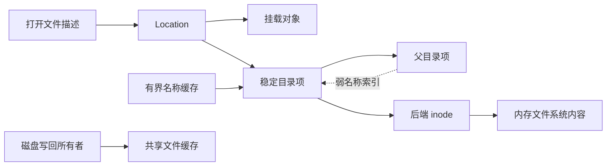
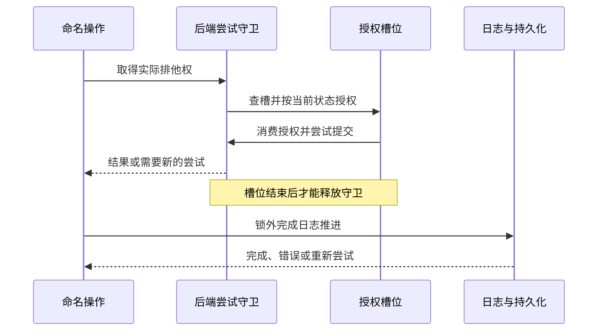

# 文件系统查找与命名操作的所有权

本设计约束路径解析、目录项身份和命名提交的共同状态，以少量拥有真实资源的
Rust 类型减少跨阶段状态丢失。实现遵循 Linux 可观察语义，并将资源释放与
可能失败的存储提交明确分开。

## 1. 行为目标

路径查找把调用者提供的名字转换为文件对象。它同时决定搜索权限、符号链接、
挂载跨越、进程根和临时查找边界，不能拆成几次独立查找后拼接结果。
本设计用于从最新主线修复 PR #2481 涉及的文件系统问题，基准是 Linux v7.1
提交 `8cd9520d35a6c38db6567e97dd93b1f11f185dc6`。
本文是批准方案的实现契约，不表示实现或验证已经完成。

### 1.1 现有边界

`fs/ax-fs-ng/src/fs_core/context.rs` 的 `FsContext` 保存进程根、当前目录与
dirfd 搜索起点；`fs/axfs-ng-vfs/src/mount/mod.rs` 的 `Location` 保存挂载与
目录项身份。这两个边界继续保留，不能以绝对路径字符串或 inode 号代替。
`fs/ax-fs-ng/src/file/open.rs` 的普通打开和 Starry 的 `sys_openat2` 接入同一
查找核心，删除分段重新初始化计数以及按 proc 路径前缀分流的实现。

修复范围包括命名关系、查找约束、对象型链接、创建授权与 inode 元数据更新。
已有同点 `pivot_root(".", ".")` 和挂载堆叠机制复用主线。不恢复原 PR 的
eBPF、网络和 IPC 身份分配、OOM、starttime、ELF 或 Docker 工具链改动。

### 1.2 类型保证与运行时证明

Rust 所有权用于限制能力的构造、借用和消费；Linux 兼容性和多线程线性化仍由
实现和测试证明。`#[must_use]` 是诊断，不是强制完成协议；
生命周期不是命名空间版本，`Arc` 保活也不等于对象仍处于同一挂载关系中。

| 不变量 | 接口约束 | 仍需运行时证明 |
| --- | --- | --- |
| 单次查找共享预算 | 会话与续走不可复制，辅助函数借用同一会话 | 每种展开和创建续走都正确收费 |
| 授权不能跨尝试复用 | 槽位实际借用尝试守卫，提交消费授权槽 | 所有别名与修改者遵守共同锁域 |
| 查找不跨作用域 | 根策略互斥，跳转经过统一检查 | rename、挂载变化及祖先关系重验证 |
| 缓存模式不回退慢路径 | 专用视图不暴露一般后端能力 | 缓存、权限和拓扑观察的有效性 |
| 资源成对释放 | 租约和锁由守卫拥有 | 析构顺序、失败发布和后端持久化结果 |

类型不得只包装裸值而保留原有无检查旁路。具体实现优先使用安全 Rust 和项目已有
同步原语，不引入通用类型状态框架，也不通过延长生命周期或增加不成立的
`Send`、`Sync` 绕过借用规则。

## 2. 对象身份

文件实体、名称别名、挂载路径和打开文件描述具有不同生命周期。
`NodeOps` 的后端 inode 继续拥有权威数据；`DirEntry` 表示名称别名；
`Location` 将别名与挂载配对；打开文件描述继续拥有偏移、标志和写入租约。

### 2.1 稳定目录项

`DirEntry` 的引用身份在 rename 前后不变。原来不可变的 `Reference` 改为受保护的
命名状态，保存 parent、name 和链接状态。读取返回一个一致的 `NameSnapshot`，
不能从可变名字返回脱离守卫的 `&str`，也不能分别读取 parent、name 后组合。

命名状态区分根、已链接、已脱链和不能信任的关系。脱链不是根；需要保留的原位置
和祖先引用用于已删除对象的显示与 Linux 允许的旧句柄操作，但不能据此允许在
已删除目录创建对象。后端部分失败导致命名结果不确定时，缓存失效并重新验证，
不能继续把旧父链作为安全证明。

rename 移动源目录项的命名关系，不重新 lookup 一个新身份再搬迁 `TypeMap`。
普通覆盖让原目标脱链；其旧 fd 仍引用原目标 inode。
硬链接是不同目录项共享同一 inode，不能合并名称身份。
`RENAME_EXCHANGE` 同时更新双方位置；无操作重命名不得错误断开任一别名。

### 2.2 引用与缓存

活跃子目录项强持父链，名称索引弱持子项，避免父子强引用环。
正项缓存的留存与树边分别管理：有界缓存保留引用用于热查找，
而不是依赖环使目录项永远存活。缓存持有者不能通过后端或挂载反向引用形成新环。
回收缓存不能使仍活跃的深层 dirfd 丢失祖先链。

同名并发 lookup 在发布时规范化为一个活跃目录项。索引身份由父项、名字及后端
对象验证共同确定；动态 proc 条目不能因为索引存在就省略重新验证或授权。
移除弱索引使用身份校验，不能由旧对象析构删除后来复用同名槽的新对象。

动态后端显式提供语义身份，不使用每次 `SimpleFsNode::new` 新分配的 inode 验证
是否为同一条目。proc 进程/线程目录的身份关联实际任务身份、procfs 实例及视图，
而不是 PID 文本；fd 与 namespace 链接的条目身份还包含槽号或链接种类。
每次访问仍重新检查任务有效性并取得当前目标，不能缓存旧目标和旧授权。
挂载保留的动态目标须能以同一语义身份被后续查找重新发现，PID 复用不得复活旧条目。

下图区分查找引用与内容保活责任。虚线索引不拥有目录项，缓存保留可回收的引用；
数据不能仅存放在一个随名称回收的对象里。

已有 `CachedFileRegistry` 强持磁盘共享缓存，回收复核关闭和干净状态；
tmpfs、ramfs 已有 inode 自有 `user_data` 和不回收内容的规则。迁移复用这些所有者，
验证硬链接与缓存回收后的数据一致，不重写页缓存算法或增加第二份文件数据登记表。
移除对象的最后一个强引用可能触发后端清理，必须在相关自旋锁、目录锁和拓扑锁外释放。

当前磁盘强登记受 `vfs` 功能控制，不能直接作为所有组合的迁移依据。
将现有登记的内容保活职责与 `vfs` 下的压力回收/后台运行职责分离：
任何启用磁盘缓存、允许目录项淘汰的组合都必须具有独立于目录项的强所有者，
包括 `host-test+ext4` 和不含 `vfs` 的 FAT。先落实并证明该前提，再弱化名称索引；
不允许通过强制启用 `vfs`、淘汰时隐式写盘或丢弃脏页解决。

### 2.3 挂载索引

`Mountpoint::children` 的键改为稳定目录项身份，不再使用可变 parent/name，
也不只使用允许硬链接共享的 inode 号。挂载位置保留目标目录项引用，
使索引身份在挂载有效期间不会复用。

`Location::ptr_eq` 继续同时比较挂载与目录项。向下进入挂载、从挂载根向上、
绝对链接跳根和对象链接跳转是显式查找事件。父关系读取不得隐藏跳过被覆盖根的动作；
在越过任何被覆盖位置之前先检查本次查找根与 `NO_XDEV`。

### 2.4 后端名称与对象复用

通用目录索引不得假定所有后端逐字节区分名称。后端负责名称等价规则，
并在权威查找后给出条目的规范名称或等价键；VFS 用该结果规范化活跃对象。
FAT 的长名、短名和大小写别名不得因不同调用拼写生成不同活跃文件实体。
精确匹配后端保持原语义，不能把通用查找统一转小写。

FAT 目前每次 lookup 分配新逻辑 inode，目录项淘汰后仅有强数据登记仍不能重发现
原缓存。复用现有逻辑 inode 分配边界建立活跃后端对象索引，以实际父对象与
权威名称关联共享状态；索引弱持对象，打开引用和缓存 backing 保活实体。
同一实体在仍有引用或脏缓存期间重开必须得到相同逻辑身份与共享内容，
父对象身份也必须在子实体需要它时保活。不能新增一份文件数据缓存解决重发现。

rename 在同一后端提交中迁移名称关联并保留源实体身份，覆盖对象独立脱链；
FAT 底层 file/editor 若绑定磁盘目录槽，必须同步重绑定共享后端状态，
不能只保留逻辑 inode 号却继续写旧槽。派生别名在删除、覆盖、rename 和错误失效时
一并处理，槽复用具有独立代际，旧引用不能指向新建文件。
这些是弱化索引的前提，不能在尚未成立时先切换到可淘汰名称缓存。

本次不私自修改、发布或供应另一份第三方 `starry-fatfs`。适配层利用共享句柄和
显式刷新/重绑定落实该依赖确实能完成的操作；依赖未提供的脱链 editor、
延迟释放簇链或目录父项更新能力不能被虚构。对无法安全完成的具体路径，
必须在任何删除或名称修改前明确返回不支持，并保留原对象与数据；
不能先删目标再失败，也不能以禁用整个 FAT 或全部拒绝 rename 代替适配。
FAT 后端支持边界和被拒绝路径在交付证据中单独记录，不宣称其具有完整 Linux 存储语义。

FAT 的根目录不能通过 `root_dir → DirEntry → FatInode → FatFilesystem` 保留自身。
文件系统只弱索引根目录项与根 holder；根逻辑 inode 的保留责任属于文件系统本身，
不在一个短命根 holder 析构时释放或重新分配。根引用消失后，`root_dir()` 可从仍存活的
文件系统重建并规范化发布同一根身份；活跃 holder 和子项继续强持实际 backend 所有者。
候选构造与最终引用释放在根索引自旋锁外完成，不能在升级失败时把文件系统误判为无根。
这复用已有弱根重发现模式，不以额外永久强登记或仅调用 flush 掩盖根引用环。

现有 `FsRef::borrow_mut` 从共享所有者引用返回可变引用，不能继续作为健全性依据。
共享句柄访问改为借用实际文件系统守卫，写访问需要独占借用该守卫，
返回引用同时受句柄和守卫生命周期约束，并核对具体所有者身份。
同一守卫不能同时派生相互别名的可变引用，其他文件系统的守卫不能解锁此对象。
既有生命周期延长与 `Send/Sync` 逐项重新证明，保留资源销毁在底层文件系统仍存活时
执行的顺序；不得靠增加 `allow` 或继续返回裸可变引用维持编译。

## 3. 查找会话

`LookupSession` 负责一次操作的完整解析，不把父遍历与最终打开变成独立操作。
普通解析、记录搜索过程和 `openat2` 只改变策略或最终意图，共用一个核心。

### 3.1 上下文快照

Starry 的路径读取入口在短持锁区取得 `FsView`，其中保留 root、cwd、
mount namespace、dirfd 起点和当前调用凭据的引用。释放任务文件系统上下文锁后，
才调用后端和 proc 对象目标获取，避免 `/proc/self/cwd`、`root` 回调重入同一把锁。

普通绝对路径忽略 dirfd；相对路径从 cwd 或 dirfd 开始。
dirfd 是搜索起点，不自动成为进程根。`IN_ROOT` 将本次起点设为临时根，
`BENEATH` 则拒绝越界。chroot 不自动更换 cwd 或撤销既有 dirfd；
修改 root、cwd、namespace 的操作仍通过原状态所有者显式提交，不修改只读快照。

快照和会话采用 `MountUseGuard` 一类实际使用租约保护选中的根、起点、当前路径和
待恢复的链接路径；只有 `Arc<Mountpoint>` 不足以参加普通卸载的忙碌判定。
转换路径时先取得新使用权再释放旧权利，并与普通卸载提交互斥，不能从已经普通卸载的
挂载重新获得使用权。`MNT_DETACH` 仍允许现有引用继续使用，不因此变成普通卸载。
卸载自身的目标解析租约通过专用消费式目标/计划转换处理，只排除该操作确实拥有的
临时使用权，不能提供跳过任意忙碌检查的布尔开关。只读快照不登记为可被 pivot 改写的
另一个任务 `FsContext`，也不要求已开始的操作追随后来的 cwd/root 修改。

### 3.2 状态与续走

会话私有字段包括当前 `Location`、本次根策略、剩余路径栈、
末组件类型、尾斜杠目录要求、搜索记录、链接总预算和拓扑观察。
`LinkBudget`、`LookupSession` 和 `Continuation` 不实现 `Copy`、`Clone`，
不提供公开重置接口。辅助操作只借用 `&mut LookupSession`。

父解析返回的 `Continuation` 拥有原会话；`finish(self, intent)` 消费续走，
继续处理末组件、链接和必要创建。普通 `NotFound` 不是创建许可；
只有解析到真实末名的空槽才能进入创建分支。链接目标不存在时继续推进原会话，
不从错误处理分支重新调用顶层 open。

根策略采用互斥枚举表示普通进程根、`BENEATH` 与 `IN_ROOT`；
正交限制使用受检位集合。末组件以普通名、根、`.`、`..` 和目录要求区分，
不依赖词法归一化之后重新猜测路径原有含义。ABI 标志保持运行时输入，
不为每个组合生成一套泛型解析器。

### 3.3 链接与末组件

一次解析共用 Linux `MAXSYMLINKS = 40` 的总预算。
父路径、末链接和悬空创建的继续解析均收费，失败路径也不恢复旧预算。
绝对链接按本次根策略重新选根；相对目标从链接所在目录继续，并保留未处理后缀。

尾斜杠和链接目标自身的目录要求在续走中保留。`O_CREAT|O_EXCL` 的存在性、
末链接不跟随、`O_PATH|O_NOFOLLOW` 句柄和目录错误按 Linux 7.1 的
`build_open_flags`、`lookup_fast_for_open`、`open_last_lookups` 与 `do_open` 决定。
创建、打开和截断是不同阶段，失败请求不得提前创建错误对象或截断未授权目标。

### 3.4 范围与竞争

`BENEATH` 从边界向上或遇绝对输入/绝对链接返回 `EXDEV`；
`IN_ROOT` 的根处 `..` 钳制在该根。`NO_XDEV` 比较挂载身份，不比较设备号。
Linux v7.1 的对象链接跳转在 scoped 查找下返回 `EXDEV`，
不能自行放宽为“目标看起来仍在子树中就允许”。

命名拓扑与挂载拓扑分别由真实写入协议发布在途状态与完成版本。
只在写后递增的计数不足以排除半完成观察；多个写者也不能用奇偶相互抵消。
读侧取得可验证的观察，逐步转换后和最终返回前重验证；
scoped 向上过程中不能证明没有竞争时返回 `EAGAIN`，
确定越界返回 `EXDEV`，不得静默关闭限制重试。

最终创建必须在槽位实际排他范围内完成必要的作用域重验证。
普通查找不长期持有全局写锁，缓存专用查找不能等待慢路径来修复观察。

## 4. 命名事务

VFS 统一授权与提交协议，真实排他权由文件系统状态所有者落实。
同一 inode 的目录别名共享锁域；目录权限更新也要与受它授权的创建协调。
名称缓存自旋锁只保护短时索引发布，不能覆盖文件系统 I/O 或日志推进。

### 4.1 尝试与槽位

一次 `MutationGuard` 代表实际持锁尝试。
`ParentSlot<'attempt>` 借用该守卫，包含被观察的名称槽；
授权消费该槽并返回 `AuthorizedSlot`，只有后者提供消费式 `commit`。
提交通过原守卫执行，不接受由其他事务提供的替代守卫。
rename 由同一尝试产生源/目标槽对，不拼接来自两次观察的令牌。

同一事务内，查找当前目标、搜索/父目录写权限、sticky、只读挂载、
目标类型、排他创建等检查必须针对实际提交对象。
父目录 mode 更新、unlink 与创建不能绕过共同排他边界。
公开的受控操作不遗留供系统调用绕开的未检查修改入口。

### 4.2 后端重试

Ext4 当前 `InodeLifetime::mutate_namespace` 在每次尝试中持有命名空间权利，
随后释放锁进行 `finish_mutation_attempt`。新授权必须进入每次真实尝试，
不能在调用该循环前只检查一次。释放权利后旧槽位不可继续提交。
FAT、内存文件系统和可变伪文件系统提供相同语义，不把 Ext4 的能力假定为所有后端已有。

实际时序必须让日志等待发生在槽位生命周期之外。下面的失败分支表示重新授权，
不是重放一个已消费的授权令牌。

可失败结果使用 `Result` 传播。后端已经修改命名空间后持久化失败时，
受影响缓存必须失效并保留真实错误，不能伪造未发生修改。
只有确定未发布的暂存才可直接丢弃；不声称 Rust 析构能够回滚磁盘事务。

后端尝试结果须区分未修改、需要新尝试、已修改及修改结果不确定，
并保留实际源/目标对象、无操作或覆盖事实。VFS 受控操作先根据该结果完成目录项
发布或标记关系不可信，再把最终错误交给调用者；不能在发布之前对一个普通 `Err`
直接使用 `?` 丢失已发生的修改。基础目录项发布与后续授权使用同一结果协议，
不另建相互竞争的提交状态机。

### 4.3 析构边界

守卫拥有锁、admission、pin 与在途权利，`Drop` 完成不失败的释放。
可失败操作显式返回提交结果，不在析构中提交、fsync 或隐藏错误。
移除的目录项、旧父引用和后端对象集中延迟到解锁后释放；
不通过目录项析构重新加父锁执行复杂树修改。

`mem::forget`、引用环、abort、内核崩溃和掉电都可能阻止析构。
漏释放只能保守保留权利或使观察失效，不能让读者信任未完成状态或越权提交。
异常展开自动解锁也不表示部分发布数据已经有效；项目的非中毒 Mutex 不提供这种保证。

本节约束新增命名事务守卫，不宣称已消除所有既有后端清理中的可失败工作。
既有 Ext4 orphan reap 和挂载租约的缓存退休保留其权威失败/重试所有者；
迁移时不得将这些错误伪装成新守卫可保证的回滚。若本轮改变其调用或引用释放路径，
必须同时核对锁外清理、错误留存与重试责任。

## 5. 对象型链接

普通符号链接的内容是路径文本；proc 的特殊链接指向已经存在的对象。
二者共用查找流程，但目标的取得方式不同。通用 VFS 不依赖 Starry 的高层文件描述类型。

### 5.1 目标与显示

链接能力返回 `LinkTarget::Text` 或 `LinkTarget::Object`。
后者持有包含挂载身份的通用路径对象，目标来自真实条目所属任务、
文件描述表、文件系统上下文、可执行文件或 namespace 的权威引用。
匿名对象和 namespace 需要具有对应对象身份，不能以描述字符串充当路径。

`readlink` 通过独立显示操作生成文本，memfd 的删除后缀属于显示语义。
动态目标以一次快照取得，不以分开查询长度与读取内容拼接不一致结果。
目标引用取得后及时释放任务或 fd 表锁；fd 关闭和复用不能把已有引用改指向新对象。

namespace 的文件身份使用同一 nsfs inode 分配域，不直接采用各 namespace 类型独立分配的
显示 ID。Starry 扩展现有 `NamespaceObject` 的单份 inode 索引：记录以真实 namespace
引用身份为键，弱持实际 namespace 所有者，强保留其 `ObjectInode`；不弱持临时
`NamespaceObject` 包装。只要真实 namespace、已打开 fd 或 vnode 仍存活，重复观察得到
同一 inode；不同类型和不同实体不能在同一 nsfs device 中碰撞。
fd、vnode 与 readlink 数字共同消费此 inode，不改写网络、IPC 等子系统原有 ID 分配政策。

索引不强持 namespace，`ObjectInode` 也不反向强持 namespace；只有 vnode 的目标对象
引用承担使用保活。每次访问清理已失去真实所有者的登记，先在锁内移出、再在锁外释放；
空闲时允许保留最近一次访问留下的已死登记，但新增访问不能使历史已死项无界累积。
候选 inode 在索引锁外分配，重新持锁规范化发布后，落败候选同样在锁外释放。
复用 nsfs 的 inode 分配器及现有索引，不增加并行身份表，不用哈希或移位拼接代替唯一性。

### 5.2 统一消费者

walker 先决定是否跟随，再获取目标，因此 `O_PATH|O_NOFOLLOW` 可保留末链接自身。
跟随目标时统一执行链接预算、`NO_SYMLINKS`、`NO_MAGICLINKS`、
`NO_XDEV`、scoped 限制与 proc 读取授权；不存在条目不能仅因路径拼写而提前拒绝。

检查顺序由 Linux `pick_link`、`proc_pid_get_link` 和 `nd_jump_link` 决定：
需要跟随时先消耗预算并检查禁止所有链接的策略，proc 回调执行读取授权和目标取得，
随后对象跳转才检查禁止 magic link、挂载及 scoped 策略。
不能仅凭 magic 标记在回调之前统一返回 `ELOOP`，覆盖本应出现的权限或目标错误。

普通 open、openat2、stat、lstat、statx、readlink 等使用同一对象语义，
但保留各入口的 flags、尾斜杠、凭据和错误顺序。
proc fd 的重新打开形成新打开描述，重新执行相关打开语义；
不是复制旧描述的偏移和状态。namespace 对象的 stat 与不跟随的链接 stat 不能混淆。

### 5.3 读取授权与凭据发布

proc 敏感链接使用一个由任务安全状态所有者提供的 `READ_FSCREDS` 授权入口，
不复用信号发送或 ptrace attach 的父子关系放行。调用者使用 fsuid、fsgid 和
effective capability；目标使用实际线程凭据及其用户命名空间。
同线程组自省按 Linux 放行；其他任务需要六项 real/effective/saved UID/GID
匹配或对目标凭据用户命名空间的 `CAP_SYS_PTRACE`。
随后检查 dumpable，并应用 commoncap 的同命名空间 permitted 子集或目标命名空间
能力规则。不能仅凭 uid 0、父进程关系或一个全局 capability 位放行。

用户命名空间保留不可变的父引用、层级和创建者在父空间中的身份，
据此实现 Linux `cap_capable_helper` 的祖先、所有者与 capability 判断；
不从 namespace 显示 ID 反查对象。MM 保留创建时的用户命名空间引用，
fork 随 MM 复制、exec 构建新 MM 时按调用者空间初始化，用于 nondumpable 的能力检查。
这与复用 MM 内既有 `ExecutableFile` 一致，不新增可执行对象镜像或重写映像发布。
本次不重做完整 UID/GID 映射子系统，也不因新增谱系信息向现有凭据发放原本没有的能力。

强父链必须有创建边界，不能让无特权任务构造无界遍历或递归析构。
`UserNamespace::new_child` 在分配子对象、占用新身份或发布之前检查父层级；
按固定 Linux `create_user_ns` 的条件，父 `level > 32` 时返回 `ENOSPC`，
父层级为 32 时仍可创建层级 33，不能用含糊的“最多 32 层”替代实际边界。
`NsProxy::unshare_user`、unshare 与 clone/clone3 的准备流程传播这个可失败结果，
拒绝时保留原命名空间身份、凭据和 MM，不发布部分准备状态。
边界及失败保持通过有界的真实创建操作验证，不以耗尽内核栈作为测试方法。

具体接口落在既有 `AddrSpace`：执行文件 getter 只克隆已有执行租约，
用户命名空间 getter 返回创建时的引用。`UserImageBuilder` 通过构建期 setter
向内部地址空间传递命名空间，不公开私有 `aspace`，exec caller 不绕过 builder。

授权读取的一组 namespace 和 credential 快照须来自共同协调的发布边界，
复用 `ProcessData::namespace_update` 的串行化职责或等价的实际所有者协议，
不能分别抓取无关联快照后声称一致。凭据所有者在暴露新的 effective/fs IDs
或需要重置 dumpable 的权限变化之前清除 dumpable；读取者先读凭据，再读 dumpable，
并建立与写侧对应的同步关系。不能只在各 syscall 发布凭据之后补清除，
也不能只加一个读侧屏障来弥补错误写序。

获得授权后保留实际目标任务引用，并在同一操作中从它取得链接目标；
不重新按 PID 字符串挑选任务，不缓存授权结果供后续访问复用。
已有用户命名空间映射或能力发放未完成的入口不因此被宣称完整兼容，
但读取授权本身不得用宽松替代规则或静默越权兜底。

## 6. 元数据变更

`Metadata` 是读取结果，不是可以稍后整体写回的授权凭证。
`MetadataChange` 表达 chmod 或逐字段 chown 等意图，由实际 inode 所有者在当前状态下执行。
普通文件继续使用后端 metadata，不增加一份 VFS 权限镜像。

### 6.1 锁内决策

`Chown { uid: Option<_>, gid: Option<_> }` 用 `None` 表示保持字段，
不能在锁外读取旧 uid/gid 再填入完整 owner。
授权、字段更新和 SUID/SGID 处理在同一 inode 同步边界内针对当前状态决定。
chmod 不被并发 chown 写回旧 mode；chown `(-1, -1)` 仍按 Linux 规则处理权限位。

对目录 mode 的变更还须参加命名操作授权的排他协议。
不使用任意用户闭包绕过后端锁层次；动态 trait 的扩展保持对象安全，
能力入口应表达领域操作而不是暴露内部锁或后端状态。

### 6.2 匿名对象

匿名 pipe 与 socket 的 mode、uid、gid 由真实共享 inode 状态拥有，
修改结果经 fstat 可观察。pipe 的两个端点以及同对象的 dup、重开共享相应实体，
socketpair 两端是不同对象，不能为了复用字段误合并 inode。

创建、修改和打开返回实际结果；通知从已提交操作产生并在锁外发布，
不通过 syscall 层事前 probe 或析构猜测是否创建。
memfd 复用已有内存 inode 与执行路径，只修正受影响的对象访问和显示。

## 7. 缓存专用查找

`RESOLVE_CACHED` 限制路径解析不得依赖慢速查找或重新验证。
它不是数据页缓存提示，也不是“先试普通 lookup，慢了再返回错误”。

### 7.1 受限能力

`CachedLookup` 只暴露已物化的名称、元数据/权限、链接与拓扑观察，
不提供普通后端 lookup，不实现可逃逸到任意后端的 `Deref`、downcast 或原始对象出口。
辅助代码不能通过取得一般 `Location` 调用慢路径。
最终允许输出正常对象的转换由完成阶段在缓存观察验证后执行。

缓存结果区分正项、带有效性证明的负项和需要慢路径。
无法非阻塞取得必要同步、动态目标需要后端重验证或观察失效时返回 `EAGAIN`；
有效负项可以返回 `ENOENT`，缓存不存在某名字不能直接证明该名字不存在。

### 7.2 参数与失效

`openat2` 输入先按 Linux `build_open_flags` 校验。
`CACHED` 与创建、截断等组合的错误顺序不能通过查找后补判断。
普通模式可以按明确策略进入慢路径，缓存模式不能静默回退。

名称、元数据、链接内容和拓扑改变均参与必要失效。
既有 `DirectoryCache::generation` 只证明局部缓存发布，不直接充当全局 rename 版本。
缓存能力必须真实覆盖所用后端，不能把一律拒绝宣传为完成缓存查找。

## 8. 迁移与验收

本设计改变共享 VFS 契约，迁移需要覆盖实际调用方与后端，而不是只修改 Starry syscall。
实现中保持设计、类型和行为对应；未取得证据的条目不标记为完成。

### 8.1 实施与回滚

先实现稳定身份、命名状态、挂载键和缓存引用，再实现统一会话及命名授权，
最后接入 proc、匿名元数据与系统调用。旧入口在同一序列中迁移并删除；
没有当前调用方的泛化框架不加入本次改动。

不修改磁盘格式。代码提交可回滚，但不能依赖 Drop 修复已发布或持久化的状态。
后端不具备的存储能力明确报错，不把目录句柄等其他对象当作成功结果。
性能比较关注普通打开的分配、锁范围、缓存命中与资源滞留，
不以所有路径全局串行化换取表面正确。

### 8.2 必要证明

关键公开能力通过合法对照和少量 compile-fail 文档证明移动、借用与消费限制；
不为测试扩大私有接口，也不能让缺导入等无关编译错误冒充契约证明。
组件测试使用真实实现及受控交错，证明重命名身份、授权重试、
元数据部分更新、错误传播、缓存与析构顺序。

Linux ABI 回归放在 `test-suit/starryos`，通过项目入口直接运行 syscall。
同一窄测试在错误实现上先失败，修复后通过；先完成一个目标红绿，再运行
x86_64、AArch64、RISC-V、LoongArch 的受影响定向集合。
共享源码的 QEMU 入口串行运行，不惯性追加无关全量验证。
标准库与文档测试使用提交后的 `cargo xtask test --since <基线>`，
并确认选中目标；Rust 改动执行 `cargo fmt` 与受影响包的 `cargo xtask clippy`。

标准库功能组合需包含 `host-test+fat` 且不启用 `vfs`，补入现有
`scripts/axbuild/src/test/std.rs` 的 `AX_FS_NG_FEATURE_PROFILES`，
与已有 `host-test+ext4` 一起证明无 `vfs` 的内容保活和重发现。
FAT 回归同时覆盖大小写/短名别名、重开、rename 后旧句柄及缓存退休，
不以单个全功能 Starry 组合代替后端功能组合证据。

最终兼容性表逐系统调用记录固定 Linux 来源、完整调用链、实现结论和系统证据。
未执行的入口不标为正确。已有有效证据按差异复用，不因阶段切换重复运行。

## 9. 参考依据

Linux 行为以固定提交源码为准；Rust 与其他 VFS 资料用于解释表达方式，
不取代项目的锁域、后端和错误语义证明。

- [Linux v7.1 路径查找](https://github.com/torvalds/linux/blob/8cd9520d35a6c38db6567e97dd93b1f11f185dc6/fs/namei.c)
- [Linux v7.1 打开参数与元数据操作](https://github.com/torvalds/linux/blob/8cd9520d35a6c38db6567e97dd93b1f11f185dc6/fs/open.c)
- [Linux v7.1 用户命名空间创建边界](https://github.com/torvalds/linux/blob/8cd9520d35a6c38db6567e97dd93b1f11f185dc6/kernel/user_namespace.c#L83-L135)
- [Linux v7.1 namespace inode 生命周期](https://github.com/torvalds/linux/blob/8cd9520d35a6c38db6567e97dd93b1f11f185dc6/kernel/nscommon.c#L56-L94)
- [Linux v7.1 nsfs 显示与实体路径](https://github.com/torvalds/linux/blob/8cd9520d35a6c38db6567e97dd93b1f11f185dc6/fs/nsfs.c#L43-L76)
- [Linux v7.1 持锁证据](https://github.com/torvalds/linux/blob/8cd9520d35a6c38db6567e97dd93b1f11f185dc6/rust/kernel/sync/locked_by.rs)
- [Starnix 固定版本目录项与重命名](https://fuchsia.googlesource.com/fuchsia/+/3b5d6be01bbadd768777e59bb65af7860b45b8af/src/starnix/kernel/core/vfs/dir_entry.rs)
- [Rust API Guidelines：类型安全](https://rust-lang.github.io/api-guidelines/type-safety.html)
- [Embedded Rust Book：类型状态](https://docs.rust-embedded.org/book/static-guarantees/typestate-programming.html)
- [Rustonomicon：析构泄漏](https://doc.rust-lang.org/nomicon/leaking.html)
- [标准库文件同步与析构错误](https://doc.rust-lang.org/std/fs/struct.File.html#method.sync_all)
