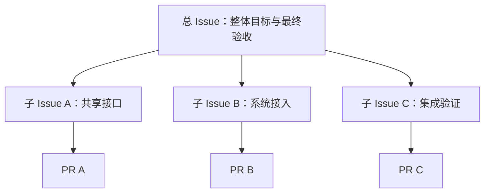
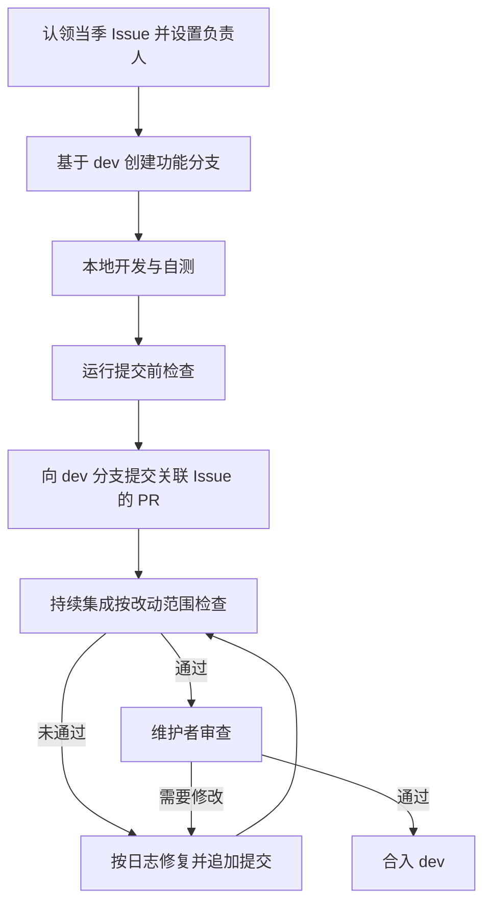

# 贡献指南

社区欢迎代码、文档、测试以及社区建设等形式的贡献。TGOSKits 按季度规划开发任务，每季度发布一个稳定版本。GitHub Issue 是开发任务清单，Pull Request（PR）是提交实现和接受审查的入口；功能、缺陷修复、重构、测试、文档和基础设施改动都应先对应已确定的 Issue，再通过 PR 交付。

季度内只处理已经讨论确定的任务，计划外任务需再次讨论通过后才能进入当季开发。仓库级实现与验证要求以 [AGENTS.md](https://github.com/rcore-os/tgoskits/blob/dev/AGENTS.md) 为准。

## 1. 开始贡献

开发任务先登记为 Issue，再由季度规划确定交付范围。沟通渠道和提问准备见[获取帮助](/community/support)，成员认可与加入机制见[团队成员](/community/team#4-成员参与)。

### 1.1 选择任务

开始实现前，确认执行 Issue 已进入当季清单、范围清楚，并按[贡献流程](/community/contributing#41-准备分支)完成认领，在 Issue 的负责人字段中选择实际负责人。首次贡献可以选择已排期的文档、示例或缺陷修复任务；入门资料与推荐顺序见[参与路径](/community/introduction#42-参与路径)。

### 1.2 提出候选

缺陷报告和功能建议先搜索已有 Issue，再按下文的 Issue 填写要求登记。功能建议说明使用场景和预期收益；大型改动先讨论设计与拆分，再根据季度规划决定是否启动。候选任务及讨论结论应保留在 Issue 中，方便后续排期与追溯。

## 2. 季度规划

社区以自然季度为一个开发和发布周期。季度初先讨论并确定本季度任务，季度内按确定的清单推进，季度末完成集成验证和稳定版本发布。

### 2.1 周期划分

季度标签统一使用小写的 `q1`、`q2`、`q3`、`q4`。由于标签本身不含年份，每个季度同时使用一个包含年份的 GitHub Milestone，例如 `2027 Q1`，用于汇总该周期的任务和完成情况。

| 季度 | 时间范围 | 季度标签 | 稳定版本发布安排 |
| --- | --- | --- | --- |
| 第一季度 | 1 月至 3 月 | `q1` | 3 月末 |
| 第二季度 | 4 月至 6 月 | `q2` | 6 月末 |
| 第三季度 | 7 月至 9 月 | `q3` | 9 月末 |
| 第四季度 | 10 月至 12 月 | `q4` | 12 月末 |

季度初会议确定具体发布日期和集成验证时间。季度标识用于安排交付，不替代版本号；版本号仍按项目已有的版本管理规则确定。

### 2.2 季度初会议

维护者在季度初组织规划会议，贡献者提前用 Issue 提出候选任务。会议根据项目目标、依赖、开发与审查能力确定本季度能交付的内容，避免只列功能名称而没有可执行的工作项。

会议应逐项确认以下内容，并把结论链接写入相关 Issue 和季度 Milestone：

1. 本季度目标、稳定版本发布日期和集成验证安排。
2. 纳入计划的 Issue 清单，以及每项任务包含和不包含的内容。
3. 每个执行 Issue 的负责人、审查协调人、依赖关系和预计交付时间。
4. 每项任务的修改方案、验收条件，以及需要覆盖的系统、架构或板卡。
5. 大型任务的总 Issue、子 Issue 列表及本季度负责交付的部分。

信息不足、范围不清或无法在季度内交付的候选任务暂不纳入。维护者在会议后核对 Issue、标签和 Milestone，形成可追溯的季度任务清单；仅创建 Issue 或添加季度标签不代表任务已经获准开发。

### 2.3 计划内开发

季度计划确定后，任务目标和交付边界原则上不再变动。开发、审查和合入都以该清单为范围，避免临时需求持续挤占已经承诺的工作。

季度内只处理已经讨论确定的 Issue。贡献者开始实现前，应确认任务已列入当季清单、已指定负责人，且验收条件足以判断完成与否。不能先提交实现，再以代码已经写好为由要求补入计划。

计划外的问题和建议可以登记为候选 Issue，供后续季度规划使用；本季度不安排其开发、技术评审或合入。维护者可说明其未纳入计划的状态，但登记、标注类型、收到反馈或提交 PR 都不构成接纳任务的承诺。

开发中发现的附带优化、相邻功能或独立缺陷，应单独登记，不能夹带在当前 PR 中。为实现既定验收条件所必需的实现细节可以在原 Issue 中补充说明；扩大对外行为、交付目标或受影响范围时，按计划变更处理。

### 2.4 特殊变更

特殊情况下需要新增任务，或调整、替换、移出已经确定的任务时，必须再次组织讨论并形成结论。严重 Bug、回归和发布阻塞问题也遵循这一流程，不因标记为 `bug` 就自动进入当季计划；紧急情况应尽快组织专项讨论。

变更提出者先在相关 Issue 中说明变更原因、处理时限、不处理的影响，以及对原计划的人力、依赖和发布日期的影响。维护者组织相关负责人和审查协调人讨论，明确接受、拒绝或延后，并记录是否需要调整其他任务。

讨论通过后，维护者同步更新季度任务清单、Issue 范围、负责人、标签和 Milestone，并保留原决定与本次变更的链接。结论形成前不启动新增范围的开发和 PR 审查；未通过的任务继续作为候选项保留。

## 3. Issue 管理

Issue 应描述一个边界清楚、能够验证的交付结果。所有开发 Issue 使用“当前问题、修改方案、测试验证”三个主体部分，仓库提供[开发任务模板](https://github.com/rcore-os/tgoskits/blob/dev/.github/ISSUE_TEMPLATE/development.md)。Bug、普通任务、总 Issue 和子 Issue 均在同一结构下填写。

### 3.1 填写要求

候选阶段可以保留尚待讨论的内容，但必须明确标注。任务纳入季度计划并开始开发前，三个部分都应足以支撑实现和验收，不以“待定”或“见 PR”代替方案与验证要求。

| 主体部分 | 必须说明的内容 |
| --- | --- |
| 当前问题 | 当前行为或能力缺口、使用场景、期望结果和影响范围；Bug 补充代码版本、系统与运行环境、执行命令与配置、复现步骤、实际结果、完整错误输出及已有排查 |
| 修改方案 | 交付范围与排除项、实现思路及理由、依赖、负责人、期望季度；总 Issue 列子任务，子 Issue 链接总任务 |
| 测试验证 | 可判定的验收条件、验证环境与方法、预期结果；执行后补充实际结果和证据，不能验证的目标说明原因 |

纳入计划后，在“修改方案”中补充正式季度、Milestone 和讨论结论链接。“测试验证”应区分规划的方法与已经取得的结果，不能把尚未执行的计划写成通过记录。

### 3.2 单项任务

一个执行 Issue 对应一个 PR，一个 PR 只交付一个执行 Issue 的内容。Issue 应说明当前问题、修改方案和测试验证方法，并写清不在本次任务内的内容，避免实现时不断扩展范围。

任务粒度是否合适，可以据此判断：审查人能否一次理解完整改动，是否有明确的通过条件，合入后是否保持仓库可构建和可使用。若必须分多批实现、审查或合入，应在开发前拆成多个子 Issue。

一个 PR 可以包含多次提交和审查后的修订；追加提交不需要另开 Issue。原 PR 关闭后如需重新提交，应在 Issue 中注明替代关系，并保证同一执行 Issue 同时只有一个有效的交付 PR。

拆分的目标是让实现、审查和验收能在一个 PR 内完成，而不是按文件数量、提交次数或开发者人数机械分配任务。

### 3.3 总任务与子任务

大型重构或功能实现采用“总 Issue + 多个子 Issue”的组织方式。总 Issue 保存整体目标、设计边界、依赖顺序和最终验收条件，各子 Issue 分别描述可通过一个 PR 交付的工作，并链接回总 Issue。

总 Issue 用子 Issue 清单汇总进度，实际实现由子 Issue 对应的 PR 提交。下图展示任务与交付的对应关系：



总 Issue 作为协调入口，不再对应一个包含全部实现的 PR，也不能因某个子 PR 合入就关闭。子 Issue 全部完成且整体验收通过后，才关闭总 Issue；需要额外实现的集成工作，也应预先建立对应子 Issue。

子任务要写清依赖及合入顺序，避免前一个 PR 合入后留下不可用的中间状态。总任务可以跨季度，但当季只交付明确列入计划的子 Issue，不能通过给总 Issue 添加季度标签，把尚未讨论的子任务一并纳入。

总 Issue 在“修改方案”中维护子 Issue 清单与依赖关系，在“测试验证”中定义整体验收。子 Issue 填写自身方案、独立验收条件和交付 PR，注明它承担总目标中的哪一部分。规划及变更讨论的结论应同时反映在总 Issue 和对应子 Issue 中。

### 3.4 拆分后的范围

将已经批准的任务细化为子 Issue 时，应在总 Issue 中说明拆分前后的对应关系，保持原有交付范围和验收条件，并同步季度清单。纯粹细化既定工作不视为新增功能；增加交付内容、改变目标或影响其他任务排期时，仍需重新讨论。

每个子 Issue 都需要自己的负责人、方案和验证要求。不能只在总 Issue 中写一份笼统说明，让子 PR 在缺少独立验收条件的情况下合入。

### 3.5 标签约定

标签用于区分任务性质和季度，Milestone 用于区分年份并汇总计划。维护者负责建立和维护统一标签；贡献者无标签管理权限时，可在 Issue 正文中填写建议类型和季度，由维护者核对后设置。

任务类型使用 `bug` 或 `task`，季度使用 `q1` 至 `q4`。标签应反映任务当前安排，讨论记录则保留安排发生变化的原因。

| 标签 | 含义 | 使用要求 |
| --- | --- | --- |
| `bug` | 已有行为不符合预期，需要修复 | 写清复现步骤、期望结果、实际结果和影响范围 |
| `task` | 功能、重构、测试、文档或基础设施任务 | 写清交付目标、范围和验收条件 |
| `q1` | 第一季度计划任务 | 与对应年份的第一季度 Milestone 配套 |
| `q2` | 第二季度计划任务 | 与对应年份的第二季度 Milestone 配套 |
| `q3` | 第三季度计划任务 | 与对应年份的第三季度 Milestone 配套 |
| `q4` | 第四季度计划任务 | 与对应年份的第四季度 Milestone 配套 |

每个执行 Issue 选择一个主要类型；纳入计划后设置一个季度标签和对应年份的 Milestone。候选 Issue 只标任务类型，期望季度写在正文中，待讨论通过后再设置正式季度标识。跨季度总 Issue 通过子 Issue 的安排跟踪交付，不同时堆叠多个季度标签。

### 3.6 状态记录

任务进展以 Issue、关联 PR 和讨论记录为依据。负责人需要在开始开发、出现阻塞、提交 PR 和完成验收时更新记录，方便维护者判断季度风险。

| 状态 | 进入条件 | 后续动作 |
| --- | --- | --- |
| 候选 | 已登记，尚未纳入季度计划 | 等待季度规划或专项讨论 |
| 已排期 | 讨论通过，已进入季度清单 | 确认负责人、依赖及验收条件 |
| 开发中 | 负责人开始实现既定范围 | 更新进展，及时报告阻塞 |
| 评审中 | 已提交关联 PR 和验证结果 | 处理审查意见，保持说明与提交一致 |
| 已完成 | PR 已合入且验收条件全部满足 | 关闭执行 Issue，更新总 Issue 进度 |

这些是协作状态，不要求额外创建同名标签。出现阻塞时，在 Issue 中说明原因、依赖、预计影响和下一步；延期或取消时保留记录，不把关闭 Issue 自动视为完成。跨季度转移任务仍需下一季度会议确认，并记录原计划和新安排。

## 4. 贡献流程

代码和文档改动先认领已纳入季度计划的执行 Issue，再通过关联该 Issue 的 PR 提交。大型任务先拆为总 Issue 和子 Issue，每个子 Issue 对应一个 PR。认领后，从准备分支到合入需要经过本地检查、持续集成和人工审查三个环节。

### 4.1 准备分支

通过认领 Issue 开始开发，必须在 Issue 的负责人字段（Assignees）中选择实际负责人。仅在正文或评论中声明认领不算完成；没有设置权限时，请维护者代为指定，确认字段已设置后再开始实现。认领已有负责人的任务前，应先协调分工，避免重复开发。

日常开发的改动以 `dev` 分支为基线，`main` 分支只接收已经完成集成验证的内容。分支划分与合并节奏由维护者统一安排，见[仓库管理指南](/docs/contributing/repo)。

请先 fork 上游仓库，再克隆自己的副本并配置上游地址，改动推送到自己的 fork。保留上游地址便于后续同步社区的最新改动，也能减少合并时的冲突。

```bash
git clone https://github.com/<your-github-name>/tgoskits.git
cd tgoskits
git remote add upstream https://github.com/rcore-os/tgoskits.git
git checkout -b feature/your-feature-name
```

分支名带类型前缀，`feature/`、`fix/`、`refactor/`、`docs/` 分别对应新功能、缺陷修复、重构和文档改动，便于他人快速判断改动性质，也便于后续按类型检索历史提交。

### 4.2 提交前的检查

提交拉取请求前按改动范围运行静态检查；影响内核运行时、设备或平台行为时，再选择对应的 QEMU 或板卡用例。这里列的是定向入口，不要求在本地复跑完整持续集成或无关矩阵。修改 Rust 代码后运行 `cargo fmt`，功能和缺陷修复仍需完成适用的行为证明。

| 受影响范围 | 定向命令示例 |
|------|------|
| Rust 软件包 | `cargo xtask clippy --package <软件包>` 或 `cargo xtask clippy --since <引用>` |
| QEMU 用例 | `cargo xtask starry test qemu --arch <架构> -c <用例>` |
| 实体板卡用例 | `cargo xtask starry test board --board <板卡> --test-case <用例>` |

需要标准库行为测试时，使用 `cargo xtask test --since <引用>`，并确认变更已经提交且选中了受影响软件包。Issue 中的“测试验证”描述验收方法，PR 中则提交实际执行的命令、环境、结果和证据链接；无法执行或仍在运行的检查不能记为通过。

具体系统与选择器见[命令索引](/docs/build/commands)和对应测试指南。`--since` 只选择已提交的差异；未提交的 Rust 改动先按软件包选择。没有受影响的 QEMU 或板卡路径时无需运行这两类用例；纯文档改动只检查差异与引用。无法在本地执行受影响的实体板卡或自托管用例时，应在拉取请求中说明未验证范围和原因。检查给出告警时应修复根因，不在改动中屏蔽告警。

### 4.3 提交拉取请求

创建 PR 时必须关联已经认领的执行 Issue，并在正文中显式填写 Issue 编号或链接，例如 `关联 Issue：#123`。未关联 Issue 的 PR 一律不予处理，补齐关联后才进入受理流程。能够在合入时满足全部验收条件的 PR 可使用 `Closes #<Issue 编号>`；总 Issue 只作关联引用，避免被子 PR 误关闭。一个 PR 只交付一个执行 Issue，不得合并多个独立任务，也不能在评审期间追加未批准的功能；需要多批交付时先拆分子 Issue。

拉取请求标题使用英文并遵循 `type(scope): content` 形式，例如 `fix(axfs-ng-vfs): keep parent traversal inside chroot`。改动集中在单个软件包时，把软件包名写进 `scope`，便于维护者据此找到合适的审查人。正文使用中文，必须包含“当前问题、修改方案、测试验证”三个主体部分，按[PR 模板](https://github.com/rcore-os/tgoskits/blob/dev/.github/PULL_REQUEST_TEMPLATE.md)填写。

| 主体部分 | 必须说明的内容 |
| --- | --- |
| 当前问题 | 关联的执行 Issue、需要解决的问题和影响；可以适当引用 Issue 中的内容，并说明本 PR 对应的范围 |
| 修改方案 | 实际改动、实现思路、每一步方案背后的理由，以及兼容性和受影响范围 |
| 测试验证 | 实际执行的命令、环境、结果和证据链接；未执行的验证说明目标及原因，纯文档改动记录差异、格式和引用检查 |

每次增加或修改提交后，同步更新 PR 描述、验证记录及 Issue 进度。

从创建分支到合入，改动会依次经过本地检查、持续集成和人工审查，其中任何一步未通过都需要回到上一步修正，下图是这条路径的完整走向，其中 CI 指持续集成检查。



持续集成仍会按改动执行适用的 `sync-lint`、标准库测试等检查；它们无需为了提交拉取请求在本地全量复跑。提交后请先确认未通过的项是由改动引起还是环境问题，再把处理结论写回拉取请求，这样审查人不必重新判断同一份日志，检查项的含义见 [CI 与容器镜像](/docs/build/ci)。

### 4.4 接受审查

所有改动都需要经过审查。维护者会审查您的拉取请求，并可能提出修改意见；请根据反馈调整改动或补充说明，并在讨论中保持友好和专业，把分歧集中在具体行为和技术取舍上。

审查关注改动是否解决了它声称的问题、是否与社区既有做法一致、是否附带必要的验证与文档更新。审查意见针对改动本身而非提交者个人，反馈及时处理可以让改动更快合入。

维护者受理 PR 前先核对 Issue 关联、Assignees、季度范围以及正文三个主体部分。未关联 Issue 的 PR 不予处理，其他信息缺失时先补齐再受理。确认实现结果、必要检查和人工审查均符合要求后合入；负责人随后核对 Issue 验收条件，补充结果并关闭任务。PR 合入但验收未完成时，Issue 保持打开并说明剩余事项。

## 5. 各类贡献

社区的工作不只有功能开发，文档、测试和日常答疑同样需要有人持续投入。不同方向的准备方式和验收标准各不相同，下面按类别说明各自需要具备的条件。

### 5.1 代码贡献

代码改动除功能本身外，还需要保证风格统一、告警清零，并为新增的公共接口补充文档注释。提交前请确认改动范围内的检查全部通过，并说明验证时使用的系统与环境。辅助脚本和工具还应说明用途、适用范围、维护方式及依赖的外部程序。

### 5.2 文档贡献

文档贡献包括修正错误或不清晰的表述、补充使用示例、完善教程以及改进导航结构。文档站点分为主文档与社区文档两部分，本地预览与写作规范见[文档部署](/docs/contributing/docs)。

写作时保持说明准确、结构清晰，行为变化时同步更新受影响页面，避免与现有说明矛盾。教程和移植、调试、性能分析等实践记录应注明对应版本、环境和适用限制；引用他人材料时注明出处，提交前核对链接。示例应说明依赖、运行方法与预期结果，并验证可以实际运行。

### 5.3 测试贡献

测试用于证明功能确实按预期工作。社区鼓励复用和增强已有用例，只有在缺少独立验证时新增测试，不以用例数量或覆盖率增长为目标，因为无法说明行为的用例在长期维护中只会增加负担。

测试位置与执行方式的选择见[测试与验证](/docs/build/ci)。修复缺陷时，先确认已有或增强后的测试在错误实现上必然失败，再实现或恢复修复并验证通过；缺少独立行为证明时才新增测试。PR 中应附上修复前后的结果，证明测试覆盖了出现问题的路径。

### 5.4 社区支持

回答问题、整理议题、翻译文档和组织分享都属于社区贡献。交流入口见[获取帮助](/community/support)；形成仓库改动时，同样先确认任务安排，再通过 PR 提交。

### 5.5 资源贡献

收录工具、教程、经验文章和示例时，说明其用途、与 TGOSKits 的关系、适用范围和维护方式。收录内容应可公开访问且可直接使用，文档与工具可以获取，示例可以运行；需要额外账号或位于私有仓库的资源只在社区讨论中介绍。长期无人维护或已经过期的资源应从文档中移除，避免误导使用者。

外部资源先在社区讨论中介绍，由维护者判断是否适合收录。实际收录或更新仍对应 Issue，经季度规划或特殊变更讨论纳入计划后，再向所属技术章节提交 PR。

## 6. 稳定版本发布

季度稳定版本汇总该周期已完成并通过验证的成果。维护者按季度初确定的时间组织收尾，发布范围必须能追溯到季度清单、已合入 PR 和验收记录。提交信息与改动说明应写清实际内容，便于整理发布记录。

### 6.1 发布准备

进入集成验证阶段后，负责人逐项核对已完成、阻塞和未完成的 Issue。稳定版本只包含已合入并满足验收要求的内容；未完成功能不能因季度结束而放宽门槛，也不能把不可用的中间状态留在发布内容中。

维护者根据实际改动核对受影响系统与目标的验证结果，处理发布阻塞问题，更新版本说明和相关文档。新发现的阻塞若不在季度清单中，先按特殊变更流程讨论纳入，再开展修复。

未完成的任务不自动延续到下一季度，应记录当前进度、延期原因和剩余范围，交由下一季度规划重新决定。若部分代码已经合入，应明确其在稳定版本中的可用状态和处置方案；需要回退或调整范围时，同样保留讨论与 PR 记录。

### 6.2 版本发布

每个季度末发布该季度对应的稳定版本。发布前若必要验证未通过或仍存在阻塞，维护者应记录原因、处理任务和调整后的日期，完成相应讨论与清单更新，不能仅为赶日期宣布稳定。

版本号遵循语义化版本控制：主版本号对应不兼容的接口修改，次版本号对应向下兼容的功能新增，修订号对应向下兼容的问题修正。发布说明由工具依据提交历史生成，因此提交信息按约定式提交格式书写，并在发布时核对和补充季度交付信息。

每次稳定版本发布同时提供四个源码压缩包，分别交付 TGOSKits 工作区和三个系统的源码。包名中的 `vxx.xx.xx` 替换为对应的稳定版本号，文件扩展名按实际压缩格式添加。

| 源码压缩包名称 | 交付内容 |
| --- | --- |
| `tgoskits-vxx.xx.xx` | TGOSKits 工作区源码 |
| `axvisor-vxx.xx.xx` | Axvisor 源码 |
| `starry-vxx.xx.xx` | StarryOS 源码 |
| `arceos-vxx.xx.xx` | ArceOS 源码 |

发布前核对四个源码压缩包是否齐全，并确认其源码与对应稳定版本一致。发布说明应列出各压缩包的下载入口及对应的源码提交或标签，便于使用者获取和追溯。

发布说明应包含版本号、发布范围、已完成的 Issue 与 PR、兼容性变化、已知限制和验证结论。季度稳定版本是项目整体交付安排；单个软件包的版本更新和自动发布机制仍按[软件包发布](/docs/ci/publishing/releases)执行，软件包发布成功不能替代季度整体验收。

### 6.3 季度复盘

发布后，维护者整理计划完成情况、范围变更、延期原因和发布中发现的问题，作为下一季度规划输入。复盘提出的改进也应登记为候选 Issue，经下一周期讨论后再安排实施。
