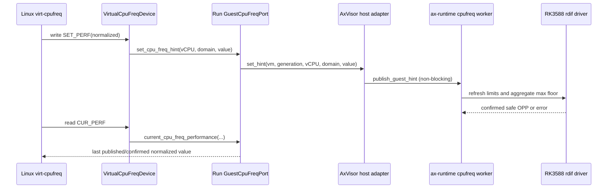

# AxVisor 客户机虚拟调频

AxVisor 通过 `qemu,virtual-cpufreq` 为 Linux 客户机提供归一化性能提示，同时保持 RK3588 CPUFreq、SCMI、PMIC、DSU 和 thermal 的宿主所有权。当前 OrangePi 生产镜像仍使用独立的 `robot-linux/perf30` host-performance profile；只有带 Linux backport 的镜像才声明该设备。这样 Linux 6.1.99 没有前端时不会把宿主高性能误报成客户机调频已经可用。

## 1. 运行时边界

`virtualization/axvm/src/configured/devices/guest_cpufreq.rs` 实现设备模型和 FDT contribution，`virtualization/axdevice/src/device.rs` 的 `GuestCpuFreqPort` 是设备到 run 的唯一能力边界，`virtualization/axvm/src/manager.rs` 的 `GuestCpuFreqBackend` 负责把 run 身份交给宿主适配器。设备 MMIO 只处理归一化值和表索引；宿主适配器不在该路径同步写物理硬件。

### 1.1 设备与宿主端口

设备节点使用 `compatible = "qemu,virtual-cpufreq"`，每个 vCPU bank 占 `0x1000`。寄存器由 `VirtualCpuFreqDevice` 按 upstream ABI 处理，`SET_PERF` 的范围是 `1..=VIRTUAL_CPUFREQ_MAX_PERFORMANCE`（当前为 1024），性能表只包含归一化值，不暴露频率或电压。AxVisor 适配层用编译期断言把该上限与 `ax-runtime::cpufreq::GUEST_MAX_PERFORMANCE` 绑在一起。

| 偏移 | 方向 | 作用 |
| ---: | :---: | :--- |
| `0x00` | 读 | 宿主适配器返回的当前归一化值 |
| `0x04` | 写 | 发布一个 vCPU 性能下限提示 |
| `0x08` | 读 | 性能表项数 |
| `0x0c` | 读写 | 选择性能表索引 |
| `0x10` | 读 | 读取所选归一化性能值 |
| `0x14` | 读 | 宿主调频域 ordinal |

`DevicePorts` 为每次 `RunId` 创建 `GuestCpuFreqPort`。`set_performance` 将 `vm_id + run_generation + vcpu_id + domain` 传给 `GuestCpuFreqBackend`；停机和失败路径先 retire 同一 generation（提示立即退出宿主聚合），只有 vCPU 全部退出后由 `close` 解除绑定。retired 但未解除绑定的 run 仍然服务 `CUR_PERF` 读，因此停机窗口内不会把正常停机变成 vCPU Fault；旧 run 的请求也不能影响复用同一数字 VM ID 的新 run。

### 1.2 宿主聚合策略

`os/arceos/modules/axruntime/src/cpufreq.rs` 保存 guest hint 表，并在原有唯一策略线程中合并。每个 host domain 取所有有效 VM 请求的最大归一化值，再和宿主 governor 目标取较大值；每轮仍先刷新 `available_opps` 和 thermal/DSU 限制，最终由驱动选择并确认安全 OPP。guest MMIO 不调用 `set_fixed_frequency`，也不绕过 `rdif-cpufreq`。



客户机性能表由 `ax-runtime::cpufreq::guest_performance_table` 根据完整硬件 OPP 表生成，
同一模块的 `guest_performance_index` 按该公式把 `SET_PERF` 写回原索引；AxVisor 适配层只调用表入口。
宿主策略或 `refresh_limits()` 失败时，`guest_hint_performance` 仍返回该域上一次确认的归一化值，
策略线程只写日志、保持当前频率；run 在停机 retire 之后、绑定解除之前保持同一读语义。
Linux `virt-cpufreq` 每个调度 tick 都会读 `CUR_PERF`，
MMIO 读错误会经设备模型变成 vCPU Fault 并停止整个 VM run，因此瞬时宿主失败不能出现在读路径上。
热控降低上限并在下一轮成功确认后，归一化值只能下降。v1 的 `domain` 是 host domain ordinal，
配置层从 `phys_cpu_sets` 推导并拒绝跨 A55、big0、big1 的 vCPU 映射。

## 2. 配置和客户机资产

普通 Linux 配置继续使用 `orangepi-5-plus-6.1.99`，不声明 virtual-cpufreq。`test-suit/axvisor/normal/board-orangepi-5-plus/robot-linux/perf30/` 是立即可用的 host-performance profile：Linux vCPU 固定到 CPU4（`phys_cpu_ids = [0x400]`、`phys_cpu_sets = [0x10]`），宿主 U-Boot bootargs 增加 `cpufreq.default_governor=performance`，客户机脚本只对确认属于 Linux 的 RKNPU/DMC `devfreq` 节点设置 `performance`，缺节点或写入失败立即失败。

双客户机机器人入口也固定 Linux 到 CPU4、Zephyr 到 A55 CPU2（分别为
`0x400/0x10` 与 `0x200/0x4`），继续保留 `/usbdrd3_0`、USB PHY 和 PCIe PHY
排除项；Linux 独占摄像头/RKNPU，Zephyr 独占 UART6/IVC。该入口仍保持自己的
宿主 bootargs 配置；普通单客户机 smoke 继续保持原来的 CPU0/默认 governor 基线。

### 2.1 virtual-cpufreq 请求

带 backport 的 Linux 资产在 VM TOML 中加入一个虚拟设备请求。模型选项与 `Options` 对应，
`domain` 和 `vcpu_count` 由配置提供；`performance_table` 在 AxVisor 准备 VM 时由
`GuestCpuFreqBackend::performance_table` 读取 `ax-runtime::cpufreq::snapshot` 返回的
宿主完整硬件 OPP 表（`rdif-cpufreq::Interface::all_opps`），并转换成严格递增的归一化值。
`available_opps` 仍单独表示当前安全集合；动态 thermal/DSU 上限不从稳定表中删除，
而由宿主 worker 在每次请求时约束；这样上限降低后 `cur_perf` 仍按完整硬件 OPP 基准
下降，而不会把受限最高点重新标成 1024。配置中的示例值只作为序列化模板，实际 FDT
表项以板卡启动时的 OPP 表为准：

```toml
[[devices.virtual]]
id = "guest-cpufreq"
model = "virtual-cpufreq"
domain = 1
vcpu_count = 1
# Materialized from the host's complete hardware-validated OPP table during VM preparation.
# Runtime thermal and dependent-domain limits clamp requests after boot.
performance_table = [256, 512, 768, 1024]
```

`domain = 1` 对应 RK3588 big0 的 host domain ordinal；配置若迁移到其他平台必须重新核对
`ax-runtime::cpufreq::domains()`，不能把物理频率写入表项。宿主无法读取安全 OPP 时，
VM 准备直接 fail-closed；设备后端缺失时寄存器访问也返回 typed `Unsupported`。patched
kernel 的验收必须同时检查 `scaling_driver=virt-cpufreq` 和
`scaling_governor=performance`。

### 2.2 客户机 FDT 所有权

`virtualization/axvm/src/boot/fdt/core/create.rs` 继续移除客户机 CPU 节点上的 `clock`、`operating-points-v2`、`cpu-supply` 等物理控制属性。virtual-cpufreq 节点只提供 hint MMIO；它不会重新给 Linux 一条 SCMI、PMIC 或真实 CPU clock 控制路径。FDT 生成后应检查每个客户机 CPU 节点不再包含这些宿主专属属性，同时存在唯一 `qemu,virtual-cpufreq` 节点。

## 3. 验收与回滚

QEMU/AArch64 只验证 FDT、MMIO bank、非法值和 Linux driver probe；RK3588 OPP、NPU devfreq、摄像头吞吐和温度必须在实体板卡验证。`robot-linux/perf30` 的当前 gate 是两个约 10 秒窗口和现有视觉脚本的 `29.5 FPS` 入口；实体板完整交付还需 60 秒 `rknn_yolov8_bench` 的 `capture_fps >= 29.5`、零解码/推理错误、IVC/执行器 PASS，并记录实际 OPP、温度、commit 和资产 SHA256。当前 OrangePi 板卡的 ATF 不提供受信 DMC devfreq，入口会记录 `DMC_DEVFREQ_UNAVAILABLE_FIRMWARE`，但不会把缺失能力伪装成已启用；当前 session `fda87432-169a-4b24-b736-6cfb2fbb229a` 的 CPU4 + host-performance + NPU 实机运行通过 30 FPS 门槛（视觉汇总 `29.97 FPS`，60 秒 benchmark `capture_fps=29.90`）。

### 3.1 负向检查

这些检查覆盖设备寄存器边界、run 代际清理和宿主限制收紧。它们应在 AxVM 单元测试与
带 virtual-cpufreq 前端的客户机 probe 中同时观察，以区分设备模型错误和宿主 OPP 失败。

- `SET_PERF` 为 `0` 或大于 `1024`、未对齐访问、未知寄存器和越界 bank 必须返回 typed device error。
- 两个 VM 的 hint 必须按 domain 取最大值；retire 旧 generation 后，旧请求不能在 worker 下一轮重新出现，该 generation 随后的 `SET_PERF` 也不能重新抬高宿主下限。
- 热控收紧后，客户机读到的 `CUR_PERF` 按完整参考表下降；宿主策略瞬时失败时仍返回上一次确认值，VM 继续运行。retired 但尚未解除绑定的 run 在 vCPU 停止前仍服务 `CUR_PERF` 读；越界 `SET_PERF` 和未绑定 run 仍返回 typed device error。
- 缺少 Linux virtual-cpufreq 前端时只报告 `CPUFREQ_VIRT_UNAVAILABLE_HOST_PERF`，回滚到 stock 6.1.99 + host-performance profile 不需要该设备。

### 3.2 实体板入口

实体板入口只证明 RK3588 的实际 OPP、thermal、NPU、摄像头和机器人流水线；QEMU 测试不能
替代这些硬件条件。运行前先保存版本和资产指纹，运行后保留每个 FPS 窗口的原始值，便于
把性能回归与客户机镜像或板卡温度变化区分开。

```text
cargo xtask axvisor test board --board orangepi-5-plus-robot-linux-perf30
```

板卡运行前应保存 AxVisor、Linux、initramfs/rootfs、模型和 RKNN runtime 的 SHA256，以及板卡编号、启动参数、CPU4/CPU5 亲和性、三个 CPUFreq domain 的 available/current/max OPP、RKNPU/DMC governor、温度和每个 FPS 窗口的原始输出。实体板卡运行记录保存在 `test-suit/axvisor/normal/board-orangepi-5-plus/robot-linux/perf30/README.md`；带 DMC 的固件仍需按上述 gate 重新验收。
