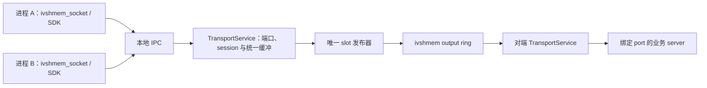
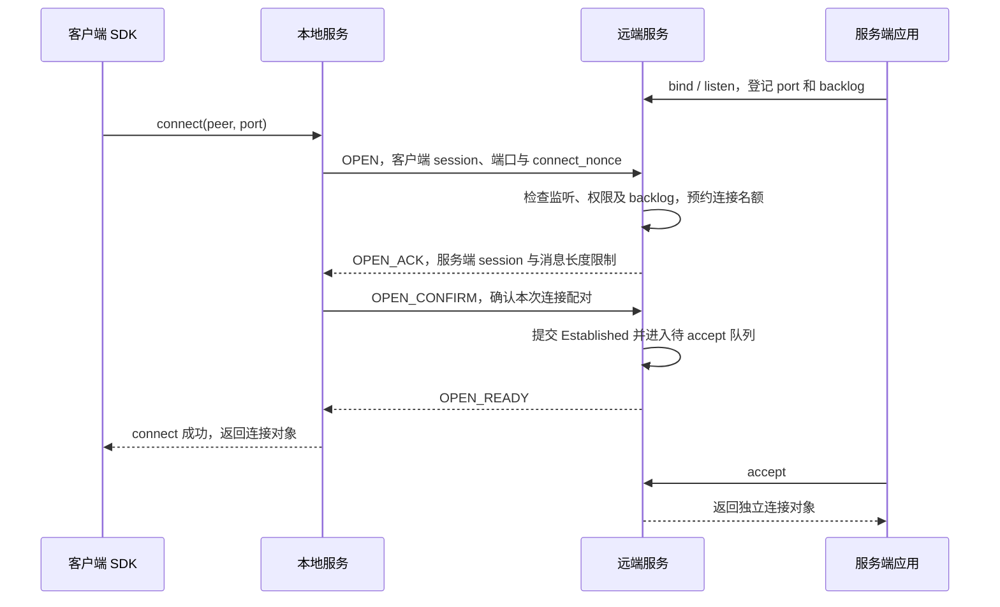
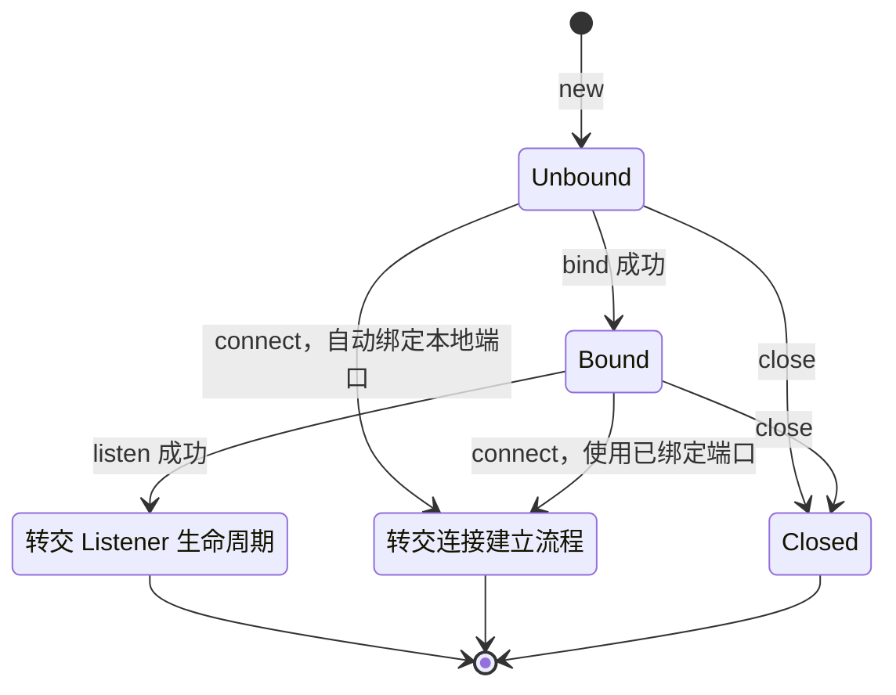
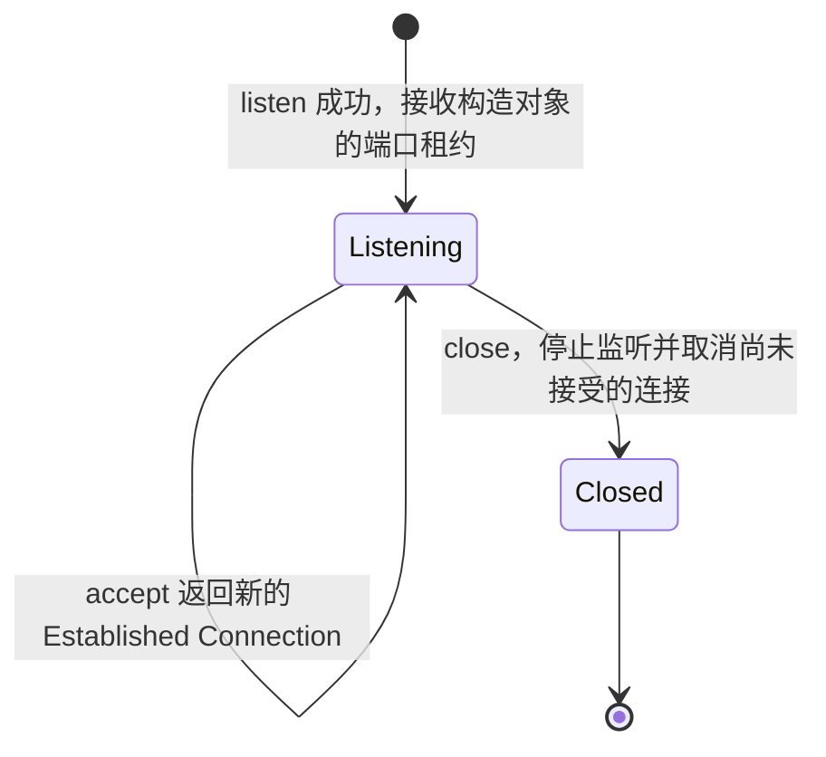
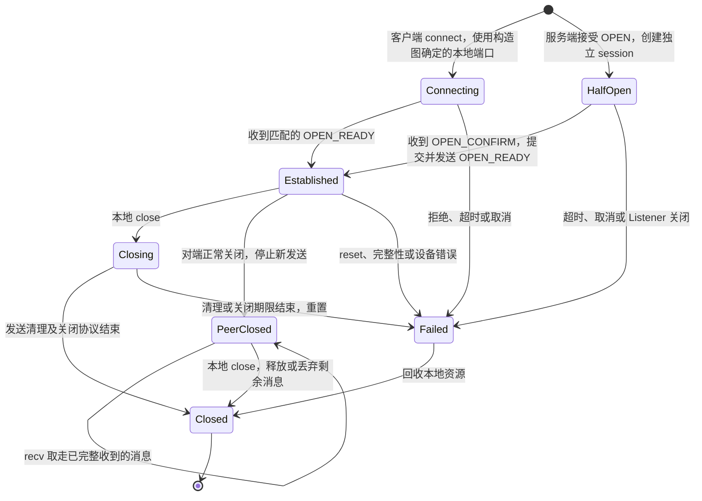
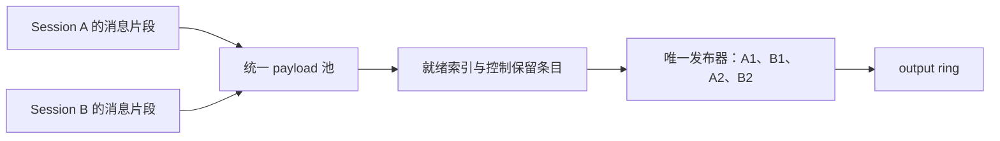
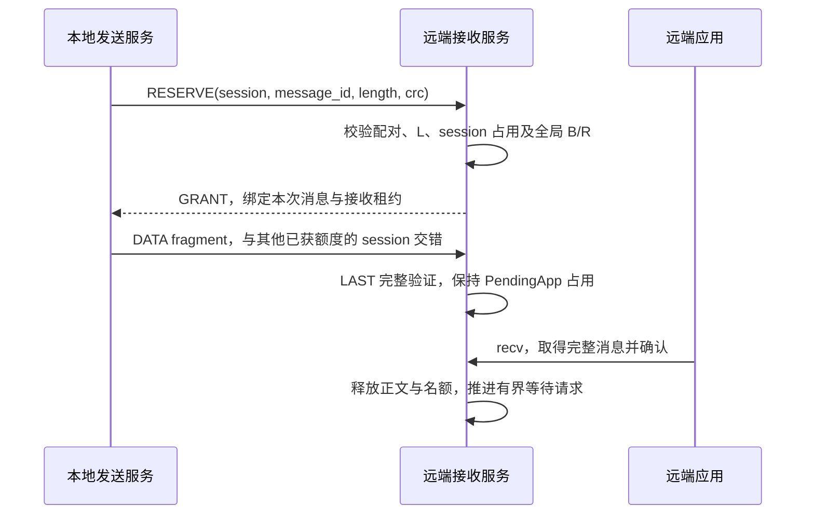
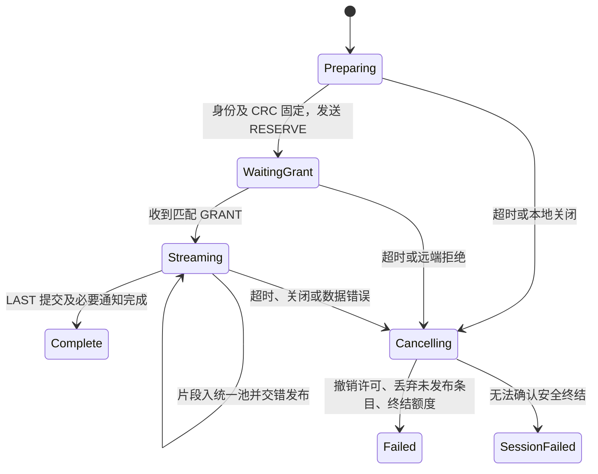
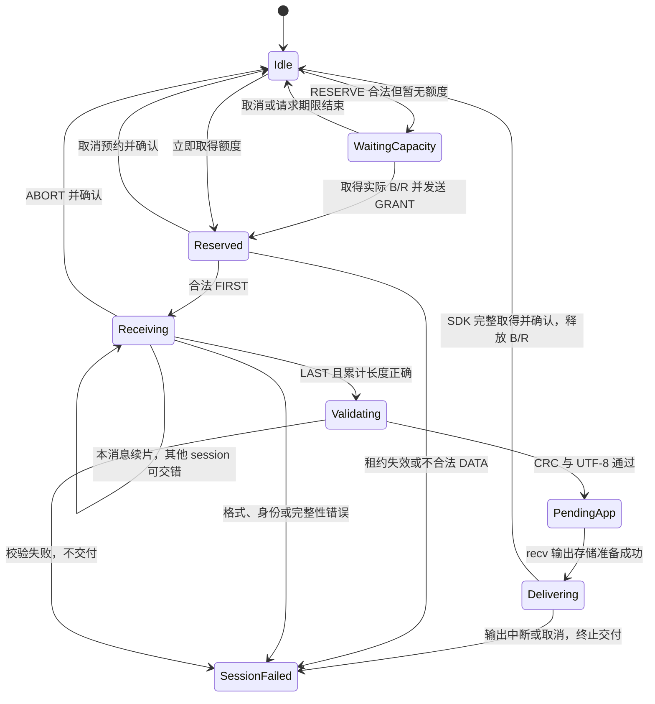

# axvisor-ivshmem：ivshmem_socket 设计

本文定义 `ivshmem_socket` 通信抽象，借鉴网络套接字的应用契约：port 定位监听入口，connect 建立 session，多个进程通过统一缓冲收发完整消息。本文是设计提案，接口示例、状态和协议字段用于表达目标契约，不以当前代码作为设计依据或完成证明。

## 1. 应用契约

应用通过 `ivshmem_socket` 使用 bind、listen、accept、connect、send、recv 和 close，不操作共享页、fragment 或 ring 索引。`ivshmem_socket` 是连接型、保留消息边界的通信对象，与 Linux TCP socket 和内部 IPC 的 Unix socket 区分，也不承诺 POSIX socket 的全部语义。

### 1.1 使用方式

服务器绑定本 guest 的逻辑端口，监听并接受连接；客户端指定同一链路中的远端 peer/port，connect 成功后获得已建立连接。每次 accept 返回独立的 `ivshmem_socket` 连接对象，监听对象继续接受其他连接。

```rust
let mut ivshmem_socket = IvshmemSocket::new()?;
ivshmem_socket.bind(9000)?;
let listener = ivshmem_socket.listen(backlog)?;
let connection = listener.accept()?;
let received = connection.recv()?;
connection.send(&reply)?;
```

客户端不必手工分配 session ID，未 bind 时自动分配本地端口。接口示例只表达拟议的调用方式，不绑定某个实现版本。

```rust
let ivshmem_socket = IvshmemSocket::new()?;
let connection = ivshmem_socket.connect(PeerAddr::new(2, 9000))?;
connection.send(&message)?;
let received = connection.recv()?;
```

自定义通信组件统一称为 `ivshmem_socket`；Rust 类型用 `IvshmemSocket`、`IvshmemListener`、`IvshmemConnection` 表达构造、监听和连接状态，listen/connect 消费构造对象，只有连接对象提供 send/recv。C 使用 opaque `ivshmem_socket` handle 表达相同操作和受检状态，不维护第二套协议。

### 1.2 消息语义

send 借用 `&str`，SDK 按字节分帧，不要求源字符串堆分配或先复制整条消息。recv 返回拥有完整 UTF-8 文本的 `ReceivedMessage`，包含 message ID 和来源地址；空字符串是合法消息，不表示连接结束。对端关闭使用独立的 PeerClosed 结果表达。

同一 session 的发送调用按整条消息串行，交付顺序与该 session 的发送顺序一致；不同 session 的 fragment 可以交错。不同 session 之间没有消息完成顺序保证。接收一条消息只交给一个本地调用者，不把半条消息作为成功返回。

send 成功指所有 DATA fragment 已发布且必要通知完成，不是仅进入本地缓冲，也不是远端应用消费确认。错误保留 None/Prefix/Complete 发布阶段、已发布字节和 slot 数；IPC 断开导致结果未取得时报告 Unknown。不会自动重发或声称具有 TCP 的确认、重传与字节流可靠性。

### 1.3 传输所有者

每个 guest 的每个本地 ivshmem 设备由一个 `TransportService` 独占。业务 server 是绑定逻辑端口的应用，不是这个设备服务；应用进程只获得本地 IPC 权限，不获得 raw BAR FD 或 output ring 的可写映射。



AxVisor 管理 guest 共享页权限和通知路由，设备适配层提供受控资源访问与 IRQ，传输服务负责协议调度，SDK 和 FFI 提供应用入口。每个 session 独立维护消息上下文，设备级发布器统一维护物理 ring，不能让不同连接互相覆盖重组状态。

## 2. 端口与连接

`PeerAddr { peer_id, port }` 定位同一设备链路内的应用入口，session 标识一次已建立连接。port 不是 PID，也不是操作系统 TCP/UDP 端口；进程可以拥有多个 `ivshmem_socket` 对象，一个 listener 可以接受多个来自同一 peer 的连接。

### 2.1 地址登记

port 使用 u16，监听时必须非零，bind(0) 表示请求服务分配实际端口。端口表归 TransportService，绑定权限由部署策略与 IPC owner 决定，冲突返回 AddressInUse；不隐含 Linux 特权端口规则，不提供 reuseport 或广播。本设计不支持本 guest 的 ivshmem loopback。

| 登记对象 | 权威信息 |
| --- | --- |
| 端口租约 | 实际 port、owner、绑定对象及仍引用该端口的连接 |
| Listener | port、owner、backlog、半开及待 accept 的连接 |
| Session | 本地 session ID、远端 peer/session ID、本地/远端 port、owner、状态 |
| 发送上下文 | session、message ID、总长、CRC、令牌、期限、入队及发布进度 |
| 接收上下文 | session、message ID、额度、接收偏移、CRC、正文缓冲及交付状态 |

本地 session ID 是非零 u64，由服务单调分配，本次设备运行中不复用，耗尽时拒绝创建。消息 ID 由设备级服务统一分配给 DATA 和 CONTROL，非零且不复用，不要求它们在交错发布时数值递增。端口租约直到引用它的绑定对象和连接释放才回收；端口最终复用也不会复用旧 session。

### 2.2 同 peer 多进程

peer1 的两个进程连接 peer2:9000 时，peer2 创建两个独立的接受连接，双方各自的 session ID 构成固定配对。数据按这个配对路由，不通过目的 port 猜测归属哪个连接。

| 连接 | peer1 地址与 session | peer2 地址与 session |
| --- | --- | --- |
| 进程 A | port 40001，session 17 | port 9000，session 31 |
| 进程 B | port 40002，session 18 | port 9000，session 32 |

A 的 DATA 携带 source_session=17、destination_session=31；回复使用 31→17，B 使用 18↔32。来源 peer 仍由 publisher section 确定。数据路由验证远端 peer/session 配对和本地 owner，应用不能修改来源身份或把别人已建立的 session 作为自己的发送目标。

### 2.3 建立连接

connect 必须等待远端服务确认监听入口和连接资源，不能只在本地保存地址。服务通过有界控制消息建立 session；以下握手是本协议的设计，不是 TCP wire protocol。



connect 成功不要求业务应用已调用 accept，但必须已经有 listener，且远端已提交连接状态。backlog 同时约束半开与待 accept 名额，耗尽返回 Busy，未监听返回 ConnectionRefused。connect_nonce 绑定本次尝试，过期响应不能复活已取消对象；半开连接使用各 guest 自己的单调时钟有限期清理，不比较跨 guest 的绝对时刻。

超时或客户端退出时取消本次 nonce；若远端 session 已知则关闭对应配对，未知时用客户端 session/nonce 清理半开记录。确认与取消竞争可以让远端短暂看到随后被重置的连接，但不能泄漏名额或把迟到结果交给新的 `ivshmem_socket` 对象。控制操作按连接身份和阶段幂等处理，不自动开启新的连接尝试。

### 2.4 对象生命周期

`IvshmemSocket`、`IvshmemListener` 和 `IvshmemConnection` 分别承担构造、监听和单连接通信，按对象拆开描述，避免把绑定状态、监听角色和 session 阶段放进同一个枚举。状态的权威记录仍由服务维护，应用只能通过句柄查询快照。

#### 2.4.1 ivshmem_socket 构造

`ivshmem_socket` 保留两种客户端用法：显式 bind 后 connect，或直接 connect 时自动绑定。listen 将已绑定的 `IvshmemSocket` 转交为 Listener；connect 则进入 2.4.3 节连接图对应的建立流程，成功后返回 Connection。



转交节点表示构造对象的角色及所有权转移，不是额外的长期 `ivshmem_socket` 状态；这里的结束符也不表示释放转交后的端口或 session。客户端两条路径汇合到同一个 Connecting 阶段，不维护两套握手。bind/listen 的校验错误通过操作结果返回，连接建立中的拒绝、超时和清理由连接图描述。

#### 2.4.2 Listener 生命周期

Listener 从 listen 成功开始存在，持续管理监听入口和待接受连接。收到 OPEN 时按 2.3 节建立独立 session；accept 取出其中已经 Established 的连接，返回新的 Connection 对象，Listener 自己仍保持 Listening。



握手尚未完成或 accept 队列为空时，accept 等待或按期限返回，不改变 Listener 的监听状态。close 会清理半开及尚未 accept 的连接；已经 accept 的 Connection 不随 Listener 关闭，继续持有自己的 session 和端口租约引用。

#### 2.4.3 Connection 生命周期

一条 Connection 逻辑上管理一个 Session，服务中的 session 状态驱动它的可观察连接状态，不维护另一份独立的连接状态事实来源。图中的 Connecting/HalfOpen 是服务内部在 SDK 返回 Connection 之前已有的记录：客户端由 connect 进入 Connecting，服务端通过 OPEN 检查后创建 HalfOpen。



客户端 connect 成功、服务端 accept 成功都向应用返回 Established 的 Connection，但服务端 session 可以在应用调用 accept 之前建立。尚未 accept 的 Established 连接仍属于 Listener 的待接受队列，Listener 关闭会重置它；accept 之后则进入独立生命周期。

Established 期间等待消息、发送空间或接收额度不退回 Connecting，具体进度由第 6 节的消息状态管理。PeerClosed 可以继续读取已有完整消息，排空后 recv 返回 PeerClosed 而不是空字符串；应用也可以直接 close 丢弃剩余消息，不要求先读完才能释放句柄。Failed 表示连接已经不可用，Closed 表示清理完成，不静默回到 Unbound 重连。

## 3. 统一发送缓冲

所有应用通过 IPC 向服务的一个有界发送缓冲生产片段，不为每个 session 建一个共享 ring。session 只保存身份、进度与调度索引，payload 来自同一个固定容量存储池。

### 3.1 本地 IPC

Linux 使用 pathname `AF_UNIX/SOCK_STREAM`，请求有明确长度、类型与请求 ID，不依赖 read/write 边界。IPC 客户端会话与线上 session 是不同对象：一个认证会话可以拥有多个 `ivshmem_socket` 对象，服务将所有句柄绑定该 owner，不相信客户端自报 PID 或 source_session。

权限与凭据遵循 Linux [unix(7)](https://man7.org/linux/man-pages/man7/unix.7.html) 的 Pathname socket ownership and permissions、SO_PEERCRED 条款。凭据是 connect 时的快照，不是每条消息的实时 PID。SDK 使用一个内部读取者匹配响应，按完整 IPC 帧串行写入；FD 使用 close-on-exec，不支持 fork 后继续使用旧会话。

本方案传输实际字节，不在应用与服务之间传递普通切片指针。正文经过 Unix socket 复制到服务，不需要应用映射共享缓冲，也不要求发送整条副本；共享内存直写并非本方案的前提。IPC 原生 socket 缓冲按会话数量另行预算，不能把服务缓冲容量当成全部内存上限。

### 3.2 缓冲条目

SDK 获得该消息的远端接收额度后，逐片发送原字符串。服务验证令牌、owner 和偏移，再将片段填入统一缓冲；未完整填充的预约条目也占容量，只有提交后的条目可以被消费者读取。

| 片段关联信息 | 用途 |
| --- | --- |
| `tx_ticket` | 绑定发送上下文、session、路由和远端额度 |
| `message_id` | 关联具体消息，不代替 session 身份 |
| `offset`、`len` | 校验本地顺序和有效字节数 |
| `payload` | 服务拥有的数据块，最多 196 字节 |

消息头信息归发送上下文，客户端不能逐片重填不同路由。统一缓冲中 DATA 容量为 Qd，另保留 Qc 个 CONTROL 条目；两者来自同一存储池，控制保留量不能被正文占满。消息可超过缓冲和 ring 容量，服务边接收边消费，不等待整条消息入队。

### 3.3 片段调度

发布器维护就绪 session 索引，按轮转选择各 session 的下一片段，不按混合 FIFO 的队首盲等。索引指向统一缓冲的条目，不是每 session 的另一份 payload ring；只发布同一消息的下一个 offset，不重排它自己的片段。



不同 session 的就绪片段可以交错发布；某个 session 暂时没有片段时，发布器选择其他就绪 session。等待额度的消息不能先占正文块；池满时未发布条目都已有远端额度，发布器可继续消费并释放本地空间。控制流按有界优先级处理，但同一连接遵守因果顺序，例如 OPEN_READY 先于该方向的 RESERVE；不能用优先级绕过前置状态。发布前复核 ticket/session 阶段，撤销后的候选不再发送。轮转仍保证就绪 DATA 有机会发布，不允许应用调用阻塞服务的接收、取消或关闭处理。

## 4. 接收容量与背压

交错发送的必要条件是接收端能保存多个 session 的前缀。message ID 只能关联数据，不能提供内存；本设计通过控制消息先预约接收额度，避免遇到 B-FIRST 无空间而挡住后面的 A-LAST。

### 4.1 资源上限

部署明确最大消息字节数 L、ivshmem_socket/session 名额 S、接收消息名额 R、接收正文预算 B、DATA 缓冲 Qd 和 CONTROL 保留 Qc，且 Qd、Qc 均非零。名额覆盖连接建立、在途、待应用消费和关闭过程，不只统计已完成调用。

每个 session 的每个方向最多一条 Reserved、Receiving 或 PendingApp 消息，加一个有界待预约请求。整个服务在所有 session 间共享 R 个消息名额和 B 字节，不固定为每个 session 预分配 L。空消息仍占一个消息名额，申请长度检查 u64/usize 转换及溢出。

端口、backlog、IPC 会话、等待请求、错误记录和控制输出也有上限。接收内存是 Receiving 与 PendingApp 的统一预算，不能将完成消息挪到无界应用队列后立即伪称额度已释放。

### 4.2 消息额度

服务为 send 分配设备级 message ID 和固定 session 配对，SDK 从源字符串计算 CRC，然后请求远端预约。远端在实际存储和名额取得成功后才发送 GRANT，发送端看到匹配的 GRANT 才准入该消息正文。



容量不足时保留该 session 的一个预约请求或返回明确拒绝，不阻塞 ring 扫描，不允许未获额度的 FIRST 入场。重复 RESERVE 只能返回同一额度或原终态，不能重复分配。等待公平调度，并有期限；租约失效导致 session 重置及明确失败，不能静默释放后仍接收旧 DATA。

接收租约只约束 Reserved/Receiving 阶段，到 PendingApp 后停止传输租约计时，完整消息保留到应用消费或本地关闭，不能因发送调用期限结束而静默回收。正常释放不跨 session 借用额度：上一条 PendingApp 未消费时，本 session 的下一条消息等待，但其他 session 在预算允许时继续。ABORT 或取消通过确认终结该预约，下一条消息不能依赖“控制消息已入队”就假定旧额度回收。slot 的 `credit[15]` 仍只控制物理槽位，不替代 B/R。

## 5. Message V2

拟议 Message V2 使用 44 字节 header 和 196 字节 fragment，承载 session、控制消息及 CRC。底层 section/slot 布局按本文约定，版本不兼容的参与者不能混用。

### 5.1 帧头

每 peer 的 output section 规定为 4096 字节，包含 256 字节 metadata 和 15 个 256 字节 slot；slot header 占 16 字节，payload 为 240 字节。V2 整数显式 little-endian 编码，不复制 Rust struct 布局。

| 字节范围 | 字段 | 含义 |
| --- | --- | --- |
| 0 | version | 2 |
| 1 | flags | FIRST=1、LAST=2、ABORT=4、CONTROL=8，其余位为零 |
| 2..3 | header_len | u16，44 |
| 4..7 | fragment_len | u32，0..196 |
| 8..15 | message_id | u64，当前 DATA 或 CONTROL 的唯一 ID |
| 16..23 | message_len | u64，完整正文长度 |
| 24..31 | source_session | u64，来源端本地 session ID |
| 32..39 | destination_session | u64，目的端本地 session ID |
| 40..43 | message_crc32c | u32，消息描述和正文的 CRC32C |
| 44.. | fragment | 最多 196 字节 |

DATA 两端 session 非零且必须匹配已建立配对；来源 peer 从 section 得到，目的 peer 使用 slot.dst。控制帧必须 FIRST|LAST|CONTROL、单片且长度一致，不接受 CONTROL|ABORT。session 0 只表示服务控制入口：OPEN/CANCEL_OPEN 可发往 0，拒绝 OPEN 的响应可从 0 发出，其他连接控制使用已知配对。应用数据不使用 0 或 BROADCAST。

### 5.2 控制消息

CONTROL 正文按固定宽度字段编码，首字节 opcode，最大 196 字节，不进行应用文本解码。完整校验通过后才解释 opcode、端口、nonce 或额度，所有操作校验 session 所有权、连接阶段与来源配对。

| 控制类别 | 必要操作与语义 |
| --- | --- |
| 建立 | OPEN、OPEN_ACK、OPEN_CONFIRM、OPEN_READY、OPEN_REFUSED、CANCEL_OPEN |
| 额度 | RESERVE、GRANT，正文引用 DATA message ID、总长及 CRC，绑定已建立配对 |
| 取消 | 首片前 CANCEL_SEND 及确认；已发布前缀用 DATA ABORT 及终结确认 |
| 关闭 | CLOSE、CLOSE_ACK；无法正常终结时 RESET |

控制帧自己的 message ID 与正文引用的 DATA ID 不混用。OPEN 还携带双方 port、connect_nonce 和消息长度限制，限制按方向取双方可支持值；控制重放或重复处理由引用的连接/消息身份及阶段判定，不靠反复分配新对象恢复。

section version 约定为 2，建立链路时检查版本、容量及 profile，拒绝不兼容 peer。profile 与版本必须统一，不能把旧 V1 的 FIRST 或保留 flags 默认为新控制消息。

### 5.3 CRC 与帧规则

CRC32C 使用 [RFC 4960 Appendix B](https://www.rfc-editor.org/rfc/rfc4960#appendix-B) 的 Castagnoli 多项式，反射多项式 `0x82f63b78`，初值及最终异或 `0xffffffff`；`123456789` 得到 `0xe3069283`。CRC 检测偶发损坏，不是认证或恶意篡改防护，连接授权仍由可信服务和设备权限保证。

校验输入为 37 字节描述加完整正文：`class:u8`（DATA=0、CONTROL=1）、`source_peer:u16`、`destination_peer:u16`、`source_session:u64`、`destination_session:u64`、`message_id:u64`、`message_len:u64`。CRC 不包含自身；版本、header_len、flags 组合和各片长度按解码规则独立检查。

DATA 的固定元信息和 CRC 必须与已验证的 RESERVE 一致，每片长度符合剩余字节与 196 的边界，零长 DATA 是 FIRST|LAST。ABORT 只有零字节 fragment，沿用被取消消息的总长、身份及预期 CRC，不把前缀当完整正文校验。正文按原次序追加，LAST 才验证总长、CRC 和 UTF-8。

SDK 在取得 message ID 后预扫描原字符串计算 CRC，再经 IPC 发送，源字节读取两遍但不建立整条副本。发送服务也增量核验，错误末片不发布 LAST。校验/元信息错误不交付正文并使可确定的 session 失败；损坏字段不能可靠归属时按已知来源 peer 失败处理，不将错误归给猜测的应用。

## 6. 消息状态与发布

服务维护每 session 的发送和接收上下文，message ID 关联其中一次操作，不用一个设备级或 publisher 级消息上下文承载所有连接。共享对象由服务单一所有，SDK 的排队进度不是线上发布进度。

### 6.1 发送状态

send 等待同 session 的上一发送调用结束，完成身份分配、CRC 和额度申请后进入流式生产。客户端等待的总期限覆盖排队、CRC、额度、IPC 和发布，重试不重置期限；各 guest 的租约使用各自单调时钟。



终止与 slot 提交在服务的短状态提交边界决定先后。None 只需取消未使用预约，Prefix 必须 ABORT/确认，Complete 不再 ABORT；取消先停止该 ticket 的新入队并丢弃未发布条目。无法终结时关闭该 session，不继续发其下一条消息；其他 session 不因某条消息仍有前缀而被禁止正常交错。

send 返回后 SDK 不访问源引用，服务只持有已复制的字节和清理状态。客户端丢失结果返回 Unknown，不据此猜测零发布；RPC 结果不能由 Unix socket write 完成替代。通知失败保留真实发布阶段，LAST 提交后即使通知失败仍为 Complete。

### 6.2 单 slot 发布

唯一发布器从统一池选择一个就绪片段，构造 header 并处理一个 slot；片段 Full 时保留候选及其所属上下文，不推进该消息的 published offset。真正需要排他的范围是 slot 的写入、Release 发布和对应进度提交，不是整条消息。

共享 slot 的 payload 约定为 240 字节，按对齐的 32 位原子单元访问。header 和 fragment 分段写入，不将并发共享区域当作普通独占字节切片，也不额外拼接整帧临时副本；此访问契约不依赖某个语言类型或结构体布局。重复 Full 检查不能重复计入 CRC，候选增量状态只在该 slot 发布成功时提交。

通知、IPC、等待和完整字符串分配不在 ring 核心锁内。发布器与独立接收任务协调短状态边界，接收不取整消息发送门控；适配层明确共享页发布到 MMIO doorbell 的排序。单 publisher 的 tail/seq 仍唯一维护，多个 session 不能各自自增公共 tail。

### 6.3 接收状态

接收先验证 CONTROL 并建立预约，随后 DATA 在 `(source_peer, source_session, message_id)` 对应的上下文中按顺序重组，并验证目的 session 配对。每个方向只允许一条已获额度消息，多个 session 独立推进，不用一个 publisher 级状态互相覆盖。



接收任务持续扫描 slot：非目的数据推进 credit，目的 DATA 使用已预约存储，CONTROL 使用保留的小消息处理空间。PendingApp 不暂停整个 publisher，其他 session 的合法数据和控制消息继续消费。未获额度、超 L 或未知有效配对的 DATA 是协议错误，不能在 ring 头无限等待内存。

recv 先得合法长度，SDK 分配 String 成功后才请求正文；申请失败不移除 PendingApp，等待超时不重置合法前缀。服务以有界 IPC 帧输出，SDK 完整取得消息后确认并释放额度。正文交付前超时保留 PendingApp；进入正文输出后若 IPC 失败或调用取消，终止该 session、释放交付对象并返回错误，不在仍为 Established 的连接上重投可能已取得的消息。SDK 提交完整结果与超时判定互斥，连接或 owner 关闭的释放责任唯一，不能借消费确认交给两个调用者。

## 7. 生命周期与部署

`ivshmem_socket` 的建立、关闭和端口复用都在设备服务生命周期内进行，不重新初始化物理 ring。session ID 不复用保证迟到数据不会进入新连接，CRC 不能替代这项生命周期约束。

### 7.1 连接关闭

本地 close 停止新发送、有限期终结已发布前缀并发送 CLOSE。对端停止该配对的新发送，清理未完成消息并确认；已经完整接收的消息可先由本地 recv 排空，随后返回 PeerClosed。接收存储保留到本地应用取走或关闭句柄，不要求远端 close 等待业务消费。

若取消、关闭、租约或设备故障不能安全结束，RESET 并返回明确错误；连接关闭不自动重连。迟到的旧 session 数据被跳过并推进 slot credit，不重新创建 session。应用 IPC EOF 时回收其所有未绑定对象、listener、连接、请求和额度，不影响其他 owner 的端口登记。

listener 的端口租约可被已 accept 的连接继续引用，关闭 listener 不误杀这些连接。SDK 状态查询返回服务快照，关闭和等待者唤醒在状态发布后进行；不可留下看似 Established、实际永远不能完成的请求。

### 7.2 设备契约

服务先取得独占租约、验证 profile、准备有界存储和接收推进、初始化 section，再发布 READY。本设计选用无 Common 的 Message profile：state 表占 offset 0 的 4096 字节，output 从 4096 开始、stride 4096；启动时核对实际设备配置，不按 BAR2 总长或其他 profile 的示例猜布局。全体静态 peer 统一 V2 前不开放连接。

设备映射必须限定 BAR2 自己 output 可写、其他 output/state 只读、Reserved 不映射；BAR0 是通知 MMIO，BAR1 MSI-X 由内核管理。设备适配层必须提供受控映射与事件通知，并明确普通用户授权、独占租约、缓存一致性、映射偏移、映射生命周期及中断撤销契约，不绑定具体模块名称或资源访问入口。

关闭服务先停止准入、唤醒等待、有限期终结连接，再停止访问任务、撤回 READY、解除映射和租约。崩溃或 peer reset 不自动重新附着旧链路，重建前停止旧参与运行，不在存活读者下清零。普通应用不能绕过服务操作设备，模块契约未证实前不得宣称具备生产隔离或失效安全。

### 7.3 软件交付

可复用协议核心负责 V2 编解码、CRC、连接及消息状态规则，保持 `no_std`，固定容量或受检存储由适配层提供。Linux 服务管理资源和 IPC，ArceOS 用任务适配相同的 `ivshmem_socket`/连接核心，不把 Unix socket 依赖带入协议层。

Rust SDK 和 C FFI 在本仓库统一维护。C 使用 opaque ivshmem_socket/message handle、指针加长度、固定宽度地址和结构化错误，头文件从 FFI 定义生成；输入 UTF-8 校验、调用期有效且不可修改，返回后不保留源指针。收到的完整消息由 handle 拥有，只读指针有效到释放，销毁不与使用并发，不暴露 Rust enum/slice 布局或跨 ABI panic。

静态库按 guest 目标构建，镜像不用安装 Rust 编译器。部署产物应包含传输服务、客户端、本地 IPC 权限配置及匹配 guest 内核的设备适配模块，并先启动服务再启动应用；初始化文件系统或根文件系统的打包方式不影响协议契约。只有设备资源契约不足时才需更新适配模块与镜像，SDK 变更本身不要求重建 Linux 内核。

## 8. 审查与验收

本设计选择 `ivshmem_socket`、真实 session 建立、统一缓冲和跨 session 交错，不要求一条消息独占整个设备的发布流程。它没有增加 TCP/IP 栈、同 session 多消息交错、重传、自动发现、reuseport、半关闭或应用直写共享队列。

### 8.1 迁移边界

底层 section/slot 与上层消息格式分层，消息协议使用 V2、独立 session 上下文和调度；控制额度通过控制消息表达，不额外增加共享 metadata 字段。所有 Rust/C demo、profile 与测试参与者统一迁移，不与 V1 混跑；回滚先停止整次运行再恢复旧程序与 profile。

| 边界 | 必要变更 |
| --- | --- |
| ring 核心 | section version 2、header/fragment 分段发布，保持索引布局 |
| 协议核心 | session 握手、44 字节 header、CONTROL、CRC、额度及多 session 状态 |
| 服务 | 端口租约、认证 owner、统一缓冲、就绪调度、独立接收推进 |
| SDK/FFI | ivshmem_socket 构造、bind/listen/accept/connect/send/recv/close、状态与结构化错误 |
| 应用与打包 | 两个同 peer 客户端、业务 server、服务启动及统一生成产物 |

连接、控制协议和并发生命周期属于高风险设计，实施前需要合格领域审查人确认，尤其复核半开清理、额度撤销、关闭竞争和共享内存发布证明。设计约定不等于完成证据，设备资源契约和目标运行必须独立验证。

### 8.2 行为证明

验证按完整行为组织，覆盖 ring 环绕、slot 背压和帧规则，不以某一版测试或替身协议自测代替设计验收。宿主组件测试负责编解码和确定性状态，真实进程/guest 负责 IPC、调度、资源和跨语言装配。

| 行为风险 | 层级与必须判定 |
| --- | --- |
| 连接与路由 | 组件及真实进程：端口冲突/拒绝、握手取消、两个同 peer 客户端连接同一 port，响应只回对应 session |
| 交错与完整性 | 协议组件：强制 A-FIRST、B-FIRST、A-LAST、B-LAST，独立重组和 CRC，破坏任一身份或正文不得交付 |
| 容量与推进 | 组件及 QEMU：B 无额度时 A 仍可完成；PendingApp 不挡其他 session；统一池满时控制与消费能推进 |
| 取消与关闭 | 确定性状态及真实进程：GRANT/LAST/EOF/关闭竞争不重复释放，旧 session/nonce 不作用于新对象 |
| ivshmem_socket 消息接口 | SDK/FFI：跨片 Unicode、空消息、超过 ring/统一池容量的消息；消息边界、同 session 顺序和 PeerClosed 可区分 |
| 真实装配 | QEMU：生成 C 头文件链接同一 Rust 库，服务及多个客户端跨 guest 双向收发，V1 在建立期拒绝 |

实施验证应覆盖格式化、静态检查、协议组件、真实 IPC、跨语言互操作和 QEMU 场景，并使用项目统一验证入口执行。本文规定必须证明的行为，不绑定测试文件或测例名称。本次仅检查文档结构、引用、字段算术与契约一致性，不运行 Rust 构建或 QEMU；性能需另记录同一负载下 IPC 复制、CRC 双遍读取、额度等待、尾延迟及通知数，不能宣称零拷贝或完全背压隔离。
