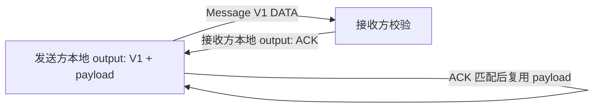

# TGOSKits ivshmem 板卡迁移设计

本设计限定 issue #2720 / PR #2239 的迁移边界。应用通过各 guest OS 的设备接口访问 IVC，不接触 raw PCI/BAR、MSI-X、Message V1 ring 或 link/peer provisioning。TGOSKits 拥有设备、驱动、协议、payload 映射和生命周期；tgosimages 只使用同一份 TGOSKits 源码构建并发布 StarryOS、Zephyr 和 rootfs 产物。

当前 AArch64 AxVisor QEMU 已验证 Starry、ArceOS、Linux 和 PCI 设备用例。Orange Pi 实体板卡已完成 Zephyr 向 StarryOS 发送 256 KiB、512 KiB、1 MiB 和 10 MiB 载荷的 benchmark。StarryOS 对每次传输校验内容并回送 ACK，两侧分别报告通过。

产品目标是在同一经宿主配置的 ivshmem 通信组内允许多个客户机查询可见 peer，并选择通信对象建立独立会话。固定 Zephyr-Starry 双端是当前已验收 profile，用来证明设备与 Message V1 基线，不代表多 peer 目标已经实现。应用继续通过句柄调用 `ivc_send()`、`ivc_recv()` 和 `ivc_close()`，大块 payload 按会话保留。`ivc_open_peer` 只是待实现名称示例，具体签名和 PCI capability 结构由实现阶段决定。多 peer Message V1 目前尚未实现。

## 1. 目标与当前边界

迁移涉及的设备 ABI、PCI 身份、共享状态和平台输入必须独立验收。源码存在只能证明相应层已实现，不能替代客户机运行、真实中断或实体板卡证据。

### 1.1 应用与设备 ABI

#2239 的统一应用 record 入口是公共头 [`ivc.h`](../../apps/common/ivc/include/ivc.h#L1)。它声明不透明句柄 `struct ivc` 以及 `ivc_open()`、`ivc_send()`、`ivc_recv()`、`ivc_close()`，并固定 `IVC_MAX_RECORD_BYTES = 48` 和 `IVC_MAX_TIMEOUT_MS = 60000`。Linux、StarryOS 和 Zephyr 的 C 适配器使用同一组名称和语义；ArceOS 的 safe Rust 入口保留同名 [`ivc_open()`](../../apps/arceos/ivshmem-pci/src/ivc.rs#L825)、[`ivc_send()`](../../apps/arceos/ivshmem-pci/src/ivc.rs#L837)、[`ivc_recv()`](../../apps/arceos/ivshmem-pci/src/ivc.rs#L876) 和 [`ivc_close()`](../../apps/arceos/ivshmem-pci/src/ivc.rs#L910)，以类型化 `Result` 报告错误。统一流程先调用 [`IvcDevice::discover()`](../../apps/arceos/ivshmem-pci/src/ivc.rs#L199) 按设备报告的 peer ID 得到 role，再以 `ivc_open(&mut device)` 借用该设备创建 session；`IvcDevice::open(role)` 只服务旧的跨 fragment record 流。公共头只定义应用 contract，不包含 PCI、BAR、MSI-X、MMU、Message V1 ring 或 session incarnation 的实现。

保留同一 `ivc.h` 名称和 `ivc_*` 语义比按 OS 重命名头文件更适合移植：同一份应用或示例源码只需替换目标实现并重新链接，不必维护条件编译的头名和符号名。直接公开 `axivc` Rust crate、Message V1 record 或 ring 类型会把应用绑定到内部 wire 实现，也会迫使 C 应用引入 Rust 对象模型。四端共享的是稳定的应用操作 contract，设备发现、映射所有权、通知和清理仍由各自适配层负责。

当前公共 [`ivc_open()`](../../apps/common/ivc/include/ivc.h#L46) 接收一个不透明句柄输出，不接收目的 peer。ArceOS 的 [`IvcDevice::discover_two_peer()`](../../apps/arceos/ivshmem-pci/src/ivc.rs#L229)、StarryOS 的 [`REQUIRED_PEERS` 校验](../../os/StarryOS/kernel/src/pseudofs/dev/axivc_ivshmem.rs#L351) 和 Zephyr 的 [`max_peers` 校验](../../apps/zephyr/ivshmem/src/tgos_ivc_zephyr.c#L478) 限定了当前单对端实现的范围，本文记录的 `ivc_*` 双端行为以此为准。

所有 C 调用成功返回零或正的 record 长度，失败返回负 errno；一次成功的 `ivc_send()` 发布一条完整的 `1..IVC_MAX_RECORD_BYTES` record，`ivc_recv()` 返回 `1..48` 的正长度。`timeout_ms == 0` 执行一次非阻塞尝试，`1..IVC_MAX_TIMEOUT_MS` 给出包含必要 peer handshake 的上界，负数或超过 `60000` 返回 `-EINVAL`。同一个句柄上的所有调用，包括 close，都由调用方串行化；`ivc_open()` 可以在 peer 启动前成功。

接收缓冲不足时，`ivc_recv()` 返回 `-ENOSPC`，下一条 record 保持不变且不消费。确认 session reset 后返回 `-EPIPE`，该句柄的后续操作继续报 `-EPIPE`，直到关闭并重新打开。`ivc_close()` 无论成功还是报告清理错误都消耗句柄，调用方不得重试同一个指针。

统一头不意味着四端功能完全对等。下表给出各端的设备边界和构建绑定；同一个 guest 镜像只能打包它自己的实现，避免把 Linux 静态库送入 Zephyr、把 Zephyr module 送入 StarryOS，或在 ArceOS 中重复链接另一套 session 状态。

| 端 | 设备边界与 Rust/C 入口 | 构建或链接入口 |
| --- | --- | --- |
| ArceOS | 统一路径由 [`IvcDevice::discover()`](../../apps/arceos/ivshmem-pci/src/ivc.rs#L199) 得到 role，再以 [`ivc_open(&mut device)`](../../apps/arceos/ivshmem-pci/src/ivc.rs#L825) 借用设备；safe `ivc_*` 操作返回 `Result`，不把 errno 暴露给应用。旧分片流保留 [`IvcDevice::open(role)`](../../apps/arceos/ivshmem-pci/src/ivc.rs#L213) | 应用依赖 [`arceos-ivshmem-pci`](../../apps/arceos/ivshmem-pci/Cargo.toml#L1)，由 Cargo 构建并链接 Rust 实现 |
| StarryOS | `/dev/axivc0` 自动选择唯一 native pair；[`ivc_open()`](../../apps/starry/ivshmem/src/starry_axivc.c#L99) 只打开 fd 并分配句柄，[`starry_axivc_payload_get()`](../../apps/starry/ivshmem/src/starry_axivc.c#L124) 才执行 payload ioctl、mmap 和 generation lease；C 应用只持有 `struct ivc` | 现有 [`apps/starry/ivshmem/Makefile`](../../apps/starry/ivshmem/Makefile#L1) 生成设备对象并链接静态应用，或链接同目标的现成实现；不发布 `libaxivc.so` |
| Zephyr | native Zephyr device 绑定 PCI/MMU/MSI-X；[`ivc_zephyr.c`](../../apps/zephyr/ivshmem/src/ivc_zephyr.c#L1) 把统一 C ABI 接到现有 `tgos_ivc_*` session | [`module.yml`](../../apps/zephyr/ivshmem/zephyr/module.yml#L1) 和 [`CMakeLists.txt`](../../apps/zephyr/ivshmem/CMakeLists.txt#L1) 构建 native module、公共头路径和 Rust static adapter；原有 tgosimages Zephyr module/sample 构建继续使用该 module |
| Linux | UIO ivshmem 适配器验证 PCI profile、映射 BAR0/BAR2、取得进程 writer lock，并在关闭时 invalidate incarnation | 既有 `liblinux_ivc.a` 通过 [`ffi.rs`](../../apps/linux/ivshmem/message-peer/src/ffi.rs#L383) 导出 `ivc_*`；[`ivc_abi_contract.c`](../../apps/linux/ivshmem/message-peer/tests/ivc_abi_contract.c#L1) 用 C11 公共头直接编译并链接静态库，不从 StarryOS 的 ioctl 接口推断行为 |

统一 `1..48` record 接口承载控制消息，不替代大块 payload。StarryOS 的 [`starry_axivc_payload_get()`](../../apps/starry/ivshmem/src/starry_axivc.c#L124) payload mapping，以及 Zephyr 的 `tgos_ivc_write_payload()`、`tgos_ivc_read_payload()` 和容量查询继续独立存在；benchmark 通过 payload 窗口传数据，再用短 record 发布 DATA/ACK 或状态。ArceOS 既有 `MessageRecordEndpoint` 仍保留跨多个 Message V1 fragment 的 record 流，[`APP_MAX_MESSAGE_LEN`](../../apps/arceos/ivc_subscriber/src/lib.rs#L16) 的 `7484` 字节及 `7424`、`7484` 边界继续由 `ivc-arceos`、`ivc-local` 等原系统用例覆盖，这些旧流仍使用 `IvcDevice::open(role)`，不能把它们改写成 `ivc_send()` 的 48 字节 record。四端在短 record contract 上同名同语义，不代表大块 payload、分片、恢复或通知能力全部对等。

该统一接口不重写既有二进制，不修改内核 ABI，也不修改 Message V1 wire。迁移旧 Linux 源时，原来包含 `linux_ivc.h` 或调用 `linux_ivc_*` 的应用改用公共 `ivc.h` 和 `ivc_*` 后，必须重新编译并链接对应的 `liblinux_ivc.a`；仍调用旧符号的二进制不能与新库混装。既有镜像中的旧二进制继续与匹配的实现和归档一起运行。

新的 native 自动端点入口仍是 `/dev/axivc0`，提供单通道 `open`、`read`、`write`、`poll` 和 `close`。它不需要 `axivc.link`，当前只支持一个有明确设备身份的 exclusive static pair，属于当前已验收 profile。peer 未启动时 open 可以成功而数据操作返回 `EAGAIN`。旧 manager `/dev/axivc`、`axivc.link=<key>:<publisher-vm-id>` 和 v2/HVC 后端继续保留给旧 fixture，不能与新自动 pair 混用。

StarryOS payload ABI 使用 `_IOR('I', 6, 40)`，编码值为 `0x80284906`，返回五个 `u64`：`version`、`generation`、`local_offset`、`peer_offset` 和 `payload_size`。`local_offset = 0` 映射本端可写 payload，`peer_offset = 0x10000000` 映射对端只读 payload；两者初始 `mmap` 和后续 `mprotect` 都禁止写对端或增加 `PROT_EXEC`，策略检查见 [`axivc.rs`](../../os/StarryOS/kernel/src/pseudofs/dev/axivc.rs#L53) 与 [`axivc_ivshmem.rs`](../../os/StarryOS/kernel/src/pseudofs/dev/axivc_ivshmem.rs#L1)。

每个 payload mapping 通过 generation lease 保持 backing 生命周期。旧 VMA 全部拆除前，新的 `open` 返回 `EBUSY`；旧 generation 不获得新 backing。Message V1 ring 和状态页始终私有，用户态只看到页对齐协议区之后的 payload。映射决议来自设备持有的 physical range，而不是把 kernel VA 泄漏给用户态。

### 1.2 PCI 身份

AxVisor 设备以 `VID:DID = 1af4:1110` 和 vendor-specific class `ff0000` 枚举。原有 non-cacheable 路径使用 revision 1 与 transport protocol `0x4000`。revision 1 是既有预构建 Linux UIO 模块的硬要求。当前生产 write-back 路径改用 revision 2 与 `0x4001`，让旧驱动在接触 BAR2 前拒绝新 profile。

严格门禁要求 capability ID `0x09`、长度 36、版本 1、magic `AXIV`、peer epoch feature 和对应的 class revision/protocol 组合全部匹配。`bar2_transport()` 把策略编码为 revision 1 + `0x4000` 或 revision 2 + `0x4001`，[`policy_for_profile()`](../../drivers/ax-driver/src/pci/ivshmem.rs#L318) 只接受这两个成对值。交叉组合、缺少 capability 的 classic QEMU 设备和未知协议都必须被拒绝，见 [`ivshmem.rs`](../../drivers/ax-driver/src/pci/ivshmem.rs#L23)。

### 1.3 共享状态与生命周期

BAR2 第一页是只读状态表，host peer epoch 位于偏移 `0x100`，peer 间隔 8 字节。host 将每个 epoch 作为 little-endian `AtomicU64` 发布，guest 使用 acquire 语义读取；该表不从 guest-owned output 推导，也不允许 guest 写回，见 [`layout.rs`](../../virtualization/axdevice/src/ivshmem/layout.rs#L118)。

reset、stop 或 detach 只更新 host 状态和 epoch，不覆盖 guest-owned output。epoch 的 release-store 与 link 状态更新在 host lock 内串行；锁释放后才调用 sink，并通过合并后的单向量 MSI-X 投递通知。受影响 FD 观察到 `HUP`，后续 I/O 返回 `EIO`。

同一保留 slot 可以在 warm reset 后重新 attach。slot 一旦完全 retired，在整个 link teardown 前必须阻塞，不得复用，也不得把逻辑关闭当作 backing 已可回收。状态转移和 sink 通知顺序由 [`IvshmemLink`](../../virtualization/axdevice/src/ivshmem/link.rs#L278) 约束。

## 2. 消息与载荷

应用只传递逻辑 record 和 payload；设备层负责 Message V1、session incarnation、doorbell、MSI-X 和 ACK 生命周期。

### 2.1 owner output

每个 peer 的 output 前部是私有 Message V1 ring，页对齐区之后才是应用 payload。发送方写自己的 output，接收方只读对端 output 并在自己的 output 发布 ACK；接收方不清除发布者 output。该顺序同时约束协议页隔离和 payload 复用。



ACK 必须匹配 frame 类型、case、iteration、长度、checksum 和累计字节数，发送方才能复用本端 payload。ArceOS 设备 record 适配器在结束 record 前等待 `outbound_drained()`，避免只完成本地 publish 就报告成功，见 [`record.rs`](../../apps/arceos/ivshmem-pci/src/record.rs#L1)。驱动把对端 peer ID 写入 doorbell 高 16 位，低 16 位编码通知向量，当前使用向量 0。

### 2.2 benchmark 负载

benchmark 使用 256 KiB、512 KiB、1 MiB、10 MiB 四档，每档 100 次，并逐次校验确定性 payload、checksum、顺序和 total bytes。共享帧与 ACK 规则位于 [`tgos_ivc_app.h`](../../apps/zephyr/ivshmem/samples/common/tgos_ivc_app.h#L1)，Zephyr producer 和静态 Starry consumer 分别由 [`benchmark`](../../apps/zephyr/ivshmem/samples/benchmark/src/main.c#L1) 与 [`ivc_starry_bench.c`](../../apps/starry/ivshmem/src/ivc_starry_bench.c#L1) 实现。

StarryOS 接收端在 DATA 通知到达后、ACK 发出前调用 `verify_payload()`。该函数先按 chunk 用一次 `memcpy` 把 peer BAR2 快照到本地 `actual` 缓冲，随后 `tgos_ivc_verify_chunk()` 对本地缓冲区计算校验和并与确定性期望值逐字节比较。共享区由 transport capability 选择 Normal-NC 或 Normal-WB，payload 只在快照阶段读取。这个顺序利用 ACK 前发送方不能复用 payload 的协议约束，见 [`ivc_starry_bench.c`](../../apps/starry/ivshmem/src/ivc_starry_bench.c#L162) 与 [`tgos_ivc_app.h`](../../apps/zephyr/ivshmem/samples/common/tgos_ivc_app.h#L271)。

Zephyr 示例在首次写入 payload 前调用 `tgos_ivc_wait_ready()`，通过设备等待对端完成 Message V1 握手。该调用有超时，应用层的 record 和 ACK 格式保持一致。见 [Zephyr 设备接口](../../apps/zephyr/ivshmem/include/tgos_ivc.h#L38)。

旧 16 MiB benchmark 窗口只作为 before 基线。迁移后应用从设备返回的 capacity 推导可用 payload，不能假定 BAR2 或 payload 固定大小。

## 3. 应用适配

各 OS 复用同一 `axivc` Message V1 和 payload 语义，但只在各自设备边界内暴露 API；应用不复制 codec、ring layout 或 lifecycle 状态。

### 3.1 消费者职责

消费者只处理 record、payload 与 ACK；PCI、MMU、MSI-X、epoch 和 backing 生命周期由设备适配层独占。C 消费者共享 [`ivc.h`](../../apps/common/ivc/include/ivc.h#L1) 的短 record 入口，ArceOS 使用语义对应的 Rust safe API；大块 payload 和旧跨 fragment record 流继续走各自的既有路径。

| 消费者 | 设备边界与入口 |
| --- | --- |
| ArceOS | [`ivc.rs`](../../apps/arceos/ivshmem-pci/src/ivc.rs#L825) 提供 safe `ivc_*`，统一入口先 `IvcDevice::discover()` 再借用设备；[`record.rs`](../../apps/arceos/ivshmem-pci/src/record.rs#L1) 保留由 `IvcDevice::open(role)` 驱动的跨 fragment device record adapter |
| Linux | 公共 [`ivc.h`](../../apps/common/ivc/include/ivc.h#L1) 提供 `ivc_*` C ABI；应用链接同目标 ABI 的 `liblinux_ivc.a`，由设备客户端负责 UIO、BAR 和 Message V1 |
| Zephyr | [`module.yml`](../../apps/zephyr/ivshmem/zephyr/module.yml#L1) 提供 native Zephyr device；[`ivc_zephyr.c`](../../apps/zephyr/ivshmem/src/ivc_zephyr.c#L1) 实现统一 C ABI，[`tgos_ivc_zephyr.c`](../../apps/zephyr/ivshmem/src/tgos_ivc_zephyr.c#L1) 绑定 PCI/MMU/MSI-X |
| StarryOS | [`Makefile`](../../apps/starry/ivshmem/Makefile#L1) 使用 `aarch64-linux-musl-gcc` 生成静态 `ivc-demo` 与 `ivc-starry-bench`，并链接本镜像自己的设备实现；不发布 `libaxivc.so` |
| C samples | record 路径包含公共 `ivc.h`；需要大块 payload 时另用 [`tgos_ivc.h`](../../apps/zephyr/ivshmem/include/tgos_ivc.h#L1) 的平台 payload API |

### 3.2 Orange Pi 编译期描述

Zephyr 在编译期链接自己的 DTS，而 AxVisor 在运行时生成最终 guest FDT，两者必须分别维护。运行时输入或继承的 guest FDT 不得包含预先存在的 PCI bridge，因为 AxVisor 会在最终 guest FDT 中生成该节点；已有 bridge 必须按冲突失败。编译期 Zephyr overlay 只镜像同一资源契约，不能作为 runtime FDT 已注入 bridge 的证明。

共享描述见 [`orangepi_5_plus_rk3588_axvisor.dtsi`](../../apps/zephyr/ivshmem/samples/common/boards/orangepi_5_plus_rk3588_axvisor.dtsi#L1)，demo 与 benchmark 通过同一 overlay 引用它。当前 profile 记录 `0x0b000000` ECAM、`0x0c000000` 起的 64 MiB aperture 和 `0xfe640000` ITS0，但不得假定 BDF、BAR、MSI-X vector、EventID 或 legacy IRQ 永久固定；运行时移动窗口或选择其他 ITS 时，必须按最终 guest FDT 重新生成编译期 overlay。

两份 Zephyr 示例都配置了 2 MiB 系统堆和 32 张 MMU 转换表。这个 profile 声明两个 ITS，虚拟 ITS 公布 16 位 DeviceID，因此 Zephyr 为每个 ITS 分配一张 512 KiB 设备表。GICv3 还要分配 LPI 表并满足对齐约束。MMU 转换表用于容纳 ECAM、GIC 和两片大块 BAR2 载荷区等映射。示例使用单个 MSI-X 向量，应用 Kconfig 将 IRQ 表扩展到 Zephyr ITS 分配的第一个 LPI（INTID 8192）。驱动确认 PCI host 和 MSI parent 都已就绪，并检查动态分配的 IRQ 在表内。见 [Zephyr benchmark 配置](../../apps/zephyr/ivshmem/samples/benchmark/prj.conf#L1)、[应用 Kconfig](../../apps/zephyr/ivshmem/samples/common/Kconfig#L1) 和 [Zephyr 设备适配](../../apps/zephyr/ivshmem/src/tgos_ivc_zephyr.c#L325)。

### 3.3 多客户机目标与已测边界

`bar2_smoke --three-peer` 的源码表明该测例覆盖定向 doorbell、目标状态和 mailbox 布局，属于设备层的目标路由与布局测试。未找到该具体 case 的实体板日志，因此它不能作为 `ivc_*` 或 Message V1 三客户机的运行通过记录。

| 层级 | 当前事实 | 可证明与不可证明的边界 |
| --- | --- | --- |
| host 多 peer 设备 | [`MAX_PEERS_LIMIT`](../../virtualization/axdevice/src/ivshmem/link.rs#L83) 允许同一 link 配置最多 15 个 peer；[`IvshmemLink::deliver_doorbell()`](../../virtualization/axdevice/src/ivshmem/link.rs#L526) 按 target 投递，[`DoorbellEvent`](../../virtualization/axdevice/src/ivshmem/doorbell.rs#L49) 的 source 来自 host attachment；[`IvshmemDirectPlan::derive()`](../../virtualization/axdevice/src/ivshmem/plan.rs#L41) 只给 owner 写自己的 output，其他 peer output 为只读 | 证明设备路由、来源约束和映射所有权基础，不证明客户机 API 或 Message V1 多会话已完成 |
| 设备层的测试范围 | [`bar2_smoke --three-peer`](../../apps/linux/ivshmem/bar2_smoke/main.c#L31) 使用测试自己的 mailbox，检查 peer 0 定向通知 peer 1、peer 2 不串收，以及共享状态和 payload 可见性，见 [`three_peer_exchange()`](../../apps/linux/ivshmem/bar2_smoke/main.c#L480) | 属于目标路由与布局测试，没有调用 `ivc_*`，也没有运行 Message V1，不能记为三方公共 API 或 Message V1 通过 |
| guest Message V1 与 ABI | [`IvshmemMessagePort::attach()`](../../virtualization/axivc/src/ivshmem/mod.rs#L198) 明确一个 port 对应 local 与 peer 两条 per-peer lane；ArceOS、StarryOS、Zephyr 适配仍选取唯一对端，公共 `ivc_open()` 不接受目的 peer | 证明现有双端 Message V1 和 handle contract，不证明同一句柄可切换对端，也不证明多个 peer 会话可独立关闭 |

下文用 A[B] 表示 A 侧面向 B 的会话。A 与 B 的双向通信构成一组双向会话，A[B] 与 B[A] 分别写各自 host 映射的 owner output，各有 TX ring，并各自记录来自对方的接收 credit。A[B] 与 A[C] 是独立会话。A 与 B 各自持有一个面向对方的 `IvshmemMessagePort` 实例，分别承载 A[B] 与 B[A]。

主方案复用 Message V1，为每个有向 peer pair 分配独立 ring，并保留各自的 credit、incarnation 与设备 epoch 校验状态。仅提高 `max_peers`，或给一个共享 ring 增加 destination 字段，都不足以维持现有 SPSC 读进度、背压和会话失效语义。为每一对客户机单独配置 PCI 设备只能作为静态权宜，不能替代同一通信组内的多 peer 传输。无论分配多少 lane，host 映射仍保持 owner 写入，其他 peer 只读。

doorbell 的 BAR0 写入只携带 target 和 vector，不携带 source；source 由 host 按写入 attachment 注入。当前通知又合并到单个 Event Status 位，因此接收端不能靠 vector 判断来源。多 peer 实现必须允许一次通知对应多个就绪会话，由就绪状态或队列定位来源并扫描处理，且不能把通知合并误当成丢包或重复消息。

host 配置组成员。其他 peer 的读取范围由现有 stage2 映射决定，当前设计不承诺按组成员选择性遮蔽。队列和会话隔离不等于消息保密，默认把同组 peer 视为可信共享域。

大块 payload 的容量和寿命按会话约束。现有双 peer profile 为每端提供约 12 MiB output，并受 [`MAX_BAR2_SIZE`](../../virtualization/axdevice/src/ivshmem/link.rs#L87) 的 32 MiB BAR2 上限约束，不能为每个方向静态预留整份 12 MiB。Write-Back 继续使用双 peer 能力门禁和 benchmark 证据，多 peer 不自动继承该结论。

单个客户机可以并发保留面向多个 peer 的句柄。发现新活动对端可以由设备事件或查询触发，具体接口、事件语义和并发上限留到实现阶段决定。

最小多客户机验收从三台客户机开始。A 同时与 B、C 双向通信，B 与 C 双向通信，每条消息对应正确来源且不串包，B reset、关闭或背压不影响 A-C。通过后再验证跨 OS 混合组、payload 容量与寿命、通知合并、恢复和性能。该验收尚未执行。

下列历史结果只适用于旧路径，不能作为新 Message V1 多 peer 证据。BallPick 的历史 IVC 功能场景在同一次 AxVisor 启动中运行 Linux、StarryOS 和 Zephyr，依次完成 Linux 与 Zephyr、Linux 与 StarryOS、Zephyr 与 StarryOS 三组请求和应答。该场景还检查无发布者超时、Ctrl+C 主动取消，以及取消后的 `ivc latency` 恢复；这些结果继续作为旧 `/dev/axivc`、`axivc.link` 和 v2/HVC 路径的历史验收保留。

## 4. 构建与验收

构建层必须把应用、协议和平台输入绑定到同一 source/ref，并在运行时按应用 marker 判定成功。缺少集成运行或实体板卡证据时，只记录对应阶段产物。

### 4.1 tgosimages

[tgosimages](https://github.com/rcore-os/tgosimages) 的同源 builder `scripts/apps/ivc-rk3588.sh` 从同一 TGOSKits checkout 构建 Starry 静态应用、Zephyr module/samples 和 Starry kernel。Starry 应用通过现有 app Makefile 生成或连接自己的设备实现，Zephyr firmware 通过 native module 链接 `ivc_zephyr.c` 和 Rust adapter；一个 guest 镜像只携带对应实现。builder 生成 `artifact-manifest.toml`，记录 TGOSKits/tgosimages provenance、dirty state、benchmark iterations、Zephyr `entry_point`/`kernel_load_addr`，并生成 `SHA256SUMS`。

阶段目录继续提供 `guest/starry/orangepi-5-plus`、`guest/zephyr/zephyr-ivc-{demo,benchmark}.{bin,elf,dtb,map}`、`usr/bin/ivc-demo` 和 `usr/bin/ivc-starry-bench`。新的 `scripts/apps/aka-rk3588-zephyr.sh` wrapper 已使用新的 AKA source 在本地构建通过，但配套归档尚未发布，因此构建成功不能替代可复现的发布产物。

外部 AKA 的上游是 [`bullhh/aka-rk3588` 的 `dual` 分支](https://github.com/bullhh/aka-rk3588/tree/dual)。其公开 [`f2554db`](https://github.com/bullhh/aka-rk3588/commit/f2554db4105f0f0499a11106d7dd318a159ee58f) 仍使用旧 `ivc-sdk` 接口；本地补丁将 Linux 改为链接 `liblinux_ivc.a`、StarryOS 改为 `/dev/axivc0`、Zephyr 改为使用 TGOSKits 的 `apps/zephyr/ivshmem`。该补丁尚未成为公开 AKA 产物；旧版本配置仍依赖旧接口，待迁移完成后删除，最终只保留 ivshmem。若 AKA/SDK 包装仍包含 `linux_ivc.h` 或调用 `linux_ivc_*`，迁移时同步改为公共 `ivc.h` 和 `ivc_*`，并按目标重新链接；这是一项应用源级迁移，不改变既有二进制、内核 ABI 或 Message V1 wire。

### 4.2 原生板卡用例

主工作树中的 [`ivc-benchmark-native`](../../benchmarks/axvisor/board-orangepi-5-plus/ivc-benchmark-native/README.md#L1) 使用真实 Zephyr producer 和 StarryOS consumer。两台客户机从 AxVisor host initramfs 启动，不写入板卡持久根文件系统；[`prepare-assets.sh`](../../benchmarks/axvisor/board-orangepi-5-plus/ivc-benchmark-native/prepare-assets.sh#L35) 接受已 staging 的 tgosimages 输出，校验 `SHA256SUMS`，并从同一份 Zephyr ELF 取得 `entry_point` 与 `kernel_load_addr`。

获得同一批 tgosimages 产物后，从仓库根目录运行以下入口：

```sh
AXIVC_BENCH_ARTIFACT_DIR=/path/to/ivc-stage \
  cargo xtask axvisor test board \
  --board orangepi-5-plus-ivc-benchmark-native \
  --board-type OrangePi-5-Plus
```

[`board-orangepi-5-plus-ivc-benchmark-native.toml`](../../benchmarks/axvisor/board-orangepi-5-plus/ivc-benchmark-native/board-orangepi-5-plus-ivc-benchmark-native.toml#L1) 先等待 Zephyr 输出 producer 成功标记，再切到 StarryOS 等待完整的四档统计。该用例暂不进入 CI selector，因为它依赖的 tgosimages builder 和 artifact 变更尚未形成公开配套发布。

### 4.3 成功信号

应用自身 marker 才是运行时通过依据；进入 shell、完成配置或只看到 ready 行都不能替代。

| 路径 | 成功信号 |
| --- | --- |
| Zephyr demo | `AXIVC Zephyr-Starry pass` |
| Zephyr benchmark producer | `AXIVC Zephyr benchmark producer pass` |
| 新 Starry board benchmark | `AXVISOR_IVC_BENCH_RESULT=PASS cases=4 testTime=100 bytes=1232076800 chunks=400` |
| Linux C ABI | `ivc C ABI contract pass` |
| Starry 直接设备用例 | `AXIVC_STARRY subscriber PASS ...` / `AXIVC_STARRY publisher PASS ...`，完整字段以 [`ivc-starry.toml`](../../test-suit/axvisor/qemu/aarch64/ivc-starry/tests/ivc-starry.toml#L42) 为准 |
| 旧 Linux/ArceOS 基线 | `linux ivc demo pass backend=ivshmem-pci`、`ivc full-duplex demo complete backend=ivshmem-pci` 或 `IVSHMEM_PCI_SUITE_PASSED` |

板卡 benchmark 等待 Zephyr 的最终 ACK 校验完成标记，再切到 StarryOS 控制台核对完整统计和进程退出状态。

### 4.4 验证状态

2026-11-24 已在 `OrangePi-5-Plus-1` 记录 `78970caaa` 的旧 `ivc-channel` benchmark，使用默认 image archive digest `198a132fa4a79a9e087c21ffb1f9d24f60d6422d0088312815f01e339bf46ddb`。四组发送/接收带宽（MB/s，按输出）依次为 256 KiB `963.75/672.31`、512 KiB `780.51/564.21`、1 MiB `780.11/664.06`、10 MiB `774.03/639.01`，结果为 `PASS cases=4 testTime=100 bytes=1232076800 chunks=400`。该记录保留为工作负载和硬件 before 基线，不是新 transport 的通过证明。

本次 native board fixture 使用与 StarryOS 同一批打包的 Zephyr 资产，Zephyr producer 输出 `AXIVC Zephyr benchmark producer pass`，StarryOS 随后输出 `AXVISOR_IVC_BENCH_RESULT=PASS cases=4 testTime=100 bytes=1232076800 chunks=400`，两侧均通过。四档发送/接收带宽（MB/s，按输出）依次为 256 KiB `113.16/3.83`、512 KiB `113.18/3.82`、1 MiB `113.14/3.82`、10 MiB `112.72/3.82`；StarryOS 报告的可用容量为 `12570624` 字节。

Starry benchmark 快照优化已在同一 Orange Pi 实体板卡复测。`verify_payload()` 对每个 chunk 仅从 Normal-NC 共享区 `memcpy` 一次，后续 checksum 和逐字节比较使用本地副本；同一四档、每档 100 次、共 400 次传输和 1232076800 字节均再次通过。四档发送/接收带宽（MB/s，按输出）依次为 256 KiB `115.85/44.25`、512 KiB `116.02/44.48`、1 MiB `116.01/44.65`、10 MiB `115.79/44.87`，最终输出 `AXVISOR_IVC_BENCH_RESULT=PASS cases=4 testTime=100 bytes=1232076800 chunks=400`。

前一段 native 首轮 `3.82–3.83 MB/s` 的接收结果是优化前的 Normal-NC 校验路径，不是旧 HVC 基线。实际旧 HVC 基线仍是更上面的四档 `963.75/672.31`、`780.51/564.21`、`780.11/664.06`、`774.03/639.01 MB/s` 记录；本次优化复测提升了 native 路径本身，不改变两组历史记录的含义。

2026-11-25 的「分段性能」复测在 `OrangePi-5-Plus-2` 上完成。四组均为 native ivshmem，使用相同 payload 和 hash，每组各按四档运行 100 次，各 400 次均通过。下表把 10 MiB 每轮的分段耗时取均值；接收吞吐由 StarryOS 逐轮以 `10 MiB / verify_payload` 完整计时计算后取均值，不是 DATA→ACK；端到端吞吐按 10 MiB 档 100 轮共 1000 MiB 除以端到端总耗时计算。两种吞吐统一写 MiB/s；历史日志字段仍标 MB/s，不回写旧记录。

| 配置 | 生成+checksum (ms) | Zephyr 写 (ms) | DATA→ACK (ms) | Starry BAR2 读 (ms) | 本地校验 (ms) | 接收 (MiB/s) | 端到端 (MiB/s) |
| --- | ---: | ---: | ---: | ---: | ---: | ---: | ---: |
| NC 基线 | 61.31 | 25.37 | 229.00 | 83.63 | 142.43 | 43.77 | 31.67 |
| 字宽 checksum | 58.49 | 25.23 | 141.73 | 86.00 | 52.78 | 70.84 | 44.33 |
| NC checksum + Zephyr copy | 58.52 | 9.93 | 141.80 | 86.06 | 52.80 | 70.81 | 47.54 |
| WB 试验 | 61.38 | 18.26 | 149.40 | 3.42 | 142.96 | 67.22 | 43.64 |

Zephyr 的 `generate_and_publish()` 分开统计 chunk 生成加 checksum 与 `tgos_ivc_write_payload()` 写入，再由 `AXIVC_IVC_BENCH_TIMING role=sender` 汇总；端到端从每轮生成前开始，到最终 ACK 返回为止，见 [`main.c`](../../apps/zephyr/ivshmem/samples/benchmark/src/main.c#L32) 和 [sender timing](../../apps/zephyr/ivshmem/samples/benchmark/src/main.c#L185)。Starry 的 `verify_payload()` 分开统计 BAR2 `memcpy` 快照与本地校验，并通过 `AXIVC_IVC_BENCH_TIMING role=receiver` 汇总，见 [`ivc_starry_bench.c`](../../apps/starry/ivshmem/src/ivc_starry_bench.c#L46) 和 [receiver timing](../../apps/starry/ivshmem/src/ivc_starry_bench.c#L110)。两组时间都来自各自 guest 的 monotonic 微秒时钟；这里没有跨 guest 的单向中断延迟测量，计时读取开销包含在结果中且未扣除。

`DATA→ACK` 已包含 StarryOS 接收通知、BAR2 读、本地校验、ACK 回传和 Zephyr 收到 ACK 的时间，因此不能再次加上 Starry BAR2 读或本地校验求总；端到端则从 payload 生成开始覆盖完整轮次。Zephyr 写路径由 `copy_payload_bytes()` 在确认源、目标不重叠时使用 `ptr::copy_nonoverlapping`，重叠区间仍使用 `ptr::copy` 保留原应用缓冲语义，见 [`lib.rs`](../../apps/zephyr/ivshmem/rust/src/lib.rs#L65)。payload 的 little-endian 字节序列和 checksum 更新算法仍由 `tgos_ivc_fill_chunk()` 与 `tgos_ivc_checksum_update()` 保持原值，见 [`tgos_ivc_app.h`](../../apps/zephyr/ivshmem/samples/common/tgos_ivc_app.h#L131)。对应日志证据文件名依次为 `nc-baseline-board3.log`、`nc-opt-board.log`、`nc-fast-copy-board-retry.log` 和 `wb-baseline-board.log`。

历史 4 行表是 Normal-NC 与 write-back 的隔离试验，不作为今天的生产口径。其中 WB 行只用于隔离试验，生产路径必须同时使用 revision 2、`0x4001`、管理端 write-back 设置和两端匹配映射。Linux 仍通过 `resource2_wc` 将 BAR2 映射为 Normal-NC，见 [`ivshmem.h`](../../apps/linux/ivshmem/lib/ivshmem.h#L23)。同一物理地址不能让两种内存属性并存，见 [Arm memory attributes](https://documentation-service.arm.com/static/63a43e333f28e5456434e18b)。

2026-11-25 的 `OrangePi-5-Plus-2` 生产路径记录 `production-wb-board.log` 在同一轮先运行默认严格生成路径的 4×100 benchmark，再运行旧口径校准。严格路径四档共 `1232076800` 字节并通过。下表只取 10 MiB 档每档 100 轮的累计时间。所有吞吐都用 100 轮共 1000 MiB 除以对应累计秒数，单位写 MiB/s。

| 严格路径分段 | 累计时间 (us) | 吞吐 (MiB/s) |
| --- | ---: | ---: |
| `generate_checksum_sum_us=5866336` | 5866336 | 170.46 |
| `bar2_write_sum_us=298280` | 298280 | 3352.55 |
| `bar2_copy_sum_us=328682` | 328682 | 3042.45 |
| `local_verify_sum_us=5303775` | 5303775 | 188.54 |
| `end_to_end_sum_us=12100035` | 12100035 | 82.64 |

严格路径最初在接收端对完整 payload 做逐字节 `memcmp` 内容比较，并由 `tgos_ivc_verify_chunk()` 重新生成期望字节和计算双方 checksum，见 [`tgos_ivc_app.h`](../../apps/zephyr/ivshmem/samples/common/tgos_ivc_app.h#L271)。10 MiB 档生成加 checksum 占端到端约 48.48%，本地完整校验约占 43.83%，两项合计约占 92.31%。因此 82.64 MiB/s 的端到端数值主要由应用生成和完整内容校验决定，不能把它解释成 BAR2 搬运能力。BAR2 写的 3352.55 MiB/s 与读快照的 3042.45 MiB/s 才对应现有分段搬运开销。

同轮旧口径校准先预生成 payload。发送计时只包含一次 `tgos_ivc_write_payload()` 批量写，记录 3949.71 MiB/s。接收计时只包含旧式原位 32-bit word sum，记录 3928.87 MiB/s。完整字节检查仍在 ACK 前完成，但不计入该接收计时。发送端从批量写开始，到接收端完整校验并由发送端收到 ACK 结束，记录 273.14 MiB/s。发送缓冲生成和发送校验准备都在这个端到端计时之外。该实验用于解释旧口径差异，不是产品应用路径。复测基本搬运应读取现有严格路径分段日志，不要把比较程序结果当作产品能力。

可构建的 `AXIVC_BENCH_PREPARED=1` 模式已在同一块 `OrangePi-5-Plus-1` 完成四档各 100 轮，正式结果记录在 `final-wb-board.log`。其中 10 MiB 档 100 轮的预生成 payload 一次批量写为 3937.51 MiB/s，接收端原位全字节核对加 32-bit 累加为 2061.68 MiB/s，从已准备 payload 写入开始到 ACK 为 1208.75 MiB/s。Starry Makefile 和 Zephyr CMakeLists 都把同一编译开关传给两端，生成严格路径默认仍关闭该模式。

prepared 模式不包含 payload 生成，批量写和上述端到端数字不能解释为包含应用生成的严格吞吐。关闭或省略 `AXIVC_BENCH_PREPARED` 时恢复普通严格生成路径。此前独立双阶段试验的 `production-fused-board.log` 记录 3952.42 MiB/s 批量写、2154.17 MiB/s 原位全字节核对加 32-bit 累加和 1245.86 MiB/s 完整往返，作为该模式收敛前的追溯数据保留，不作为当前主报口径。

最终验收使用同一套 tgosimages 应用与镜像，只改变 BAR2 缓存策略。`final-tgosimages-board.log` 记录 `OrangePi-5-Plus-1` 的 write-back 结果，`final-tgosimages-nc-prepared-board.log` 记录同型号另一块 `OrangePi-5-Plus-3` 的 non-cacheable 结果。两侧都对 10 MiB 运行 100 轮，四档累计 `1232076800` 字节均通过。payload 生成和发送端校验准备都发生在计时之前，下表只比较 prepared 搬运路径。

| 缓存策略 | 实板 | 一次批量写 (MiB/s) | 原位全字节核对加 32-bit 累加 (MiB/s) | 写至 ACK 完整往返 (MiB/s) |
| --- | --- | ---: | ---: | ---: |
| write-back | OrangePi-5-Plus-1 | 3932.30 | 2070.58 | 1210.41 |
| non-cacheable | OrangePi-5-Plus-3 | 3851.41 | 78.89 | 76.74 |

两组写入接近，write-back 的原位全字节核对加 32-bit 累加为 non-cacheable 的 26.25 倍，写至 ACK 完整往返为 15.77 倍。该对比使用相同应用和镜像，但实板分别为 `OrangePi-5-Plus-1` 与 `OrangePi-5-Plus-3`，因此倍数包含板间差异，不能解释为同一块板上的严格受控 A/B 比值。

`starry-qemu-final.log` 记录 AArch64 AxVisor QEMU 的 dedicated Starry 1/1：双向 10 MiB、实际 MSI-X、local RW 与 peer RO、`mprotect` 拒写和禁执行、graceful close，以及 host forced-stop 活动 session 的 `HUP`、旧 FD `EIO` 和清理均被检查。`integration-qemu5.log` 记录 `ivc-arceos`、`ivc-local` 和 `ivshmem-pci` 在同一套件通过；早期混合运行不能替代 dedicated Starry 恢复后的完整覆盖。

host std 的 `axdevice`、`axvm` 和 `virtualization-tests` 包通过，C adapter 的 103 项检查全部通过。`images-doorbell-build.log` 记录 tgosimages 从同一份本地 TGOSKits 源码实际构建 Starry kernel、两个静态应用和两份 Zephyr firmware。11 个产物与随附清单均通过 SHA-256 检查。

在 `OrangePi-5-Plus-1` 上，两侧 BAR2 共用 backing，stage-2 映射分别授予本端读写和对端只读权限。StarryOS 打开 `/dev/axivc0` 并完成两个 payload 映射，可用容量为 12,570,624 字节。`board-benchmark-verified.log` 包含 StarryOS 的 MSI-X 事件、Zephyr 收到最终 ACK 后的通过标记、StarryOS 的 `PASS cases=4 testTime=100 bytes=1232076800 chunks=400` 和接收进程退出状态 0。板卡用例本身也通过。

实板 benchmark 的发送生成、拷贝和校验速度为 115.25–115.52 MB/s，StarryOS 直接读取共享映射并逐字节验证的速度为 3.85 MB/s。两项指标包含应用的内容生成或校验开销。实板采用 RAM 启动的临时 `--test-root` 运行 `cargo xtask axvisor test board`。Zephyr 来自新打包产物，StarryOS 内核使用同源单 vCPU 构建，benchmark 可执行文件与打包版本逐字节一致。宿主强制停止后的 `HUP/EIO` 和 payload 权限检查使用定向 QEMU 入口 `cargo xtask axvisor test qemu --arch aarch64 --test-case qemu/aarch64/ivc-starry`。

Linux、StarryOS 和 Zephyr 三端的 AKA 本地补丁均已完成真实 AArch64 交叉构建，但尚未执行机器人全程实板运行。该结果只证明三端源码与当前 ABI、头文件及设备适配能够交叉编译，不能证明摄像头、NPU、机械臂、IVC 会话恢复或板卡时序已经端到端通过。

### 4.5 Linux PCI UIO 独立验收

[tgosimages](https://github.com/rcore-os/tgosimages) 的新入口 `scripts/apps/ivshmem-linux-module.sh` 将 Linux PCI UIO 驱动与 IVC HVC 后端拆开：它只复用 [axvisor-tools](https://github.com/arceos-hypervisor/axvisor-tools) 固定提交中的 [`uio_ivshmem.c`](https://github.com/arceos-hypervisor/axvisor-tools/blob/f8233ca9fb5bc915d7d19976073d651b1d792bee/uio_ivshmem/uio_ivshmem.c) 和 [`axvisor_ivshmem.h`](https://github.com/arceos-hypervisor/axvisor-tools/blob/f8233ca9fb5bc915d7d19976073d651b1d792bee/uio_ivshmem/axvisor_ivshmem.h)，在隔离的 Kbuild 目录中只发布 `uio_ivshmem.ko`。入口会拒绝意外生成的 `axvisor.ko`，因此该产物不包含 IVC HVC 驱动。

该模块已分别使用与目标版本匹配的 x86_64 KDIR 和 Ubuntu AArch64 `5.15.0-187` KDIR 构建通过。隔离 QEMU 的 `ivc-local` Linux guest 使用真实 Ubuntu 5.15 内核启动，initramfs 模块集只有 `uio.ko` 与 `uio_ivshmem.ko`；Linux subscriber 实际收到 `uio-msix` 中断，接收 5 个请求、发送 3 个数据帧并返回 5 个 ACK，最终输出 `linux ivc demo pass backend=ivshmem-pci`。这证明独立 PCI UIO 模块可在不加载 IVC HVC 驱动时完成 native ivshmem-pci 收发。

这里的 QEMU 结果不是实体板卡证据。默认旧归档中的 `axvisor.ko` 仍必须随新发布产物替换为独立 `uio_ivshmem.ko`；机器人实际 Linux 内核还需要用对应 KDIR 构建的匹配模块，并在实体板上完成部署和验收。

### 4.6 统一接口记录

`board-final.log` 记录 `OrangePi-5-Plus-1` 的统一接口 prepared benchmark：Zephyr 和 StarryOS 两侧由 tgosimages 重新打包，两份 stage 的 `artifact-manifest.toml` 均指向同一已有 Starry kernel 产物 `guest/starry/orangepi-5-plus`，其 SHA-256 为 `277a7696305f2dfb91eb5df51a2bca6985281dce646a0f81ccb94ce456e8c2e3`。四档各运行 100 次，最终输出 `AXVISOR_IVC_BENCH_RESULT=PASS cases=4 testTime=100 bytes=1232076800 chunks=400`。

本轮 10 MiB 档 100 次的 `end_to_end_sum_us=824443`，写入至 ACK 吞吐为 `1212.94 MiB/s`。该口径与原始 prepared benchmark 的 `end_to_end_scope=bulk_write_plus_data_ack` 一致：不含 payload 生成和发送端校验准备，包含 Zephyr 批量写 payload、DATA 通知、StarryOS 接收并校验、ACK 回传及 Zephyr 收到 ACK；计时读取和其他计时开销包含在内且未扣除，见 [`main.c`](../../apps/zephyr/ivshmem/samples/benchmark/src/main.c#L50) 与 [`ivc_starry_bench.c`](../../apps/starry/ivshmem/src/ivc_starry_bench.c#L179)。这个数字不是接收端 checked-read 吞吐，也不能解释为包含应用生成和完整校验准备的产品吞吐。

`demo-board.log` 记录同批重打镜像上的 demo 运行，Zephyr 输出 `AXIVC Zephyr-Starry pass`，StarryOS 输出 `AXIVC Starry peer pass`，两端均通过。StarryOS 收到第一条消息时先以 `IVC_MAX_RECORD_BYTES - 1` 的缓冲区调用 `ivc_recv()`，要求得到 `-ENOSPC`；随后用完整 frame 缓冲再次接收，仍读到同一条首消息并继续校验、ACK，见 [`ivc_demo.c`](../../apps/starry/ivshmem/src/ivc_demo.c#L87)。

最终 QEMU 证据分为仓库回归与隔离 API 验收。`regression-qemu.log` 中仓库原有 `ivc-local`、`ivc-arceos` 长分片用例均通过，结果为 `2/2 case(s) passed`；`cross-api-qemu.log` 使用隔离的既有 QEMU fixture 驱动公共 API，两端短缓冲均返回不消费的 `ENOSPC`，随后读取得到字节一致的记录，同时覆盖非阻塞、49 字节发送拒绝，以及 Linux 对端关闭后的连续两次 `EPIPE`。`arceos-short-qemu2.log` 通过 guest `kernel.cmdline` 的 `axvisor.ivc_case=arceos-message-smoke` 启用实际 ArceOS publisher/subscriber 的短消息模式，双向 48 字节与重置观察均通过。这些是隔离验收，不新增 CI 条目。

Linux 静态库用 C11 公共头 [`ivc_abi_contract.c`](../../apps/linux/ivshmem/message-peer/tests/ivc_abi_contract.c#L13) 直接包含 `ivc.h` 并链接 `liblinux_ivc.a`，在 qemu-aarch64 运行后输出 `ivc C ABI contract pass`，证据记录在 `linux-c-contract.log`。该静态链接测例验证了声明与符号，真实收发由前面的 QEMU 日志覆盖。

## 5. 风险与回退

迁移切换依赖 tgosimages 发布新产物，以及默认 board fixture 和外部 AKA 应用切到该接口。当前没有与新的 AKA source 配套发布的归档；公开 AKA `dual@f2554db` 仍使用旧接口，因此不能把本地补丁或未发布 SHA 当作稳定发行物。

移除旧 HVC 和 Starry 私有 v2 的 cutover 已在隔离工作树完成实际 Linux/ArceOS 与 StarryOS/ArceOS QEMU 验证，两个用例合计 `2/2`，宿主 std 也通过。该隔离验证已证明旧代码可以从对应构建和测试集合中移除，但线上既有工作负载仍由旧配置运行。默认板卡配置仍缺少配套 artifact 和机器人真实用例，所以删除尚未合入主工作树。

回退时同步恢复旧 `ivc-channel` HVC 后端、历史应用和对应归档。BallPick 三客户机请求/应答、取消和延迟场景继续作为历史兼容基线；旧基线也继续用于记录迁移前的板卡行为。
