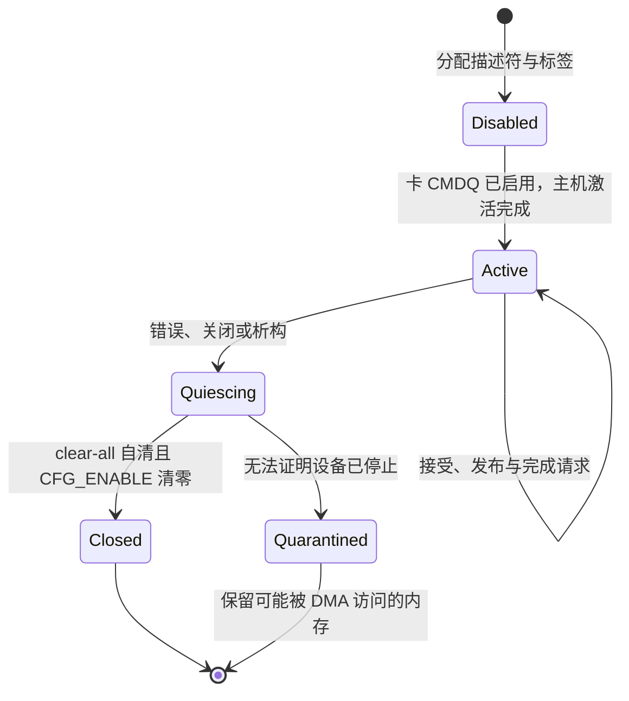

# RK3588 eMMC 高速时序与命令队列

## 1. 性能边界

RK3588 原有 SDHCI 路径以单一命令状态和 ADMA 表处理块请求，`max_inflight=1`。文件系统虽然能够合并读取和批量写回，控制器仍只能接收一个在途请求。`RockchipSdhciClock` 原来只有低速 DLL 配置，板级代码没有启用 1.8 V 能力，协议层已有的 HS200 分支也无法投入使用。

### 1.1 目标与依据

目标是让同一 eMMC 能够在经过调谐的 HS200 时序下处理多个独立请求。Linux 板端记录显示该设备使用 HS400 Enhanced Strobe、200 MHz、8 位、1.8 V，且 `cmdq_en=1`；本实现接通 HS200 与 CQE，不把它表述为已经达到 Linux 的 HS400 链路能力。

设备 I/O 计时属于独立的文件系统统计改动，本驱动不依赖 `BlockIoStats`。两者配合时可以观察已接受请求的在途时间与设备忙碌区间；这些指标不包含接受前的软件排队，也不能单独分离 CPU 计算时间。

时序、队列和停止流程对照 Linux 源码树 `980ab36ae597` 的 `drivers/mmc/host/sdhci-of-dwcmshc.c`、`sdhci.c`、`cqhci-core.c` 与 `cqhci.h`。这里借鉴的是 Linux 的控制器实现选择，不能代替实体设备的信号完整性验证。

### 1.2 方案取舍

只增大 `QueueLimits::max_inflight` 会让多个请求争用同一张 ADMA 表和命令寄存器，不能实现并发。只增大软件队列可以缓解生产者阻塞，但控制器仍然串行。`cqhci-host` 因此单独持有标准 CQHCI 的描述符、标签和错误状态，复用 `rdif-block` 与 `dma-api` 的所有权契约；RK3588 专用寄存器留在 `ax-driver`。

这项变更属于高风险存储驱动改动：错误可能导致 DMA 越界、文件系统损坏或无法启动。静态源码审查、确定性状态机测试和实体板验证分别证明不同层面的性质，任何一项都不能互相替代。

## 2. 电压与时钟

`sdmmc-host::BusOp` 区分 eMMC 的直接信号电压选择和 SD 在 CMD11 后的切压握手，避免对 eMMC 套用 SD 的 DAT 线低电平前置条件。

### 2.1 板级能力

`probe()` 只在固件声明不可移除、具有 HS200/HS400 1.8 V 能力、没有 `no-1-8-v` 且具备外部时钟时启用高速分支。若存在 `vqmmc-supply`，当前要求该电源描述为常开且上下限均为 1.8 V；动态稳压器尚未接入，不能仅凭控制器能力假定电源已经切换。没有该电源属性时，以板级显式高速能力声明作为固定接线契约。

`max-frequency` 限制最高请求时钟，最高 200 MHz。`rockchip,txclk-tapnum` 接受字节或可表示为字节的单元值，缺省为 Linux 使用的 `0x10`。映射范围必须覆盖标准寄存器、完整 Vendor Area 1 和 Rockchip DLL；CQHCI 窗口还必须与这些区域分离。

### 2.2 切压与调谐

`SetSignalVoltage` 修改 Host Control 2 的信号选择位，保持 Power Control 中的 VCC 供电设置不变；`SwitchSdVoltage` 另行检查 CMD11 前后的 DAT 线状态。完成切压后，协议状态记录 `mmc_signal_1v8`，HS200 失败降级到高速 SDR 时保留已经成功选择的 1.8 V。

外部时钟流程先停止 SD 时钟输出，设置 CRU 时钟并等待内部时钟稳定，再运行 RK3588 DLL 配置，最后开放 SD 时钟。低速采用 DLL bypass；高速执行 DLL reset、锁定等待、TX tap 和自动调谐延时配置。DLL 锁定失败返回错误，不能继续发布高速初始化成功。

删除原 `init_rk3588_dwcmshc_phy_3v3()` 的依据是 Linux 的实际平台接线。在固定源码 `980ab36ae597` 中，[`sdhci_dwcmshc_rk3588_pdata`](https://github.com/torvalds/linux/blob/980ab36ae597/drivers/mmc/host/sdhci-of-dwcmshc.c#L2157-L2171) 选择 `sdhci_dwcmshc_rk35xx_ops`、`dwcmshc_rk35xx_init()` 与 revision 1；其 [`dwcmshc_rk3568_set_clock()`](https://github.com/torvalds/linux/blob/980ab36ae597/drivers/mmc/host/sdhci-of-dwcmshc.c#L752-L880) 同时服务 RK3588，低速写入 `0x800` 起的 DLL bypass、RX/TX、CMDOUT 与 STRBIN，高速在同一区域执行复位、锁定和采样配置。相反，`0x300` 起的 `PHY_CNFG_R`、pad RXSEL、pull、slew 和 Synopsys PHY DLL 配置属于 [`dwcmshc_phy_init()`](https://github.com/torvalds/linux/blob/980ab36ae597/drivers/mmc/host/sdhci-of-dwcmshc.c#L453-L520)，由 TH1520 的时序设置和电压切换回调使用；RK3588 的 ops 没有接入它。这支持移除 RK3588 路径中无对应 Linux 接线、且硬编码 3.3 V RXSEL 的写入，不是声称已用硬件手册证明 `0x300` 的所有偏移均不存在。

低速 DLL 状态并未全部交给固件：本实现的 `init_rk3588_dwcmshc_after_reset()` 和 `configure_rk3588_dwcmshc_clock_regs()` 显式重设 Rockchip DLL bypass 及相关时钟寄存器。引脚复用、上下拉和驱动强度由 `rdrive::probe_fdt_matches()` 在设备 probe 前调用 `apply_default_pinctrl()`，按设备树默认状态交给已注册的 pinctrl 驱动；没有 pinctrl 设备时该步骤直接返回，未声明或未覆盖的 pad 设置仍依赖固件或复位默认值。固定 VQMMC 也只验证设备树契约，不测量实际电压、不替代稳压器控制。因此源码对照和寄存器夹具不能证明所有固件下的 3.3 V 低速启动、1.8 V 高速信号或冷启动电气状态，仍须在目标板核验。

仓库的 RK3568 适配器仍保留 `0x300` 写入，它不是 RK3588 的寄存器依据；上述 Linux 版本中的 RK3568 同样选择 rk35xx 路径。本次只修改 RK3588，未审定或验证 RK3568 的既有 PHY 初始化，不能据此把两者差异解释为已经验证的硬件需求。

`advance_host2_tuning()` 实际发出 CMD19 或 CMD21，块大小按协议和总线宽度选择 64 或 128 字节。只有已确认的 buffer-ready IRQ 才能推进调谐；定时唤醒只负责超时和 CMD19 的间隔。最多 40 次尝试，每次等待上限 50 ms。失败清理命令线和数据线，不用全控制器复位抹掉已经协商好的总线宽度与电压。降级时钟失败也向上返回，不假定降级已经完成。

## 3. 队列所有权

`CommandQueueAccelerator` 是协议层与硬件队列的边界。卡发现、EXT_CSD 解析和 CMD6 切换属于 `sdmmc-protocol`；`CqhciQueue` 只在卡已完成 CMDQ_MODE_EN 切换后接管主机数据通路。

### 3.1 初始化与提交

初始化前最多预留 31 个数据标签的运行时容量。固件未声明 CQE、寄存器窗口无效、描述符分配失败或卡不支持时，保留原有深度一通路；卡端支持判断包含 EXT_CSD 修订号、CMDQ_SUPPORT 和队列深度。启用主机失败时先停止 CQE，再在卡上完成 CMDQ_MODE_EN=0，最后才发布 legacy Ready；停止或卡端回退失败则初始化失败。

每次 `submit_batch_owned()` 只移走已接受前缀，未接收项留给调用方。`DescriptorTables` 限制 32 位 DMA 地址、标签数量、LBA、块数和描述符容量，并在 128 MiB 边界处分割传输。所有描述符按小端写入；`commit_submissions()` 在设备写屏障后一次写门铃位图。

队列保存构造时的 `DmaDeviceInfo`。安全的激活入口在访问硬件前拒绝不同 DMA 域、一致性契约或放宽地址、对齐、边界和段长约束的配置，并要求 512 字节逻辑块。提交还核对读写方向与 `PreparedDma` 的缓存维护方向一致。当前只支持独立 flush，不发布 FUA 或 PREFLUSH 能力，也不静默忽略这些标志。

### 3.2 中断与完成

`CqhciIrqHandle` 唯一读取并确认完成状态，将 legacy 错误、CQHCI 错误和 TCN 标签以一个原子快照发布。IRQ 不分配内存、不释放 DMA、不执行文件系统回调。队列所有者读取快照并经过设备读屏障后，才将 `InFlightDma` 转成可由 CPU 接收的完成对象。

`CqhciQueue` 的生命周期可以概括为下图。图中的失败终态禁止继续复用标签，避免迟到完成作用于新请求。

`active` 表示成功激活后取得的数据通路归属，`engine_armed` 表示硬件可能仍能访问描述符，`poisoned` 表示禁止再次提交。运行时错误和显式关闭都保留 CQE 的通路归属，因为停止主机并未关闭卡端 CMDQ；后续请求由已关闭队列拒绝，不能误投给 legacy 引擎。初始化激活失败则尚未取得该归属，只有主机停止和卡端回退都成功后才允许使用 legacy。

### 3.3 持久化与故障

flush 是队列屏障：先等全部数据标签完成，再使用标签 31 发出 FLUSH_CACHE；缓存关闭时使用 SEND_STATUS。缓存打开时还需第二条 SEND_STATUS 确认卡回到可接收数据的 Transfer 状态，才返回 flush 成功。卡错误和 SWITCH_ERROR 均返回 I/O 错误。

`quiesce()` 屏蔽 CQHCI 中断并停止 IRQ 快照接收，写入 HALT 并读回后请求 clear-all，等待设备将 clear-all 位自清，最后清除 `CFG_ENABLE` 并读回。HALT 位读回本身不作为 DMA 所有权交还的充分证据；必须继续确认任务清除及引擎关闭。每次控制转换有 20 ms 上限。只有确认停止后才能返回 DMA 所有权；无法确认时，`quarantine_all()` 同时保留载荷与描述符内存，向所有等待者完成一次错误并关闭队列。析构也遵守这条规则。此策略以有限的内存保留换取错误设备下的内存安全，不承诺运行中自动重建损坏的卡会话。

平台数据通路恢复由独立的 `data_path_restore_pending` 管理：在调用 `enable_data_path()` 前登记，只有 `disable_data_path()` 成功才清除，覆盖启用期间部分失败。激活失败回滚、显式关闭及直接析构均在确认 CQHCI 停止后执行恢复；未启用的队列不调用恢复，重复关闭或关闭后析构不重复执行成功的恢复，恢复失败则保留重试状态。显式关闭返回错误；析构无法返回错误，只记录诊断。RK3588 适配器在这里清除响应中断并恢复保存的 legacy 中断使能，不承诺还原所有 SDHCI 寄存器，也不关闭卡端 CMDQ 或重新授权 legacy 请求。

## 4. 验证与回滚

组件测试、系统测试与实体板验证各自保护不同边界。以下说明其验收职责；具体提交的执行结果、日志和未覆盖项记录在对应 PR 验证材料中。

### 4.1 组件证据

寄存器夹具验证 CMD21 确实发送、无 IRQ 不能完成调谐，以及 eMMC 直接选择 1.8 V 时不改 VCC。CQHCI 组件用例覆盖批量门铃、乱序完成、flush 最终状态、错误与完成同时到达、停止失败时描述符和载荷都不释放。夹具只表达设备事件，不能证明真实 IRQ 路由、DLL 锁定或实际 DMA 一致性。

同一队列生命周期用例还从公开安全入口检查 DMA 域与一致性错配在硬件激活前被拒绝、方向错误的载荷仍归调用方、未实现的持久化标志返回不支持，以及毒化后的迟到 IRQ 不会再次完成请求。队列生产状态机和这些测试保留在同一模块，便于对照接受、提交、完成和停止的唯一所有权链；文件长度主要来自生命周期夹具，不按行数拆散该链。

验证阶段使用项目 `cargo xtask clippy` 和标准库测试入口检查受影响包；新驱动进入测试允许列表前按项目流程核验。随后通过定向系统测试确认文件读写、mmap、同步和卸载语义，最后才允许部署板卡。

### 4.2 实体板证据

上板先确认 Linux 启动脚本已恢复并持久化，再使用已验证的看门狗方案。先验证实际时钟、调谐、CQE 深度和有限数据读写，再冷编相同源码的 `arceos-helloworld`。Linux 与 StarryOS 复用同一份 Linux 构建的 `tg-xtask`，使用新的 target 目录，记录退出码、产物校验、I/O 统计、耗时和串口告警。

HS200 调谐失败会回到协议层原有低速初始化路径；CQE 启用前失败只有完成卡端回退才使用 legacy。运行时致命错误停止整个设备，不悄悄重试可能已写入的数据。板卡回 Linux 后必须检查启动脚本、SSH、fsck 和根文件系统；出现无法证明完整性的结果时不得写成性能成功。
