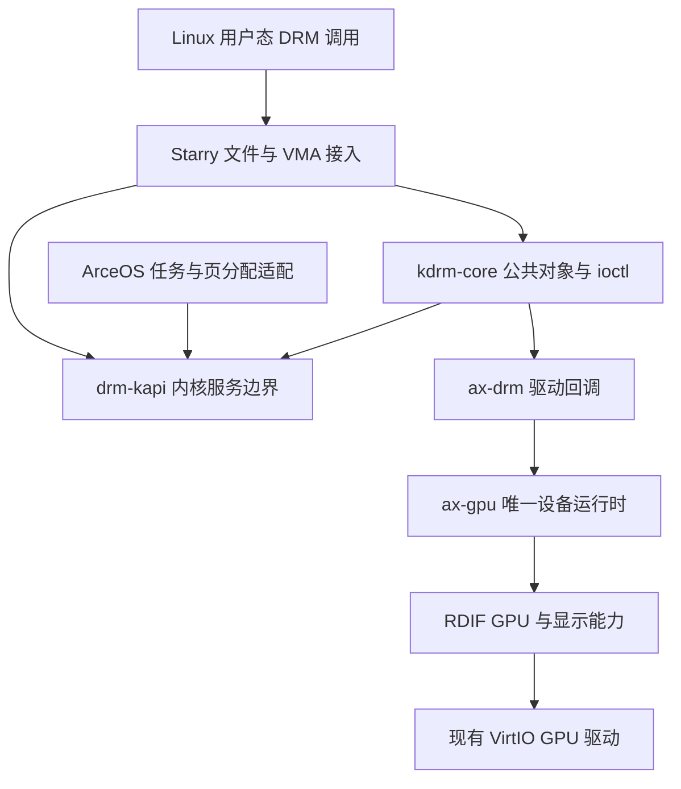

# 共享 DRM 核心接入

## 1. 目标

Starry 的图形设备当前通过 `card0` 内部的 GEM、PRIME、KMS 和事件实现提供 Linux DRM ABI。
本次改动将这些公共语义移入 `kdrm-core`，让现有 RDIF GPU 能力成为其后端，而不是再为一种
用户态驱动增加一套同步对象和资源登记表。首个实际消费者仍是 Starry 和现有 VirtIO GPU。

### 1.1 范围

公共核心负责 DRM 设备、文件、master、GEM、VMA offset、PRIME、framebuffer、atomic KMS、
syncobj 和事件的状态与生命周期。`drm-kapi` 提供它实际需要的内核服务边界，`ax-drm` 将这些
服务接到 ArceOS，并将 DRM 驱动回调接到既有 `ax-gpu` 和 RDIF。Starry 只实现进程、凭据、
用户内存、文件描述符、poll 和 VMA 接入。

本次不引入 Intel 驱动，不替换 VirtIO 传输实现，不改造固件帧缓冲和控制台，也不宣称支持
尚无后端的 DP MST、bridge 或 writeback。RKNPU 仍使用现有驱动入口，其节点编号和共享
UAPI 定义不能因 `card0` 替换而失效。

### 1.2 方案选择

继续在 `card0` 内补充同步和 KMS 功能，能够解决单个应用问题，但不能消除公共语义与设备
完成路径的耦合。只导入没有消费者的库也不能证明接口可用。重新设计整个驱动栈则会重复
已有的 RDIF 和设备运行时。本次选择移植已有 DRM 算法、替换公共状态所有者，并保留现有
硬件运行时；以完整用户态调用路径作为验收单位。

本改动涉及用户 ABI、并发和 `unsafe` 对象生命周期，按高风险功能处理。该文档和代码需要
在合入前接受领域审查；宿主测试和 QEMU 结果不代替安全与设计审查。

### 1.3 审阅导航

- **移植算法**：`components/kdrm-core/src/*_upstream.rs` 按 Linux 7.2.3 对应 DRM
  源文件组织，`// upstream:` 标记对应函数，`*_types.rs` 保存所需的 C 布局类型。这是
  Rust 移植，不是原样编译 Linux 源码；名称与布局对应不能代替引用、别名和锁语义的核对。
- **系统适配**：`components/drm-kapi` 提供 DRM 所需的内核机制与服务接口，
  `axdrm/src/runtime` 和 Starry 提供实际运行时；`axdrm/src/backend` 将驱动回调接到
  既有 RDIF 设备。重点检查服务契约、错误传播及 GEM、VMA、DMA backing 的引用配对，
  不把这一层视为无行为的转发包装。
- **有意改写**：阻塞 atomic 提交增加可失败的 `atomic_commit_pre_swap`，非阻塞提交
  失败走 `drm_atomic_helper_commit_error`（见 3.2）；GPU 完成通知转交工作队列后再运行
  fence 回调。`hrtimer` 按 10 ms jiffy 向上取整（见 2.1）；`drm-kapi/src/rcu.rs`
  使用全局读者计数，并为回收回调创建任务等待读者归零。这些是本地机制，不应据此推断
  与 Linux 相同的调度、精度或性能保证。

## 2. 分层

DRM UAPI、驱动资源和操作系统状态分别有一个所有者。`kdrm-core` 不依赖 Starry、ArceOS
或 VirtIO；`drm-kapi` 不依赖 VT-d、PCI 或 Intel 运行时。接口依赖如下。

`ax-drm` 使用 `DrmDriver` 回调表和 `DrmDevice` 记录，不再引入第二套公共 GPU trait。
Linux 对照实现的内部函数和类型名称保留，便于维护算法与错误路径；系统服务通过显式
provider 接入，不依靠驱动探测顺带初始化。

### 2.1 内核服务

`drm-kapi` 的锁、等待、时间、任务工作、分配和页服务由运行时实现；凭据、用户内存、
匿名文件和 eventfd 服务由 Starry 实现。用户内存复制解析当前调用任务，不保存进程全局的
临时调用者指针。服务缺失时拒绝操作，不使用假 fd、固定容量影子 fd 表或成功返回桩。
当前 `hrtimer` 使用真实单调时钟和异步 timer worker，但调度截止时间向上取整到
`CONFIG_HZ=100` 的 jiffy，精度为 10 ms 加任务调度延迟；它不是 Linux 原生高精度定时器，
不能据此声称具备同等 vblank 时间精度。周期重启、取消和截止时间由同一 timer 队列维护。
`FileOperations.poll` 和 `unlocked_ioctl` 使用类型化 C 回调；sync_file 的 ioctl 和 poll
经过同一张操作表，不能因未注册回调而把未完成 fence 报成始终可读。

DRM 的公共文件、同步对象和内存算法不得依赖 `device.virgl()`。设备适配器将 RDIF 的
完成状态转换为公共 fence，syncobj 只持有 fence 或 timeline 的引用。

### 2.2 体系结构

共同的 DRM 对象和 UAPI 面向现有四个 64 位目标；锁、页、缓存和硬件指令仍由各目标的
ArceOS 实现负责。移植来源的 x86_64 内部布局不能当作跨架构用户 ABI；只有实际用于
对象嵌入或 FFI 的内部布局才保留一致性约束。用户态结构按 Linux 对应架构校验。

| 层级 | 共同机制 | 保留的差异或限制 |
| --- | --- | --- |
| `kdrm-core` | 对象、UAPI、PRIME、atomic、syncobj | 不直接访问体系结构指令和硬件 |
| `drm-kapi` | 引用、容器、锁字、等待和 fence 状态机 | `ClockOps`、`LockContextOps` 等由使用内核提供 |
| `ax-drm::runtime` | 绑定 ArceOS 任务、等待与页服务 | 体系结构行为留给 `ax-hal`、`ax-mm`；未提供 WC 别名时显式拒绝 |
| `ax-drm::backend` | 通过 RDIF 分配、提交、完成 | 首个后端只接现有 VirtIO GPU；跨设备 PRIME 映射只接受 Direct DMA 域 |
| Starry VFS/MM | 当前任务、凭据、用户复制、fd 和 VMA | 长期用户页 pin 尚未提供，返回不支持 |

这些 provider 区分的是内核服务所有者，不是以运行时枚举选择体系结构；目标专用的指令、
中断和页表实现仍由 ArceOS 既有编译期装配选择。

## 3. 所有权

`ax-gpu` 继续独占已经探测的设备和传输；`ax-drm` 持有 DRM 设备的稳定注册对象，不接管
或复制底层设备。每个 DRM open file 独立管理自己的 GEM 和 syncobj 句柄，复制 fd 共享
同一个打开文件描述。DRM 对象编号与 RDIF 缓冲区编号分别由各自层维护，不能互相冒充。

### 3.1 缓冲区生命周期

GEM handle、framebuffer、PRIME 文件、VMA 和设备中的 scanout 各自保持所需的资源引用。
关闭 handle 不提前释放仍被映射或导出的 backing；用户态关闭文件后，既有 VMA 的租约
继续保活 backing。PRIME 导入导出通过真实文件表转移引用，不另建全局 fd 映射。

`mmap` 先通过 DRM VMA offset manager 查找对象并检查当前文件权限，再建立保活 GEM 与
backing 的映射租约。租约随 VMA 克隆或拆分保留，最后一次映射释放后才能归还映射引用。
底层设备未确认解除访问之前，引用计数归零本身不构成可以释放 DMA backing 的证明。
`PendingFence` 保留旧 scanout 的 GEM 引用直到 RDIF 完成；`ImportedBacking` 保留导出端
DMA-BUF 引用直到设备释放 backing。Direct 域以外的导入不能沿用仅保留文件的策略，必须
同时保留完整 DMA 映射和 attachment，所以当前适配器在该能力边界拒绝导入。

### 3.2 提交与完成

`TEST_ONLY` 只验证状态，不改 scanout、不发布事件，也不消耗正式提交的完成令牌。
正式提交保留新旧资源，按后端返回的完成状态决定何时通知事件与释放旧资源；提交失败
不能留下已发布的部分 DRM 状态或提前释放正在显示的缓冲区。

RDIF 的显示提交可以在检查后失败，因此阻塞提交使用明确的 `atomic_commit_pre_swap` 回调：
在准备资源、等待输入 fence 和前序提交之后，先完成可失败的 RDIF 提交，再发布 DRM
状态。回调失败沿原 ioctl 返回，并清理准备阶段资源，不交换对象状态或发送成功事件。
这是本组件相对 Linux `atomic_commit_setup` 的内部接入差异，不是新的用户 ABI；不能
把这两个回调的调用时机视为相同。该可失败的 pre-swap 路径只用于阻塞提交。
`NONBLOCK` 提交沿 Linux helper 的状态交换与工作队列路径接收：返回前发布软件状态，
工作线程等待输入 fence 和前序提交，再通过驱动的 `atomic_commit_tail` 提交硬件。
不能因输入 fence 尚未完成而持续拒绝合法的非阻塞帧，也不能忽略 fence，或把请求改成
同步等待。异步硬件失败不能回溯成原 ioctl 的错误返回；必须以 fence 错误及设备不可用
状态结束等待，取消未完成的翻页事件，同时完成内部提交依赖。设备未确认停止访问前，
保留可能仍被访问的扫描输出资源，不以软件提交清理代替 DMA 完成证明。

`ax-drm` 复用 simple-KMS 的对象与回调，但采用与 Linux VirtIO 显示驱动一致的 CRTC
检查：允许保持活动 CRTC 而禁用 primary plane，仍保留通用的 FB/CRTC 配对、模式和
plane 几何检查。未绑定的 inactive plane 属性变更只更新软件状态，不提交虚假的显示
操作，也不占用等待硬件完成的资源。

GPU 完成通知可能在设备运行时锁内触发。该通知只能发布待处理状态或唤醒任务，不在其中
重入 `ax-gpu`，也不直接运行可能取得 DRM 锁的任意 fence 回调。任务上下文取得完成快照，
释放设备锁后更新公共 fence 和事件状态；等待方先登记再复查，避免丢失唤醒。

## 4. 替换与兼容

本地实现完成后，Starry 的 DRM open、ioctl、read、poll 和 mmap 都经过公共核心。删除
被替代的 `card0` 公共状态机，不保留新旧 DRM 运行时选择开关。Linux `video=` 启动参数
发现、AUX 字符设备、CRC/debugfs、bridge、MST 和 writeback 没有运行时接入；删除没有
消费者的入口，仍可由输入触达的路径显式拒绝，不添加填补链接的成功桩。VirtGPU 私有 ioctl 属于
设备适配器的回调表，但仍使用公共 DRM 文件、GEM 和同步对象。

### 4.1 ABI

Linux 对照基线为 7.2.3 中的 DRM ioctl、GEM、PRIME、atomic、syncobj 和 dma-fence 实现。
已有 2D 和 virgl 用户态 ABI 不应因重构退化。能力位只公布后端实际实现的路径；公共
syncobj 不以 Venus 是否存在为启用条件。没有 GPU 时仍不发布虚假的 DRM 节点。

本次不改变磁盘格式或外部持久配置。若需回退，回退这组代码提交即可；不在运行时遇到
错误后静默重试旧 DRM 实现。

### 4.2 验证边界

宿主测试验证公共对象、引用、同步与拒绝规则，不能证明真实调度或设备完成。既有 Starry
DRM version、modeset、atomic 和 per-buffer 用例验证实际文件、用户内存和映射边界；同步
生命周期用例验证 syncobj、sync_file 和 eventfd。virgl 应用验证设备专属 ioctl 和渲染链路。

四个受影响目标至少通过公共组件的项目静态检查，QEMU 按实际设备路径验证。验证命令、
实际结果和未验证范围在提交说明中记录；没有运行的目标、真实 Intel 硬件和 Venus 宿主
不能由编译成功或其他平台测试代替。
