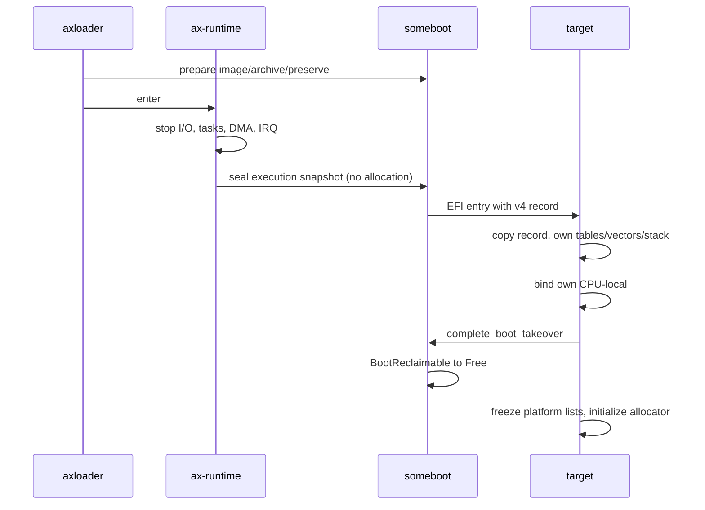

# someboot 启动资源与 EFI 交接

## 1. 能力与所有权

someboot 同时服务内核启动和原生 UEFI 应用。`boot_resources` 管理启动期内存，`handoff` 管理交接描述和发布事务；镜像地址、池容量及 OTA 策略属于应用。`boot-resources` 不依赖网络、文件系统或交接生产端，`efi-handoff` 组合 `efi` 与资源能力。普通 EFI 内核消费交接不需要生产端 feature。

### 1.1 资源计划

[`boot_resources`](../../platforms/someboot/src/boot_resources/mod.rs) 的 `declare_boot_resources!` 将 `ResourceRequest` 数组写入保留的 `.someboot.resources` 链接节。请求包含资源 ID、容量、对齐、地址约束和可选的 `InitialContents`，不包含应用函数或静态指针。`prepare_static_plan()` 在退出 Boot Services 前校验整个计划、申请资源并初始化内容；失败时逆序释放本轮全部申请，随后终止这次必需资源初始化，不发布部分计划。没有声明时不申请应用池。原生 UEFI 应用通过 `reserve()` 执行相同的类型化请求，错误直接返回调用方。

[`allocation.rs`](../../platforms/someboot/src/boot_resources/allocation.rs) 的 `Allocation` 是唯一所有者。[`intervals::Arenas`](../../platforms/someboot/src/boot_resources/intervals.rs) 为所有资源合计维护最多 128 个存活区间，支持任意顺序释放；槽位携带不回绕的代际号，陈旧句柄不能释放复用后的分配。`ResourceSnapshot` 保存 ID、容量和不可变前缀 `initialized`，不再保存历史 `used` 水位。实际分配从前缀之后寻找不与存活区间相交的空间；区间表或容量不足返回 `Capacity`，失败不发布部分分配。

继承目标依据自己的 `.someboot.resources` 静态计划保留资源 ID、容量和约束。没有计划时不继承应用池；请求较小容量时保留前缀容量，尾部扣除存活对象后可回收。资源容量与对象寿命分别表达：`HandoffSpec::image`、归档及 `preserve` 显式选择存活分配，旧 loader 的普通下载缓冲和已退役镜像不自动传给下一阶段。目标也是 axloader 时，仍保留它声明的等待下载容量，但祖先死亡的区间重新参与池内分配。

`InitialContents::FirmwareBootImage` 显式请求在固件仍可读文件时保存最初启动的 EFI 文件。继承阶段继续得到同一份固件来源文件，不能把它解释为当前运行子镜像。`firmware::initialize_image()` 使用固件分配的单页缓冲读文件，再复制到内核直接映射地址，避免把内核虚拟地址交给固件 DMA。文件不可访问或大于请求容量时，本次必需计划失败；不从已重定位、数据段已改变的运行镜像伪造可持久化文件。

### 1.2 构建边界

[`lib.rs`](../../platforms/someboot/src/lib.rs)、[`Cargo.toml`](../../platforms/someboot/Cargo.toml) 与 [`build.rs`](../../platforms/someboot/build.rs) 共同以 `target_os = "uefi"` 隔离内核入口、页表、SMP 及其依赖，原生构建只保留公共能力和固件适配，也不生成内核链接脚本。其他目标继续使用原有根模块和符号路径，构建脚本派生的 `cfg(efi)` 保持原语义。构建模式由 target 确定，不使用反向 feature，避免 Cargo feature 合并改变产物模式。

## 2. EFI 交接

[`handoff`](../../platforms/someboot/src/handoff/mod.rs) 的 `HandoffSpec` 描述目标镜像物理范围、cmdline、initramfs 和带 ID、版本的应用元数据。通用验证先于平台发布；LoongArch 的 `PreparedHandoff` 只准备镜像描述、载荷与元数据，不发布内存图；停稳后通过 `seal(&ExecutionSnapshot)` 生成 `SealedHandoff`，才允许非安全 `enter()`。调用方始终保留镜像分配，失败或返回时守卫撤销本次交接。LoongArch 运行于 Boot Services 已退出的环境，原生 x86 UEFI 在固件服务仍有效时调用目标，两者保留不同的清理边界。

### 2.1 协议与继承

[`protocol::HandoffRecord`](../../platforms/someboot/src/handoff/protocol.rs) 使用 v4 和 GUID `7b9fa931-a25b-d043-b13c-63435428c473`，采用 `repr(C)`、固定宽度整数及有界数组：最多 8 个资源、128 个存活分配、128 个内存区、4095 字节 ASCII cmdline、512 字节应用元数据。它不保存 OTA 槽位或固定池。`boot_services_exited` 区分固件活动与继承阶段：前者不替代固件内存图，也不携带资源或归档；后者验证资源范围由保留的启动内存覆盖，镜像与归档分别属于显式存活分配、不覆盖不可变前缀，并验证区间、版本和边界。`caller_image` 描述旧阶段镜像，仅用于记账与验收，不授予访问权限。

LoongArch 的 [`handoff/received/loongarch64.rs`](../../platforms/someboot/src/handoff/received/loongarch64.rs) 在复用固件配置表之前，将完整记录复制到本镜像的私有存储，并负责继承资源及内存图的恢复；通用元数据副本属于 `handoff/received`，`handoff::inherited_metadata()` 不返回可被下一次生产事务改写的共享表引用。`boot_payload` 只负责 initramfs 的发布、领取及回收。`efi_stub/loongarch64/mod.rs` 只转换固件表存储地址，函数指针保持原值；目标恢复内存图并跳过第二次 ExitBootServices。普通 EFI 消费端始终随 `cfg(efi)` 编译，资源恢复仅要求 `boot-resources`，与生产端 `efi-handoff` 独立。

v4 与旧记录不兼容，沿用 v3 GUID，通过版本和结构大小拒绝旧记录。LoongArch 遇到旧 GUID 明确拒绝；生产者、目标和 A/B 槽必须在本次迁移中一起重建，不承诺旧二进制槽与新协议互相交接。持久 `State` 记录格式不变，但不能靠回滚至旧协议 loader 绕过这个重建要求。

### 2.2 固件路径

x86 的 [`handoff/firmware`](../../platforms/someboot/src/handoff/firmware/mod.rs) 保留 LoadedImage LoadOptions、Linux LoadFile2 的查询和复制语义，元数据另以 v4 配置表发布；OTA 仍由 axloader 的 LoadImage/StartImage 路径拥有。私有 [`uefi_protocol`](../../platforms/someboot/src/handoff/uefi_protocol/mod.rs) 承载不调用固件的 UCS-2 编码、设备路径和 LoadFile2 回调，宿主测试只编译这一层；安装、撤销和事务守卫仅由原生 UEFI 后端装配。目标返回且固件服务仍活动时恢复原 LoadOptions 和原配置表、卸载 initrd 提供者并释放分配；若目标已经退出服务，守卫保留这些页，不再调用 Boot Services。配置表或协议撤销失败时也不能释放仍被固件引用的内存。

LoongArch 的 [`efi_stub/loongarch64/handoff.rs`](../../platforms/someboot/src/efi_stub/loongarch64/handoff.rs) 在首次退出前安装配置表，之后只操作预留资源、复制 cmdline/归档/元数据、最终封存停稳后的快照并刷新指令缓存。事务守卫排除重复发布，失败或目标返回时撤销记录并回退本事务拥有的归档分配。`someboot::efi_stub::setup_service` 和 `someboot::boot_payload::publish` 路径保持不变；initramfs 继续一次领取，归档消费后归还到仍继承的资源池，或交给普通分配器；不调用已经退出的 EFI 页释放服务。

### 2.3 应用策略

[`axstd_loader`](../../bootloader/axloader/src/axstd_loader/mod.rs) 显式声明 4 项资源：32 MiB 镜像区固定在 `0x200000`，256 MiB 归档区、32 MiB EFI 槽执行区，以及 32 MiB 固件原文件区。控制循环与 HTTP 路由保留在模块入口；[`image`](../../bootloader/axloader/src/axstd_loader/image.rs) 拥有装载分配、载荷和终结性交接，[`ota`](../../bootloader/axloader/src/axstd_loader/ota.rs) 拥有 FAT 槽文件、状态提交和继承代次。原文件区用于初次验证、Flush 并读回 `A.EFI`，不保存运行时已修改的数据段，因此未确认 trial 复位后能重新执行稳定槽。该配置要求最初 loader 由可读的 EFI 文件系统启动，文件不得超过声明容量。继承槽必须已有有效持久状态；状态缺失时拒绝把祖先文件冒充当前槽重新建档。

[`ota/handoff.rs`](../../bootloader/axloader/src/ota/handoff.rs) 编解码 axloader 自己的元数据 ID、版本、槽位和持久代次；someboot 只承载有界字节。固定镜像地址属于应用策略：若当前镜像已经占有相同执行区，则拒绝再次覆盖该区，不猜测 load bias。原生 x86 ELF 路径也使用共同 `ResourceRequest`/`reserve()` 和 `HandoffSpec`/`PreparedHandoff`，仍由固件决定实际页申请与 EFI 生命周期。

axloader 的 [`http_control`](../../bootloader/axloader/src/http_control.rs) 统一路由分类、单值控制头、epoch 和 trial 准入；状态查询不要求 epoch，修改请求仍核对当前代次。两前端仅保留传输与平台动作。共同 [`elf::ElfImage`](../../bootloader/axloader/src/elf.rs) 校验 ELF64、machine、段范围及可执行入口；x86 保留未对齐段与固件 load bias，LoongArch 后端拥有页对齐、固定地址和缓存策略。someboot 的 `handoff::cmdline` 同时约束生产与消费，4095 字节 ASCII 上限不再各自实现。

### 2.4 运行时退出

LoongArch 的目标会重用继承内存图中的空闲页；关闭 HTTP socket 不能证明旧网络设备已停止 DMA。退出由 [`ax-runtime::handoff::enter`](../../os/arceos/modules/axruntime/src/handoff.rs) 编排，someboot 不依赖网络、文件系统或任务：应用完成 OTA 状态提交、释放连接并准备好交接事务后，调用终结性的运行时交接入口。当前入口只接受一个运行处理器且不支持用户地址空间交接，应用必须先停止自己创建的任务及 I/O；多处理器退出不在本阶段能力内。

退出顺序为文件系统同步与封存、块控制器停止及 IRQ 同步、网络协议任务退出并 join、网络 IRQ 同步及队列任务停止并 join、控制台排空和串口屏蔽，最后关闭本核 IRQ、抢占与 clockevent，再调用目标。块设备复用 `release_block_irqs_for_passthrough()` 已有的完整停稳契约。网络需要把 IRQ 同步、任务 join 与 DMA 停稳结果逐层返回；任何隔离保留只能保护当前内核，不能作为交接成功的证据。VirtIO 网络写入设备状态零后读取状态零，按 VirtIO 1.2 §2.4 确认设备不再访问旧队列，才允许释放队列 backing。

不采用只丢弃 socket 或禁用 CPU IRQ 的方案，因为设备仍可能异步写旧内存。也不在继承内存图中永久保留全部运行时堆来掩盖设备未退出的问题。退出一旦开始不恢复 HTTP 服务；任一步失败、处理器数量不符或目标返回都复位机器，由已经持久化的 OTA 状态处理回滚，不能返回已经停运的运行时。目标入口、地址转换和缓存维护继续归 someboot 平台适配层。

目标在开启中断、接管异常或复用祖先运行时内存前，先安装自己的异常入口、处理器局部状态和栈。返回式 EFI 程序必须保持调用方的栈、MMU 映射、处理器局部状态和中断屏蔽；已经替换这些执行上下文的内核不得返回旧 EFI 调用帧。LoongArch smoke 上传仅执行 `ori $a0, $zero, 0; ret` 的独立 ELF，要求入口返回后机器复位，重新提供具有新 epoch 的 HTTP 服务，并保持稳定 OTA 状态；它与正常内核交接分别验证返回和不返回两条路径。

## 3. 迁移与验证

所有生产端与消费端在同一 PR 重建，不保留 `efi-loader` 或旧 `loader_*` 别名。公共算法使用宿主测试验证，目标地址转换、缓存和固件生命周期通过真实 EFI QEMU 验证。

### 3.1 共同性与差异

共同机制按资源与事务分层；涉及固件调用和处理器状态的动作留在选定的平台模块，不增加公共 trait 或动态分派。

| 层次 | 共同机制 | 平台保留职责 |
| --- | --- | --- |
| 资源 | 请求校验、所有权、失败回退、快照 | EFI 页申请、直接映射 |
| 交接 | 描述校验、ABI、应用元数据、事务 | 配置表与 LoadOptions/LoadFile2 |
| 启动 | 校验目标及活动镜像不重叠 | EFI ABI、缓存、继承内存图 |

只重命名旧 feature 无法移走固定三池和 OTA 字段；新增独立软件包则会拆散 someboot 已有的启动资源生命周期，因此采用现有软件包内的公共模块。所有功能转发已在 axstd、ax-runtime、ax-hal、axplat-dyn、somehal 和 axloader 同步迁移，删除旧入口而不建立兼容别名。

### 3.2 验收边界

someboot 宿主 profile `boot-resources` 验证计划校验、部分申请回退、存活区间、退役与协议拒绝；原生 UEFI 产物契约检查实际 rlib、依赖与构建脚本输出，确认没有内核入口。Clippy 配置覆盖 x86 裸机、原生 x86 UEFI、AArch64 EFI 编译、RISC-V 非 EFI、LoongArch 普通 EFI、资源及交接生产组合。

`python3 bootloader/axloader/scripts/loong-qemu-smoke.py` 先执行脱离网络、OTA 和交接生产端的资源应用，再在独占 FAT、QMP socket 和宿主端口中验证写满返回 `409 ota_storage_failed` 且状态不变，以及 HTTP 独立 ELF、cmdline/initramfs、未确认 trial 复位回滚、旧确认拒绝、新 trial 确认及再次复位后的稳定摘要。x86 使用 `cargo xtask axloader test qemu --target x86_64-unknown-uefi` 的既有可选 payload 和真实 FAT OTA 回归。宿主模型不能代替这些固件和持久存储证据。AArch64 EFI 镜像生成与 LoongArch 非 EFI 启动不在本轮范围。

## 4. 启动内存回收

本能力采用接收方完成接管后再回收的生命周期。参考 [UEFI 2.11 §7.2](https://uefi.org/specs/UEFI/2.11/07_Services_Boot_Services.html)、[Limine memory map](https://github.com/limine-bootloader/limine-protocol/blob/trunk/PROTOCOL.md#memory-map-feature) 和 [Multiboot2 memory map](https://www.gnu.org/software/grub/manual/multiboot2/html_node/Boot-information-format.html)，物理 RAM 的可用性与当前对象占用分别表达。仅把 loader 代码结束等同于可回收会破坏仍在使用的栈、页表及 CPU-local，因此回收发生在目标内核。

### 4.1 内存分类

[`MemoryType`](../../components/kernutil/src/memory.rs) 明确区分固件保留、当前启动分配和等待接管的旧分配。`BootData` 用于 early RAM、资源及载荷，`BootReclaimable` 用于上一阶段仍被执行上下文引用的内存。`Reserved` 继续表示固件或无法证明可回收的区域；Runtime Services、系统表、配置表数组、各配置表载荷所处的固件描述符、ACPI 与 MMIO 均保持保护。共享交接记录本身仍在 EFI Runtime Services 内存里，复制记录不意味着可以释放原表。

[`received::loongarch64::receiver_map`](../../platforms/someboot/src/handoff/received/loongarch64.rs) 将旧 `KImage`、`PerCpuData` 和 `BootData` 转成待回收，再扣除目标静态计划、当前镜像、未消费归档及显式存活对象。所有裁剪通过 [`BootMap::assign`](../../platforms/someboot/src/handoff/memory.rs) 构建候选 map；覆盖固件区、区间缺口或超过 128 段时失败，原 map 不变。目标自身 early allocator 只取 `Free`，不能提前使用待回收范围。

### 4.2 不可返回的接管

[`ax-runtime::handoff::enter`](../../os/arceos/modules/axruntime/src/handoff.rs) 负责文件系统、IRQ、任务与 DMA 的停稳，随后在 IRQ 和抢占关闭的无分配窗口中形成 `ExecutionSnapshot`。[`page-table-generic::visit_table_frames`](../../memory/page-table-generic/src/table.rs) 只读遍历根表完整跨度及中间表帧，不包括叶数据页；[`ax-mm`](../../os/arceos/modules/axmm/src/lib.rs) 持有活动地址空间锁并核对硬件根表。栈与 TLS 由资源所有者报告真实 backing，虚拟栈逐物理页报告，bootstrap 栈使用平台提供的边界。

交接时必须先保护旧执行环境，再让目标建立自己的环境。准备阶段仍允许分配和失败回退；设备退出后不再恢复旧运行时，封存失败或目标返回都复位。

[`axplat-dyn::boot::main`](../../platforms/axplat-dyn/src/boot.rs) 在主 CPU 绑定成功后、`call_main` 前调用完成入口。此时 someboot 已安装本镜像的页表、异常入口和栈，`bind_current_cpu` 又替换了 CPU-local。此后旧代码、栈与表页才成为普通 RAM；返回旧 EFI 调用帧已不合法。原生 x86 UEFI 仍遵循活动固件与返回式调用的生命周期，不执行这条后 EBS 回收路径。

### 4.3 后期归还与验证

[`boot_payload::Initramfs`](../../platforms/someboot/src/boot_payload/mod.rs) 是不可复制的唯一所有者，`bytes()` 的借用受其寿命约束。解包及符号表复制完成后，`finish(self)` 才能生成一次性 `InitramfsReclaim`；仅完整、独占的页可以归还。仍被目标继承的资源池先退役归档区间，超出保留容量的完整尾页可交给普通分配器；其余普通归档页通过 `global_add_memory_compact()` 加入分配器。只有实际成功转移后才提交完成状态，失败或丢弃句柄保留页面。

平台启动内存列表完成后保持不可变。后期归还由 someboot 的唯一所有权状态记录，下一次 `export_map` 从冻结 map 加上已完成的归还派生，避免修改已发布的静态切片。紧凑插入会扣除 buddy 元数据，不足以形成可管理区间时返回零字节；日志分别报告原始回收量与 allocator 管理量。

现有 LoongArch smoke 从运行时 `axloader_memory` 记录取得两级 loader 的 EFI 实际镜像范围，以最后一次冷启动记录划分生命周期，不依赖早期内存图打印。它临时生成 1 MiB 归档夹具，独立 helloworld 目标使用普通 `alloc_pages` 从回收的旧镜像、资源池和消费完成的归档中取得页面，写满一页并读回，输出 `HANDOFF_MEMORY_RECLAIM_PASSED` 与 `HANDOFF_INITRAMFS_RECLAIM_PASSED`。组件验证覆盖任意顺序释放、容量失败、代际拒绝、版本拒绝、页边界与区间裁剪；页表验证包含四帧根表和巨大叶映射。A/B 文件与目标必须一起重建至 v4，持久 OTA 状态格式不变。
