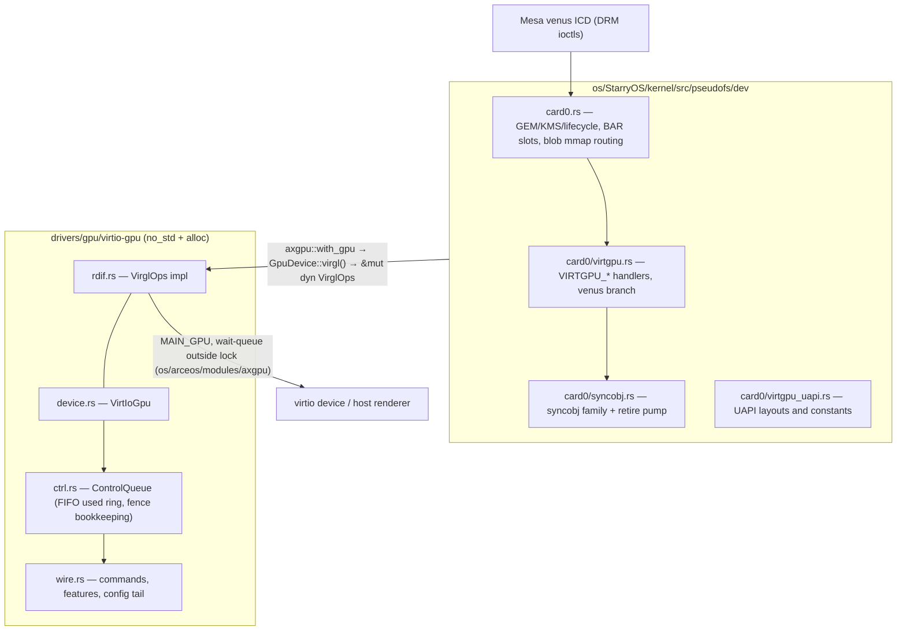

# Venus face on the portable GPU stack (`card0`)

> 实现状态：本设计最初对应旧 `card0`。同步 Venus 主线后，设备相关实现已迁至
> `os/arceos/modules/axdrm/src/backend/{virtgpu,host_blob,gem}.rs`，公共同步与映射分别
> 归共享 DRM 核心和 Starry 文件/VMA 适配。旧路径不再并存；当前所有权契约见
> [共享 DRM 核心接入](shared-drm.md)。下文的旧文件定位作为原始设计背景保留。

The venus (capset 4) 3D face as implemented on this branch. This file
replaces the 2026-10-07 edition, which described a first porting round
against symbols that no longer exist (`pseudofs/dev/vgpu.rs`,
`VirtioGpu3D`, `register_global_3d`, `VgpuBlobFd`); the face has since
been re-landed on the portable GPU stack and its retire semantics inverted
(out-syncobjs signal at host retire, not at submit). Symbol anchors; lines
drift.

## 1. Background and goal

Upstream `dev` carries a portable GPU stack — rdif `VirglOps`, an async
control queue, `card0` with per-fd GEM semantics — whose 3D face is
virgl-only: `CONTEXT_INIT` refuses capset 4, `GETPARAM(HOST_VISIBLE)` is
0, and there is no syncobj family, hostmem window or `MAP_BLOB`, so
Mesa's venus ICD cannot initialize. This branch adds the venus face as
an increment on top of it, with the virgl path (classic contexts,
guest-backed blobs, `FENCE_FD_IN/OUT` execbuffers) unchanged and sharing
the same per-fd context-id space.

The increment spans three layers:

- `drivers/gpu/virtio-gpu` negotiates `RESOURCE_BLOB`, `CONTEXT_INIT` and
  `BLOB_ALIGNMENT`, and drives `MAP_BLOB` / `UNMAP_BLOB` and ring-based
  fenced submissions against the PCI hostmem window.
- `drivers/interface/rdif-gpu` grows `VirglOps` default methods
  (`submit_ring`, `map_blob`, `unmap_blob`, `host_memory_region`,
  `blob_alignment`); existing implementors are unaffected.
- StarryOS `card0` admits venus contexts by the host's capset list, maps
  venus blobs into recyclable hostmem BAR slots, and serves the syncobj
  family with retire-accurate semantics.

## 2. Overall structure

The face is a vertical slice through the portable stack: guest DRM
ioctls enter at `card0`, reach the driver through the rdif trait, and
land on one virtio control queue. The diagram shows the layers a venus
submission crosses; each box names the module that owns that stage.

### 2.1 Driver crate

`drivers/gpu/virtio-gpu/src/` implements the Linux virtio_gpu submission
model behind `VirglOps`. `wire.rs` carries the feature bits (including
`BLOB_ALIGNMENT`, bit 5), the config tail field
`Config::blob_alignment` (read only once that feature was negotiated),
`CtrlHeader::with_fence_ring` (`FENCE` + `INFO_RING_IDX`, the Linux
`virtio_gpu_fence_emit` shape) and the `MAP_BLOB` (0x0208) / `UNMAP_BLOB`
(0x0209) commands with `OK_MAP_INFO`, all with ABI size asserts.
`ctrl.rs` owns `ControlQueue`: a strict-FIFO used ring, fire-and-forget
`enqueue` that never kicks plus the boundary `notify` (=
`virtio_gpu_notify()`) that delivers, blocking `request_sync`, bounded
waits (`WAIT_TIMEOUT_NS` = 5 s) and the fence bookkeeping of §3.1.
`device.rs` exposes `submit_3d_ring`, `map_blob` (blocking, returns the
host `map_info` cache bits), `unmap_blob`, `attach_hostmem` and
`blob_alignment()`; `rdif.rs` binds them to `VirglOps`.

### 2.2 Interface and OS adapters

`drivers/interface/rdif-gpu/src/lib.rs` defines the `VirglOps` trait and
`HostMemoryRegion`; every venus addition is a default method, so
out-of-tree implementors keep compiling. `os/arceos/modules/axgpu`
publishes the one registered device behind `MAIN_GPU` (`with_gpu`,
`wait_gpu_condition` + `GPU_WAIT_QUEUE` for sleeps outside the device
lock, `service_irq_work`). `drivers/ax-driver/src/pci/mod.rs::
parse_virtio_shm_cap` resolves the PCI `SHARED_MEMORY_CFG` capability
into `VirtioShmRegion`; `virtio/display.rs::probe_pci` filters shm_id 1
(`VIRTIO_GPU_SHM_ID_HOST_VISIBLE`) and injects it with `attach_hostmem`
before registration, so plain 2D devices degrade to "no mappable blobs".

### 2.3 Kernel card0

`os/StarryOS/kernel/src/pseudofs/dev/card0.rs` (+ `card0/`) implements
per-fd GEM handles, KMS and lifecycle. `GpuResource` carries
`mapped_blob: Option<MappedBlobBar>`; PRIME exports wrap the same `Arc`
(`HostResourceDmaBuf`) and same-device imports alias it under
`blob_aliases`, so mmap and fb lookups resolve to one host resource
(zero-copy, the `virtgpu_prime.c` shape). `ADDFB2` binds a blob handle to
`FbBacking::Gpu3d`; presenting reaches rdif `bind_scanout`, which uses
`set_scanout_blob` for blobs. Exported dma-buf mmaps honor the caller's
offset within the window (`HostResourceDmaBuf::device_mmap`), matching
Linux `drm_gem_mmap` sub-range semantics.

## 3. Fence and retire model

Core property: **an out-syncobj signals when the host retires the
submission's fence, never at submit time** — early signalling lets the
guest lap the venus ring and corrupt the host command stream. Everything
in this section exists to make that property observable from userspace
without requiring further ioctls.

### 3.1 Completion watermarks

The host defers a ring batch's used-ring response until its renderer
retires the batch, while later empty ring kicks complete immediately —
completions arrive **out of order**. A venus `EXECBUFFER` submits a
fenced `SUBMIT_3D` via `VirglOps::submit_ring` (the ring index rides the
fence header, so the host retires the fence on that ring's timeline); the
fence id comes from the monotonic counter shared with every fenced
command. `pump_completions` folds a pop into the contiguous watermark
`completed_fence_id` only when it extends the prefix; out-of-order pops
park in `completed_fences` until the hole fills, and `fence_completed`
accepts either. A single max-popped watermark would let a later id
subsume an earlier still-running batch — observed as `vkWaitForFences`
returning early and readbacks arriving zeroed. A fence id the host never
retires is a permanent hole: the watermark stays below it and each later
pop retains one entry in `completed_fences` (§7).

### 3.2 Retire pump and waiters

card0 registers each submit's out-syncobjs as a `PendingRetire`
(`pending_retires`). `pump_retired_fences` asks the device
`fence_completed` (which itself delivers the batch and pumps the queue),
then advances each `signaled_point` watermark and wakes the registered
waiters — eventfds signalled, sync-file exports bound to the retiring
fence (`pending_fence_for`) flip. Drained entries are removed by
registration id, never by fence id: one fence backs several registrations
(a point exported and imported twice), and the pump queries the device
outside the registry lock, so a fence-id removal could also delete a
registration pushed in that window — a point nothing has advanced yet,
which every wait would then observe only as `ETIME`. Surviving same-fence
registrations drain on the next pump round. Two drivers run it: every
syncobj-observing entry point (wait, query, export) pumps first, and a
dedicated `syncobj-retire-pump` kernel thread covers clients that issue
no further ioctls — while any retire is outstanding it pumps on a 250 µs
active tick (mirroring the out-fence refresher's cadence), otherwise it
sleeps on a 50 ms idle backstop. The GPU completion notifier chains both
(`syncobj::on_gpu_completion` = `sync_file::on_gpu_completion` +
`kick_retire_pump`), and `EXECBUFFER` kicks the pump when it registers a
retire, so a client parked in `poll(eventfd)` observes the completion
within µs of the IRQ-side pump, never via a later ioctl.

### 3.3 In-syncobj waits

In-syncobjs are waited **inline before the submit**
(`wait_syncobj_dependency`) — a real wait, not a FIFO assumption, since
ring batches retire out of order (Linux `virtio_gpu_parse_deps` +
`virtio_gpu_do_fence_wait`). A dependency point that is neither reached
nor backed by a pending retire has no fence to wait on and fails the
submit with `EINVAL` before parking, exactly like Linux's parse stage.
The wait itself is interruptible like `dma_fence_wait(fence, true)`: it
parks in bounded 250 µs slices (`block_on_user_timeout`) and a
deliverable signal aborts it with `EINTR`, so a client bug can no longer
make the task unkillable.

### 3.4 Delivery and bounded waits

Delivery is boundary-based: every card0 ioctl ends with
`VirglOps::ctrl_notify`. A ring kick that carries no out-syncobj has no
other delivery path — without the boundary notify the doorbell sits in
the avail ring with the host idle and every waiter sleeps forever.
`GpuResource::drop` uses the same contract: fire-and-forget
`UNMAP_BLOB` plus one boundary notify ahead of the fenced UNREF. All
waits are bounded: the 5 s `WAIT_TIMEOUT_NS` unwedges a stalled host
with a typed error; the syncobj WAIT ioctls park in interruptible slices
and expire with `ETIME`; fenced UNREF observations go to the
`gpu-release-reaper` kernel thread, which retries forever (a slow host
costs retries, not a freeze — nothing is freed there).

## 4. Hostmem BAR and slot management

Host-visible venus blobs live in the PCI hostmem window exposed by
`VIRTIO_GPU_SHM_ID_HOST_VISIBLE`; the slot allocator turns that one
window into recyclable per-blob mappings.

### 4.1 Window and slots

The window comes from `VirglOps::host_memory_region()`;
`GETPARAM(HOST_VISIBLE)` reports 1 only when it exists
(`venus_available`). Slots come from `reserve_bar_slot(region_len, size,
granularity)` — first-fit over `BAR_SLOTS` (offset → padded length) at
granularity `max(negotiated alignment, BAR_SLOT_ALIGN)`; the 16 KiB
`BAR_SLOT_ALIGN` exists because macOS hosts back QEMU with 16 KiB pages
and a sub-16K-aligned hostmem subsection makes the hvf memory listener
skip the EPT mapping. The wire size rounds up to the granularity; the
userspace-visible size stays the requested one (`MappedBlobBar`: `phys`,
`size`, `bar_offset`, `slot_len`, `mmap_key`, `map_info`). Exhaustion is
`ENOSPC`.

### 4.2 Recycling

`release_bar_slot` runs in `GpuResource::drop` only when the `UNMAP_BLOB`
enqueue succeeded — not after it completes, because the strict-FIFO
control queue makes any later `MAP_BLOB` at the same offset execute after
the ringed-or-parked unmap, so create/destroy cycles cannot exhaust the
window. An enqueue failure recycles nothing: `QueueBusy` (ring and
parking FIFO both full while the host stalls) is recoverable and leaves
the host still mapping the offset, so reuse could alias the window; the
slot is leaked instead — logged, with the finite window degrading to
`ENOSPC` on new blobs long before that aliasing could bite. That is what
lets `CREATE_BLOB` map eagerly (§5): slot recycling bounds the hostmem
cost `DEFER_MAPPING` exists to save, so no lazy-map path is needed.

### 4.3 Userspace mapping

`VIRTGPU_MAP` returns the resource's synthetic `mmap_key` (page-strided
from `BLOB_MMAP_KEY_BASE = 1 << 40`, disjoint from the dumb-offset key
space). `device_mmap` routes keys at or above the base through
`blob_mmap_target` (creator fd or a `blob_aliases` PRIME clone — a
guessed key must not map another client's blob) to
`DeviceMmap::PhysicalCachedResolved` — cacheability follows the host's
`map_info` — with the resource `Arc` pinned for the VMA's lifetime.
Exported dma-buf fds mmap the same window with the caller's offset
honored (`HostResourceDmaBuf::device_mmap` validates
`offset + length <= size` and maps from `phys + offset`).

## 5. UAPI surface

`card0/virtgpu_uapi.rs` and `drm.rs` pin the layouts, `card0/virtgpu.rs`
and `card0/syncobj.rs` the semantics. The `drm-test-syncobj` suite
transcribes its guest-side structs from the Linux headers independently of
the kernel (§6.1).

### 5.1 Version baseline

`EXECBUFFER` is the 64-byte v6.6 layout with the syncobj tail, the
handle↔fd `TIMELINE` flag is the v6.16 point form, and `CREATE_BLOB` is
56 bytes with the `blob_hints` tail — **linux master, post-v7.1**: the
ioctl number encodes the struct size, so the 48-byte pre-hints layout is
unreachable to current Mesa. The syncobj wait structs follow the same
baseline: `drm_syncobj_wait` is the 40-byte form (timeout before counts,
trailing `deadline_nsec`) and `drm_syncobj_timeline_wait` the 48-byte
form, both pinned by unit tests to the exact command words libdrm
computes (`0xc02864c3`, `0xc03064ca`).

### 5.2 VIRTGPU ioctls

The acceptance table lists what each entry point admits on the venus
face; everything else is `EINVAL`/`ENOENT` per the Linux reference.

| ioctl | Acceptance on the venus face |
| --- | --- |
| `CONTEXT_INIT` | Once per fd (repeat → `EEXIST`). `CAPSET_ID` validated against the host capset mask (`device_capset_mask`): capset 4 admitted exactly when the host lists it; id > 6 → `EINVAL`. `NUM_RINGS` 1..=64. `POLL_RINGS_MASK` accepted, ignored. Unknown param → `EINVAL`. |
| `GETPARAM` | `3D_FEATURES`, `CAPSET_QUERY_FIX` (=1), `RESOURCE_BLOB`, `CONTEXT_INIT` per negotiation; `HOST_VISIBLE` per hostmem presence; `CROSS_DEVICE` = 0; `SUPPORTED_CAPSET_IDS` = host mask; `BLOB_ALIGNMENT` = negotiated value or `ENOENT`. Unknown → `EINVAL`. The value is written through the `value` pointer as the UAPI `int` (four bytes), like `virtio_gpu_getparam_ioctl`. |
| `GET_CAPS` | v7.1 semantics: `size==0` → `EINVAL`; missing or too-old capset → `EINVAL`; copy clamped to `min(size, host_size)`; cached per (id, ver). |
| `RESOURCE_CREATE_BLOB` | Requires a venus context and `HOST3D`; `pad != 0` or hint bits beyond `DEFER_MAPPING` → `EINVAL`; size a multiple of the negotiated alignment, ≤ window; no guest shadow (virgl keeps one). Every mappable blob is **mapped eagerly** — `DEFER_MAPPING` is accepted but not honored (§4.2 tradeoff). Slot exhaustion → `ENOSPC`. |
| `EXECBUFFER` | Flags ⊆ `RING_IDX` (size 0 = ring kick, legal; `FENCE_FD_IN/OUT` rejected — venus uses syncobjs); `ring_idx < num_rings`; ≤ 256 bo handles; ≤ 1024 syncobj entries each direction, `syncobj_stride` ≥ 16; out-entry flags must be 0, in-entry flags may carry `RESET` (applied after the submit, Linux cleanup stage); unknown in-handle → `ENOENT`, unknown out-handle → `EINVAL`. In-syncobjs waited inline (§3.3); out-syncobjs enter `pending_retires` and arm the retire pump — or advance immediately when the driver completed synchronously (no retire to wait for, Linux `virtio_gpu_process_post_deps` attaching the fence unconditionally). An out-entry `point` of 0 addresses the binary view (Linux replaces the fence of a point-0 syncobj at retire) and is normalized to watermark 1 at collection, exactly like the in-side dependency wait and the EVENTFD path — the raw 0 would compare as always-reached in every completion path and the binary out-fence would never advance. |
| `MAP` | Blob handle → its `mmap_key`; dumb handles keep the dumb-offset space. |
| `WAIT` | Waits/probes the resource's `last_fence`; expiry and NOWAIT-busy both `EBUSY`. |
| `TRANSFER_TO/FROM_HOST` | From-host waits its own fence outside the device lock, then syncs the backing for the CPU; to-host is fire-and-forget at the boundary. |
| `RESOURCE_CREATE/INFO` | Classic virgl 3D path, unchanged. |
| `GET_CAP` | `DRM_CAP_SYNCOBJ` (0x13) and `DRM_CAP_SYNCOBJ_TIMELINE` (0x14) = 1 — what makes Mesa's DRM sync provider pick the kernel path; the values must match the UAPI headers userspace was built against. |

### 5.3 Syncobj family

One timeline watermark per syncobj; binary userspace is the point-1
view. The family serves `CREATE/DESTROY/RESET/SIGNAL/QUERY/
TIMELINE_SIGNAL/WAIT/TIMELINE_WAIT/EVENTFD/HANDLE_TO_FD/FD_TO_HANDLE`
(nrs `0xBF..0xCF`); `SYNCOBJ_TRANSFER` is not implemented.

| Entry | Semantics |
| --- | --- |
| `WAIT` / `TIMELINE_WAIT` | Absolute `CLOCK_MONOTONIC` deadline (`timeout_nsec` is signed: negatives already lapsed), expiry `ETIME`; `WAIT_AVAILABLE` legal only on the timeline form; `WAIT_DEADLINE` accepted as a hint; empty handle list succeeds; point 0 addresses the binary view (point 1); a point neither reached nor backed by a pending retire, without `WAIT_FOR_SUBMIT` (or `WAIT_AVAILABLE` on the timeline form) → `EINVAL`; a successful non-`WAIT_ALL` return writes the first satisfied index to `first_signaled`; a deliverable signal aborts the wait with `EINTR`. |
| `CREATE` / `DESTROY` / `RESET` / `SIGNAL` / `TIMELINE_SIGNAL` | Unknown `CREATE` flag → `EINVAL`; a nonzero tail word (`pad`) is `EINVAL` everywhere, and an empty handle list is `EINVAL` for `RESET` / `SIGNAL` / `TIMELINE_SIGNAL` (Linux `drm_syncobj_*_ioctl` guards). |
| `QUERY` | Reports the timeline watermark; `LAST_SUBMITTED` reports the newest attached point (the watermark or the highest still-pending out point, whichever is further); any other flag and an empty handle list are `EINVAL` (Linux `drm_syncobj_query_ioctl` guards). |
| `EVENTFD` | `point` 0 addresses the binary view; validation covers flags/pad/handle/eventfd only — a point no fence backs yet still registers and fires when the point completes (Linux keeps the entry until `add_point`/`replace_fence` lands the fence). An already-completed point fires at registration. `WAIT_AVAILABLE` entries fire when a fence *attaches*: an EXECBUFFER out-syncobj registration or a sync-file import fires them on the spot (`fire_available_waiters`), and completion fires the rest via the retire pump (§3.2). |
| `HANDLE_TO_FD` / `FD_TO_HANDLE` | Export: unknown handle `ENOENT`, bad fd / non-sync-file `EINVAL`; without `EXPORT_SYNC_FILE` the ioctl is `EINVAL` — that direction hands out the syncobj's own fd in Linux (`drm_syncobj_handle_to_fd`), an object this driver never models (mirroring the import side's no-flag rejection), and handing back a sync_file instead would break the standard HANDLE_TO_FD → FD_TO_HANDLE round trip; an already-reached point exports a signaled file; a point backed by an outstanding submission binds to its retiring device fence; a point nothing backs is `EINVAL` (Linux `drm_syncobj_find_fence` — parking the file would fake completion, since fence id 0 reports signaled on the first poll); `TIMELINE` carries the point. Import (`IMPORT_SYNC_FILE`): `fd` is validated before the handle (bad fd / non-sync-file `EINVAL`, unknown handle `ENOENT` — the Linux order); the fence lands in the *existing* syncobj named by `handle`, `point` 0 replacing its whole view, and no handle is written back; an already-signaled file completes the point at import, a pending one when the host retires its fence (pending-retire path). Without `IMPORT_SYNC_FILE` the ioctl is `EINVAL`: that direction takes a *syncobj* fd (Linux's fops check), which this driver never hands out. |

## 6. Verification matrix

Every behavior above is pinned twice: host-side unit tests and QEMU
system regressions for the UAPI surface, and the darwin-venus e2e for
the host-interaction semantics CI cannot reach.

### 6.1 Unit and QEMU regressions

Host unit tests (`drivers/gpu/virtio-gpu`, fake transport) cover boundary
notify, queue-full parking, bounded waits and fence watermark advance;
`drm.rs` unit tests pin the syncobj command words against the libdrm
values. QEMU system regressions (`cargo xtask starry test qemu -c
test-suit/starryos/qemu/system/...`) run `drm-test-drm-atomic` (KMS +
deferred-release path) and the `drm-test-syncobj` conformance suite
(host-3D-free; the check count grows with each Linux-semantics case
added — see the suite source for the current set). The syncobj suite
transcribes its structs
independently from the Linux UAPI headers and `_Static_assert`s the
packed command words, so a kernel-side layout regression surfaces as
`ENOTTY` instead of both sides agreeing on a wrong layout; the suite is
validated bidirectionally — the predecessor implementation failed 14
checks before the UAPI alignment fixes. **Coverage gap**: the suite is
host-3D-free, so it exercises the syncobj ioctls but never the venus
`EXECBUFFER` out-syncobj path (submitting needs a venus context and a
retiring host fence) — that path, including the point-0 binary-view
normalization, is covered only by the venus e2e (§6.2), which CI cannot
run.

### 6.2 venus e2e

The venus e2e needs the darwin-venus host stack (venus-enabled QEMU with
blob hostmem and a MoltenVK renderer); CI cannot cover it. There the
21-step `vkprobe` (Vulkan init, BAR round-trip, timeline fence, fenced
compute readback 4/4) passes, and the desktop e2e four criteria hold —
flip counter growing, screendump distinct-pixel count ≈ 61k at 1280×800,
cross-time pixel diffs, `unavailable_output_ticks = 0`. The same rig
carries a `syncobj0` behavior probe for the point-0 out-syncobj path the
guest suite cannot reach: a venus EXECBUFFER ring kick with a binary
out-syncobj, then `poll(eventfd)` and a plain `SYNCOBJ_WAIT` — on the
fix it fires and returns after the host retires (waterline 1); on the
pre-fix kernels it either times out (pending point normalized, fence
never delivered) or fails with `EINVAL` (pending point left at 0, no
backing found — the signature that motivated the fix).

## 7. Known limitations

These are the deliberate gaps and divergences left in the face; each has
a reason and a cost bound.

- `FENCE_FD_IN/OUT` are rejected on a venus `EXECBUFFER`; virgl keeps
  them.
- `DEFER_MAPPING` does not defer anything (§4.2 tradeoff).
- Interrupted waits report `EINTR` where Linux restarts transparently
  (`-ERESTARTSYS`): correct clients retry, but the errno differs.
- A host-enqueued fence that never retires pins the completion watermark
  below itself; `completed_fences` then grows by one entry per submit in
  that wedged state (§3.1). The device is broken at that point; the cost
  is bounded memory, not wrong completions.
- No cross-device blobs (`CROSS_DEVICE` rejected, `GETPARAM` = 0; needs
  `RESOURCE_UUID`/`RESOURCE_ASSIGN_UUID`), no EDID, no cursor queue,
  single scanout driven by the driver (`SCANOUT_ID` 0 boot path).
- `DRM_IOCTL_SYNCOBJ_TRANSFER` is not implemented; `unmap_blob` is
  fire-and-forget, so a host rejection is only logged while the guest
  slot is still recycled (§4.2 ordering argument).
