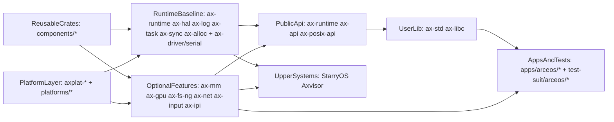
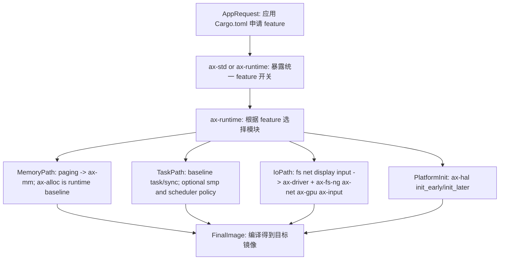
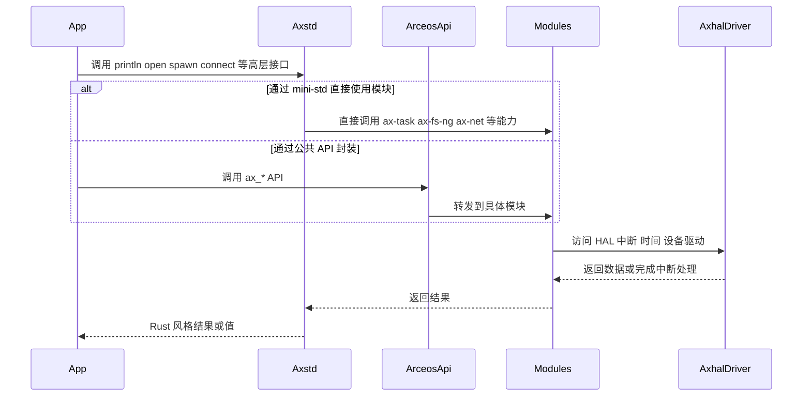
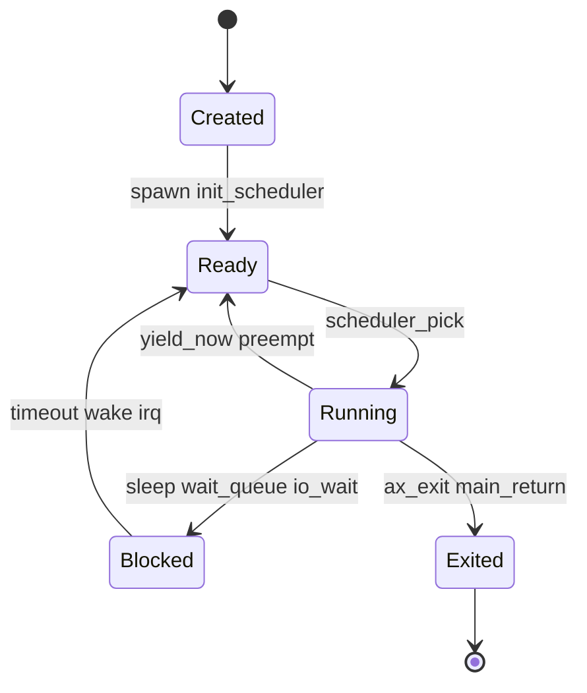
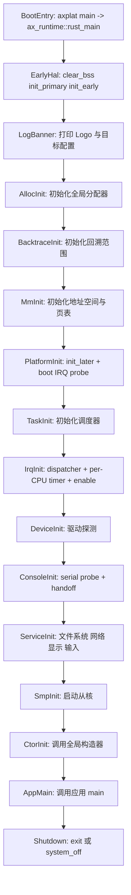

# ArceOS 架构

ArceOS 是 TGOSKits 中的组件化 Unikernel，通过 Rust crate 与 Cargo feature 做编译期装配。它在仓库中同时扮演三种角色：独立运行时、示例应用平台，以及 StarryOS 和 Axvisor 的共享能力提供者。

## 系统定位

ArceOS 在仓库中同时扮演三种角色：独立运行的 Unikernel、示例应用的平台，以及 StarryOS 和 Axvisor 的共享能力提供者。这种多重定位决定了它的模块化程度和接口设计——既要自身可用，又要便于上游系统复用。

| 角色 | 含义 | 在仓库中的体现 |
| --- | --- | --- |
| 组件化单内核 | 通过 Cargo feature 做编译期装配，只链接被选中的能力 | `os/arceos/modules/*`、`api/*`、`ulib/*` |
| 基础系统平台 | 直接承载示例应用和测试包 | `apps/arceos/*`、`test-suit/arceos/*` |
| 共享能力提供者 | 为 StarryOS 和 Axvisor 复用 HAL、调度、内存、驱动等基础能力 | `ax-hal`、`ax-task`、`ax-mm`、`ax-driver` 等被上层直接依赖 |

ArceOS 的设计核心在于：**"功能是否存在"本质上是编译期装配问题，而非运行时开关问题。** 应用只需在 `Cargo.toml` 中声明所需的 feature，运行时自动按 feature 组装对应的模块链路。

## 架构概览

ArceOS 的 crate 按职责组织成一条从底层平台到上层应用的能力传递链。



应用最终经由 `user lib -> API -> runtime modules/shared crates -> HAL/platform` 链路获取能力。StarryOS 和 Axvisor 直接复用底层 crate，因此 `ax-hal`、`ax-task`、`ax-driver` 等共享能力的改动可能同时影响多个系统。

## 分层职责

ArceOS 从底部硬件平台到顶部应用形成逐层依赖，且尽量通过 Cargo feature 控制是否参与编译，而非在运行时做条件判断。

| 层次 | 主要目录 | 关注点 |
| --- | --- | --- |
| 可复用 crate 层 | `components/*` | 算法、同步、容器、地址空间、设备抽象等可被多个系统复用的基础构件 |
| 平台与 HAL 层 | `platforms/*`、`os/arceos/modules/axhal` | 架构相关启动、时钟、中断、内存映射、设备访问 |
| 内核服务模块层 | `os/arceos/modules/*` 与共享领域 crate | 内建运行时模块，以及分配器、任务、驱动、文件系统、网络和图形能力 |
| API 聚合层 | `os/arceos/api/*` | feature 选择、稳定 API 封装、POSIX 兼容接口 |
| 用户库层 | `os/arceos/ulib/*` | `ax-std`、`ax-libc` 等高层开发接口 |
| 应用与测试层 | `apps/arceos/*`、`test-suit/arceos/*` | 场景化验证与系统回归 |

## 模块体系

ArceOS 的内建运行时模块位于 `os/arceos/modules/`，而分配器、任务、驱动、文件系统和网络等共享 crate 位于根工作区的其他目录。两者的目录边界和 feature 依赖不同，不能把 `os/arceos/modules/` 当作 ArceOS 全部能力的清单。

### 运行时基线

`axruntime/Cargo.toml` 把 `ax-hal`、`ax-log`、`ax-task`、`ax-sync`、`ax-alloc` 和带串口能力的 `ax-driver` 作为运行时基线依赖。`ax-runtime` 负责启动、初始化顺序和多核协同，`ax-hal` 提供平台抽象，`ax-log` 输出日志，`ax-task` 与 `ax-sync` 提供任务和同步能力，`ax-alloc` 提供全局分配器。

- `ax-runtime`：启动与初始化总控。
- `ax-hal`：统一硬件抽象层。
- `ax-task`：任务、调度、等待队列与 timer。
- `ax-sync`：任务态同步原语。
- `ax-log`：日志输出与格式化。
- `ax-alloc`：全局内存分配器。
- `ax-driver`：串口等基础设备驱动。

### 内建模块与共享 crate

`os/arceos/modules/` 中的模块直接参与 ArceOS 运行时装配，其中 `ax-mm`、`ax-gpu`、`ax-display`、`ax-input` 和 `ax-ipi` 由 feature 或上层 crate 选择；`ax-hal`、`ax-log`、`ax-runtime` 和 `ax-sync` 构成固定的运行时结构。共享 crate 则由 `ax-runtime` 按 feature 引入，并可被其他系统直接依赖。

| 内建模块 | 目录 | feature 边界 | 作用 |
| --- | --- | --- | --- |
| `ax-runtime` | `modules/axruntime` | 运行时入口 | 启动、初始化顺序、线程与多核协同 |
| `ax-hal` | `modules/axhal` | 运行时基线 | CPU、内存、时间、中断、页表、TLS、DTB 等硬件抽象 |
| `ax-log` | `modules/axlog` | 运行时基线 | 多级日志与格式化输出 |
| `ax-sync` | `modules/axsync` | 运行时基线 | mutex 等同步原语 |
| `ax-mm` | `modules/axmm` | `paging` | 地址空间、页表与映射后端 |
| `ax-gpu` | `modules/axgpu` | `display`（运行时） | GPU 设备与资源运行时 |
| `ax-display` | `modules/axdisplay` | `display`（API 层） | 基于 `ax-gpu` 的显示访问 |
| `ax-input` | `modules/axinput` | `input` | 输入设备管理与事件分发 |
| `ax-ipi` | `modules/axipi` | `ipi` / `wake-ipi` | 处理器间中断管理 |

共享 crate 的路径和典型 feature 映射如下。`ax-runtime` 的 feature 会继续向这些 crate 传递能力开关，因此修改 feature 时要以 `axruntime/Cargo.toml` 为准。

| 共享 crate | 目录 | 典型 feature | 关键职责 |
| --- | --- | --- | --- |
| `ax-alloc` | `memory/ax-alloc` | 运行时基线 | 全局堆分配与 DMA 相关地址转换 |
| `ax-task` | `components/ax-task` | 运行时基线；`smp` | OS 无关调度、线程句柄、等待队列、timer/PI/task-work |
| `ax-driver` | `drivers/ax-driver` | `serial` 基线；`block`、`gpu`、`net`、`input`、`rtc`、`vsock` | 设备探测与驱动初始化 |
| `ax-fs-ng` | `fs/ax-fs-ng` | `fs`；`ext4fs` / `fatfs` | 文件系统、页缓存与块设备运行时 |
| `axfs-ng-vfs` | `fs/axfs-ng-vfs` | `fs` | VFS 节点、目录项与挂载拓扑 |
| `ax-net` | `net/ax-net` | `net`；`vsock` | 统一网络栈与 socket 抽象 |

## 核心设计机制

ArceOS 的设计围绕三个核心机制展开：Feature 驱动的编译期装配、多层 API 封装策略，以及基于状态机的任务调度模型。理解这些机制是阅读和修改 ArceOS 代码的基础。

### Feature 驱动的系统装配

ArceOS 的装配逻辑分布在应用依赖、`ax-std/ax-runtime` feature 以及 `ax-runtime` 的 feature 依赖图中。



`ax-runtime` 的 feature 映射关系（来自 `axruntime/Cargo.toml`）：

```toml
[features]
paging = ["ax-hal/paging", "dep:ax-mm"]
smp = ["ax-hal/smp", "ax-task/smp", "wake-ipi"]
ipi = ["dep:ax-ipi", "ax-hal/ipi"]
fs = [
  "paging",
  "dep:ax-fs-ng",
  "ax-fs-ng/vfs",
  "dep:axfs-ng-vfs",
  "dep:rdif-block",
  "ax-driver/block",
]
net = ["paging", "dep:ax-net", "dep:rd-net", "ax-driver/net"]
display = ["paging", "dep:ax-gpu", "ax-driver/gpu"]
input = ["paging", "dep:ax-input", "ax-driver/input"]
ext4fs = ["fs", "ax-fs-ng/ext4"]
fatfs = ["fs", "ax-fs-ng/fat"]
vsock = ["net", "ax-net/vsock", "ax-driver/vsock"]
```

平台 IRQ framework、公共 dispatcher、per-CPU timer、任务调度和同步能力都是
固定依赖。`smp` 负责多核启动，`ipi` 与 `wake-ipi` 负责处理器间中断扩展；
`preempt` 和调度算法等策略仍保留各自独立的配置语义。

DMA 是必编译基础能力：`dma-api` 提供 owned DMA 类型和约束检查，`axklib`
提供平台 allocator/cache glue。设备驱动仍由各自 feature 选择；未启用
`paging` 时 coherent 映射属性切换会明确返回 `Unsupported`。

### API 封装策略

ArceOS 并不暴露单一风格的接口，而是针对不同使用者提供三种粒度：面向上层系统的稳定 API、面向兼容层的 POSIX 接口，以及面向应用开发者的 mini-std 接口。

| 接口层 | 目录 | 适合谁使用 | 特点 |
| --- | --- | --- | --- |
| `ax-api` | `api/arceos_api` | 内核模块、系统软件、上层系统 | 按能力域导出稳定函数（`sys`、`time`、`mem`、`task`、`fs`、`net`、`display`） |
| `ax-posix-api` | `api/arceos_posix_api` | 需要 POSIX 风格接口的兼容层 | 更接近 C / POSIX 习惯 |
| `ax-std` / `ax-libc` | `ulib/*` | 应用开发者 | 分别提供 Rust 风格 mini-std 与 libc 风格接口 |

`ax-std` 不走 syscall，而是直接调用 ArceOS 模块，减少了中间 ABI 层开销：



### 任务与调度模型

`ax-task` 是 ArceOS 并发模型的核心，并且始终使用完整多任务实现。调度算法由默认策略、`sched-rr`、`sched-cfs` 等 feature 选择；不再存在单任务 busy-wait 或固定 PID 的兼容路径。



## 启动流程

ArceOS 的主入口位于 `ax_runtime::rust_main()`，从平台引导代码跳入后，按固定顺序建立运行时环境。IRQ 与调度步骤无条件执行；内存、设备服务和 SMP 仍按各自能力配置。



启动流程中的基础契约固定，分配器在早期启动阶段初始化，其余独立子系统按 feature 选择：

- 没有 `paging` → 不进入 `ax-mm::init_memory_management()`
- 没有 `fs`、`net`、`display`、`input` → 相应子系统不会初始化

平台 boot IRQ probe、调度器、公共 IRQ dispatcher、per-CPU timer 注册和本地 IRQ
enable 始终先于设备 probe；console handoff 始终先于 SMP。任何基础阶段失败都保持
原有 panic/fail-close 语义，不回退到 no-IRQ 或单任务实现。

## 模块交互主线

ArceOS 的模块间交互可归纳为四条主线：

1. **启动主线**：`ax-runtime → ax-hal → ax-alloc/ax-mm → ax-task → ax-driver → ax-fs-ng/ax-net`
2. **API 主线**：`ax-std/arceos_api → ax-task/ax-fs-ng/ax-net/... → ax-hal`
3. **平台主线**：`axplat-* / platforms/* → ax-hal → ax-runtime`
4. **测试主线**：`apps/arceos/* / test-suit/* → ax-std or ax-api → modules/shared crates`
