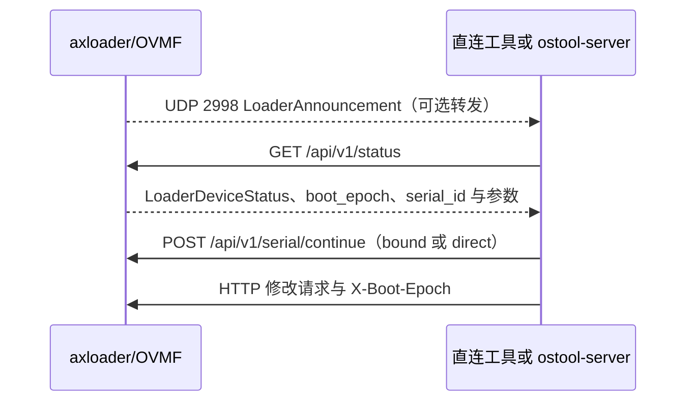

# Axloader

`cargo xtask axloader` 负责构建 x86_64 UEFI 装载器；LoongArch EFI 前端通过 `cargo xtask arceos` 使用 axstd 构建。两条路径都提供设备 HTTP 启动、可选 cmdline/initramfs 和 A/B OTA。axloader 启动后是 TCP4 HTTP 服务端；直连工具与 ostool-server 都调用同一组设备接口。x86 固件路径和 LoongArch axstd 路径都提供串口身份帧，后者在 ArceOS 激活 runtime UART 时通过 axstd console 报告实际波特率和 8N1 参数；没有活动 UART 时继续 fail-closed 并要求显式 `direct` continue。

## 1. 构建入口

本地入口由 `scripts/axbuild/src/axloader/mod.rs` 提供。当前支持 `x86_64-unknown-uefi + OVMF + q35`，产物包含负责选择 A/B 槽的启动器和提供设备接口的装载器。

### 1.1 命令

`build` 构建 EFI 文件，`test qemu` 依次执行宿主测试、UEFI target 检查、release 构建和真实网络场景。

```text
cargo xtask axloader <subcommand>
  build   构建 axloader EFI
  test
    qemu  执行宿主测试、UEFI check 和真实网络启动/OTA
```

常用命令如下；项目验证应从工作区根目录执行。

```bash
cargo xtask axloader build --target x86_64-unknown-uefi --release
cargo xtask axloader test qemu --target x86_64-unknown-uefi
```

### 1.2 产物与布局

`run_loader_build()` 生成两个 EFI 文件。安装后的 ESP 由固定启动器选择装载器槽，普通 OTA 只写非活动槽。

| 产物 | ESP 位置 | 职责 |
| --- | --- | --- |
| `axloader-launcher.efi` | `EFI/BOOT/BOOTX64.EFI` | 校验双状态记录和槽摘要，选择 A/B 槽，处理未确认试运行的回滚 |
| `axloader.efi` | `EFI/AXLOADER/A.EFI` 或 `B.EFI` | 广播设备、提供 HTTP 启动和 OTA 接口、交接目标内核 |

`axloader::ota::State` 保存稳定槽、待试槽、摘要、升级 ID、来源和结果；`axloader::ota::OtaDisk` 负责 `STATE0.BIN`、`STATE1.BIN` 与槽文件的 Flush 和读回校验。两份状态都损坏或没有可信槽时，启动器停止并要求外部介质恢复。

### 1.3 LoongArch EFI 构建

LoongArch 目标使用 `loongarch64-unknown-none-softfloat` 和 `arceos-efi`，由
`bootloader/axloader/build-loongarch64-unknown-none-softfloat.toml` 选择
axstd、FAT/NVMe 和 EFI loader 特性，再由
`bootloader/axloader/qemu-loongarch64.toml` 配置 `virt`、virtio-net、NVMe/FAT
磁盘、`uefi = true` 和 `to_bin = true`。`axstd_loader::run()` 负责单任务轮询
发现和 HTTP 路由；`TargetSpec` 的 `LOONGARCH64_EFI` 固定 ELF machine
`EM_LOONGARCH` 与 `efi_pe_entry`，someboot 的 `LoongBootPayload` 交接目标镜像、
cmdline、initramfs 和内存图。该结构是 LoongArch 专用 v2 EFI 配置表，使用独立
GUID，不复用最新 dev 已移除的 `host-boot-abi` v1；x86_64 继续使用最新 dev 的
Linux EFI `LoadFile2` initrd 协议。

```bash
cargo xtask arceos build \
  --package axloader \
  --config bootloader/axloader/build-loongarch64-unknown-none-softfloat.toml
cargo xtask arceos qemu \
  --package axloader \
  --config bootloader/axloader/build-loongarch64-unknown-none-softfloat.toml \
  --qemu-config bootloader/axloader/qemu-loongarch64.toml
```

要验证目标 ELF 的正向交接，先构建独立的 ArceOS EFI 应用并打包宿主归档：

```bash
cargo xtask image pack-initramfs test-suit/host-initramfs \
  target/axbuild/host-initramfs/loong-host.cpio
cargo xtask arceos build \
  --package arceos-helloworld \
  --config bootloader/axloader/build-loongarch64-helloworld-efi.toml
```

该配置启用 `loong-efi-smoke`，使用 `loongarch64-unknown-none-softfloat`、
`ax-std/efi`、cmdline/initramfs smoke 特性，生成
`target/loongarch64-unknown-linux-musl/release/arceos-helloworld`。目标应用的
输出用于确认 EFI 入口已经完成 cmdline 和宿主 initramfs 交接。

CI 的控制面 smoke 改用 `qemu-loongarch64-http.toml`，并在后台运行同一 ArceOS
镜像后执行 `python3 bootloader/axloader/scripts/loong-http-smoke.py`。该配置不以
串口成功标记提前停止 QEMU，而是保留 `hostfwd`，让脚本完成状态、启动事务和
OTA trial/confirm 后再关闭实例。

LoongArch 的持久文件位于 FAT 卷的 `axloader/` 目录：`A.EFI`、`B.EFI`、
`STATE0.BIN` 和 `STATE1.BIN`。`LaOta::prepare_bootstrap()` 在进入待试槽前提交
`attempted`，`loader_slot` 随 EFI 配置表传给下一份 axstd loader，确认请求由
`LaOta::confirm()` 按升级 ID 和来源提交。没有可信 UEFI/FDT 启动熵时，loader
会先提交持久化启动代次，再用代次和当前镜像摘要派生 `boot_epoch`；继承入口复用
父 loader 已提交的代次。非 EFI LoongArch 启动和 UHI FDT handoff 暂不属于此阶段。

首次启动时，loader 会校验并 Flush 自身的 someboot LoongArch PE 到
`A.EFI`，然后创建 `STATE0.BIN`。该引导种子只接受 `ImageBase = 0` 且没有
base relocation directory 的 someboot 产物；其他 PE 会在写入稳定槽前拒绝。

## 2. 设备控制

v6 把控制面放在设备上。`network::NetworkInterface` 要求同一 UEFI 控制器同时提供 SNP、IP4、UDP4 和 TCP4；`network::Announcer` 向 UDP `2998` 单向广播带 `serial_id` 与 `serial_ready` 的 `LoaderAnnouncement`，`direct::Listener` 在 TCP `2999` 接受请求。设备不再发现、轮询或下载 ostool-server 的资源。

### 2.1 发现与代次

每次固件启动都会生成新的 `boot_epoch`。调用方先读取 `GET /api/v1/status`，随后在修改请求中携带相同的 `X-Boot-Epoch`；旧代次返回 `409`。广播只用于发现，有设备地址的直连调用方不依赖 ostool-server。



本地服务端联调只把测试环境中的设备地址映射到 QEMU `hostfwd` 端口。ostool-server 随后通过真实 HTTP 连接操作客户机中的 axloader，测试夹具不替设备生成响应。

### 2.2 启动事务

`boot_server::BootServer` 保存单个内存事务，并直接使用 `httpboot_protocol::DeviceBootJob`、`DeviceBootImage` 和 `DeviceBootStatus`。同一启动 ID 与相同清单可以重试；冲突清单或并发事务返回 `409`。cmdline 和 initramfs 相互独立，均可省略。

| 接口 | 行为 |
| --- | --- |
| `POST /api/v1/boot/jobs` | 提交启动 ID、x86_64 ELF64、文件长度和 SHA-256，以及可选 cmdline/initramfs |
| `GET /api/v1/boot/jobs/{id}` | 查询文件接收状态和阶段 |
| `PUT /api/v1/boot/jobs/{id}/kernel` | 定长上传内核并核对 `X-Image-Sha256` |
| `PUT /api/v1/boot/jobs/{id}/initramfs` | 上传清单声明的可选归档 |
| `POST /api/v1/serial/continue` | 携带 `X-Boot-Epoch`、`serial_id`、`binding_id` 和 `bound/direct`；相同请求幂等，`bound` 需要当前串口身份就绪 |
| `DELETE /api/v1/serial/bindings/{binding_id}` | 撤销当前启动的绑定令牌并恢复身份帧 |
| `DELETE /api/v1/boot/jobs/{id}` | 取消尚未执行的事务 |
| `POST /api/v1/boot/jobs/{id}/start` | 完成 ELF 与载荷检查，核对 `X-Serial-Binding`，回复 `202`，关闭网络对象后交接 |

v6 只接受 `__x86_64_efi_pe_entry`。cmdline 经 `entry::PreparedLoadOptions` 编码为带 NUL 的 UCS-2 EFI LoadOptions；initramfs 存在时由 `payload::PreparedPayload` 注册 Linux EFI `EFI_LOAD_FILE2_PROTOCOL` 提供者。启动文件单个上限 256 MiB，请求头上限 4 KiB，只接受定长 body。上传、状态查询和 OTA 不受串口门禁限制；没有隧道需求的调用方必须显式使用 `direct` continue。

LoongArch 请求使用 `BootArch::Loongarch64`、`ImageFormat::Elf64` 和
`efi_pe_entry`。`axstd_loader::LoadedElf` 拒绝错误 machine、入口、重叠
`PT_LOAD` 或与当前 loader 重叠的装载区域；`PublishedPayload` 通过
`someboot::loader_set_payload_with_image()` 交接 cmdline/initramfs。目标 EFI
镜像由 `LoadedPe` 校验 LoongArch PE/COFF machine 并从独立槽位内存池装载。

v6 设备必须与支持 `POST /api/v1/serial/continue`、`X-Serial-Binding` 的 ostool-server
配套，板卡 ESP/U 盘中的 `axloader.efi` 也要更新到同一版本。启动返回
`409 serial_binding_required` 时，先检查服务端与 loader 是否配套，再检查当前
`serial_id` 是否已完成绑定；无需串口隧道时使用显式 `direct` continue。

### 2.3 OTA 事务

OTA 实现集中在 `bootloader/axloader/src/ota/`。`state.rs` 维护纯状态机与记录编解码，`disk.rs` 独占 ESP 文件访问，`runtime.rs` 的 `OtaController` 负责当前运行槽、上传失败原因和确认操作。该分层让宿主测试可以验证状态机，同时把 UEFI I/O 限制在目标专用模块。

| 接口 | 行为 |
| --- | --- |
| `GET /api/v1/ota/status` | 返回运行槽、稳定槽、待试 ID、来源和最近结果 |
| `PUT /api/v1/ota/image` | 流式写非活动槽，核对长度、SHA-256、PE/COFF 和 UEFI LoadImage 后重启 |
| `POST /api/v1/ota/confirm` | 仅由匹配升级 ID 与来源的待试槽提交为稳定槽 |

EFI 镜像上限 32 MiB。待试槽确认前拒绝内核启动；启动失败、掉电或复位后，启动器清除未确认槽的可信摘要并回到稳定槽。替换 `BOOTX64.EFI` 仍有断电窗口，安装时必须准备外部恢复介质；迁移模式另保留旧装载器备份。

## 3. 安装与本地验证

安装脚本支持两种入口：

```bash
# 全新安装：不要求 ESP 中存在旧 BOOTX64.EFI
./bootloader/axloader/scripts/build-install-efi.sh \
  --fresh --device /dev/sdb1

# 迁移已有装载器：把旧 BOOTX64.EFI 保存为 A
./bootloader/axloader/scripts/build-install-efi.sh \
  --device /dev/sdb1
```

`--fresh` 在 ESP 上创建 `EFI/AXLOADER/A.EFI`、`B.EFI`、两份状态记录和
`EFI/BOOT/BOOTX64.EFI` launcher。A、B 初始是同一份新装载器，A 稳定启动，
首次启动不需要试运行确认。ESP 中若已有 `BOOTX64.EFI`，脚本只保存为
`EFI/AXLOADER/BOOTX64.PREVIOUS.EFI`，不把它纳入自动回滚。迁移模式要求旧
`BOOTX64.EFI`，将其保存为 `BOOTX64.ORIGINAL.EFI`，并让 B 首次作为待试槽。
两种模式都拒绝覆盖已有 `EFI/AXLOADER` 文件；首次替换 launcher 仍须准备外部
恢复介质。

QEMU 验证使用真实 FAT 磁盘、OVMF VARS 和 SLiRP `hostfwd`。`scripts/axbuild/src/axloader/ota_qemu.rs` 属于宿主测试编排层，负责创建 ESP、启动 QEMU、调用设备 HTTP 接口并跨多次启动复用同一磁盘。

### 3.1 执行链

`test qemu` 的每一步都有不同责任：宿主测试验证纯状态和解析，UEFI check 验证目标组合，QEMU 场景验证固件网络、持久磁盘和真实内核交接。

1. 执行 `cargo test -p axloader --all-targets`。
2. 检查 `axloader` 的 `x86_64-unknown-uefi` 目标。
3. release 构建启动器、装载器和真实 ArceOS UEFI ELF。
4. 把启动器、A/B 槽和双状态记录写入真实 FAT 镜像。
5. 用 `hostfwd` 调用客户机 TCP `2999`，先读取状态并完成 `bound/direct` continue，再覆盖直连启动、OTA、重启确认和回滚。
6. 在五种可选载荷组合中观察启动后的内核输出。

该流程不会安装 systemd 服务，不会修改 runner、板卡配置或实体设备。宿主需要 `qemu-system-x86_64`、KVM、`mkfs.vfat`、`mcopy`、`mmd` 和 `python3`。

### 3.2 成功判据

测试必须到达目标内核，`ready_to_handoff` 只表示 axloader 已准备交接。四种组合分别验证无附加载荷、仅 cmdline、仅 initramfs 和两者都有。

- 基础场景输出 `Hello, world!`。
- cmdline 场景输出精确的 `HOST_CMDLINE`。
- initramfs 场景输出 `HOST_INITRAMFS_PASSED`。
- initramfs 回退场景验证 ESP 上的 Linux EFI initrd provider。
- OTA 场景跨 QEMU 启动验证坏摘要、短请求、未确认复位回滚、确认持久化和再次启动。

QEMU 提前退出或超时时保留 transcript。测试应根据具体失败阶段报告 HTTP、网络、磁盘或内核交接错误，不能用重试掩盖确定性失败。

当前 LoongArch CI/QEMU 门禁使用 `qemu-loongarch64-http.toml` 和
`scripts/loong-http-smoke.py`，通过 host `3999` 到 guest `2999` 的转发执行真实
HTTP 请求。它覆盖状态读取、manifest 幂等、serial continue、坏 ELF/OTA 拒绝、有效
PE 槽位写入、重启 trial 和 confirm；随后构建独立的 `arceos-helloworld` EFI ELF，
将 `test-suit/host-initramfs` 作为 HTTP 上传的目标归档，并检查
`elf_loaded`、`ready_to_handoff`、`HOST_CMDLINE: axloader-positive=1`、
`HOST_INITRAMFS_PASSED` 和 `Hello, world!`。普通 `qemu-loongarch64.toml` 的启动
配置则以跨行正则同时等待 `network_ready: arch=loongarch64` 和
`loader_server: port=2999`。失败 trial 的跨重启 rollback 仍需要后续独立 QEMU
场景；其中 `ready_to_handoff` 单独出现时只表示 loader 已准备交接。LoongArch axstd 前端在活动 runtime UART
未绑定时通过 axstd console 输出 `AXLOADER-SERIAL/1 <serial_id>` 身份帧，并在状态/UDP
公告中报告 runtime 波特率和 8N1 参数；没有活动 UART 时报告 `ready=false`，客户端使用
显式 `direct` continue。绑定后暂停身份帧，撤销绑定后恢复输出。

## 4. 故障定位

诊断从设备状态和稳定日志标记开始。广播失败与 TCP 监听失败的影响不同，持久状态损坏也不能按普通网络错误处理。

### 4.1 网络路径

下表把常见日志或 HTTP 结果映射到最先检查的边界。

| 现象 | 优先检查 |
| --- | --- |
| `loader_tcp4_unavailable` | 同一网卡是否同时发布 SNP、IP4、UDP4、TCP4 service binding |
| `loader_tcp4_listen_failed` | 固件能否在 TCP `2999` 建立被动监听，端口是否已占用 |
| `loader_broadcast_error` | UDP `2998` 的广播地址和载荷大小；公告是可选发现路径，有设备 IP 时仍可直连 |
| `serial_binding_required` | 先读取当前 `serial_id`，通过 `POST /api/v1/serial/continue` 完成 `bound` 或显式 `direct` continue，再在启动请求中携带返回的绑定令牌 |
| `serial` 为 `ready=false` | 检查 UEFI `ConOut` 或 axstd EFI console 是否可用，再读取新的 `serial_id` 和 `boot_epoch` |
| `409 stale_boot_epoch` | 重新读取 `/api/v1/status` 并使用新的启动代次 |
| 上传被拒绝 | `Content-Length`、`X-Image-Sha256`、清单长度和当前事务 ID |

设备回复准备交接后，`direct::Listener`、TCP 子句柄、事件和 UDP 广播对象必须先析构。退出 Boot Services 后不能继续调用固件网络或控制台服务。

### 4.2 启动与恢复

`ready_to_handoff` 后失败时检查 ELF 入口、EFI LoadOptions 和 Linux EFI initrd provider。OTA 复位循环则先读取两份状态记录的代次与校验和，再核对当前槽文件摘要。

| 现象 | 优先检查 |
| --- | --- |
| cmdline 缺失 | 清单字段、`PreparedLoadOptions`、someboot 的 EFI image handle 与命令行优先级 |
| initramfs 缺失 | 清单是否声明归档、上传状态、`LoadFile2` 提供者是否在 ExitBootServices 前读取 |
| 待试槽重复回滚 | 升级 ID、`OtaSource`、运行摘要和确认请求是否匹配 |
| 两份状态均无效 | 停止自动启动，使用备份的原装载器和外部介质恢复 |

当前 OTA 只用 SHA-256 检查传输一致性，适用于可信隔离实验网。MAC 绑定不构成认证；以后引入内核验签时，应先让两槽执行同一验签策略并验证拒绝路径。
