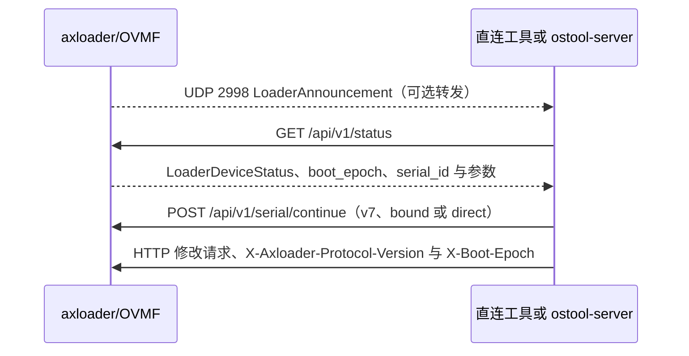

# Axloader

`cargo xtask axloader` 为 x86_64、LoongArch64 和 RISC-V64 构建原生 UEFI 装载器。三种架构共享 SNP/smoltcp 网络、串口身份、HTTP v7、ELF 校验和 someboot 固件交接；EFI 入口与 launcher 产物按目标选择。

客户端只上传实际文件；设备按本地 `TargetSpec` 检查 machine、EFI 符号和装载约束，并从本机符号约定选择入口。通用 legacy LoongArch axstd 后端仍保留，但不是新默认路径；LoongArch 原生路径直接加载目标 ArceOS ELF。

## 1. 构建入口

本地入口由 `scripts/axbuild/src/axloader/mod.rs` 提供。原生目标为 `x86_64-unknown-uefi`、`loongarch64-unknown-uefi` 和 `riscv64-unknown-uefi`，均产出 launcher 与主映像。自定义 UEFI 目标通过 `uefi_build_target_for()` 共用编译配置入口，`axloader::artifact` 复用 LLVM 转换工具并分别执行架构产物校验。

### 1.1 命令

`build` 构建 EFI 文件，`test host` 执行共享契约测试。`test qemu` 为 x86_64、LoongArch64 和 RISC-V64 执行宿主测试、UEFI 目标检查、release 构建及网络启动和 OTA 场景。

```text
cargo xtask axloader <subcommand>
  build   构建 axloader EFI
  test
    host  执行宿主契约测试
    qemu  执行宿主测试、UEFI check 和真实网络启动/OTA
```

常用命令如下；项目验证应从工作区根目录执行。

```bash
cargo xtask axloader build --target x86_64-unknown-uefi --release
cargo xtask axloader build --target loongarch64-unknown-uefi --release
cargo xtask axloader build --target riscv64-unknown-uefi --release
cargo xtask axloader test host
cargo xtask axloader test qemu --target x86_64-unknown-uefi
cargo xtask axloader test qemu --target loongarch64-unknown-uefi
cargo xtask axloader test qemu --target riscv64-unknown-uefi
cargo xtask axloader test qemu --target loongarch64-unknown-uefi \
  --firmware-code /path/to/code.fd --firmware-vars /path/to/vars.fd
```

### 1.2 产物与布局

`run_loader_build()` 为三种原生架构生成两个 EFI 文件，安装后的 ESP 由固定启动器选择装载器槽，普通 OTA 只写非活动槽。

| 产物 | ESP 位置 | 职责 |
| --- | --- | --- |
| `axloader-launcher.efi` | `EFI/BOOT/BOOTX64.EFI`、`BOOTLOONGARCH64.EFI` 或 `BOOTRISCV64.EFI` | 校验双状态记录和槽摘要，选择 A/B 槽，处理未确认试运行的回滚 |
| `axloader.efi` | `EFI/AXLOADER/A.EFI` 或 `B.EFI` | 主映像，广播设备并提供启动与 OTA 接口 |

`axloader::ota::State` 保存稳定槽、待试槽、摘要、升级 ID、来源和结果；`axloader::ota::OtaDisk` 负责 `STATE0.BIN`、`STATE1.BIN` 与槽文件的 Flush 和读回校验。两份状态都损坏或没有可信槽时，启动器停止并要求外部介质恢复。

### 1.3 LoongArch 原生 EFI

LoongArch 新默认入口为 `loongarch64-unknown-uefi`。裸入口在 Rust 全局和分配器初始化前保存固件参数、对齐栈、清 BSS，并应用 `R_LARCH_RELATIVE` 重定位。最终 PE 使用 machine `0x6264`、EFI application subsystem、零 ImageBase 和无 PE base relocation；ELF 构建阶段拒绝 `SHT_REL`、非空 RELR 和其他 relocation 类型。

构建器和安装文件分别为：

```text
target/loongarch64-unknown-uefi/release/axloader.efi
target/loongarch64-unknown-uefi/release/axloader-launcher.efi
```

装载器保持 Boot Services 存活，通过 `someboot::handoff::PreparedHandoff` 安装 LoadOptions 和 Linux EFI initramfs provider。目标以 `efi_pe_entry` 完成自身重定位并建立执行环境，随后自行调用 `ExitBootServices`。原生路径不依赖 ArceOS loader 或旧 inherited handoff。

启动器和装载器都在 UEFI helpers 初始化成功后、任何 OTA/网络/SerialIO 等待之前，通过标准 Boot Services 关闭固件 watchdog。BDS 通常在 `StartImage` 前启用五分钟计时器；长期驻留的无人值守 loader 必须显式取消，timeout 设为 0 且 `WatchdogCode` 使用应用区合法值 `>= 0x10000`。`SetWatchdogTimer` 失败必须输出诊断并按初始化失败返回，不能静默继续。该操作不调用 `ExitBootServices`，目标仍负责退出 Boot Services。龙芯固件报告的 `V00011003`/`WatchdogTimerDxe` 是 watchdog 到期事件，不是 LoongArch CPU fault。

### 1.4 Legacy LoongArch EFI

LoongArch 目标使用 `loongarch64-unknown-none-softfloat` 和 `arceos-efi`，由
`bootloader/axloader/build-loongarch64-unknown-none-softfloat.toml` 选择
axstd、FAT/NVMe 和 `efi-handoff` 能力，再由
`bootloader/axloader/qemu-loongarch64.toml` 配置 `virt`、virtio-net、NVMe/FAT
磁盘、`uefi = true` 和 `to_bin = true`。`axstd_loader::run()` 负责单任务轮询
发现和 HTTP 路由；`target::LOONGARCH64_EFI` 固定 ELF machine
`EM_LOONGARCH` 与 `efi_pe_entry`。someboot 公共 `boot_resources` 管理类型化资源，
`handoff::HandoffSpec` 和 `PreparedHandoff` 管理两条平台路径的交接事务；x86_64
继续使用 EFI LoadOptions 与 Linux EFI LoadFile2。

`boot-resources` 可以独立使用；`efi-handoff = ["efi", "boot-resources"]` 开启生产端，
普通 EFI 消费始终跟随构建脚本的 `cfg(efi)`。原生 UEFI target 只编译 someboot
公共能力与固件适配，不带入内核入口、分页或 SMP。LoongArch 的 v4 配置表承载资源
快照、镜像、cmdline/initramfs 和应用元数据，不包含固定三池或 OTA 槽位字段；
GUID 为 `7b9fa931-a25b-d043-b13c-63435428c473`。v2/v3 已拒绝，迁移须同时重建
生产者、目标与 A/B 槽。完整边界见[设计文档](https://github.com/rcore-os/tgoskits/blob/dev/docs/design/someboot-boot-resources.md)。

`axstd_loader::run()` 在启动及每次连接处理后发送 UDP 公告，阻塞等待连接期间
不周期重发。依赖公告发现的服务端须先就绪；服务端后启动或启动广播丢失时，
使用已知设备 IP 直接访问 HTTP 接口。

两前端使用 `http_control::Route` 共享 v7、epoch/trial 准入，三种 GET 状态查询
无需 epoch，单值控制头重复时返回 `400`。v7 是唯一运行协议；非 v7 修改请求在
解析 body、接管串口或写入文件前返回顶层 `unsupported_protocol`，不进入旧协议
解析器。`elf::ElfImage::parse(image, target)` 只接收本机 `TargetSpec`，统一解析
并校验可执行 EFI 入口；具体装载地址、内存申请和缓存维护由后端负责。LoongArch 在最终跳转前
通过 `ax-runtime::handoff::enter()` 同步文件系统、停止块设备与网络 DMA、join
网络任务、关闭串口及本核中断；当前限定一个运行处理器。停稳失败或保持调用方
执行上下文的 EFI 目标返回时复位；已接管栈、MMU 或处理器状态的内核不得返回。

```bash
cargo xtask arceos build \
  --package axloader \
  --config bootloader/axloader/build-loongarch64-unknown-none-softfloat.toml
cargo xtask arceos qemu \
  --package axloader \
  --config bootloader/axloader/build-loongarch64-unknown-none-softfloat.toml \
  --qemu-config bootloader/axloader/qemu-loongarch64.toml
```

要验证目标 ELF 的正向交接，先构建独立的 ArceOS EFI 应用并打包宿主归档：

```bash
cargo xtask image pack-initramfs test-suit/host-initramfs \
  target/axbuild/host-initramfs/loong-host.cpio
cargo xtask arceos build \
  --package arceos-helloworld \
  --config bootloader/axloader/build-loongarch64-helloworld-efi.toml
```

该配置启用 `loong-efi-smoke`，使用 `loongarch64-unknown-none-softfloat`、
`ax-std/efi`、cmdline/initramfs smoke 特性，生成
`target/loongarch64-unknown-linux-musl/release/arceos-helloworld`。目标应用的
输出用于确认 EFI 入口已经完成 cmdline 和宿主 initramfs 交接。

完整 LoongArch 回归由以下入口统一构建并运行，不需要手动保留后台 QEMU：

```bash
python3 bootloader/axloader/scripts/loong-qemu-smoke.py
```

脚本先执行 `boot-resources` 独立资源应用，再根据 `qemu-loongarch64-http.toml`
创建独占 FAT、QMP socket 和空闲宿主端口，运行正常 HTTP/OTA/ELF 与 FAT 写满两组
场景。loader 构建配置中的 `to_bin = true` 让 `arceos build` 在准备 FAT 前生成
EFI `.bin`。失败时输出 QEMU 日志并停止自己创建的进程组。可加
`--output-dir /tmp/loong-efi` 保留本次运行证据。需要 QEMU LoongArch、dosfstools、
mtools 和 `python3`。

LoongArch 的持久文件位于 FAT 卷的 `axloader/` 目录：`A.EFI`、`B.EFI`、
`STATE0.BIN` 和 `STATE1.BIN`。`LaOta::prepare_bootstrap()` 在进入待试槽前提交
`attempted`；`ota::handoff` 编解码应用自己的槽位和代次，someboot 仅传递有界
元数据。确认由 `LaOta::confirm()` 按升级 ID 和来源提交。没有可信启动熵时先提交
持久代次，再派生 `boot_epoch`；继承入口复用父 loader 已提交的代次。

axloader 的静态计划声明 32 MiB 镜像区（`0x200000`）、256 MiB 归档区、32 MiB
EFI 槽执行区和 32 MiB 原文件区。首次启动在退出服务前通过
`InitialContents::FirmwareBootImage` 保存最初固件启动文件，再校验、Flush 并读回
`A.EFI`，最后创建状态记录；不使用已修改的运行镜像字节。该配置要求最初从可读的
EFI 文件系统启动，源文件不超过 32 MiB，来源不可用或必需资源申请失败时停止。
仅接受 `ImageBase = 0`、无 base relocation directory 的 someboot LoongArch PE。
继承阶段保留同一份固件来源文件，当前槽身份以持久状态为准，缺失状态时拒绝建档。
非 EFI LoongArch、UHI FDT handoff 和 AArch64 EFI 镜像生成不在本阶段。

### 1.5 RISC-V 原生 EFI

RISC-V 使用仓库自定义的 `riscv64-unknown-uefi`，`src/arch/riscv64/mod.rs` 内联固件入口汇编，在进入 Rust 前完成自身相对重定位和指令同步。`target::RISCV64_EFI` 接收 `EM_RISCV` ELF64，目标内核入口为 `efi_pe_entry`。

`Fdt::prepare()` 在架构层保持有效设备树，随后进入三种原生架构共享的 `snp::run()`。
`snp::Network` 独占一个固件 SNP，由 smoltcp 提供 DHCP、IPv4、UDP 发现与 TCP，
广播和 HTTP 共用同一地址。RISC-V 计时使用 FDT 的 `/cpus/timebase-frequency`，
固件 RNG 不可用时停止发布身份。

产物为 `target/riscv64-unknown-uefi/release/axloader.efi` 和 `axloader-launcher.efi`。RISC-V 的两个映像共用入口重定位与链接脚本；launcher 复用共享 A/B 状态机。按第 1.2 节部署，`EFI/BOOT/BOOTRISCV64.EFI` 必须是 launcher，主映像位于 A/B 槽。直接执行主映像可以网络启动内核，但不启用槽位 OTA。BananaPi 同一 ESP 还需提供匹配的 `EFI/BOOT/board.dtb`。

BananaPi 使用独立测试 U 盘的 FAT ESP，保留板载系统的启动文件。`Fdt::prepare()` 从 loader 所在文件系统读取匹配 DTB；显式输入损坏或 fixup 失败时停止，不能放宽保留区校验。

DTB 的 UART 类型也必须准确。K3 控制台节点应包含 `compatible = "spacemit,k3-uart", "intel,xscale-uart"`、`reg-shift = <2>` 和 `reg-io-width = <4>`，与 [Linux K3 设备树](https://git.kernel.org/pub/scm/linux/kernel/git/torvalds/linux.git/tree/arch/riscv/boot/dts/spacemit/k3.dtsi) 一致。`ax-driver` 依此选择 `UartVariant::XScale` 并保持 IER.UUE 端口使能位。

仅声明为 `ns16550` 会选择标准 UART 行为，清除 IER 时可能关闭实际的 XScale 端口。`Fdt::prepare()` 的结构校验不验证设备描述与硬件是否一致，不能据此认定串口配置正确。

1. 使用第 1.1 节的 RISC-V 构建命令生成两个映像，按第 3 节的 `--fresh --target riscv64-unknown-uefi` 安装 A/B 布局，保留匹配的 `board.dtb`，同步并卸载测试盘。
2. 通过 F2 Boot Manager 进入 UEFI Shell，执行 `map -r` 确认测试盘编号，再执行该盘的 `\EFI\BOOT\BOOTRISCV64.EFI`。
3. 等待 FDT 安装与网络后端日志，释放调试串口供配套 ostool 会话完成身份绑定、内核和 initramfs 传输，并按第 3.2 节核对目标输出。

无人值守启动和 OTA 重启要求固件优先启动测试 U 盘。先用 `map -r`、`vol` 确认 AXLOADER 测试盘，再用 `bcfg boot dump -v` 找到对应 USB 启动项，将其当前索引通过 `bcfg boot mv <USB索引> 0` 移到首位，保留板载 Linux 和 Shell 启动项。索引随枚举变化；配置后可通过断电重启检查启动项是否持久化，以及固件能否自动进入 USB launcher。

## 2. 设备控制

v7 把控制面放在设备上。三个原生 UEFI 目标通过共享 `snp::run()` 和 `snp::Network`
独占一个固件 SNP，由 smoltcp 提供 DHCP、IPv4、UDP 发现与 TCP。UDP `2998`
单向广播带 `serial_id` 与 `serial_ready` 的 `LoaderAnnouncement`，TCP `2999`
接受 HTTP 请求；MAC、公告和 HTTP 共用同一网卡与 DHCP 地址。设备不发现、
轮询或下载 ostool-server 的资源，也不维护旧 discovery、poll 或 OTA 兼容入口。

### 2.1 发现与代次

每次固件启动都会生成新的 `boot_epoch`。调用方先读取 `GET /api/v1/status`，随后在所有 boot、serial 和 OTA mutation 中携带相同的 `X-Boot-Epoch` 与 `X-Axloader-Protocol-Version: 7`；旧代次返回 `409 boot_epoch_mismatch`。GET 状态查询可以不带协议版本头。广播只用于发现，有设备地址的直连调用方不依赖 ostool-server。



本地服务端联调只把测试环境中的设备地址映射到 QEMU `hostfwd` 端口。ostool-server 随后通过真实 HTTP 连接操作客户机中的 axloader，测试夹具不替设备生成响应。

### 2.2 启动事务

`boot_server::BootServer` 保存单个内存事务，并使用 v7 `DeviceBootJob`、`DeviceBootImage` 和 `DeviceBootStatus`。`DeviceBootJob` 只有 `boot_id`、`kernel`、可选 `initramfs` 与可选 `cmdline`；`arch`、`image_format` 和 `entry_symbol` 不属于请求，携带这些字段的 JSON 因 `deny_unknown_fields` 被拒绝。同一启动 ID 与相同清单重试返回当前状态；冲突清单或并发事务返回 `409 boot_job_busy`。

| 接口 | 行为 |
| --- | --- |
| `POST /api/v1/boot/jobs` | 提交启动 ID、内核长度和 SHA-256，以及可选 cmdline/initramfs；不传架构、格式或入口 |
| `GET /api/v1/boot/jobs/{id}` | 查询接收、ready 或 failed 状态及首个错误 |
| `PUT /api/v1/boot/jobs/{id}/kernel` | 定长上传内核并核对 `X-Image-Sha256` |
| `PUT /api/v1/boot/jobs/{id}/initramfs` | 上传清单声明的可选归档 |
| `POST /api/v1/serial/continue` | 携带 `X-Boot-Epoch`、`serial_id`、`binding_id` 和 `bound/direct`；相同请求幂等，`bound` 需要当前串口身份就绪 |
| `DELETE /api/v1/serial/bindings/{binding_id}` | 撤销当前启动的绑定令牌并恢复身份帧 |
| `DELETE /api/v1/boot/jobs/{id}` | 释放当前事务；failed 事务同样可通过 DELETE 释放 |
| `POST /api/v1/boot/jobs/{id}/start` | 在本机唯一解析实际 ELF，核对 `X-Serial-Binding`，完整发送 `202 ready_to_handoff` 并确认后才交接 |

x86_64 的本地目标使用 machine `62` 和 `__x86_64_efi_pe_entry`，原生 LoongArch64 使用 machine `258` 和 `efi_pe_entry`，RISC-V64 使用 machine `243` 和 `efi_pe_entry`。这些值由设备 `TargetSpec` 持有，状态 `arch` 只用于显示和诊断；主机不据此做准入。当前提供三种原生 UEFI 前端，并保留 LoongArch64 `arceos-efi` 前端。`someboot::handoff::PreparedHandoff` 将 cmdline 编码为带 NUL 的 UCS-2 EFI LoadOptions，并为可选 initramfs 注册 Linux EFI `EFI_LOAD_FILE2_PROTOCOL` 提供者。启动文件单个上限 256 MiB，请求头上限 4 KiB，只接受定长 body。上传、GET 状态和 OTA 状态不受串口门禁限制；没有隧道需求的调用方必须显式使用 `direct` continue。

LoongArch 原生请求只传文件字节。`target::LOONGARCH64_UEFI` 提供本机 machine、
`efi_pe_entry`、装载/链接地址与允许的 `R_LARCH_RELATIVE` 策略。
`ElfImage::parse()` 在 start 中只执行一次，拒绝错误 machine、缺失或不可执行入口、
重叠/溢出 `PT_LOAD` 和不支持的 RELA/RELR，并把 machine 实际值与期望值、本地要求的
符号写入错误消息。复制前清零完整分配范围，复制后刷新 LoongArch 指令缓存。目标入口
仍须自行应用重定位并调用 `ExitBootServices`。

原生 RISC-V 与 LoongArch 的 ELF 保留 `__rela_dyn_begin` 和 `__rela_dyn_end`
边界符号。`ElfImage::parse()` 按这两个符号预检所声明的已装载 RELA 字节，检查完整记录、
类型、符号索引、可写目标及表自身保护；缺少边界或范围无效时拒绝启动。
section header 的重定位节检查同时保留。符号表属于输入元数据，不能代替执行端的
检查：someboot 按 PC 相对指令取得的 linker 地址重新检查实际表，目标必须落在
运行中的数据/RELRO 范围且不覆盖表，并排除启动栈及启动记录，整表通过后才写入。元数据与实际表不一致时，
仍不能绕过该检查；非法表从 EFI 入口返回 `LOAD_ERROR`。

原生网络只要求固件提供可用 SNP，不需要固件 IP4、UDP4 或 TCP4 协议。
`Network::open()` 按候选网卡获取 DHCP 地址，每卡最多等待 30 秒；失败时先完成
NIC 停稳，再尝试下一卡。整轮遇到 DHCP 超时或无链路时，间隔 2 秒重新轮选，
网络恢复后继续启动；停稳失败仍终结复位，不作为可重试网络故障。
选定接口后创建启动身份，服务期间不自动搬移事务。
`loader_snp_open` 报告实际网卡，`loader_snp_dhcp` 报告 smoltcp 取得的地址。
串口身份要求能从 ConOut 唯一选择 UEFI SerialIo 并读取线路参数；没有 SerialIo、参数或唯一匹配时输出
`loader_serial_probe` 和 `loader_serial_unavailable`，状态保持 `ready=false`，
不得伪造 115200 串口。三个目标都优先使用固件 RNG；x86_64、LoongArch64
在缺失时保留平台身份回退，RISC-V 则停止发布身份。

Loong QEMU profile 添加 `virtio-rng-pci`，供固件提供 RNG；Virtio 网卡和 RNG
都使用空 `romfile`，由 Loong 固件提供驱动。smoltcp 通过 SNP 收发以太网帧，
不依赖固件 `TcpDxe` 或 Hash2 生产者。

测试可通过成对的 `--firmware-code`、`--firmware-vars` 指定临时固件；缺一项
立即报错。Loong CODE/VARS 会复制到本次 artifact 目录并按需补零到 16 MiB，
源文件不变。

v7 设备必须与发送 v7 头和 `X-Serial-Binding` 的 ostool CLI/server 配套，板卡
ESP/U 盘中的 `axloader.efi` 也要更新到同一版本。启动返回
`409 serial_binding_required` 时，检查当前 `serial_id` 是否已完成 `bound` 或
显式 `direct` continue；无需串口隧道时使用 `direct`。

设备控制错误统一为顶层 `{code,message}`。上传长度或摘要失败、ELF/装载失败及
handoff 准备失败进入 `failed`，保留首个错误并释放 kernel/initramfs 大缓冲；
failed 事务的后续 PUT/start 返回同一 `422`，GET 返回 `200 failed`，DELETE
后释放。epoch/binding 不匹配、文件未齐和未知 ID 是非终态，不破坏事务。

两个 frontend 都在 body 读取和状态修改前按 v7 版本、epoch/trial、当前 ID 与
failed 状态依次检查。旧 epoch 即使指向 failed job 也先返回
`409 boot_epoch_mismatch`；当前 epoch 的 failed PUT/start 即使携带错误或超大的
新长度，也直接重放首个 `422`，不扩展或保留恢复缓冲。只有这些检查通过后才验证
声明长度、摘要并读取/分配 body。

`BootServer::prepare()` 返回拥有装载镜像和 handoff 载荷的 `BootExecution`。
原生 UEFI 路径只有在 `202 ready_to_handoff` 完整发送并收到 TCP ACK 后才进入
终结 `Boot` 分支。`snp::connection::Connection::finish()` 在入口及每次推进网络后，
先确认 DHCP 地址有效、TCP 状态为 `Established` 或 `CloseWait`，再判断发送队列为空。
正常半关闭连接可以继续接收并确认响应；RST、租约丢失或发送超时会析构本次 execution，
保留 ready job 供同一 ID 重试。响应确认后才进行有界 FIN 交换，不以 FIN 是否完成
代替 ACK 证明。LoongArch axstd/arceos-efi 前端保持其运行时发送与交接流程。

进入终结分支后不再处理第二个控制请求：UEFI 路径先停稳 SNP，释放 `BootServer`、
OTA、网络对象和串口 beacon，
Loong axstd 路径在 runtime 停稳及 seal 前释放普通 heap 上的 server/OTA/连接对象，
只保留 execution 持有的装载和 handoff 资源。`202` 只表示准备完成，不表示内核
已经成功运行。

### 2.3 OTA 事务

本节的 launcher/A/B 部署适用于 x86_64、LoongArch64 和 RISC-V64。`OtaDisk` 按设备本地 `TargetSpec` 检查 EFI machine，RISC-V 为 `0x5064`；不接受其他架构的 EFI 映像。

OTA 实现集中在 `bootloader/axloader/src/ota/`。`state.rs` 维护纯状态机与记录编解码，`disk.rs` 独占 ESP 文件访问，`runtime.rs` 的 `OtaController` 负责当前运行槽、上传失败原因和确认操作。该分层让宿主测试可以验证状态机，同时把 UEFI I/O 限制在目标专用模块。

| 接口 | 行为 |
| --- | --- |
| `GET /api/v1/ota/status` | 返回运行槽、稳定槽、待试 ID、来源和最近结果 |
| `PUT /api/v1/ota/image` | 流式写非活动槽，核对长度、SHA-256、PE/COFF 和 UEFI LoadImage 后重启 |
| `POST /api/v1/ota/confirm` | 仅由匹配升级 ID 与来源的待试槽提交为稳定槽 |

EFI 镜像上限 32 MiB。待试槽确认前拒绝内核启动；启动失败、掉电或复位后，启动器清除未确认槽的可信摘要并回到稳定槽。替换当前架构的 EFI/BOOT launcher 仍有断电窗口，安装时必须准备外部恢复介质；迁移模式另保留旧装载器备份。

## 3. 安装与本地验证

安装脚本支持三种原生架构；自动 QEMU 套件目前支持 x86_64、LoongArch64，RISC-V 验证方法见第 3.2 节。安装脚本支持两种入口：

```bash
# 全新安装：不要求 ESP 中存在旧 BOOTX64.EFI
./bootloader/axloader/scripts/build-install-efi.sh \
  --fresh --device /dev/sdb1

# LoongArch64 全新安装
./bootloader/axloader/scripts/build-install-efi.sh \
  --fresh --device /dev/sdb1 --target loongarch64-unknown-uefi

# RISC-V64 全新安装，BananaPi 还须在同一 ESP 保留匹配的 board.dtb
./bootloader/axloader/scripts/build-install-efi.sh \
  --fresh --device /dev/sdb1 --target riscv64-unknown-uefi

# 迁移已有装载器：把旧 BOOTX64.EFI 保存为 A
./bootloader/axloader/scripts/build-install-efi.sh \
  --device /dev/sdb1
```

`--fresh` 在 ESP 上创建 `EFI/AXLOADER/A.EFI`、`B.EFI`、两份状态记录和
当前架构的 `EFI/BOOT` launcher。x86_64 使用 `BOOTX64.EFI`，LoongArch64
使用 `BOOTLOONGARCH64.EFI`，RISC-V64 使用 `BOOTRISCV64.EFI`。A、B 初始是同一份新装载器，A 稳定启动，
首次启动不需要试运行确认。ESP 中若已有当前架构的 EFI/BOOT launcher，脚本只把它保存为
同名的 `.PREVIOUS.EFI`，不纳入自动回滚。迁移模式要求旧 launcher，将其保存为
同名的 `.ORIGINAL.EFI`，并让 B 首次作为待试槽。
两种模式都拒绝覆盖已有 `EFI/AXLOADER` 文件；首次替换 launcher 仍须准备外部
恢复介质。

LoongArch64 与 RISC-V64 的首次原生安装必须使用 `--fresh`。从 legacy ArceOS LoongArch loader 迁移到 native loader 时，
A/B 均写入 native loader，旧 `BOOTLOONGARCH64.EFI` 只保存为
`BOOTLOONGARCH64.PREVIOUS.EFI`，不进入 OTA 回退槽。

QEMU 验证使用真实 FAT 磁盘、OVMF VARS 和 SLiRP `hostfwd`。`scripts/axbuild/src/test/ota/ota_qemu.rs` 属于宿主测试编排层，负责创建 ESP、启动 QEMU、调用设备 HTTP 接口并跨多次启动复用同一磁盘。

### 3.1 执行链

`test qemu` 的每一步都有不同责任：宿主测试验证纯状态和解析，UEFI check 验证目标组合，QEMU 场景验证 SNP/smoltcp 网络、持久磁盘和真实内核交接。

1. 通过 `cargo xtask axloader test host` 对应的宿主契约测试步骤验证 `axloader`。
2. 检查 `axloader` 的当前原生 UEFI 目标；LoongArch 使用 custom JSON、`core,alloc` 和 ELF 转换。
3. release 构建当前架构的启动器和装载器。x86_64 还准备 StarryOS、AxVisor guest ELF 与归档；LoongArch64 准备 ArceOS cmdline/initramfs 烟测 ELF。
4. 把启动器、A/B 槽和双状态记录写入真实 FAT 镜像。
5. 用 `hostfwd` 调用客户机 TCP `2999`，先读取状态并完成 `bound/direct` continue，再覆盖直连启动、OTA、重启确认和回滚。这里只证明 HTTP；真实 UDP 广播留待隔离 TAP 或实机。
6. 在五种可选载荷组合中观察启动后的内核输出。
7. x86_64 继续上传 StarryOS 和 AxVisor guest 载荷；LoongArch 通过 native HTTP loader 直接启动 ArceOS cmdline/initramfs 烟测 ELF，并完成 HTTP/OTA 场景。该路径不创建 AxVisor 宿主或虚拟机。

该流程不会安装 systemd 服务，不会修改 runner、板卡配置或实体设备。x86_64 需要 `qemu-system-x86_64`、KVM；LoongArch 使用 `qemu-system-loongarch64`、`virt`、`la464`、TCG、Loong UEFI CODE/VARS 和 `BOOTLOONGARCH64.EFI`。两种架构都由宿主侧 fatfs 创建真实 FAT ESP，不需要 mtools。

### 3.2 成功判据

测试必须到达目标内核，`ready_to_handoff` 只表示 axloader 已准备交接。五种组合分别验证无附加载荷、仅 cmdline、仅 initramfs、两者都有和 ESP initramfs 回退。

202 资源所有权回归使用仅 QEMU 测试构建启用的 `qemu-fail-202-write` feature。
它对固定测试 boot ID 的前两次真实 prepare 结果分别注入响应写失败，以及响应确认前的
smoltcp socket 复位；测试要求已关闭的连接拒绝交接并保留 ready job。
随后使用同一 ID，在请求发送后通过 `shutdown(Write)` 正常半关闭客户端，检查响应
确认后目标能够执行。生产构建完全编译掉注入分支且 HTTP 不能开启。x86_64 与原生
LoongArch QEMU 还分别上传错误 machine、缺失本地 EFI 符号、不可执行入口和坏段范围
的 ELF，要求 `422`、failed 可 GET，以及后续 PUT/start 重放首错；随后正确 ELF
仍须完成真实启动。

- 基础场景输出 `Hello, world!`。
- cmdline 场景输出精确的 `HOST_CMDLINE`。
- initramfs 场景输出 `HOST_INITRAMFS_PASSED`。
- initramfs 回退场景验证 ESP 上的 Linux EFI initrd provider。
- StarryOS 必须运行归档中的 shell 脚本，检查 cmdline 参数并完成文件写读，输出完整行 `STARRY_AXLOADER_USERSPACE_PASSED`。
- AxVisor 必须消费宿主归档中的 builtin 配置和 Linux 镜像，按宿主参数 `axvisor.vm_start=1` 启动客体；测试等待管理 shell 后执行 `vm console 1`，客体脚本完成同样检查后输出完整行 `AXVISOR_GUEST_AXLOADER_USERSPACE_PASSED`。
- LoongArch 必须从 HTTP loader 直接进入 ArceOS，并观察目标执行输出；`ready_to_handoff`、loader 网络状态或 AxVisor 宿主 banner 都不能替代目标结果。
- OTA 场景复用既有上传和启动轮次，验证坏摘要、短请求、提交后响应写入失败或连接复位仍自动试启动、未确认复位回滚、确认持久化和再次启动。

`ota_qemu::payloads::OsPayloads` 只负责准备 OS 载荷，复用 `boot_smoke()` 的真实 HTTP 上传、校验和串口门禁。构建在 `AXBUILD_NO_SNAPSHOT=1` 子进程中调用现有 `cargo xtask starry/axvisor build`，前后逐字节核对保存的命令快照，保留用户默认选择；不修改多线程父进程的全局环境。成功行不出现在 cmdline 原文中，命令行回显不能替代实际执行。每次运行在 `target/axbuild/axloader/qemu/x86-*` 保留 ESP、VARS、历次串口和 stderr；提前退出或超时也保留。测试应根据具体失败阶段报告 HTTP、网络、磁盘或内核交接错误，不能用重试掩盖确定性失败。

`cargo xtask axloader build --target loongarch64-unknown-uefi --release` 是 native
LoongArch EFI 的构建入口，执行 custom target 构建、ELF 转换和最终 PE 校验；
当前 CI 未将该命令设为独立步骤。现有 LoongArch HTTP CI 仍执行旧 axstd 后端的
`loong-qemu-smoke.py`。`cargo xtask axloader test qemu --target loongarch64-unknown-uefi`
是 native Loong 的本地验证入口，尚不是自动 CI 门禁，使用具备 SNP 的 Loong UEFI
CODE/VARS 对。该 QEMU 场景验证 HTTP v7、真实 FAT、OTA 回滚/确认、ArceOS
`HOST_CMDLINE`/`HOST_INITRAMFS_PASSED`。标准 QEMU 不需要 QEMU-LVZ 或 AxVisor
宿主配置。

legacy `scripts/loong-qemu-smoke.py` 继续保留用于旧 axstd loader 回归，但不再
代表 native loader 的 CI/验收入口。SLiRP `hostfwd` 只证明 HTTP；真实 UDP 广播
需要隔离 TAP 网络或实体板卡。

当前 native Loong QEMU 结果不构成实体 LoongArch 硬件验收。实体板卡通过
`.github/ci/checks/arceos.toml` 中的 native firmware 用例直接启动 ArceOS：

```bash
cargo xtask arceos test board \
  --board loongson-3a6000-ll --test-case http-boot
```

RISC-V QEMU 用例使用 `qemu-system-riscv64` 和 EDK II 的 CODE/VARS 固件。可用
`--firmware-code` 和 `--firmware-vars` 指定本地固件。用例将 QEMU 生成的 DTB 放入
测试 ESP，由测试 launcher 发布为 EFI FDT 配置表。它用同一块 FAT 镜像验证
内核启动、升级试运行、未确认回滚和确认持久化。测试 launcher 单独构建在
`target/axbuild/axloader/qemu-build`。

RISC-V 使用共享 SNP/smoltcp 启动接口。检查内核交接时，结合
`loader_snp_open`、`loader_snp_dhcp` 日志确认网卡与地址，再核对启动资源、命令行、initramfs
和目标程序输出。ArceOS smoke 的对应标记为 `BOOT_RESOURCES_PASSED`、
`HOST_CMDLINE: axloader-positive=1`、`HOST_INITRAMFS_PASSED` 和 `Hello, world!`。
StarryOS 的用户态验证方法见本节的归档脚本与成功行说明。

RISC-V 复用 `ota::State` 和 `OtaController` 的 A/B 升级流程。可通过上传非活动槽、
确认待试槽后重启，以及未确认时重启，分别检查升级、确认持久化和回滚；结合
升级 ID 与稳定槽摘要确认实际启动的映像。错误摘要、无效 EFI、错误 machine
和短请求体用于检查上传拒绝路径。`OtaController::finish_update()` 持久提交升级后，
`snp::run()` 通过 `reboot_pending()` 保证重启；HTTP `202` 的写入或确认失败不撤销
提交。上传方未收到完整响应时，应等待新 `boot_epoch`，核对升级 ID、运行摘要及
`trial`，再确认试运行，不能仅凭连接中断判定上传失败并重复下发。

验证 ostool-server 自动调度时，通过管理接口上传镜像并创建板卡升级任务，
由服务端执行镜像下发和确认。正常升级的任务状态依次为
`queued → downloading → staged → confirming → succeeded`；设备的升级 ID、
稳定槽摘要及重启后的状态可用于核对结果。普通 session 占用板卡期间会暂停下发，
无人值守重启按第 1.5 节配置 USB 启动项。

### 3.3 升级到 v7

v7 是破坏性切换，运行时不接受 v2 至 v6 manifest、旧 discovery/poll 路由或旧
arch/format/entry 字段，也不提供“仅用于 OTA 升级”的桥接。切换前先暂停新 session
和 OTA 任务，完成或取消活动旧 OTA 并确认设备退出 pending/trial；随后停止旧
server，按部署要求人工整理旧配置和 OTA 观测缓存，备份后安装新的 v7 axloader，
再部署配套 CLI/server 并重新发现设备。

旧 `boot.boot_arch`、旧配置 kind 和已删除的 loader network 字段不会自动迁移。
保留的 `jobs.json`、OTA 镜像和有效回滚记录不由 loader 删除。安装失败时按
现有外部恢复介质流程恢复稳定槽；不得让新 server 通过旧协议把旧 loader
升级到 v7。

## 4. 故障定位

诊断从设备状态和稳定日志标记开始。广播失败与 TCP 监听失败的影响不同，持久状态损坏也不能按普通网络错误处理。

### 4.1 网络路径

下表把常见日志或 HTTP 结果映射到最先检查的边界。

| 现象 | 优先检查 |
| --- | --- |
| `loader_snp_candidate_open_failed` | 候选 SNP 是否可打开，并检查对应的 start、initialize 或 receive filters 错误；初始化后不会仅凭 `MediaPresent` 跳过 DHCP，以便等待 PHY 协商 |
| `loader_snp_retry` | 本轮候选存在 DHCP 超时或无链路，稍后重新轮选；检查链路和 DHCP 服务 |
| `loader_snp_unavailable` | 初始化未能取得可用网卡，且不能按临时网络故障重试；检查时钟和候选网卡错误 |
| 没有 `loader_snp_dhcp` | SNP 链路、DHCP 服务和网络隔离配置；地址由 smoltcp 获取 |
| `loader_snp_dhcp_lost` | DHCP 租约与链路，当前连接会取消，地址恢复后重新访问 |
| `loader_http_response_failed` | 响应写入、TCP 状态和 ACK 是否完成；RST、租约丢失或超时后可用同一 ready job 重试 |
| `loader_snp_stop_failed` | NIC 和已提交发送缓冲是否停稳；失败时 loader 保留所有者并复位 |
| UDP 公告不可达 | UDP `2998` 的广播路由；公告是可选发现路径，有设备 IP 时仍可直连 |
| `serial_binding_required` | 先读取当前 `serial_id`，通过 `POST /api/v1/serial/continue` 完成 `bound` 或显式 `direct` continue，再在启动请求中携带返回的绑定令牌 |
| `serial` 为 `ready=false` | 检查 UEFI `ConOut` 或 axstd EFI console 是否可用，再读取新的 `serial_id` 和 `boot_epoch` |
| `409 boot_epoch_mismatch` | 重新读取 `/api/v1/status` 并使用新的启动代次 |
| 上传被拒绝 | `Content-Length`、`X-Image-Sha256`、清单长度和当前事务 ID |

原生 UEFI 交接前，`snp::Network::close()` 必须停稳 NIC。`snp::device::Device`
保留固件已提交的发送缓冲，直到 `GetStatus` 返回原指针；关闭失败时保留所有者并复位。
网络对象和串口 beacon 在目标入口前释放，Boot Services 仍保持存活，由目标自行退出。
退出 Boot Services 后不能继续调用固件网络或控制台服务。

### 4.2 启动与恢复

`ready_to_handoff` 后失败时检查 ELF 入口、EFI LoadOptions 和 Linux EFI initrd provider。OTA 复位循环则先读取两份状态记录的代次与校验和，再核对当前槽文件摘要。

| 现象 | 优先检查 |
| --- | --- |
| cmdline 缺失 | 清单字段、`PreparedLoadOptions`、someboot 的 EFI image handle 与命令行优先级 |
| initramfs 缺失 | 清单是否声明归档、上传状态、`LoadFile2` 提供者是否在 ExitBootServices 前读取 |
| 待试槽重复回滚 | 升级 ID、`OtaSource`、运行摘要和确认请求是否匹配 |
| 两份状态均无效 | 停止自动启动，使用备份的原装载器和外部介质恢复 |

当前 OTA 只用 SHA-256 检查传输一致性，适用于可信隔离实验网。MAC 绑定不构成认证；以后引入内核验签时，应先让两槽执行同一验签策略并验证拒绝路径。

LoongArch 交接的资源容量与存活对象分开管理。等待下载的 axloader 继续保有声明容量；
普通目标没有资源计划时，只保留当前镜像、未消费归档及显式存活分配。旧镜像、栈、
页表和逐核区在目标安装自身执行环境并绑定 CPU-local 后才回收，随后才初始化普通分配器。
`PreparedHandoff::seal` 在运行时停稳后的无分配窗口发布最终快照，生成可进入的 `SealedHandoff`。
initramfs 解包借用结束后通过唯一所有者归还完整页；冻结的平台 map 不再修改。
机制、内存分类与失败边界见[启动内存回收设计](https://github.com/rcore-os/tgoskits/blob/dev/docs/design/someboot-boot-resources.md#4-启动内存回收)。

LoongArch 实机退出 UEFI 时，固件 runtime/MMIO 描述符可能多于 32 项。
虚拟地址映射复用 128 KiB 静态缓冲，保留原始 descriptor 大小、版本和扩展字节；
不在退出服务后因固定 32 项容量溢出而 panic。启动故障仍需以对应 EFI 的实机日志
定位，QEMU 通过不能替代物理网卡和本机固件验证。
