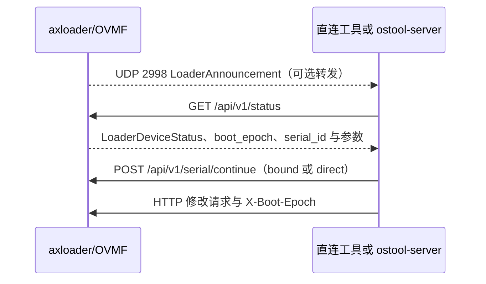

# Axloader

`cargo xtask axloader` 为 x86_64 和 LoongArch64 构建同一套原生 UEFI 装载器。两者共享固件网络、串口身份、HTTP v6、A/B OTA、ELF 校验和 someboot 固件交接；架构 profile 只选择 ELF machine/入口、UEFI 固件、QEMU 参数和启动文件名。通用 legacy LoongArch axstd 后端仍保留，但不是新默认路径；LoongArch 原生路径直接加载目标 ArceOS ELF。

## 1. 构建入口

本地入口由 `scripts/axbuild/src/axloader/mod.rs` 提供。原生目标为 `x86_64-unknown-uefi` 与 `loongarch64-unknown-uefi`，产物包含负责选择 A/B 槽的启动器和提供设备接口的装载器。LoongArch 使用自定义 ELF/PIC target，再由 `llvm-objcopy` 生成零 ImageBase、无 PE base relocation 的 EFI。

### 1.1 命令

`build` 构建 EFI 文件，`test qemu` 依次执行宿主测试、UEFI target 检查、release 构建和真实网络场景。

```text
cargo xtask axloader <subcommand>
  build   构建 axloader EFI
  test
    qemu  执行宿主测试、UEFI check 和真实网络启动/OTA
```

常用命令如下；项目验证应从工作区根目录执行。

```bash
cargo xtask axloader build --target x86_64-unknown-uefi --release
cargo xtask axloader build --target loongarch64-unknown-uefi --release
cargo xtask axloader test qemu --target x86_64-unknown-uefi
cargo xtask axloader test qemu --target loongarch64-unknown-uefi
cargo xtask axloader test qemu --target loongarch64-unknown-uefi \
  --firmware-code /path/to/code.fd --firmware-vars /path/to/vars.fd
```

### 1.2 产物与布局

`run_loader_build()` 生成两个 EFI 文件。安装后的 ESP 由固定启动器选择装载器槽，普通 OTA 只写非活动槽。

| 产物 | ESP 位置 | 职责 |
| --- | --- | --- |
| `axloader-launcher.efi` | `EFI/BOOT/BOOTX64.EFI` 或 `EFI/BOOT/BOOTLOONGARCH64.EFI` | 校验双状态记录和槽摘要，选择 A/B 槽，处理未确认试运行的回滚 |
| `axloader.efi` | `EFI/AXLOADER/A.EFI` 或 `B.EFI` | 广播设备、提供 HTTP 启动和 OTA 接口、交接目标内核 |

`axloader::ota::State` 保存稳定槽、待试槽、摘要、升级 ID、来源和结果；`axloader::ota::OtaDisk` 负责 `STATE0.BIN`、`STATE1.BIN` 与槽文件的 Flush 和读回校验。两份状态都损坏或没有可信槽时，启动器停止并要求外部介质恢复。

### 1.3 LoongArch 原生 EFI

LoongArch 新默认入口为 `loongarch64-unknown-uefi`。裸入口在 Rust 全局和分配器初始化前保存固件参数、对齐栈、清 BSS，并应用 `R_LARCH_RELATIVE` 重定位。最终 PE 使用 machine `0x6264`、EFI application subsystem、零 ImageBase 和无 PE base relocation；ELF 构建阶段拒绝 `SHT_REL`、非空 RELR 和其他 relocation 类型。

构建器和安装文件分别为：

```text
target/loongarch64-unknown-uefi/release/axloader.efi
target/loongarch64-unknown-uefi/release/axloader-launcher.efi
```

装载器保持 Boot Services 存活，通过 `someboot::handoff::PreparedHandoff` 安装 LoadOptions 和 Linux EFI initramfs provider。目标以 `efi_pe_entry` 完成自身重定位并建立执行环境，随后自行调用 `ExitBootServices`。原生路径不依赖 ArceOS loader 或旧 inherited handoff。

启动器和装载器都在 UEFI helpers 初始化成功后、任何 OTA/网络/SerialIO 等待之前，通过标准 Boot Services 关闭固件 watchdog。BDS 通常在 `StartImage` 前启用五分钟计时器；长期驻留的无人值守 loader 必须显式取消，timeout 设为 0 且 `WatchdogCode` 使用应用区合法值 `>= 0x10000`。`SetWatchdogTimer` 失败必须输出诊断并按初始化失败返回，不能静默继续。该操作不调用 `ExitBootServices`，目标仍负责退出 Boot Services。龙芯固件报告的 `V00011003`/`WatchdogTimerDxe` 是 watchdog 到期事件，不是 LoongArch CPU fault。

### 1.4 Legacy LoongArch EFI

LoongArch 目标使用 `loongarch64-unknown-none-softfloat` 和 `arceos-efi`，由
`bootloader/axloader/build-loongarch64-unknown-none-softfloat.toml` 选择
axstd、FAT/NVMe 和 `efi-handoff` 能力，再由
`bootloader/axloader/qemu-loongarch64.toml` 配置 `virt`、virtio-net、NVMe/FAT
磁盘、`uefi = true` 和 `to_bin = true`。`axstd_loader::run()` 负责单任务轮询
发现和 HTTP 路由；`TargetSpec::LOONGARCH64_EFI` 固定 ELF machine
`EM_LOONGARCH` 与 `efi_pe_entry`。someboot 公共 `boot_resources` 管理类型化资源，
`handoff::HandoffSpec` 和 `PreparedHandoff` 管理两条平台路径的交接事务；x86_64
继续使用 EFI LoadOptions 与 Linux EFI LoadFile2。

`boot-resources` 可以独立使用；`efi-handoff = ["efi", "boot-resources"]` 开启生产端，
普通 EFI 消费始终跟随构建脚本的 `cfg(efi)`。原生 UEFI target 只编译 someboot
公共能力与固件适配，不带入内核入口、分页或 SMP。LoongArch 的 v4 配置表承载资源
快照、镜像、cmdline/initramfs 和应用元数据，不包含固定三池或 OTA 槽位字段；
GUID 为 `7b9fa931-a25b-d043-b13c-63435428c473`。v2/v3 已拒绝，迁移须同时重建
生产者、目标与 A/B 槽。完整边界见[设计文档](https://github.com/rcore-os/tgoskits/blob/dev/docs/design/someboot-boot-resources.md)。

`axstd_loader::run()` 在启动及每次连接处理后发送 UDP 公告，阻塞等待连接期间
不周期重发。依赖公告发现的服务端须先就绪；服务端后启动或启动广播丢失时，
使用已知设备 IP 直接访问 HTTP 接口。

两前端使用 `http_control::Route` 共享 epoch/trial 准入，三种 GET 状态查询无需
epoch，单值控制头重复时返回 `400`。`elf::ElfImage` 统一解析和校验可执行 EFI
入口，具体装载地址、内存申请和缓存维护由后端负责。LoongArch 在最终跳转前
通过 `ax-runtime::handoff::enter()` 同步文件系统、停止块设备与网络 DMA、join
网络任务、关闭串口及本核中断；当前限定一个运行处理器。停稳失败或保持调用方
执行上下文的 EFI 目标返回时复位；已接管栈、MMU 或处理器状态的内核不得返回。

```bash
cargo xtask arceos build \
  --package axloader \
  --config bootloader/axloader/build-loongarch64-unknown-none-softfloat.toml
cargo xtask arceos qemu \
  --package axloader \
  --config bootloader/axloader/build-loongarch64-unknown-none-softfloat.toml \
  --qemu-config bootloader/axloader/qemu-loongarch64.toml
```

要验证目标 ELF 的正向交接，先构建独立的 ArceOS EFI 应用并打包宿主归档：

```bash
cargo xtask image pack-initramfs test-suit/host-initramfs \
  target/axbuild/host-initramfs/loong-host.cpio
cargo xtask arceos build \
  --package arceos-helloworld \
  --config bootloader/axloader/build-loongarch64-helloworld-efi.toml
```

该配置启用 `loong-efi-smoke`，使用 `loongarch64-unknown-none-softfloat`、
`ax-std/efi`、cmdline/initramfs smoke 特性，生成
`target/loongarch64-unknown-linux-musl/release/arceos-helloworld`。目标应用的
输出用于确认 EFI 入口已经完成 cmdline 和宿主 initramfs 交接。

完整 LoongArch 回归由以下入口统一构建并运行，不需要手动保留后台 QEMU：

```bash
python3 bootloader/axloader/scripts/loong-qemu-smoke.py
```

脚本先执行 `boot-resources` 独立资源应用，再根据 `qemu-loongarch64-http.toml`
创建独占 FAT、QMP socket 和空闲宿主端口，运行正常 HTTP/OTA/ELF 与 FAT 写满两组
场景。loader 构建配置中的 `to_bin = true` 让 `arceos build` 在准备 FAT 前生成
EFI `.bin`。失败时输出 QEMU 日志并停止自己创建的进程组。可加
`--output-dir /tmp/loong-efi` 保留本次运行证据。需要 QEMU LoongArch、dosfstools、
mtools 和 `python3`。

LoongArch 的持久文件位于 FAT 卷的 `axloader/` 目录：`A.EFI`、`B.EFI`、
`STATE0.BIN` 和 `STATE1.BIN`。`LaOta::prepare_bootstrap()` 在进入待试槽前提交
`attempted`；`ota::handoff` 编解码应用自己的槽位和代次，someboot 仅传递有界
元数据。确认由 `LaOta::confirm()` 按升级 ID 和来源提交。没有可信启动熵时先提交
持久代次，再派生 `boot_epoch`；继承入口复用父 loader 已提交的代次。

axloader 的静态计划声明 32 MiB 镜像区（`0x200000`）、256 MiB 归档区、32 MiB
EFI 槽执行区和 32 MiB 原文件区。首次启动在退出服务前通过
`InitialContents::FirmwareBootImage` 保存最初固件启动文件，再校验、Flush 并读回
`A.EFI`，最后创建状态记录；不使用已修改的运行镜像字节。该配置要求最初从可读的
EFI 文件系统启动，源文件不超过 32 MiB，来源不可用或必需资源申请失败时停止。
仅接受 `ImageBase = 0`、无 base relocation directory 的 someboot LoongArch PE。
继承阶段保留同一份固件来源文件，当前槽身份以持久状态为准，缺失状态时拒绝建档。
非 EFI LoongArch、UHI FDT handoff 和 AArch64 EFI 镜像生成不在本阶段。

## 2. 设备控制

v6 把控制面放在设备上。`network::NetworkInterface` 要求同一 UEFI 控制器同时提供 SNP、IP4、UDP4 和 TCP4；`network::Announcer` 向 UDP `2998` 单向广播带 `serial_id` 与 `serial_ready` 的 `LoaderAnnouncement`，`direct::Listener` 在 TCP `2999` 接受请求。设备不再发现、轮询或下载 ostool-server 的资源。

### 2.1 发现与代次

每次固件启动都会生成新的 `boot_epoch`。调用方先读取 `GET /api/v1/status`，随后在修改请求中携带相同的 `X-Boot-Epoch`；旧代次返回 `409`。广播只用于发现，有设备地址的直连调用方不依赖 ostool-server。



本地服务端联调只把测试环境中的设备地址映射到 QEMU `hostfwd` 端口。ostool-server 随后通过真实 HTTP 连接操作客户机中的 axloader，测试夹具不替设备生成响应。

### 2.2 启动事务

`boot_server::BootServer` 保存单个内存事务，并直接使用 `httpboot_protocol::DeviceBootJob`、`DeviceBootImage` 和 `DeviceBootStatus`。同一启动 ID 与相同清单可以重试；冲突清单或并发事务返回 `409`。cmdline 和 initramfs 相互独立，均可省略。

| 接口 | 行为 |
| --- | --- |
| `POST /api/v1/boot/jobs` | 提交启动 ID、当前架构 ELF64、文件长度和 SHA-256，以及可选 cmdline/initramfs |
| `GET /api/v1/boot/jobs/{id}` | 查询文件接收状态和阶段 |
| `PUT /api/v1/boot/jobs/{id}/kernel` | 定长上传内核并核对 `X-Image-Sha256` |
| `PUT /api/v1/boot/jobs/{id}/initramfs` | 上传清单声明的可选归档 |
| `POST /api/v1/serial/continue` | 携带 `X-Boot-Epoch`、`serial_id`、`binding_id` 和 `bound/direct`；相同请求幂等，`bound` 需要当前串口身份就绪 |
| `DELETE /api/v1/serial/bindings/{binding_id}` | 撤销当前启动的绑定令牌并恢复身份帧 |
| `DELETE /api/v1/boot/jobs/{id}` | 取消尚未执行的事务 |
| `POST /api/v1/boot/jobs/{id}/start` | 完成 ELF 与载荷检查，核对 `X-Serial-Binding`，回复 `202`，关闭网络对象后交接 |

x86_64 只接受 `__x86_64_efi_pe_entry`，LoongArch64 只接受 `efi_pe_entry`；广播、状态和启动 manifest 的架构都来自当前编译目标。`someboot::handoff::PreparedHandoff` 在内部将 cmdline 编码为带 NUL 的 UCS-2 EFI LoadOptions，并为可选 initramfs 注册 Linux EFI `EFI_LOAD_FILE2_PROTOCOL` 提供者。启动文件单个上限 256 MiB，请求头上限 4 KiB，只接受定长 body。上传、状态查询和 OTA 不受串口门禁限制；没有隧道需求的调用方必须显式使用 `direct` continue。

LoongArch 原生请求使用 `BootArch::Loongarch64`、`ImageFormat::Elf64` 和
`efi_pe_entry`。共享 `elf_loader::load_elf()` 拒绝错误 machine、入口、重叠
`PT_LOAD`、不支持的 RELA/RELR；复制前清零完整分配范围，复制后刷新 LoongArch
指令缓存。目标入口必须自行应用 `R_LARCH_RELATIVE`，并由目标调用
`ExitBootServices`。

固件必须由同一控制器提供 SNP、IP4Config2、UDP4 service binding 和 TCP4
service binding。串口身份要求能从 ConOut 唯一选择 UEFI SerialIo 并读取线路参数。
没有网络协议时 ConOut 输出 `loader_net_controller[...]` 与
`loader_tcp4_listen_failed`；没有 SerialIo、参数或唯一匹配时输出
`loader_serial_probe` 和 `loader_serial_unavailable`，状态保持 `ready=false`，
不得伪造 115200 串口。

Loong QEMU profile 添加 `virtio-rng-pci`，因为 `DxeNetLib` 的 DEPEX 要求
RNG 协议；Virtio 网卡和 RNG 都使用空 `romfile`，由 Loong 固件提供驱动。
`TcpDxe` 还需要 `Hash2DxeCrypto`，若所选固件没有该生产者，应报告固件依赖
缺口，不能用 loader 自带网络栈或私有网卡绕过。

测试可通过成对的 `--firmware-code`、`--firmware-vars` 指定临时固件；缺一项
立即报错。Loong CODE/VARS 会复制到本次 artifact 目录并按需补零到 16 MiB，
源文件不变。

默认 `Prebuilt::LATEST` 的 Loong 固件当前可能缺少 Hash2，因此 CI 无条件执行的
是 native Loong EFI 构建门禁；完整 native Loong QEMU 验收必须显式提供包含
Hash2、SNP/IP4/UDP4/TCP4 和 SerialIO 的 CODE/VARS 对。legacy
`loong-qemu-smoke.py` 继续作为旧 axstd-loader 的独立保护项，不能代替 native
QEMU 验收。

v6 设备必须与支持 `POST /api/v1/serial/continue`、`X-Serial-Binding` 的 ostool-server
配套，板卡 ESP/U 盘中的 `axloader.efi` 也要更新到同一版本。启动返回
`409 serial_binding_required` 时，先检查服务端与 loader 是否配套，再检查当前
`serial_id` 是否已完成绑定；无需串口隧道时使用显式 `direct` continue。

### 2.3 OTA 事务

OTA 实现集中在 `bootloader/axloader/src/ota/`。`state.rs` 维护纯状态机与记录编解码，`disk.rs` 独占 ESP 文件访问，`runtime.rs` 的 `OtaController` 负责当前运行槽、上传失败原因和确认操作。该分层让宿主测试可以验证状态机，同时把 UEFI I/O 限制在目标专用模块。

| 接口 | 行为 |
| --- | --- |
| `GET /api/v1/ota/status` | 返回运行槽、稳定槽、待试 ID、来源和最近结果 |
| `PUT /api/v1/ota/image` | 流式写非活动槽，核对长度、SHA-256、PE/COFF 和 UEFI LoadImage 后重启 |
| `POST /api/v1/ota/confirm` | 仅由匹配升级 ID 与来源的待试槽提交为稳定槽 |

EFI 镜像上限 32 MiB。待试槽确认前拒绝内核启动；启动失败、掉电或复位后，启动器清除未确认槽的可信摘要并回到稳定槽。替换当前架构的 EFI/BOOT launcher 仍有断电窗口，安装时必须准备外部恢复介质；迁移模式另保留旧装载器备份。

## 3. 安装与本地验证

安装脚本支持两种入口：

```bash
# 全新安装：不要求 ESP 中存在旧 BOOTX64.EFI
./bootloader/axloader/scripts/build-install-efi.sh \
  --fresh --device /dev/sdb1

# LoongArch64 全新安装
./bootloader/axloader/scripts/build-install-efi.sh \
  --fresh --device /dev/sdb1 --target loongarch64-unknown-uefi

# 迁移已有装载器：把旧 BOOTX64.EFI 保存为 A
./bootloader/axloader/scripts/build-install-efi.sh \
  --device /dev/sdb1
```

`--fresh` 在 ESP 上创建 `EFI/AXLOADER/A.EFI`、`B.EFI`、两份状态记录和
当前架构的 `EFI/BOOT` launcher。x86_64 使用 `BOOTX64.EFI`，LoongArch64
使用 `BOOTLOONGARCH64.EFI`。A、B 初始是同一份新装载器，A 稳定启动，
首次启动不需要试运行确认。ESP 中若已有当前架构的 EFI/BOOT launcher，脚本只把它保存为
同名的 `.PREVIOUS.EFI`，不纳入自动回滚。迁移模式要求旧 launcher，将其保存为
同名的 `.ORIGINAL.EFI`，并让 B 首次作为待试槽。
两种模式都拒绝覆盖已有 `EFI/AXLOADER` 文件；首次替换 launcher 仍须准备外部
恢复介质。

从 legacy ArceOS LoongArch loader 迁移到 native loader 必须使用 `--fresh`。
A/B 均写入 native loader，旧 `BOOTLOONGARCH64.EFI` 只保存为
`BOOTLOONGARCH64.PREVIOUS.EFI`，不进入 OTA 回退槽。

QEMU 验证使用真实 FAT 磁盘、OVMF VARS 和 SLiRP `hostfwd`。`scripts/axbuild/src/axloader/ota_qemu.rs` 属于宿主测试编排层，负责创建 ESP、启动 QEMU、调用设备 HTTP 接口并跨多次启动复用同一磁盘。

### 3.1 执行链

`test qemu` 的每一步都有不同责任：宿主测试验证纯状态和解析，UEFI check 验证目标组合，QEMU 场景验证固件网络、持久磁盘和真实内核交接。

1. 执行 `cargo test -p axloader --all-targets`。
2. 检查 `axloader` 的当前原生 UEFI 目标；LoongArch 使用 custom JSON、`core,alloc` 和 ELF 转换。
3. release 构建当前架构的启动器和装载器。x86_64 还准备 StarryOS、AxVisor guest ELF 与归档；LoongArch64 准备 ArceOS cmdline/initramfs 烟测 ELF。
4. 把启动器、A/B 槽和双状态记录写入真实 FAT 镜像。
5. 用 `hostfwd` 调用客户机 TCP `2999`，先读取状态并完成 `bound/direct` continue，再覆盖直连启动、OTA、重启确认和回滚。这里只证明 HTTP；真实 UDP 广播留待隔离 TAP 或实机。
6. 在五种可选载荷组合中观察启动后的内核输出。
7. x86_64 继续上传 StarryOS 和 AxVisor guest 载荷；LoongArch 通过 native HTTP loader 直接启动 ArceOS cmdline/initramfs 烟测 ELF，并完成 HTTP/OTA 场景。该路径不创建 AxVisor 宿主或虚拟机。

该流程不会安装 systemd 服务，不会修改 runner、板卡配置或实体设备。x86_64 需要 `qemu-system-x86_64`、KVM；LoongArch 使用 `qemu-system-loongarch64`、`virt`、`la464`、TCG、Loong UEFI CODE/VARS 和 `BOOTLOONGARCH64.EFI`。两种架构都由宿主侧 fatfs 创建真实 FAT ESP，不需要 mtools。

### 3.2 成功判据

测试必须到达目标内核，`ready_to_handoff` 只表示 axloader 已准备交接。五种组合分别验证无附加载荷、仅 cmdline、仅 initramfs、两者都有和 ESP initramfs 回退。

- 基础场景输出 `Hello, world!`。
- cmdline 场景输出精确的 `HOST_CMDLINE`。
- initramfs 场景输出 `HOST_INITRAMFS_PASSED`。
- initramfs 回退场景验证 ESP 上的 Linux EFI initrd provider。
- StarryOS 必须运行归档中的 shell 脚本，检查 cmdline 参数并完成文件写读，输出完整行 `STARRY_AXLOADER_USERSPACE_PASSED`。
- AxVisor 必须消费宿主归档中的 builtin 配置和 Linux 镜像，按宿主参数 `axvisor.vm_start=1` 启动客体；测试等待管理 shell 后执行 `vm console 1`，客体脚本完成同样检查后输出完整行 `AXVISOR_GUEST_AXLOADER_USERSPACE_PASSED`。
- LoongArch 必须从 HTTP loader 直接进入 ArceOS，并观察目标执行输出；`ready_to_handoff`、loader 网络状态或 AxVisor 宿主 banner 都不能替代目标结果。
- OTA 场景跨 QEMU 启动验证坏摘要、短请求、未确认复位回滚、确认持久化和再次启动。

`ota_qemu::payloads::OsPayloads` 只负责准备 OS 载荷，复用 `boot_smoke()` 的真实 HTTP 上传、校验和串口门禁。构建在 `AXBUILD_NO_SNAPSHOT=1` 子进程中调用现有 `cargo xtask starry/axvisor build`，前后逐字节核对保存的命令快照，保留用户默认选择；不修改多线程父进程的全局环境。成功行不出现在 cmdline 原文中，命令行回显不能替代实际执行。每次运行在 `target/axbuild/axloader/qemu/x86-*` 保留 ESP、VARS、历次串口和 stderr；提前退出或超时也保留。测试应根据具体失败阶段报告 HTTP、网络、磁盘或内核交接错误，不能用重试掩盖确定性失败。

LoongArch native CI 无条件执行
`cargo xtask axloader build --target loongarch64-unknown-uefi --release`，只证明
custom target、ELF 转换和最终 PE 门禁。完整
`cargo xtask axloader test qemu --target loongarch64-unknown-uefi` 尚不是自动 CI
门禁，因为默认 Loong 固件可能缺 Hash2；运行它必须显式提供完整 CODE/VARS
对。该 QEMU 场景才验证 HTTP v6、真实 FAT、OTA 回滚/确认、ArceOS
`HOST_CMDLINE`/`HOST_INITRAMFS_PASSED`。标准 QEMU 不需要 QEMU-LVZ 或 AxVisor
宿主配置。

legacy `scripts/loong-qemu-smoke.py` 继续保留用于旧 axstd loader 回归，但不再
代表 native loader 的 CI/验收入口。SLiRP `hostfwd` 只证明 HTTP；真实 UDP 广播
需要隔离 TAP 网络或实体板卡。

当前 native Loong QEMU 结果不构成实体 LoongArch 硬件验收。实体板卡通过
`.github/ci/checks/arceos.toml` 中的 native firmware 用例直接启动 ArceOS：

```bash
cargo xtask arceos test board \
  --board loongson-3a6000-ll --test-case http-boot
```

## 4. 故障定位

诊断从设备状态和稳定日志标记开始。广播失败与 TCP 监听失败的影响不同，持久状态损坏也不能按普通网络错误处理。

### 4.1 网络路径

下表把常见日志或 HTTP 结果映射到最先检查的边界。

| 现象 | 优先检查 |
| --- | --- |
| `loader_tcp4_unavailable` | 同一网卡是否同时发布 SNP、IP4、UDP4、TCP4 service binding |
| `loader_tcp4_listen_failed` | 固件能否在 TCP `2999` 建立被动监听，端口是否已占用 |
| `loader_broadcast_error` | UDP `2998` 的广播地址和载荷大小；公告是可选发现路径，有设备 IP 时仍可直连 |
| `serial_binding_required` | 先读取当前 `serial_id`，通过 `POST /api/v1/serial/continue` 完成 `bound` 或显式 `direct` continue，再在启动请求中携带返回的绑定令牌 |
| `serial` 为 `ready=false` | 检查 UEFI `ConOut` 或 axstd EFI console 是否可用，再读取新的 `serial_id` 和 `boot_epoch` |
| `409 stale_boot_epoch` | 重新读取 `/api/v1/status` 并使用新的启动代次 |
| 上传被拒绝 | `Content-Length`、`X-Image-Sha256`、清单长度和当前事务 ID |

设备回复准备交接后，`direct::Listener`、TCP 子句柄、事件和 UDP 广播对象必须先析构。退出 Boot Services 后不能继续调用固件网络或控制台服务。
HTTP `CloseToken` 只进行有界轮询；超时后必须调用 TCP4 `Configure(NULL)` 中止 pending Close、重置实例，不能把 Close token 传给 `Cancel()`。Accept token 可在有界等待中调用合法 `Cancel()`，receive/transmit 超时取消也遵循同一有界 reset 契约，随后仍须 `Configure(NULL)`。若 reset 后 token 仍未完成或固件拒绝 reset，loader 记录诊断并冷复位，不能释放仍可能被固件引用的 token。交接路径输出一次性 `handoff_stage`，依次标记 HTTP close 开始/完成、listener 完成、其余资源完成和 target entry。

### 4.2 启动与恢复

`ready_to_handoff` 后失败时检查 ELF 入口、EFI LoadOptions 和 Linux EFI initrd provider。OTA 复位循环则先读取两份状态记录的代次与校验和，再核对当前槽文件摘要。

| 现象 | 优先检查 |
| --- | --- |
| cmdline 缺失 | 清单字段、`PreparedLoadOptions`、someboot 的 EFI image handle 与命令行优先级 |
| initramfs 缺失 | 清单是否声明归档、上传状态、`LoadFile2` 提供者是否在 ExitBootServices 前读取 |
| 待试槽重复回滚 | 升级 ID、`OtaSource`、运行摘要和确认请求是否匹配 |
| 两份状态均无效 | 停止自动启动，使用备份的原装载器和外部介质恢复 |

当前 OTA 只用 SHA-256 检查传输一致性，适用于可信隔离实验网。MAC 绑定不构成认证；以后引入内核验签时，应先让两槽执行同一验签策略并验证拒绝路径。


LoongArch 交接的资源容量与存活对象分开管理。等待下载的 axloader 继续保有声明容量；
普通目标没有资源计划时，只保留当前镜像、未消费归档及显式存活分配。旧镜像、栈、
页表和逐核区在目标安装自身执行环境并绑定 CPU-local 后才回收，随后才初始化普通分配器。
`PreparedHandoff::seal` 在运行时停稳后的无分配窗口发布最终快照，生成可进入的 `SealedHandoff`。
initramfs 解包借用结束后通过唯一所有者归还完整页；冻结的平台 map 不再修改。
机制、内存分类与失败边界见[启动内存回收设计](https://github.com/rcore-os/tgoskits/blob/dev/docs/design/someboot-boot-resources.md#4-启动内存回收)。

LoongArch 实机退出 UEFI 时，固件 runtime/MMIO 描述符可能多于 32 项。
虚拟地址映射复用 128 KiB 静态缓冲，保留原始 descriptor 大小、版本和扩展字节；
不在退出服务后因固定 32 项容量溢出而 panic。启动故障仍需以对应 EFI 的实机日志
定位，QEMU 通过不能替代物理网卡和本机固件验证。
