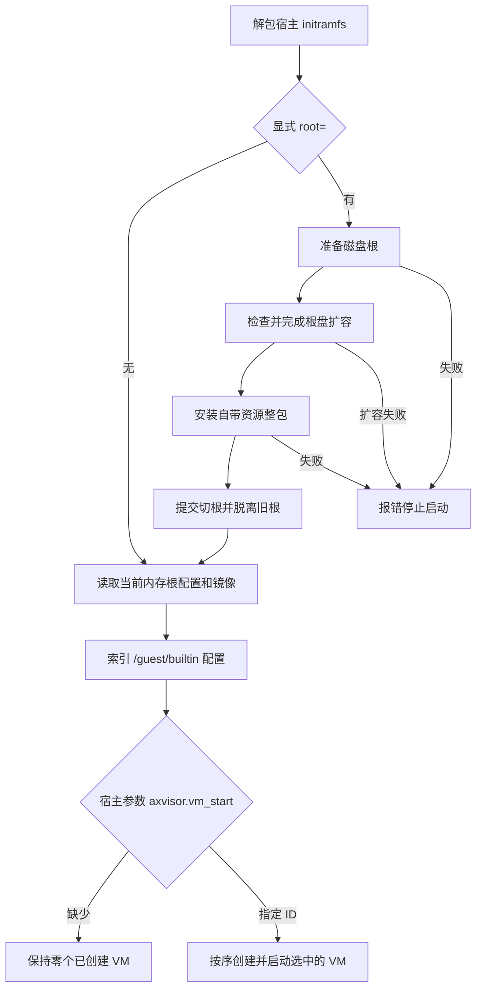

# Axvisor 运行

Axvisor 的 QEMU 流程把 host 启动配置、hypervisor 构建配置、VM 描述和 rootfs 选择分开处理。`axvisor/rootfs.rs` 识别并改写已接入的宿主根盘，检查 `to_bin`/UEFI 契约；它不会根据架构擅自注入 CPU、firmware 或 guest 启动参数。

## 1. QEMU 启动

`axvisor/rootfs.rs::qemu()` 读取宿主 QEMU 配置，准备所需磁盘和客户机镜像，再用 `bundle::attach()` 生成宿主归档。内核初始化文件系统后，`builtin::prepare_root()` 在加载 VM 前完成可选安装及切根。



没有块设备驱动或磁盘根时，可以省略 `root=`，直接从 initramfs 运行客户机。显式 `root=` 无法满足时报告错误，不启动 VM。

共享的 `RootSpec` 支持 `root=UUID=<文件系统标识>`：ext4 使用 `blkid -s UUID -o value` 显示的标准 UUID，FAT16/FAT32 使用 `XXXX-XXXX` 卷序列号。它与 GPT/MBR 的 `PARTUUID` 分别匹配，分区根和整盘文件系统都可以使用，比较时忽略十六进制字母大小写。`root::read_filesystem_uuid()` 仅在指定 UUID 时只读探测，ext4 启用元数据校验和时会先校验超级块；设备无法扫描或身份读取、校验失败时，仅警告并跳过对应设备或分区，继续查找其他可用候选；未找到或已确认多个候选具有相同 UUID 时仍报错，不回退到其他根盘。内存不足会中止查找，不伪装成目标缺失。扩容不生成或修改 UUID，因此原有 UUID 启动参数继续有效。保留现有 `PARTUUID=`、`PARTLABEL=` 和设备路径选择。

默认 QEMU 模板位于：

```text
os/axvisor/configs/qemu/qemu-<arch>.toml
```

QEMU TOML 拥有 machine、CPU、accelerator、firmware、device、UEFI 和 `to_bin`。x86 VMX、SVM、UEFI 等场景分别通过对应 test case 的 build/QEMU TOML 表达。

### 1.1 根文件系统

QEMU rootfs 路径的选择顺序为：

1. CLI `--rootfs`，经 image storage 解析后的路径；
2. 第一个 VM config 中 `[kernel].kernel_path` 同目录的现有 `rootfs.img`；
3. 当前 arch 的 managed `rootfs-<arch>-alpine.img`。

只在 QEMU 已有可识别的宿主根盘接线时准备或改写根盘，不为纯 initramfs 场景自动接入磁盘。`disk0` 或唯一匿名文件后端可作为宿主盘；其他明确命名的 guest/data drive 保持原值。显式 `root=` 缺少宿主盘接线会在运行前报错。

磁盘根上的自带资源目录固定为 `/guest/builtin`。源目录存在时整包替换；空包清空旧资源，源目录缺失时保留已安装版本。Ext4 使用 `EXCHANGE` 发布；FAT 使用备份与失败回滚，不保证断电原子性。安装失败时不切根、不启动客户机。可写客户机磁盘不参与替换。

AxVisor 的 `builtin::prepare_root()` 使用 `ax_fs_ng::root::prepare_block_root()`：镜像写入更大介质后，在安装自带资源和发布根目录前，把备份 GPT 迁到实际设备末尾，扩大显式选中的末尾 ext4 根分区，再扩大文件系统的可分配空间。磁盘 GUID、分区 PARTUUID、文件系统 UUID、分区起点和原文件保持不变；StarryOS 的 ax-runtime 根初始化共用这一扩容流程。未指定 `axvisor.vm_start` 时仍保持零个已创建 VM。

只读根、只读设备、非 GPT/ext4、根分区后仍有其他分区、没有可靠 flush，均跳过扩容。文件系统预检还会拒绝无 journal、MMP、META_BG、sparse_super2、未知扩容特征，以及保留 GDT、resize inode 或 journal 事务容量不足的目标；GPT 混合布局也不自动修改。跳过时日志说明原因，并继续已有挂载流程；错误态 ext4 根沿用只读回退。

`volume::grow_partition()` 校验主备头及完整数组的 CRC，先写新备份并 flush，再更新保护 MBR、主数组和主头并 flush；唯一有效备份需要原址改写时，先恢复主表。`rsext4::Ext4::mount_growing()` 只在返回可共享的挂载实例前增长：新增组元数据先初始化并刷盘，已发布元数据、resize inode、容量和备份按有界 journal 事务一起更新。扩容后重新创建分区视图，避免复用旧容量。最后不足以容纳合法块组的尾部可以保留。

GPT 来源选择遵循 [Linux `find_valid_gpt()`](https://github.com/torvalds/linux/blob/v6.12/block/partitions/efi.c) 的有效主表优先规则：刷入较小镜像后，介质末尾残留的无关备份不能否决有效主表。Linux 内核负责读取选择；备份迁移与重建由 [libfdisk](https://github.com/util-linux/util-linux/blob/v2.37.2/libfdisk/src/gpt.c) 等用户态工具完成。本实现的 `Copies::growth_tables()` 还保留与主表身份一致、仅末尾分区单调增长的备份，用于恢复备份先写的扩容事务；没有有效主表时，互不兼容的有效备份仍会导致拒绝写入。任何 GPT 探测 I/O 失败也禁止修改，并返回根准备错误；不会把无法证明安全的增长规划一律降级为普通挂载。卷扫描的元数据保护范围继续覆盖所有有效副本，不随增长候选筛选而缩小。

扩容进度来自磁盘上的 GPT/ext4 元数据，没有另建完成标记。GPT 已扩大而 ext4 尚未完成时，下次启动继续增长；中断后的日志先经过只读恢复视图校验，再回放到磁盘。恢复视图由同一解析器生成最终目标块到日志位置的索引，按需读取 payload，不保留整份日志数据副本。新增索引由 `MAX_REPLAY_INDEX_BYTES` 限制为最多 4 MiB，并另用一个文件系统块缓冲；索引和缓冲分配失败或索引超限返回 `NoMemory`，预览阶段不写回。已有日志解析器的事务及撤销索引仍有其自身的内存需求。GPT 分区已到目标且超级块校验通过、文件系统干净、无待恢复日志、容量达到 `growth_target_blocks()` 推导的目标（包含元数据放不下时裁掉的新尾组）时，`root_filesystem_complete()` 跳过两次临时挂载，直接进入正常挂载；GPT 仍经幂等更新路径检查和修复副本；两份 GPT 已一致但保护 MBR 容量陈旧时，只修正该字段并 flush，再次调用无额外写入。仅 GPT 分区已扩大不足以跳过 ext4 增长。已经完成时不重复执行扩容写入；正常挂载维护仍可能写盘。日志包含原分区容量、预检目标、完成耗时或失败阶段，不属于已声明“不支持”的元数据或 I/O 预检错误，以及实际写入或 flush 失败，均会阻止切根和客户机启动；容量预检前的临时挂载可能已回放日志，因此不能把该阶段的全部错误当作尚未写盘而忽略。禁止通过缩小分区终止 LBA 回滚已扩大的 ext4。

`load_journal_bootstrap_layout()` 在回放前通过 `SystemZoneMap::from_base_metadata()` 保护由超级块独立确定的主备超级块、有效及保留 GDT 区域，再检查候选描述符的位图和 inode 表地址。无描述符校验和时，旧保留 GDT 中非零的 inode 7 指针也不能被当作新描述符；越界、相互重叠或落入固定元数据的记录暂按未知组保护。journal 所在组必须可信，完整恢复视图仍须通过布局、所有权及 journal 映射校验后才能写回，避免新超级块先 checkpoint 时阻断本可恢复的扩容。

`GrowthStep::publish()` 通过 `Jbd2Dev::zero_unpublished_ranges()` 初始化旧容量之外的 inode 表，再通过 `write_unpublished_blocks()` 写入新元数据；初始化与 journal payload 共用提交路径的 preflush，再以 FUA 或等效 flush 持久化引用这些块的 commit record。初始化数据必须先于 commit 持久化，但无须再执行一次会回收旧事务的独立 flush，也不需要逐小段 FUA；MMP 和独立超级块更新仍保留各自的立即持久化要求。写入或屏障失败仍中止此次挂载，重新打开后从最后提交容量恢复。初始化持久化、journal commit、home checkpoint 的先后保证保持不变，checkpoint 可以合并多个已提交批次。

inode 表清零通过 `BlockIo::write_zeroes()` 一次提交本批所有表范围，保留范围之间的间隙。物理块层的 `lifecycle::zero` 优先检查 `QueueLimits::max_write_zeroes_blocks`：非零时按该上限拆分原始区间，逐个提交无 DMA payload 的 `RequestOp::WriteZeroes`，成功完成后才推进下一段。eMMC 的 `MmcTrimSupport` 仅对标准 TRIM、擦除后读零、身份和几何校验均通过的 CQHCI 卡公布能力，排除已知需要特殊命令或 TRIM 损坏的型号；`MmcTrimRequest` 保持整个 CMD13/35/36/38/13 序列排他，在最终 ready+TRAN 后完成。CQHCI 中这些命令统一使用 R1 响应与 timing=1；序列开始前由 CMD13 确认就绪，CMD38 后继续通过 CMD13 检查 busy，固定截止时间不随状态查询延长。中途错误关闭当前队列会话，不重放为普通写零。清零上限根据卡的超时和几何计算，不固定为某块卡的 Linux 上限。

MMC 初始化在 EXT_CSD 读取后通过 `prepare_mmc_erase_geometry()` 恢复复位后丢失的 `ERASE_GROUP_DEF`，按与 Linux 一致的 HC 定义解释擦除和写保护组；只有 CMD6 及最终 ready+TRAN 确认后才更新缓存并继续总线配置。`MmcSwitchRequest` 锁存报告后可能清除的拒绝状态，并以 `GENERIC_CMD6_TIME` 控制本次期限；确认拒绝时保留原定义，传输错误或超时中止初始化。此流程不新增 GP/enhanced 分区或其他写保护定义的支持。Debug 日志的 `block native zero` 或 `block DMA zero` 表示实际选择的清零路径；`sdmmc: native zero unavailable` 提供原生能力未公布时的具体卡字段，不能仅凭 Linux 的清零上限认定 AxVisor 已启用。

不支持原生清零时保留普通零写：默认 `BlockIo` 后端使用最多 2 MiB 缓冲；`Ext4Disk`、分区视图和共享缓存保持批次，物理块层用 `TransferPlanner` 按设备 DMA、传输长度及队列限制拆分，并跨表排入两个窗口。单请求最多 1 MiB，窗口按设备深度和最多 16 MiB 的 DMA payload 总预算缩小。全零 DMA 完成后经 `CompletedDma::into_cpu_buffer()` 收回并按长度复用，重新交给设备时保留必要的缓存同步；缓冲池只属于本次同步调用。

完整输入在首次写入前校验；共享缓存持有范围锁，先写回重叠 folio 的脏槽，保留相邻数据。前置写回失败保留脏缓存；清零成功或部分失败均使相关缓存失效。写入或分配失败后停止新提交，`CompletionGroup::drain_admitted()` 排空已接受的请求才返回错误、释放范围锁；下次增长重新初始化未发布区域。清零不隐含 flush；只有具有确定读零保证的设备操作才能代替普通写零，不能使用无此保证的 discard。

`Ext4FileSystem::prepare_growth_step()` 只重编码本批增加或扩展的块组描述符；已有备份也只更新对应的 GDT 块，避免每增加一组都重写整张表。新出现的备份组仍完整初始化所有有效 GDT 块和剩余保留区域。未变描述符的校验和只依赖固定的 UUID/seed、组号及描述符内容，无需随容量重算；这种选择性备份更新也见于 [Linux `ext4_flex_group_add()`](https://github.com/torvalds/linux/blob/v6.12/fs/ext4/resize.c)。

增长先单独补齐原末尾的部分块组，再按最多 256 个新块组、最多 2 MiB 新组位图镜像选择批次。`GrowthLayout::check()` 使用与实际提交共用的 `next_geometry()` 和 `transaction_credits()` 逐批预检完整目标：先扣减新 GDT 消耗的保留块，再计入各批修改的既有超级块、GDT 块、尾组位图及 resize inode 引用；超过 journal credits 时逐步缩小批次，单组仍不足才拒绝。目标先裁掉不能容纳元数据的尾组，再判断 GDT 容量，避免无用尾部误使合法前缀被拒绝；`GrowthStep::publish()` 还在任何初始化写入前核对本批实际 journal credits 不超过共享预算及日志上限。批内容量、描述符、备份及 inode 7 引用一次提交。后续批次通过 journal overlay 读取最新版，不强制逐批 checkpoint；日志空间不足时复用已有 reservation 回收，全部批次完成后统一 checkpoint，再重建运行时并发布挂载。这样可以合并重复 home 写入及日志尾更新，同时减少重复同步等待。checkpoint 中断可能留下部分 home metadata，经过 journal 恢复后才能看到上一批或这一批的完整几何。批量不改变磁盘特征和 inode 表的清零要求，也不提供在线增长。

`grow_before_publish()` 在独占且尚未返回挂载实例的阶段推进上述批次。期间只更新超级块、组数和候选描述符，并清空 inode 缓存，避免下一批读取已被 journal 更新的 inode 7 旧记录；原分配器和保护映射只用于访问位置不变的既有 inode 7 及最初的尾组，不对外提供新空间。完成后才统一重载最终布局、重建分配器和缓存、重新保护 journal 块。任一阶段失败均丢弃本次挂载，从磁盘已提交几何恢复；正常使用者不会获得中间缓存状态。

新增块组继承原 ext4 的特征集合。没有 GDT_CSUM 或 METADATA_CSUM 时，新描述符的未用 inode 计数保持为零；有校验特征时才保存 lazy inode accounting 所需的计数，不为扩容擅自打开磁盘特征。原末尾不完整块组同样先扩展其位图和计数，再添加后续块组。

扩容事件通过已有 `Observer` 上报：`GrowthEvent::Started` 携带初始容量 `current_bytes` 和预检目标 `target_bytes`；`GrowthEvent::Committed` 携带已经持久化的 `current_bytes`，单位均为字节。开始增长时报告一次 `Started`，此后每累计至少 1 GiB 或达到目标后报告 `Committed`；提交通知在批次提交完成后执行，不在 journal 事务中调用，也不提供挂载访问。`Committed` 不表示运行时重建或挂载发布已经成功。`Ext4Observer` 统一通过 `{event:?}` 输出事件的 Debug 日志，不再单独计算或格式化扩容百分比。Info 仅保留实际扩容的开始和完成耗时，失败信息仍记录具体阶段；预期跳过原因、已完成状态及清零路径放在 Debug。已完成的文件系统不再报告增长进度。此进度说明已提交容量，不能保证某个 I/O 请求不会阻塞，也不改变测试超时。

`/guest/builtin/configs` 是 build TOML 的 `vm_configs` 生成的唯一内置启动目录。
启动时只索引并校验这些配置，不预先创建 VM；宿主命令行中的
`axvisor.vm_start=1,2` 按 ID 选择需要创建并启动的客户机。`/guest` 下的其他
配置属于动态池，供 HTTP 或 shell 按需创建；`/guest/vm_default` 不再具有覆盖
语义。HTTP 或命令行重建 VM 可直接引用安装后的启动镜像路径。

### 1.2 启动产物

`build` 默认产出 ELF。QEMU 路径读取实际 TOML 后将 `cargo.to_bin` 设为 `qemu.to_bin`：

- `to_bin = true` 时，运行器为 QEMU 准备 BIN；
- `to_bin = false` 时直接保留 ELF；
- `uefi = true` 且 `to_bin = false` 是明确错误。Axvisor 在启动前报告该错误，要求配置显式设置 `to_bin = true`。

仓库的 Axvisor x86_64 和 loongarch64 默认 QEMU 配置均将 UEFI 和 BIN 选择写在 TOML 中。
guest UEFI firmware 的路径属于 VM config（例如 `boot_protocol = "uefi"` 与
`uefi_firmware_path`）；axbuild 只在打包时展开受支持的路径变量，不改变 guest 固件 ABI。

### 1.3 LVZ QEMU

在 `loongarch64` 上，`AppContext::scoped_qemu_path()` 会为 Cargo/QEMU 调用选择 LVZ QEMU：

1. `AXBUILD_QEMU_SYSTEM_LOONGARCH64` 指定的可执行文件；
2. `AXBUILD_QEMU_DIR` 指定的目录；
3. `$HOME/QEMU-LVZ/build` 或 `$HOME/qemu-lvz/build`；
4. workspace 根及其祖先的 `QEMU-LVZ/build` 或 `qemu-lvz/build`。

找到后临时把目录置于 `PATH` 前端，结束后恢复。其余 QEMU 参数仍由 TOML 给出。

### 1.4 网页管理台

带管理台的运行不需要任何手工前端步骤：构建配置的 features 含 `web-ui` 时，axbuild 会先把 `os/axvisor/web-ui` 源码复制到工作区 target 目录的暂存区并在那里执行 `npm ci && npm run build`（需要 Node ≥ 24、npm ≥ 11），再把生成的 `dist` 打进宿主 initramfs 的 builtin 包（`/guest/builtin/web-ui`）。内核运行时从活动根读取该目录——无盘启动用 initramfs 内存根，有盘启动由 builtin 安装逻辑把包安装到磁盘根后读取——`node_modules/` 与 `dist/` 都不进源码树、不进仓库。

`web` 特性启用管理面与终端网关，`web-ui` 在其上增加仪表盘静态资源。在宿主
QEMU 或板卡命令行加入 `axvisor.vm_start=<id>[,<id>...]` 才会开机创建并启动对应
客户机；缺少该参数时保持零个已创建客户机。在 QEMU 配置里加入端口转发后运行：

```bash
cargo xtask axvisor qemu \
  -c test-suit/axvisor/normal/qemu-web-ui/build-aarch64-unknown-none-softfloat.toml \
  --qemu-config test-suit/axvisor/normal/qemu-web-ui/web-ui/qemu-aarch64-hostfwd.toml \
  --arch aarch64
```

转发参数由用例目录里的 `web-ui/qemu-aarch64.toml` 派生：把它 `args` 中的网络项换成下面这一对，另存为 `qemu-aarch64-hostfwd.toml`，其余字段保持不变。

```text
-netdev user,id=net0,hostfwd=tcp::8080-:8080 -device virtio-net-pci,netdev=net0
```

启动日志出现下面这行说明监听已就绪，此时浏览器访问 `http://localhost:8080/`。控制面按 local host 信任模型设计，没有鉴权，也不需要填写任何票据；下面的 `0.0.0.0` 只会在构建配置显式设置 `AXVM_HTTP_BIND` 时出现。

```text
management HTTP server (axum) listening on 127.0.0.1:8080
```

设置 `AXVM_HTTP_BIND = "0.0.0.0:8080"` 的受信任演示或板卡构建会把日志中的地址替换为该显式值。

手工检查覆盖自动化用例之外的部分：根路径返回页面外壳，`/assets/` 下的资源带不可变缓存策略，未知路径返回 404；`GET /api/vms/pool` 的不可用条目带原因；同一终端通道的第二个订阅者收到 409；`/ws/events` 先发全量快照再发增量帧，而登记表仍以 `GET /api/vms` 为准。无盘（不接宿主根盘）与有盘（NVMe 根）两种托管路径分别由 `web-ui-diskless` 与 `web-ui` 两条 QEMU 用例覆盖。

| 现象 | 原因 | 处理 |
| :-- | :-- | :-- |
| axbuild 报 node/npm 版本不满足 | 构建机 Node 低于 24 或 npm 低于 11 | 安装满足 `package.json` `engines` 的工具链，或去掉 `web-ui` 特性 |
| x86_64 上开 `web` 报 `rustc-LLVM ERROR: Do not know how to split...`（httparse/sha1） | x86_64 std 目标禁用全部向量指令（宿主任务切换不保存 XMM 状态），而升级前编过的 httparse 构建脚本输出仍被缓存 | 升级到带修复的版本后执行一次 `cargo clean -p httparse` 再重建；全新检出无此问题 |
| 页面返回 503 且启动日志警告无 dashboard 包 | 启动镜像的 initramfs 里没有 `/guest/builtin/web-ui`（例如绕过 xtask 手工组装了 initramfs） | 用 `cargo axvisor build/qemu` 重新生成带 builtin 包的 initramfs |
| 页面返回 404 但日志显示监听成功 | 该构建没有启用 `web-ui` | 在构建配置里启用该特性 |
| 浏览器无法连接 | QEMU 配置没有 `hostfwd` | 加入端口转发参数 |
| 界面看不到终端面板 | 该构建没有启用 `web` | 启用该特性 |
| 构建进程被杀、失败信息与代码无关 | 内存不足时 OOM killer 静默终止 cargo | 用 `CARGO_BUILD_JOBS=2` 限制并行度 |
| `--qemu-config` 报No such file | 该参数相对**仓库根**，而用例注释里写的是相对用例目录 | 用 `test-suit/axvisor/normal/qemu-web-ui/web-ui/qemu-<arch>-hostfwd.toml` |

这些现象分别落在工具链、端口、特性配置和构建环境四类，按处理栏逐项排查即可。

### 1.5 本地演示配置

`test-suit/axvisor/normal/qemu-web-ui/` 下有两类配置，用途不同：

| 配置 | 用途 |
| :-- | :-- |
| `build-<target>.toml` | **测试用例**。命名匹配用例发现规则，会出现在 `cargo xtask axvisor test` 的运行里 |
| `demo-fs-build*.toml` | **本地演示**。命名不匹配发现规则，因此不会出现在任何测试运行中 |

当前演示配置启用 `web-ui` + `web` + `ax-driver/nvme`，并且**故意不带
`vm_configs`**：启动时不建立 builtin 客户机，页面上的每一个客户机都来自操作者
放进动态 `/guest` 树的配置。池子递归读取 `/guest` 下的 `.toml`（排除
`/guest/builtin`），而控制台保存的配置也写回 `/guest`。

仓库提供 aarch64 的官方演示配置：

```bash
# aarch64
cargo xtask axvisor qemu \
  -c test-suit/axvisor/normal/qemu-web-ui/demo-fs-build.toml \
  --qemu-config test-suit/axvisor/normal/qemu-web-ui/web-ui/qemu-aarch64-hostfwd.toml \
  --arch aarch64

```

不加 `--rootfs` 时 rootfs 按1.1 的顺序自动获取；已经有一份镜像时用 `--rootfs <path>` 跳过下载。

### 1.6 x86_64 默认客户机

在支持嵌套 VMX、可访问 `/dev/kvm` 的 Intel Linux 主机上，安装仓库固定的 Rust 工具链、QEMU x86_64、Node ≥ 24 和 npm ≥ 11，然后从未生成过 Axvisor 配置的检出执行：

```bash
cargo axvisor defconfig qemu-x86_64
cargo axvisor qemu
```

`qemu-x86_64.toml` 默认启用 `web-ui`、`ax-driver/nvme` 和 `ax-driver/intel-net`，宿主使用 2 CPU、2 GiB 内存，`vm_configs = []` 保持初始客户机列表为空。构建器自动下载或校验缓存中的原始 rootfs、构建网页并打包；无需预先生成 `web-ui/dist`，也无需编辑解压后的磁盘。QEMU 显式接入 e1000，并将宿主 `127.0.0.1:8080` 转发至 Axvisor 的 8080；日志报告监听就绪后访问 [网页管理台](http://localhost:8080/)。

在「虚拟机」中选择「填表创建」。`CreateForm` 从能力声明的 `schema` 和 `defaults` 操作加载初始值，核验已有镜像后即可点击「创建」，再点击「启动并打开终端」。默认客户机使用 1 vCPU、256 MiB 内存、虚拟化地址空间和 x86 direct boot；已有内核 `/guest/linux/linux-qemu` 与磁盘 `/guest/rootfs-x86_64-alpine-0.img` 均来自原始镜像，无需上传。地址、内核参数、ID 和磁盘写入选项收在高级设置中。

默认磁盘只读，多个客户机可以复用原始文件。`rootfs_read_only` 在网页提交中为 `true`；旧 API 请求省略该字段时仍使用原有可写语义。需要可写磁盘时先选择独立副本，再调整磁盘选项及内核参数。默认客户机的 host affinity 为 CPU1，CPU0 留给宿主引导与其他任务；创建接口拒绝超出当前物理核数或空闲内存的请求，实际分配失败仍由 VM 管理器回滚。

进入 shell 后输入下面的命令。算术结果应为 `5891`，系统信息应来自客户机；终端已连接和 VM 状态为 running 本身不足以证明输入进入了 shell。

```sh
printf '%s\n' $((137 * 43))
uname -m
cat /etc/alpine-release
```

刷新页面后从左侧客户机名称重新打开终端即可继续输入。切换面板保留已经打开的终端；关闭终端标签只释放连接，「停止」结束客户机运行，「删除客户机」释放实例与通道且保留镜像文件。可再次使用默认值创建客户机，空 ID 由管理器自动分配。

定向回归入口为 `cargo xtask axvisor test qemu --arch x86_64 --test-case web-ui-vmx`，使用 e1000 和相同默认资源，通过真实客户机 shell 证明创建、启动、算术、系统信息、重连与删除后重建。启动验收门限保持 90 秒。若 Linux 在 `virtqueue_add_split` 警告后停在根盘读取，核对 PCI block adapter 的 `seg_max` 是否为直接描述符队列预留请求头和状态两个槽；不应通过延长等待掩盖不可提交的请求。本流程本地只验证 x86_64 VMX，未将 AMD SVM 或其他架构视为已验证。

## 2. U-Boot 启动

`axvisor uboot` 通过 `--uboot-config` 或 ostool 的配置发现执行 build+run。

## 3. 板卡启动

`axvisor board` 通过 ostool-server 运行；显式 `--board-config` 优先，否则 axbuild 解析当前 Cargo 配置对应的 board run config。它复用 Build Config 的 VM 列表，并将生成的宿主归档加入启动配置；FIT ramdisk、UEFI 和 HTTP Boot 使用现有交接协议。构建机可取得的镜像放入自带包，板卡 rootfs 已有的绝对资源路径可保留并在切根后加载。

## 4. 命令示例

以下命令覆盖 aarch64 guest、x86 VMX case 和 LoongArch LVZ 启动三个不同的运行契约。

```bash
# aarch64 QEMU guest
cargo xtask axvisor qemu \
  --vmconfigs os/axvisor/configs/vms/qemu/aarch64/linux-smp1.toml

# x86 UEFI/VMX case 验证宿主启动与宿主 NVMe 文件读写
cargo xtask axvisor test qemu --arch x86_64 --test-case smoke-vmx

# LoongArch LVZ
cargo xtask axvisor qemu --arch loongarch64 \
  --vmconfigs os/axvisor/configs/vms/qemu/loongarch64/linux-rootfs-smp1.toml
```
