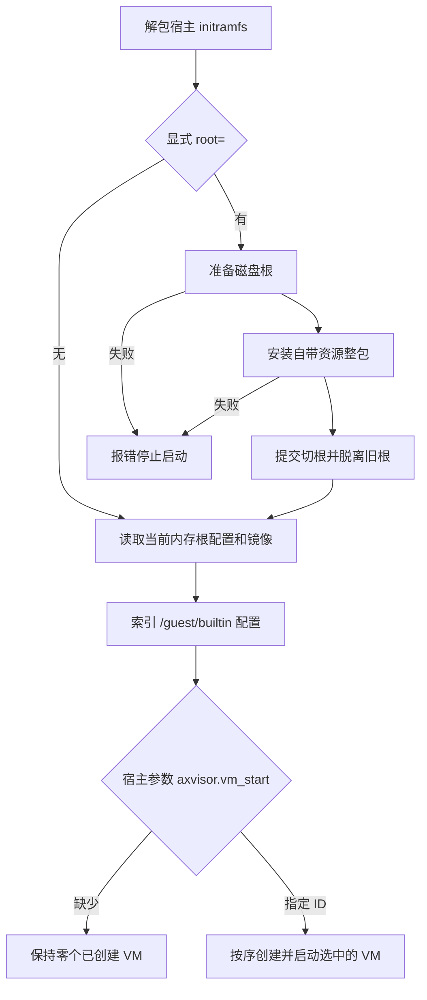

# Axvisor 运行

Axvisor 的 QEMU 流程把 host 启动配置、hypervisor 构建配置、VM 描述和 rootfs 选择分开处理。`axvisor/rootfs.rs` 识别并改写已接入的宿主根盘，检查 `to_bin`/UEFI 契约；它不会根据架构擅自注入 CPU、firmware 或 guest 启动参数。

## 1. QEMU 启动

`axvisor/rootfs.rs::qemu()` 读取宿主 QEMU 配置，准备所需磁盘和客户机镜像，再用 `bundle::attach()` 生成宿主归档。内核初始化文件系统后，`builtin::prepare_root()` 在加载 VM 前完成可选安装及切根。



没有块设备驱动或磁盘根时，可以省略 `root=`，直接从 initramfs 运行客户机。显式 `root=` 无法满足时报告错误，不启动 VM。

默认 QEMU 模板位于：

```text
os/axvisor/configs/qemu/qemu-<arch>.toml
```

QEMU TOML 拥有 machine、CPU、accelerator、firmware、device、UEFI 和 `to_bin`。x86 VMX、SVM、UEFI 等场景分别通过对应 test case 的 build/QEMU TOML 表达。

### 1.1 根文件系统

QEMU rootfs 路径的选择顺序为：

1. CLI `--rootfs`，经 image storage 解析后的路径；
2. 第一个 VM config 中 `[kernel].kernel_path` 同目录的现有 `rootfs.img`；
3. 当前 arch 的 managed `rootfs-<arch>-alpine.img`。

只在 QEMU 已有可识别的宿主根盘接线时准备或改写根盘，不为纯 initramfs 场景自动接入磁盘。`disk0` 或唯一匿名文件后端可作为宿主盘；其他明确命名的 guest/data drive 保持原值。显式 `root=` 缺少宿主盘接线会在运行前报错。

磁盘根上的自带资源目录固定为 `/guest/builtin`。源目录存在时整包替换；空包清空旧资源，源目录缺失时保留已安装版本。Ext4 使用 `EXCHANGE` 发布；FAT 使用备份与失败回滚，不保证断电原子性。安装失败时不切根、不启动客户机。可写客户机磁盘不参与替换。

`/guest/builtin/configs` 是 build TOML 的 `vm_configs` 生成的唯一内置启动目录。
启动时只索引并校验这些配置，不预先创建 VM；宿主命令行中的
`axvisor.vm_start=1,2` 按 ID 选择需要创建并启动的客户机。`/guest` 下的其他
配置属于动态池，供 HTTP 或 shell 按需创建；`/guest/vm_default` 不再具有覆盖
语义。HTTP 或命令行重建 VM 可直接引用安装后的启动镜像路径。

### 1.2 启动产物

`build` 默认产出 ELF。QEMU 路径读取实际 TOML 后将 `cargo.to_bin` 设为 `qemu.to_bin`：

- `to_bin = true` 时，运行器为 QEMU 准备 BIN；
- `to_bin = false` 时直接保留 ELF；
- `uefi = true` 且 `to_bin = false` 是明确错误。Axvisor 在启动前报告该错误，要求配置显式设置 `to_bin = true`。

仓库的 Axvisor x86_64 和 loongarch64 默认 QEMU 配置均将 UEFI 和 BIN 选择写在 TOML 中。
guest UEFI firmware 的路径属于 VM config（例如 `boot_protocol = "uefi"` 与
`uefi_firmware_path`）；axbuild 只在打包时展开受支持的路径变量，不改变 guest 固件 ABI。

### 1.3 LVZ QEMU

在 `loongarch64` 上，`AppContext::scoped_qemu_path()` 会为 Cargo/QEMU 调用选择 LVZ QEMU：

1. `AXBUILD_QEMU_SYSTEM_LOONGARCH64` 指定的可执行文件；
2. `AXBUILD_QEMU_DIR` 指定的目录；
3. `$HOME/QEMU-LVZ/build` 或 `$HOME/qemu-lvz/build`；
4. workspace 根及其祖先的 `QEMU-LVZ/build` 或 `qemu-lvz/build`。

找到后临时把目录置于 `PATH` 前端，结束后恢复。其余 QEMU 参数仍由 TOML 给出。

### 1.4 网页管理台

带管理台的运行不需要任何手工前端步骤：构建配置的 features 含 `web-ui` 时，axbuild 会先把 `os/axvisor/web-ui` 源码复制到工作区 target 目录的暂存区并在那里执行 `npm ci && npm run build`（需要 Node ≥ 24、npm ≥ 11），再把生成的 `dist` 打进宿主 initramfs 的 builtin 包（`/guest/builtin/web-ui`）。内核运行时从活动根读取该目录——无盘启动用 initramfs 内存根，有盘启动由 builtin 安装逻辑把包安装到磁盘根后读取——`node_modules/` 与 `dist/` 都不进源码树、不进仓库。

`web` 特性启用管理面与终端网关，`web-ui` 在其上增加仪表盘静态资源。在宿主
QEMU 或板卡命令行加入 `axvisor.vm_start=<id>[,<id>...]` 才会开机创建并启动对应
客户机；缺少该参数时保持零个已创建客户机。在 QEMU 配置里加入端口转发后运行：

```bash
cargo xtask axvisor qemu \
  -c test-suit/axvisor/normal/qemu-web-ui/build-aarch64-unknown-none-softfloat.toml \
  --qemu-config test-suit/axvisor/normal/qemu-web-ui/web-ui/qemu-aarch64-hostfwd.toml \
  --arch aarch64
```

转发参数由用例目录里的 `web-ui/qemu-aarch64.toml` 派生：把它 `args` 中的网络项换成下面这一对，另存为 `qemu-aarch64-hostfwd.toml`，其余字段保持不变。

```text
-netdev user,id=net0,hostfwd=tcp::8080-:8080 -device virtio-net-pci,netdev=net0
```

启动日志出现下面这行说明监听已就绪，此时浏览器访问 `http://localhost:8080/`。控制面按 local host 信任模型设计，没有鉴权，也不需要填写任何票据；下面的 `0.0.0.0` 只会在构建配置显式设置 `AXVM_HTTP_BIND` 时出现。

```text
management HTTP server (axum) listening on 127.0.0.1:8080
```

设置 `AXVM_HTTP_BIND = "0.0.0.0:8080"` 的受信任演示或板卡构建会把日志中的地址替换为该显式值。

手工检查覆盖自动化用例之外的部分：根路径返回页面外壳，`/assets/` 下的资源带不可变缓存策略，未知路径返回 404；`GET /api/vms/pool` 的不可用条目带原因；同一终端通道的第二个订阅者收到 409；`/ws/events` 先发全量快照再发增量帧，而登记表仍以 `GET /api/vms` 为准。无盘（不接宿主根盘）与有盘（NVMe 根）两种托管路径分别由 `web-ui-diskless` 与 `web-ui` 两条 QEMU 用例覆盖。

| 现象 | 原因 | 处理 |
| :-- | :-- | :-- |
| axbuild 报 node/npm 版本不满足 | 构建机 Node 低于 24 或 npm 低于 11 | 安装满足 `package.json` `engines` 的工具链，或去掉 `web-ui` 特性 |
| x86_64 上开 `web` 报 `rustc-LLVM ERROR: Do not know how to split...`（httparse/sha1） | x86_64 std 目标禁用全部向量指令（宿主任务切换不保存 XMM 状态），而升级前编过的 httparse 构建脚本输出仍被缓存 | 升级到带修复的版本后执行一次 `cargo clean -p httparse` 再重建；全新检出无此问题 |
| 页面返回 503 且启动日志警告无 dashboard 包 | 启动镜像的 initramfs 里没有 `/guest/builtin/web-ui`（例如绕过 xtask 手工组装了 initramfs） | 用 `cargo axvisor build/qemu` 重新生成带 builtin 包的 initramfs |
| 页面返回 404 但日志显示监听成功 | 该构建没有启用 `web-ui` | 在构建配置里启用该特性 |
| 浏览器无法连接 | QEMU 配置没有 `hostfwd` | 加入端口转发参数 |
| 界面看不到终端面板 | 该构建没有启用 `web` | 启用该特性 |
| 构建进程被杀、失败信息与代码无关 | 内存不足时 OOM killer 静默终止 cargo | 用 `CARGO_BUILD_JOBS=2` 限制并行度 |
| `--qemu-config` 报No such file | 该参数相对**仓库根**，而用例注释里写的是相对用例目录 | 用 `test-suit/axvisor/normal/qemu-web-ui/web-ui/qemu-<arch>-hostfwd.toml` |

这些现象分别落在工具链、端口、特性配置和构建环境四类，按处理栏逐项排查即可。

### 1.5 本地演示配置

`test-suit/axvisor/normal/qemu-web-ui/` 下有两类配置，用途不同：

| 配置 | 用途 |
| :-- | :-- |
| `build-<target>.toml` | **测试用例**。命名匹配用例发现规则，会出现在 `cargo xtask axvisor test` 的运行里 |
| `demo-fs-build*.toml` | **本地演示**。命名不匹配发现规则，因此不会出现在任何测试运行中 |

当前演示配置启用 `web-ui` + `web` + `ax-driver/nvme`，并且**故意不带
`vm_configs`**：启动时不建立 builtin 客户机，页面上的每一个客户机都来自操作者
放进动态 `/guest` 树的配置。池子递归读取 `/guest` 下的 `.toml`（排除
`/guest/builtin`），而控制台保存的配置也写回 `/guest`。

仓库提供 aarch64 的官方演示配置：

```bash
# aarch64
cargo xtask axvisor qemu \
  -c test-suit/axvisor/normal/qemu-web-ui/demo-fs-build.toml \
  --qemu-config test-suit/axvisor/normal/qemu-web-ui/web-ui/qemu-aarch64-hostfwd.toml \
  --arch aarch64

```

不加 `--rootfs` 时 rootfs 按1.1 的顺序自动获取；已经有一份镜像时用 `--rootfs <path>` 跳过下载。

### 1.6 x86_64 默认客户机

在支持嵌套 VMX、可访问 `/dev/kvm` 的 Intel Linux 主机上，安装仓库固定的 Rust 工具链、QEMU x86_64、Node ≥ 24 和 npm ≥ 11，然后从未生成过 Axvisor 配置的检出执行：

```bash
cargo axvisor defconfig qemu-x86_64
cargo axvisor qemu
```

`qemu-x86_64.toml` 默认启用 `web-ui`、`ax-driver/nvme` 和 `ax-driver/intel-net`，宿主使用 2 CPU、2 GiB 内存，`vm_configs = []` 保持初始客户机列表为空。构建器自动下载或校验缓存中的原始 rootfs、构建网页并打包；无需预先生成 `web-ui/dist`，也无需编辑解压后的磁盘。QEMU 显式接入 e1000，并将宿主 `127.0.0.1:8080` 转发至 Axvisor 的 8080；日志报告监听就绪后访问 [网页管理台](http://localhost:8080/)。

在「虚拟机」中选择「填表创建」。`CreateForm` 从能力声明的 `schema` 和 `defaults` 操作加载初始值，核验已有镜像后即可点击「创建」，再点击「启动并打开终端」。默认客户机使用 1 vCPU、256 MiB 内存、虚拟化地址空间和 x86 direct boot；已有内核 `/guest/linux/linux-qemu` 与磁盘 `/guest/rootfs-x86_64-alpine-0.img` 均来自原始镜像，无需上传。地址、内核参数、ID 和磁盘写入选项收在高级设置中。

默认磁盘只读，多个客户机可以复用原始文件。`rootfs_read_only` 在网页提交中为 `true`；旧 API 请求省略该字段时仍使用原有可写语义。需要可写磁盘时先选择独立副本，再调整磁盘选项及内核参数。默认客户机的 host affinity 为 CPU1，CPU0 留给宿主引导与其他任务；创建接口拒绝超出当前物理核数或空闲内存的请求，实际分配失败仍由 VM 管理器回滚。

进入 shell 后输入下面的命令。算术结果应为 `5891`，系统信息应来自客户机；终端已连接和 VM 状态为 running 本身不足以证明输入进入了 shell。

```sh
printf '%s\n' $((137 * 43))
uname -m
cat /etc/alpine-release
```

刷新页面后从左侧客户机名称重新打开终端即可继续输入。切换面板保留已经打开的终端；关闭终端标签只释放连接，「停止」结束客户机运行，「删除客户机」释放实例与通道且保留镜像文件。可再次使用默认值创建客户机，空 ID 由管理器自动分配。

定向回归入口为 `cargo xtask axvisor test qemu --arch x86_64 --test-case web-ui-vmx`，使用 e1000 和相同默认资源，通过真实客户机 shell 证明创建、启动、算术、系统信息、重连与删除后重建。启动验收门限保持 90 秒。若 Linux 在 `virtqueue_add_split` 警告后停在根盘读取，核对 PCI block adapter 的 `seg_max` 是否为直接描述符队列预留请求头和状态两个槽；不应通过延长等待掩盖不可提交的请求。本流程本地只验证 x86_64 VMX，未将 AMD SVM 或其他架构视为已验证。

## 2. U-Boot 启动

`axvisor uboot` 通过 `--uboot-config` 或 ostool 的配置发现执行 build+run。

## 3. 板卡启动

`axvisor board` 通过 ostool-server 运行；显式 `--board-config` 优先，否则 axbuild 解析当前 Cargo 配置对应的 board run config。它复用 Build Config 的 VM 列表，并将生成的宿主归档加入启动配置；FIT ramdisk、UEFI 和 HTTP Boot 使用现有交接协议。构建机可取得的镜像放入自带包，板卡 rootfs 已有的绝对资源路径可保留并在切根后加载。

## 4. 命令示例

以下命令覆盖 aarch64 guest、x86 VMX case 和 LoongArch LVZ 启动三个不同的运行契约。

```bash
# aarch64 QEMU guest
cargo xtask axvisor qemu \
  --vmconfigs os/axvisor/configs/vms/qemu/aarch64/linux-smp1.toml

# x86 UEFI/VMX case 验证宿主启动与宿主 NVMe 文件读写
cargo xtask axvisor test qemu --arch x86_64 --test-case smoke-vmx

# LoongArch LVZ
cargo xtask axvisor qemu --arch loongarch64 \
  --vmconfigs os/axvisor/configs/vms/qemu/loongarch64/linux-rootfs-smp1.toml
```
