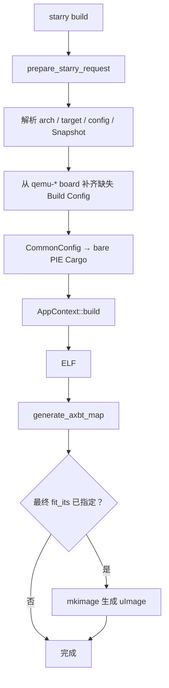

# StarryOS 构建

`cargo xtask starry build` 构建固定 package `starryos`。执行链位于 `starry/mod.rs` 和 `starry/build.rs`：先解析共享请求和系统配置，再生成 freestanding Cargo 配置，最后在 ELF 构建成功后生成同名 AXBT map，并按需生成 uImage。

## 1. 构建流程

Starry 构建在共享 Cargo 装配后生成 AXBT sidecar 和可选镜像；图中的后处理阶段解释了它与普通 `cargo build` 的差异。



### 1.1 配置装载

默认路径是：

```text
tmp/axbuild/config/starryos/build-<target>.toml
```

如果路径不存在，`starry/config.rs::ensure_default_build_config_for_target()` 查找与 target 匹配的默认 `qemu-*` board 配置并复制它。显式 `--config` 具有最高优先级；找不到默认 board 时请求返回配置错误。

典型 board-derived 配置：

```toml
target = "riscv64gc-unknown-none-elf"
features = [
  "ax-driver/serial",
  "ax-driver/nvme",
  "ax-driver/virtio-net",
]
log = "Warn"
max_cpu_num = 4
```

CLI `--smp` 覆盖配置或 Snapshot 中的 `max_cpu_num`。`FEATURES` 环境变量经 `apply_makefile_features()` 验证后并入公共配置；字段和 feature 的验证规则见 [参数与配置](../configuration)。

公共输入由 `CommonConfig` 拥有，`runtime.task_stack_size` 和 `runtime.scheduler_tick_ms` 通过本次 Cargo 子进程环境交给 runtime/HAL 的共同 helper；不要在 `[env]` 设置四个保留参数。默认值、数值检查和环境回退见[运行参数](../configuration#34-运行参数)。

### 1.2 Cargo 装配

`starry/build.rs::load_cargo_config()` 使用共享 `CommonConfig` 和 axbuild 的裸机构建适配函数：

- 逻辑裸机 target 映射到 `scripts/targets/bare/` 的 JSON target；
- 使用 `build-std = ["core", "alloc"]` 和 `BareKernelLinkMode::Pie`；
- 保持无内核 TLS 的独立 `no_std` 镜像契约；
- 固定 package 为 `starryos`，并确保 Cargo 选择其 binary；
- 写入 `AX_ARCH`、`AX_TARGET`，以及本次配置的日志、有效 runtime 参数和其他环境。
- 默认追加 `-Cdebuginfo=2`、`-Cstrip=none` 和 `-Cforce-frame-pointers=yes`，保证每个 Starry ELF 都能生成带文件行号的 AXBT map；不需要在 Build Config 中设置 `BACKTRACE` 或 `DWARF`。

共享基础配置的 `to_bin` 为 `false`。因此 `starry build` 的直接产物是 ELF；运行和部署阶段按 QEMU 或板卡配置决定是否转换。

## 2. 产物后处理

Starry 在 ELF 构建成功后按固定顺序处理内核符号和可选的启动镜像；这些步骤不会改变请求解析或 Cargo feature 选择。

### 2.1 AXBT 回溯 map

共享 `axbuild` 构建流程在最终 Starry ELF 旁生成同名 `.axbt` sidecar。生成器在构建机读取 ELF/DWARF，写入函数区间、build-id、文件名和行号；运行时只读取 AXBT，不再修改 ELF 或保留专用符号 section。使用 host-initramfs 的 QEMU 测试会把 sidecar 追加到 `/symbols/kernel.axbt`，由目标内核复制并校验后安装。

若构建产物缺少 `.axbt`，应重新运行 `cargo xtask starry build` 并检查生成日志；map 缺失时目标仍可输出地址级回溯，但 `/proc/kallsyms` 不会提供符号。

### 2.2 镜像生成

`uimage_generation_plan()` 只消费最终 `StarryConfig.fit_its`，axbuild 调用 `mkimage` 将已后处理的 ELF 生成 uImage。模板相对路径以工作区根为基准，也支持绝对路径；指定资源缺失或打包失败会报错。

旧板卡 TOML 迁移期间，同名 ITS 仅在文件覆盖前装入基值，`defconfig` 仍保留其原有资源复制行为。显式 `fit_its` 可以替换模板，`unset = ["fit_its"]` 可以清除它；打包阶段不会重新猜测同名文件，因此清除不会被撤销。

## 3. 命令示例

以下示例分别使用默认请求、显式 SMP 和 checked-in board Build Config，以验证配置选择和后处理路径。

```bash
cargo xtask starry build
cargo xtask starry build --arch aarch64 --smp 4
cargo xtask starry build --config os/StarryOS/configs/board/qemu-riscv64.toml
```

QEMU rootfs、UEFI 和 `to_bin` 的运行契约见 [StarryOS 运行](./runtime)。
