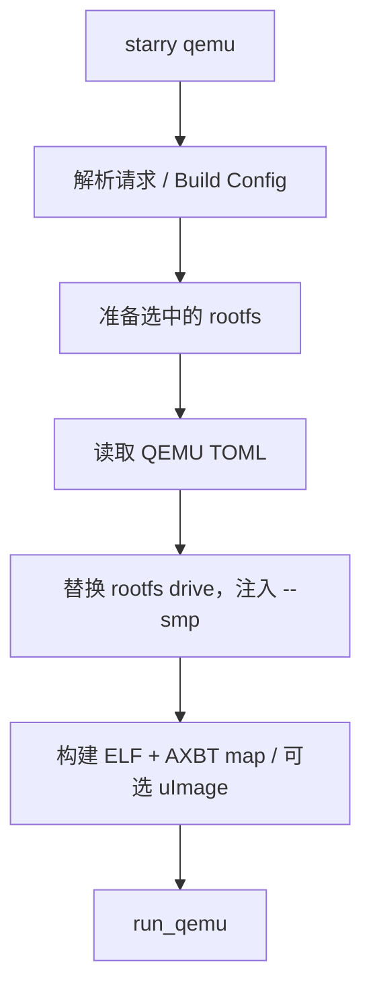

# StarryOS 运行

StarryOS 的 `qemu`、`uboot`、`board` 都先构建内核 ELF 并生成 AXBT sidecar。QEMU 运行在此基础上选择 rootfs、读取启动 TOML、补充显式 SMP，并以配置要求决定是否准备 BIN。

## 1. QEMU 启动

QEMU 路径在内核 ELF 构建后补根文件系统和显式 SMP；启动 TOML 本身仍拥有 machine、UEFI 和设备参数。下图对应 `starry/rootfs.rs` 与 `run_qemu_artifact()` 的调用顺序。



未给出 `--qemu-config` 时，默认路径为：

```text
os/StarryOS/configs/qemu/qemu-<arch>.toml
```

QEMU 的 machine、CPU、UEFI、firmware 和 device 全部来自该文件。`--smp` 仅替换或追加 `-smp`；axbuild 不会为架构选择硬编码 CPU/firmware 参数。

### 1.1 根文件系统

`starry/rootfs.rs` 按下列优先级选择 QEMU rootfs：

1. `--rootfs <IMAGE>`，先经 image storage 解析；
2. 默认 managed rootfs，即当前 arch 的 `rootfs-<arch>-alpine.img`。

在默认 QEMU 路径中，axbuild 确保 managed 镜像已存在，再通过 `patch_rootfs()` 更新 QEMU `-drive`。显式 rootfs 同样经过路径解析和存在性检查；它不会被默认镜像覆盖。

`rootfs` patch 同时依据 QEMU drive 合同处理启动和网络所需参数。应用和测试用例可声明自己的 rootfs 与资产流程，因此其行为以各 case 的 TOML 为准。

磁盘根初始化经 `ax-runtime::fs` 调用共享 `ax_fs_ng::root::prepare_root()`。显式选择可写 GPT 末尾 ext4 根时，先迁移备份 GPT、扩大根分区并原生增长 ext4，再迁移启动资源、发布根目录和启动 PID 1。原 GUID、UUID、分区起点及文件保持不变；增长中断后依据日志恢复，不另建完成标记。

共享 `RootSpec` 也支持 `root=UUID=<文件系统 UUID>`，与 `PARTUUID` 分别选择文件系统和分区身份。ext4 的标准 UUID 以及 FAT16/FAT32 的 `XXXX-XXXX` 卷序列号均可用于分区或整盘根，忽略十六进制字母大小写；无关设备扫描或身份读取、校验失败仅跳过对应候选；目标未找到或已确认身份重复时仍失败，不回退其他根盘，内存不足则直接中止查找。原生扩容保留该身份，具体规则见 [AxVisor 根选择](../axvisor/runtime)。

只读根、内存根、无显式根选择、非末尾或非 GPT/ext4、无可靠 flush 及不支持的 ext4 特征均跳过；无法证明安全的 GPT 规划、元数据或 I/O 预检错误，以及实际写入失败，均阻止发布磁盘根；扩容预检中的临时挂载可能执行日志恢复，不能把全部预检错误一律当作无写入而忽略。若 initramfs 中的 `/init` 或 `rdinit` 目标可用，启动会保留内存根；之后用户态自行 mount/pivot_root 不触发此启动扩容。完整持久化规则和支持范围与 [AxVisor 根扩容](../axvisor/runtime) 共用。

### 1.2 启动产物

基础 Cargo 构建保留 ELF。QEMU TOML 的 `to_bin` 决定运行阶段是否生成 BIN；例如仓库的 aarch64/riscv64/x86_64 默认配置均明确设置该值。x86_64 与 loongarch64 默认配置启用 UEFI 且请求 BIN。

应用和测试用例的 rootfs 写入语义由 QEMU TOML 的 `rootfs_write_policy` 与 `patch_rootfs()` 控制。测试路径固定使用 `discard`，应用路径默认 `discard` 但可显式声明 `persist`；`discard` 只让 rootfs drive 进入写时复制，避免全局 `-snapshot` 影响 EFI pflash/ESP 等非 rootfs 设备。

## 2. U-Boot 启动

`cargo xtask starry uboot` 读取 `--uboot-config`；未提供时使用 ostool 的 U-Boot 配置发现。构建完成的 ELF 先生成 AXBT map，并按可选 ITS 生成 uImage，再由 `run_prepared_uboot()` 启动。

## 3. 板卡启动

`cargo xtask starry board` 通过 ostool-server 运行。显式 `--board-config` 优先；否则在 workspace 中为当前 Cargo 配置查找或创建 board run config。axbuild 先构建并后处理 ELF，再使用 Cargo 配置的 `to_bin` 调用 `board_prepared_elf()`。

## 4. 命令示例

这些命令分别展示默认 managed rootfs、显式启动配置和两个非 QEMU 运行目标。

```bash
# 默认 riscv64 QEMU 与 managed rootfs
cargo xtask starry qemu

# 指定 rootfs 与启动配置
cargo xtask starry qemu --arch aarch64 \
  --rootfs rootfs-aarch64-alpine.img \
  --qemu-config os/StarryOS/configs/qemu/qemu-aarch64.toml --smp 4

# U-Boot 与板卡
cargo xtask starry uboot --uboot-config path/to/uboot.toml
cargo xtask starry board --board-config path/to/board.toml
```
