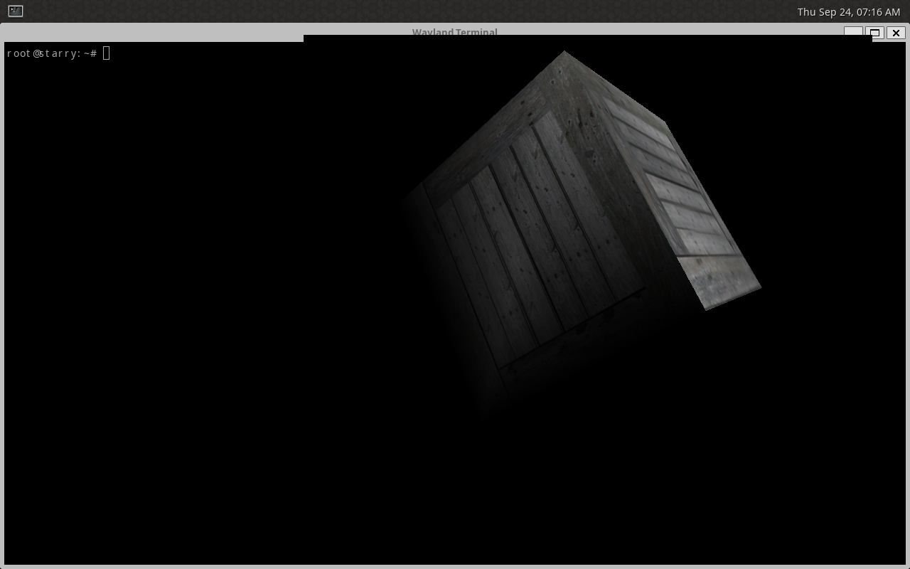

# GPU 与屏幕输出栈

## 1. 分层与唯一所有者

`rdif-gpu` 描述资源、上下文、命令与完成能力，`rdif-display` 描述显示输出；
同一块 VirtIO GPU 只注册一次设备。`ax-gpu` 独占设备和传输，`ax-drm` 将其接入
共享 `kdrm-core`。Starry 的 `card0` 只适配 Linux 文件操作、用户内存、poll 与 VMA，
不再维护另一套 GEM、syncobj、master 或 atomic 状态。详细契约见
[共享 DRM 核心接入](../../design/shared-drm.md)。

`kdrm-core` 拥有 DRM 对象与 UAPI 状态，`drm-kapi` 通过显式 provider 接入任务、
时间、等待和内存；进程凭据、用户地址空间和描述符表仍由 Starry 拥有。服务表只发布
不可变且满足 `Sync` 的对象。复制 fd 共享同一打开文件描述及其原子的 client-capability
偏好；master 检查和更新由设备锁保护。

## 2. 资源与完成

GEM handle、framebuffer、PRIME、VMA、在途命令和 scanout 分别持有必要引用。VMA
查找经过公共 VMA offset manager 与文件权限检查，并保留 GEM 租约；关闭最后一个
handle 不使仍存活的 VMA 失效。VirtGPU 对每个文件、对象独立计数 handle；最后一个
本地 handle 关闭后解除上下文附着，不将附着引用积累到整个 DRM 文件关闭。

普通 guest-backed 分配使用实际 DMA backing，host-visible blob 使用实际 BAR
映射。后者按设备对齐分配可回收区间，保留缓存属性，并在 UNMAP 与资源释放确认后才
归还区间。同设备 PRIME 别名共享对象；其他设备不能将 host-only BAR 当成 guest 页
导入。不支持的 DMA 域和映射路径明确拒绝，不制造物理地址或成功返回桩。

### 2.1 显示提交

`TEST_ONLY` 只验证，不发布 scanout 或事件。阻塞 atomic 提交在软件状态交换前执行
可失败的 RDIF 提交；失败保留原状态。非阻塞提交由工作任务等待输入 fence，再提交
设备；异步失败通过错误 fence、取消事件和设备不可用状态结束依赖。

RDIF 完成只证明旧缓冲区的设备访问结束，不能代替显示边沿。活动 CRTC 的翻页事件与
out-fence 在下一次 vblank 上共享序号和时间戳；停用或无 vblank 时才立即完成。
当前 vblank 使用运行时定时器，不是物理显示器扫描中断的精度承诺。输入 fence 的
可中断等待使用 Starry 的真实待处理信号规则，不可中断等待不会被普通信号完成。

### 2.2 并发与失败清理

硬中断只确认来源并发布状态，运行时任务推进控制队列，释放 GPU 锁后再运行 DRM
回调。文件状态短锁不得跨越可能睡眠的 RDIF 调用。关闭、析构与失败回滚使用清理入口；
超时本身不构成设备停止证明，仍保留设备可能访问的引用。VirtIO 复位须读回状态 0，
之后才能解除队列并释放 backing。

ERR/HUP 是终端事件，即使观察者没有请求普通可读事件，也必须唤醒已经睡眠的 epoll。
Starry 两个文件适配器都保留 Linux waitqueue 实际传入的事件 key，不将其统一改成 IN。

## 3. 用户态能力与迁移

VirtGPU 私有 ioctl 在 `ax-drm::backend::virtgpu` 转译到 RDIF；公共对象仍使用共享
DRM 文件、GEM、PRIME、syncobj 和 sync_file。2D、经典 VirGL 和 Venus 按实际协商能力
开放；context-init 支持最多 64 个 ring 及 poll-ring mask，提交保留 ring 选择。Venus
capset 使用版本 0 查询，`HOST_VISIBLE` 还要求实际 hostmem BAR，不根据 render 节点
存在与否猜测能力。

旧 `card0/virtgpu` 和私有同步实现已删除；迁移不改变持久格式，不增加运行时新旧实现
选择。回滚是代码级回滚，不是在错误时静默改走旧路径。

普通 DRM 系统用例验证实际 ioctl、fd、atomic、mmap 与同步对象。
`apps/starry/venus-regression` 在具备 `virgl` 主机能力时运行有界的重复 GEM/VMA 生命周期
及 Vulkan 命令、fence 和内存回读；它强制选择 virtio ICD，不允许软件渲染回退。
`virgl-test` 仍用于人工桌面与画面验收。QEMU、宿主渲染栈和真实显示器/板卡证据必须区分。

以下保留迁移前各日期的历史验证记录，不代表当前提交已经重跑对应目标。

## 4. 本轮验证记录

以下命令在 2026-09-24 的工作树上运行。未提交时 `cargo xtask test --since 9a7b868bab8dcceb42acab516dcc88d5cc69985a` 尚不能识别本轮差异，因此先运行完整 `cargo xtask test`，得到 67/67 个软件包通过；提交后再运行增量入口，得到 14/14 个软件包通过。

| 命令 | 成功标记 |
| --- | --- |
| `cargo fmt`；`git diff --check` | 退出码 0，无格式或空白错误 |
| `cargo xtask clippy --package rdif-gpu`、`rdif-display`、`virtio-gpu`、`ax-driver`、`ax-gpu`、`ax-display`、`ax-api`、`ax-runtime`、`starry-kernel` | 各软件包均有 `all clippy checks passed` |
| `cargo xtask test` | `all std tests passed`，67/67 个软件包 |
| `cargo xtask test --since 9a7b868bab8dcceb42acab516dcc88d5cc69985a` | `all std tests passed`，14/14 个受影响软件包 |
| `cargo test -p virtio-gpu --features rdif --lib` | 2/2 passed；模拟 VirtQueue 覆盖检查无副作用、失败回滚、解绑失败后复位与 backing 释放，以及正常析构在解除队列前读回复位完成。任务工具的 std 清单未覆盖该驱动的 `rdif` 功能组合，因此使用此定向宿主测试。 |
| `cargo xtask arceos test qemu --test-group rust --test-case display-basic --arch x86_64` | `ARCEOS_TEST_END ... status=pass`、`ArceOS test suite run OK!` |
| `cargo xtask starry test qemu --arch x86_64 -c qemu/gpu-absent` | `STARRY_GPU_ABSENT_PASSED`、`all starry qemu tests passed` |

下面每行都使用 `cargo xtask starry test qemu --arch <架构> -c qemu/system/<用例>` 单独运行；每项都有 `STARRY_SYSTEM_TEST_PASSED`、`STARRY_GROUPED_TESTS_PASSED` 和 `all starry qemu tests passed` 终态。LoongArch 的客体通过 `--capture-failures` 只输出失败断言，因此以系统用例和任务工具终态为准。

| 架构 | `drm-test-drm-version` | `drm-test-drm-modeset` | `drm-test-drm-atomic` | `test-drm-perbuf-dumb` |
| --- | --- | --- | --- | --- |
| `x86_64` | 14 pass，0 fail | 87 pass，0 fail | 125 pass，0 fail | 54 pass，0 fail |
| `aarch64` | 14 pass，0 fail | 87 pass，0 fail | 125 pass，0 fail | 54 pass，0 fail |
| `riscv64` | 14 pass，0 fail | 87 pass，0 fail | 125 pass，0 fail | 54 pass，0 fail |
| `loongarch64` | 通过 | 通过 | 通过 | 通过 |

`cargo xtask starry app qemu -t virgl-test --arch x86_64` 已在 KVM/QEMU 的 `virtio-vga-gl` 上运行。客体 Weston 日志报告 `GL renderer: virgl`，`es2_info` 的 OpenGL core、compatibility 和 ES profile 均报告 `virgl`，`/tmp/glmark2.log` 报告 `GL_RENDERER: virgl`，且渲染过程中多个场景持续输出 FPS。同步从本次虚机的 VNC framebuffer 取得了实际画面：

QMP `screendump` 对 `egl-headless` 返回 `no surface`，因此画面由 VNC 原始 framebuffer 捕获；这不影响客体报告的 renderer。未运行实体板卡图形输出测试，以上图形证据只对应这次 QEMU/KVM 虚机与宿主 `/dev/dri/renderD128`。

### 4.1 2026-09-28 变基与审查修复

分支先变基到 `7c79828fefde`，合并上游新增的 vblank 支持，并修复同设备 PRIME 重复导入失败时误拆除既有 virgl 上下文附着的问题；随后无冲突变基到包含 PCI ECAM 测试修复的 `8af5f36698`。`cargo fmt`、`git diff --check` 和 DRM modeset 用例的 `cc -std=gnu11 -Wall -Wextra -Werror -fsyntax-only` 均通过。`cargo xtask clippy --package starry-kernel` 完成 76/76 项检查；`cargo xtask test --since 7c79828fefde` 完成 14/14 个软件包，包含模式切换后 vblank 周期与序号的单元测试。

本次 Starry x86_64 `qemu/system` 运行期间，四个 DRM 系统用例均报告 `STARRY_SYSTEM_TEST_PASSED`。用户随后收窄本地验证范围，完整套件已中断，不能视为整套通过；其他架构与 virgl 画面没有在变基后的提交上重新运行。上方四架构和图形输出记录属于 2026-09-24 的原提交。

### 4.2 2026-09-28 驱动复核

本次修正了 `VirtIoGpuDevice` 的 2D 格式编码、3D scanout 格式和尺寸检查、主机明确拒绝创建或确认资源不存在后的释放判定，以及输出查询失败后的事件保留；新增测试先在旧实现上失败，再在修复后通过。检查只覆盖受影响功能组合，不重复运行全量 Clippy 或 QEMU。

| 命令 | 结果 |
| --- | --- |
| `cargo fmt`；`git diff --check` | 通过 |
| `cargo xtask clippy --package virtio-gpu` | 2/2 功能组合通过 |
| `cargo test -p virtio-gpu --features rdif --lib` | 5/5 测试通过；新增的 3D 尺寸断言先在旧校验上失败 |
| `cargo clippy --no-deps -p ax-driver --no-default-features --features virtio-gpu -- -D warnings` | VirtIO GPU 功能组合通过 |
| `cargo clippy --no-deps -p ax-runtime --no-default-features --features display -- -D warnings` | display 功能组合通过 |
| `cargo clippy --no-deps -p starry-kernel --no-default-features -- -D warnings` | Starry 内核基础功能组合通过 |
| `cc -std=gnu11 -Wall -Wextra -Werror -fsyntax-only test-suit/starryos/qemu/system/drm-test-drm-modeset/src/main.c` | DRM 系统用例语法检查通过 |

`ax-driver`、`ax-runtime` 与 `starry-kernel` 的项目任务工具没有单一功能组合入口；上面三条原生 Cargo 命令按任务工具展开的参数定向检查，避免执行整个功能矩阵。本次没有获取新的实体板卡、QEMU 或 virgl 画面证据；系统用例的新增断言仍需在 CI 运行。

### 4.3 2026-09-28 通用 scanout 复核

补齐无 2D 图像资源的显示控制器：`/dev/fb0` 的直接 backing 刷新可识别当前 scanout；Starry 的 KMS、dumb buffer 与 `ADDFB2` 可以提交 backing，`DRM_CAP_DUMB_BUFFER` 与实际能力一致。提交成功后当前 scanout 和异步待释放的旧 scanout 都保留 backing 或 GPU 资源引用；回收任务在完成确认后释放旧引用。

`ax-display` 的直接 backing 身份测试先在旧匹配逻辑上失败，再在修复后以相同命令通过。`cargo fmt` 和 `git diff --check` 通过；`cargo xtask clippy --package ax-display` 的 2/2 组合通过。`cargo xtask clippy --package starry-kernel` 的 AArch64 基础组合已通过，随后按本地验证范围限制中止剩余矩阵；`cargo clippy --no-deps -p starry-kernel --no-default-features -- -D warnings` 定向通过。用户要求本地不运行全量 Clippy 或 QEMU；本次没有新的图形输出证据。

提交代码后运行 `cargo xtask test --since e5efb8291dfe0997341524e1d3f14b082000e421`，`ax-display` 和 `starry-kernel` 2/2 软件包通过，其中 `ax-display` 的直接 backing 回归测试在项目入口实际执行并通过。此前只覆盖 `ax-display` 的定向测试先在旧实现上报告断言失败。本次没有可用于直接 backing 显示控制器的 QEMU 设备，因此 Starry 的纯 backing KMS 路径仍待带相应驱动的系统用例验证。

### 4.4 2026-09-28 显示事件积压修复

VirtIO 的同步显示提交原先每次都向无人消费的队列加入 `CommitCompleted`，连续输出变化也会累积重复通知。增强现有协议测试后，`cargo test -p virtio-gpu --features rdif --lib` 在旧实现上有 2/5 个测试按预期失败；修复后同一命令 5/5 通过。`cargo fmt`、`git diff --check` 和 `cargo xtask clippy --package virtio-gpu` 均通过，后者覆盖 base 与 `rdif` 两个功能组合。本次未运行 QEMU 或全量 Clippy；任务工具的 std 测试清单未包含 `virtio-gpu`，故使用驱动自身的定向宿主测试。

### 4.5 2026-09-28 断开输出的 scanout 清理

Starry 在停用时查询驱动的 `current_state`，向仍持有 framebuffer 的输出提交禁用状态；原输出断开而另一输出连上时，`select_output_for_present` 拒绝直接切换，防止旧 backing 在设备解绑前释放。现有 Starry 单元测试加入这两种状态后，`cargo xtask test --since d3536651c219946371e253237a429362c46508c4` 在旧逻辑上分别得到 13/14 个软件包通过，`starry-kernel` 的新增断言失败；修复后同一命令 14/14 通过。`cargo fmt`、`git diff --check`、`cargo xtask clippy --package rdif-display` 和 `cargo clippy --no-deps -p starry-kernel --no-default-features -- -D warnings` 均通过。后者按单一功能组合检查，避免 `xtask` 的 Starry 多配置矩阵。本地按要求未运行 QEMU 或全量 Clippy；断开后的实际显示硬件行为仍需设备测试验证。

分支随后无冲突地变基到 `dev` 的 `ce1740fcad`，纳入 SG2002 网络用例的 curl 打包修复及项目验证范围说明。`git range-diff` 显示 GPU 栈的七个提交补丁保持不变；变基后的运行证据以新提交的 CI 终态为准。

### 4.6 2026-09-28 上下文关闭与完成确认

审查发现上下文中的单个资源解绑失败会阻止 `CTX_DESTROY`，进而使随后析构的 GPU 资源因仍有附着而无法释放。Starry 文件关闭现直接请求销毁上下文；驱动在确认销毁后清除附着，结果不明确时先复位设备再释放 backing。VirtIO 规范允许控制队列提前交还响应，故协议核心为同步命令设置 fence 并核对响应中的标志和编号，覆盖 scanout 切换、传输、上下文销毁与资源解绑。

`cargo test -p virtio-gpu --features rdif --lib` 的新增关闭路径测试在旧实现上失败，修复后 7/7 通过；同一测试中的未设置 fence 断言也先在旧请求实现上失败。模拟主机故意省略 `CTX_DESTROY` 的 fence 回显时，驱动返回 `DeviceLost`，测试确认复位已读回并且 backing 随后才释放。独立复核发现普通显示访问容忍输出查询失败会使用过期模式，已恢复错误传播；进一步按任意 GPU 驱动的契约把普通 GPU 访问也恢复为错误传播，仅明确的清理与回收路径使用容错入口。

`cargo fmt`、`git diff --check`、`cargo xtask clippy --package virtio-gpu`（2/2）、`rdif-gpu`（1/1）和 `ax-gpu`（2/2）通过。`cargo xtask clippy --package starry-kernel` 在首批 10 个组合通过后按本地范围限制中断，不能作为最终差异的完整证据；任务入口无单组合选项，随后按其展开参数定向运行最终差异的 Starry AArch64 基础组合并通过。本地未运行全量 Clippy 或 QEMU；真实主机的 fence 行为仍以本次提交的 CI 和后续图形运行证据为准。

### 4.7 2026-09-28 未确认的显示提交

控制队列交还已用描述符但未回显匹配的 fence 时，驱动无法确认 `SET_SCANOUT` 是否仍会在主机侧生效，也无法安全地仅靠后续回滚命令证明旧提交已经结束。协议核心此时先写入设备复位状态、读回确认并解除队列，再允许适配层放弃旧、新 scanout backing；调用者收到 `DeviceLost`，不会把这次提交误当成普通的可回滚错误。`DisplayController::commit` 的错误契约据此明确：设备仍可用时保留旧状态；设备丢失时旧 scanout 不再有效。

模拟主机省略 `SET_SCANOUT` fence 的测试先在旧实现上失败（实际得到 `Gpu(Io)`，且没有证明复位已完成），修复后验证 `DeviceLost`、复位读回以及两份 backing 均在设备停止后释放。`cargo test -p virtio-gpu --features rdif --lib` 8/8 通过，`cargo xtask clippy --package virtio-gpu` 2/2 组合和 `cargo xtask clippy --package rdif-display` 1/1 组合通过，`cargo fmt` 与 `git diff --check` 通过。本地不运行全量 Clippy 或 QEMU。

### 4.8 2026-09-28 设备丢失后的 scanout 回收

Starry 对异步旧 scanout 每隔 20 ms 查询 `commit_status`。原逻辑将任何错误都视作待完成；若驱动报告 `DeviceLost`，后台任务会永久重试并保留旧 backing。现在 `DeviceLost` 的通用接口语义明确要求驱动先停止对所有 backing 的访问，它也是所有待完成令牌的终态：回收任务释放所有旧 scanout 引用及当前 pin，最后一个 DRM 文件关闭时即使禁用提交因设备丢失失败，也会清理 framebuffer 表和 pin。暂时性查询错误仍保留引用并重试，避免在设备继续 DMA 时提前释放。

新增的资源生命周期测试以两个 `Arc` pin 模拟“先待完成、后设备丢失”，在旧逻辑上使 `cargo xtask test --since ce1740fcad707227a8e505adeda3942cfe647251` 失败（`starry-kernel` 276 pass、1 fail），修复后同一入口 14/14 个软件包通过，测试确认两个 pin 都已释放。`cargo fmt`、`git diff --check` 和 Starry 内核基础功能组合的定向 Clippy 通过。本地未运行全量 Clippy 或 QEMU；真实设备复位后的用户态行为仍需当前提交的系统级证据。
