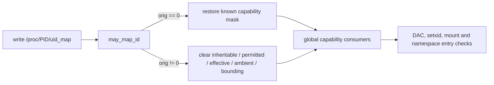

# StarryOS 用户命名空间凭据边界

StarryOS 目前只实现 `/proc/<pid>/uid_map` 和 `/proc/<pid>/gid_map` 的简化凭据更新，没有保存 Linux 用户命名空间中的完整 ID 映射，也没有把 capability 绑定到 `UserNamespace`。该边界决定了下述映射写路径必须失败封闭，不能把少量全局 capability 当作尚未实现的命名空间权限。

## 1. 当前凭据模型

凭据由 `Cred` 保存实用户、有效用户、保存用户、文件系统用户及其 capability 集合，`Thread::set_cred()` 会把一次提交发布的凭据快照安装到目标任务的全部线程。`/proc/<pid>/uid_map` 的写入闭包先调用 `may_map_id()` 检查写入者能否建立映射，再把映射第二列直接写入目标线程的 `uid`、`euid`、`suid` 和 `fsuid`。

### 1.1 映射写入

`may_map_id()` 允许两条路径：单条映射映射到写入者自己的 ID，或具有 `CAP_SETUID` 的初始用户命名空间写入者提交任意单条映射。通过检查后，映射写入不是 Linux 的“只登记映射表”操作，而是一次直接覆盖目标线程 ID 的凭据提交；`Thread::set_uid_map_written(true)` 随后只解除 `getuid` 系列入口的 `65534` 溢出显示。

### 1.2 非零映射

`orig == 0` 时，映射写入恢复当前内核已知 capability 范围，以保留初始根身份。`orig != 0` 时，`Cred::cap_inheritable`、`cap_permitted`、`cap_effective`、`cap_ambient` 和 `cap_bounding` 全部清零。`sanitize_capabilities()` 只按 `CAP_MASK` 截断 inheritable，不能靠 bounding 清除预先写入的值；若保留 inheritable，它还会跨当前 exec 与未来的 file capability 计算继续存在。`Cred::has_cap()` 及 `has_cap_setuid()`、`has_cap_dac_override()`、`has_cap_sys_admin()` 等查询只读取全局线程位，因此清空这些集合是当前模型中唯一可证明的失败封闭策略。

### 1.3 能力消费者

文件路径通过 `mutation_credentials()` 把 `CAP_DAC_OVERRIDE`、`CAP_DAC_READ_SEARCH` 和 `CAP_FOWNER` 传给 VFS；`sys_setuid()`、`sys_setresuid()` 等入口直接依赖 `CAP_SETUID`；`sys_mount()`、`sys_umount2()`、`fsopen` 系列和 `pivot_root` 等挂载入口依赖 `CAP_SYS_ADMIN`。这些检查目前没有目标用户命名空间参数，所以非零映射后的任何全局 capability 都会越过宿主对象边界。

下图概括映射值如何选择 capability 状态，以及该状态如何进入未按命名空间区分的消费者。

无论映射值为何，图中的消费者都只观察线程凭据位。因此 `orig != 0` 分支不能保留 `CAP_SETUID`、`CAP_DAC_OVERRIDE` 或 `CAP_SYS_ADMIN` 等过渡能力，否则进程会以非 root 数字 ID 继续操作初始命名空间中的宿主对象。

## 2. 用户可见边界

非零映射后的边界应由真实操作验证，而不是由 capability 常量推断。增强的命名空间系统用例由初始根父进程为 `unshare(CLONE_NEWUSER)` 子进程写入 `0 1000 1`，随后在该子进程中检查宿主文件、setxid、bounding 与共享挂载权限。

### 2.1 文件与身份

映射前，子进程用 `capset()` 预先填满 permitted、effective 和 inheritable；映射后先由 `capget()` 报告两个 capability 字中的 effective、permitted 和 inheritable 全部为零。随后用例先在映射后的原始凭据上测试宿主文件访问，再执行 `setresuid(0, 0, 0)` 和 `setuid(0)`，两者都必须返回 `EPERM`，并通过 `getresuid()` 确认身份没有发生部分提交。

宿主访问、共享挂载和 setxid 检查全部完成后，用例才执行可能改变凭据状态的 ambient raise 与 `capset()`：只请求重新填充 inheritable、以及请求恢复 permitted/effective/inheritable 的 `capset()` 都必须返回 `EPERM`，再次 `capget()` 仍须保持全零。这样旧实现的 `capset()` 成功路径不能提前清空 permitted/effective，掩盖最初映射后的宿主权限。

### 2.2 挂载与能力

子进程打开宿主 `0600` 文件后，在 setxid 之前向仍共享的 `/tmp` 请求一个不存在的文件系统类型：修复后的 capability 门禁在文件系统解析前返回 `EPERM`；旧实现若保留 `CAP_SYS_ADMIN` 会越过门禁并得到其他错误，同时该选择不会实际修改共享挂载树。最后检查环境时，`PR_CAP_AMBIENT_IS_SET` 必须报告 `CAP_SETUID` 未进入 ambient，`PR_CAP_AMBIENT_RAISE` 必须返回 `EPERM`；`prctl(PR_CAPBSET_READ, CAP_SETUID)` 还必须返回 `0`，证明非零映射没有留下后续重新取得 setxid 特权的 ambient 或 bounding 路径。

## 3. 兼容性与应用影响

该模型与 Linux 的可观察语义仍有明确差异：Linux 写 `uid_map` 不修改目标凭据，命名空间内 UID 0 按映射解析为外层 UID，并由 `ns_capable()`、`capable_wrt_inode_uidgid()` 等检查把 capability 限定到所属用户命名空间。StarryOS 当前把第二列直接写入线程凭据，且 capability 检查仍是全局的。

### 3.1 Nix 消费者

现有 Nix 应用与 `test-nix-*` 系统用例在初始 root 下把 `0 0 1` 写入子用户命名空间，因此仍命中 `orig == 0` 路径，不依赖非零映射保留全局 capability。`test-nixpkgs-first-divergence` 随后执行的 mount、UTS 和 namespace 操作也发生在该根映射场景中；不能为了支持其他映射值而恢复宿主特权，正确方向是后续让能力检查接受目标 `UserNamespace`。

### 3.2 尚未完成的 ABI

当前实现没有实现多段 `uid_map`、反向 ID 映射、完整 `setgroups` 写入规则、命名空间作用域 capability 或 exec 时的完整 capability 转换。非零映射清空全部相关能力只代表安全失败封闭，不代表支持完整 user namespace ABI；在这些语义实现前，依赖子命名空间 root 对私有挂载执行管理操作的非 root 宿主流程仍会得到权限拒绝。
