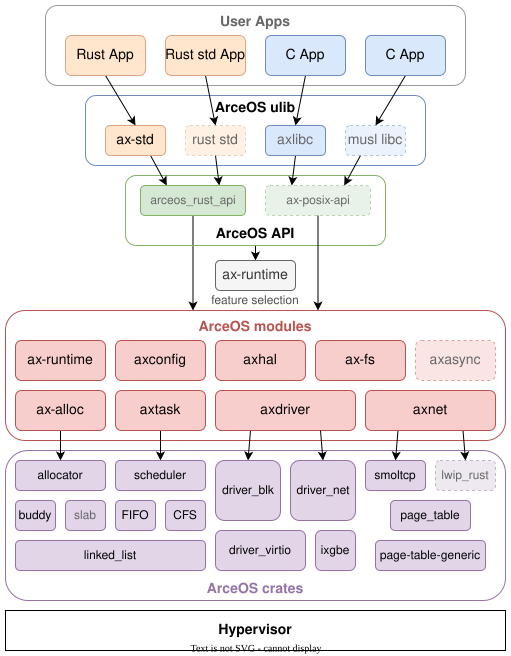

<h1 align="center">ArceOS</h1>

<p align="center">An experimental modular operating system (or unikernel) written in Rust</p>

<div align="center">

[](https://github.com/arceos-org/arceos/actions/workflows/build.yml)
[](https://github.com/arceos-org/arceos/actions/workflows/test.yml)
[](https://arceos-org.github.io/arceos/)
[](./LICENSE)

</div>

English | [中文](README_CN.md)

ArceOS was inspired a lot by [Unikraft](https://github.com/unikraft/unikraft).

Working in progress.

> **TGOSKits workspace note:** this is the upstream ArceOS README retained in
> the `os/arceos` subtree. In this repository the supported build and run entry
> point for Rust applications is the root `cargo xtask arceos` command. The
> `make` recipes remain a compatibility path for C applications.

## TGOSKits workspace entry points

Run these commands from the TGOSKits workspace root. The Rust application is a
workspace package, so the root `xtask` entry point resolves its build config,
target, and QEMU configuration without the legacy ArceOS Make variables.

```bash
cargo xtask arceos build --package arceos-helloworld --arch aarch64
cargo xtask arceos qemu --package arceos-helloworld --arch aarch64
```

Applications live under [`apps/arceos`](../../apps/arceos) in this workspace.
Use `cargo xtask arceos --help` for the current command and option set.

## Features & TODOs

* [x] Architecture: x86_64, riscv64, aarch64, loongarch64
* [x] Platform: QEMU pc-q35 (x86_64), virt (riscv64/aarch64/loongarch64)
* [x] Multi-thread
* [x] FIFO/RR/CFS scheduler
* [x] VirtIO net/blk/gpu drivers
* [x] TCP/UDP net stack using [smoltcp](https://github.com/smoltcp-rs/smoltcp)
* [x] Synchronization/Mutex
* [x] SMP scheduling with [per-cpu run queue](https://github.com/arceos-org/arceos/discussions/181)
* [x] File system
* [ ] Compatible with Linux apps
* [ ] Interrupt driven device I/O
* [ ] Async I/O

## Quick Start

### Build and Run through Docker

Install [Docker](https://www.docker.com/) in your system.

Then, from the workspace root, build all dependencies through the provided
dockerfile:

```bash
docker build -t arceos -f os/arceos/Dockerfile .
```

Create a container and build/run app:

```bash
docker run -it -v $(pwd):/arceos -w /arceos arceos bash

# Now build/run app in the container
cargo xtask arceos build --package arceos-helloworld --arch aarch64
cargo xtask arceos qemu --package arceos-helloworld --arch aarch64
```

### Manually Build and Run

#### 1. Install Build Dependencies

Install [cargo-binutils](https://github.com/rust-embedded/cargo-binutils) to use `rust-objcopy` and `rust-objdump` tools:

```bash
cargo install cargo-binutils
```

##### Dependencies for running apps

```bash
# for Debian/Ubuntu
sudo apt-get install qemu-system
# for macos
brew install qemu
```

##### Dependencies for building C apps (optional)

Install `libclang-dev`:

```bash
sudo apt install libclang-dev
```

Download & install [musl](https://musl.cc) toolchains:

```bash
# download
wget https://musl.cc/aarch64-linux-musl-cross.tgz
wget https://musl.cc/riscv64-linux-musl-cross.tgz
wget https://musl.cc/x86_64-linux-musl-cross.tgz
wget https://github.com/LoongsonLab/oscomp-toolchains-for-oskernel/releases/download/loongarch64-linux-musl-cross-gcc-13.2.0/loongarch64-linux-musl-cross.tgz
# install
tar zxf aarch64-linux-musl-cross.tgz
tar zxf riscv64-linux-musl-cross.tgz
tar zxf x86_64-linux-musl-cross.tgz
tar zxf loongarch64-linux-musl-cross.tgz
# exec below command in bash OR add below info in ~/.bashrc
export PATH=`pwd`/x86_64-linux-musl-cross/bin:`pwd`/aarch64-linux-musl-cross/bin:`pwd`/riscv64-linux-musl-cross/bin:`pwd`/loongarch64-linux-musl-cross/bin:$PATH
```

Other systems and arch please refer to [Qemu Download](https://www.qemu.org/download/#linux)

#### 2. Build & Run

```bash
# build and run the workspace application through xtask
cargo xtask arceos build --package arceos-helloworld --arch aarch64
cargo xtask arceos qemu --package arceos-helloworld --arch aarch64
```

The current example package is `arceos-helloworld`, located under
`apps/arceos/helloworld`. More examples can be found in
[`apps/arceos`](../../apps/arceos) or the
[arceos-apps](https://github.com/arceos-org/arceos-apps) repository.

`<arch>` should be one of `riscv64`, `aarch64`, `x86_64`, `loongarch64`.

The root `xtask` resolves the application package and its build configuration.
If the generated default is unsuitable, pass an explicit build config with
`--config <path>`; that file selects the logical target, features, log level,
and SMP build settings. Use `cargo xtask arceos --help` for the current command
and option set.

For example, to run the [httpserver](../../apps/arceos/httpserver) on
`qemu-system-aarch64` with 4 cores:

```bash
cargo xtask arceos qemu \
  --package arceos-httpserver \
  --arch aarch64 \
  --smp 4 \
  --qemu-config apps/arceos/httpserver/qemu-aarch64.toml
```

The QEMU config, rather than the legacy `NET` or `BLK` Make variables, selects
devices and boot arguments.

## How to write ArceOS apps

Rust applications selected by the root `xtask` are Cargo workspace packages.
C applications may remain outside the workspace and use the compatibility Make
flow. The current example is
[`apps/arceos/helloworld`](../../apps/arceos/helloworld); the upstream
[app-helloworld](https://github.com/arceos-org/app-helloworld) and
[arceos-apps](https://github.com/arceos-org/arceos-apps) repositories provide
additional references.

### Rust

1. Create a package under `apps/arceos` and add it to the root workspace
   `members` list. Use a unique Cargo package name; commands select the
   application with `--package`.
2. Add `ax-std` and its application feature to `Cargo.toml`:

    ```toml
    [package]
    name = "my-arceos-app"
    version = "0.1.0"
    edition.workspace = true

    [features]
    default = ["arceos"]
    arceos = ["dep:ax-std", "ax-std/arceos"]

    [dependencies]
    ax-std = { workspace = true, optional = true, features = ["default"] }
    ```

3. Call library functions from `ax-std` in your code, just like the Rust [std](https://doc.rust-lang.org/std/) library.

    Current applications use an ordinary `fn main()`. The `std` PIE build path
    does not require `no_std`, `no_main`, or `#[unsafe(no_mangle)]`; see the
    [hello-world entry point](../../apps/arceos/helloworld/src/main.rs).

4. Build and run the package through the root `xtask`. Add `--config <path>`
   when a custom build config is needed, and `--qemu-config <path>` to select
   devices or boot arguments:

    ```bash
    cargo xtask arceos build --package my-arceos-app --arch aarch64
    cargo xtask arceos qemu --package my-arceos-app --arch aarch64
    ```

### C

1. Create `axbuild.mk` and `features.txt` in your project:

    ```bash
    app/
    ├── foo.c
    ├── bar.c
    ├── axbuild.mk      # optional, if there is only one `main.c`
    └── features.txt    # optional, if only use default features
    ```

2. Add build targets to `axbuild.mk` and features to enable to `features.txt`
   using the C application layout expected by `scripts/make`:

    ```bash
    # in axbuild.mk
    app-objs := foo.o bar.o
    ```

    ```bash
    # in features.txt
    alloc
    paging
    net
    ```

3. Build the C application through the compatibility Make flow. This path
   remains available for C apps and is not the Rust `std` PIE entry point:

    ```bash
    # in app directory
    make -C /path/to/tgoskits/os/arceos A=$(pwd) ARCH=<arch> run
    # more args: LOG=<log> SMP=<smp> NET=[y|n] ...
    ```

## How to build ArceOS for specific devices

ArceOS now uses the mandatory `axplat-dyn` platform path for supported
architectures. Board-specific support should extend the runtime discovery path
through `somehal`, firmware tables, FDT/ACPI data, or device probes instead of
selecting a platform crate or platform config file in the in-tree build flow.

You may need to select the corresponding device drivers by setting the
`FEATURES` variable. For x86_64 QEMU builds, prefer the `cargo xtask`
`axplat-dyn` flow instead of the removed in-tree static PC platform.

## How to reuse ArceOS modules in your own project

```toml
# In Cargo.toml
 [dependencies]
ax-alloc = { git = "https://github.com/arceos-org/arceos.git", tag = "v0.2.0" } # ax-alloc
ax-hal = { git = "https://github.com/arceos-org/arceos.git", tag = "v0.2.0" } # os/arceos/modules/axhal
```

## Design


