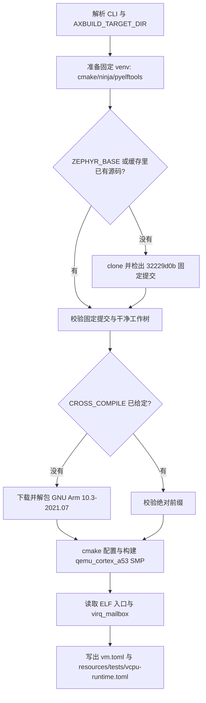

# 挂起 vCPU 的定向中断投递客户机

本目录保存 `axvm` 的 `vcpu_runtime` 测例所用的固定 Zephyr 客户机。`src/main.c` 让两个 vCPU 通过 PSCI 挂起并等待定向软件中断，`prepare.py` 编译固定版本并写出运行所需的 VM 描述与 initramfs 夹具；准备脚本不启动宿主、不运行 QEMU、也不判定测试结果，判定由 ktest 的 axtest 标记完成。

## 1. 客户机契约

客户机面向 `qemu_cortex_a53` 的 SMP 变体构建，`CMakeLists.txt` 只把 `src/main.c` 编入 `app`，`prj.conf` 打开串口控制台、`CONFIG_ARMV8_A_NS`、`CONFIG_SCHED_CPU_MASK`、`CONFIG_SYSCLOCK_TICKS_PER_SEC=1000` 并关闭时间片。`virq_mailbox` 位于一致性客户机 RAM，每个字段只有一个写入方，宿主侧读取应答，并且只写入 `complete`；这是“投递是否到达目标 vCPU”与“闲置 vCPU 是否被误唤醒”两条断言的唯一数据来源。

| 字段 | 唯一写入方 | 含义 |
| --- | --- | --- |
| `ready0` | CPU0 | CPU0 已完成初始化并进入挂起循环 |
| `ready1` | CPU1 | CPU1 已使能 SPI 48 并进入待投递状态 |
| `received` | CPU1 的中断服务程序 | CPU1 实际应答的投递次数 |
| `parks0` | CPU0 | CPU0 进入挂起的次数，用于证明非目标 vCPU 未被推进 |
| `complete` | 宿主侧测试 | 宿主确认全部投递与隔离检查结束后允许客户机完成 |

CPU1 在 `consumer_entry()` 中调用 `irq_enable(SOFTWARE_VIRQ)` 后才具备 GICv3 的 SPI 路由亲和性，`software_virq_isr()` 校验中断确实落在 CPU1 且计数未越界，`suspend_cpu()` 通过 `arm_smccc_hvc(PSCI_CPU_SUSPEND_64, ...)` 让两个 CPU 停在自己维度的等待中。CPU0 只在 `main()` 里递增 `parks0` 后挂起，不参与投递计数，因此任何“广播唤醒”都会立刻破坏 `parks0` 与 `received` 的对应关系。

GIC 允许合并同一 pending 位的重复边沿，所以客户机只保留一个未应答中断、确认收到后才允许下一次投递：300 次投递证明的是宿主路径不会丢事件，而不是架构保证的 300 次 ISR。ISR 的 CPU 选择、LR 饱和与优先级规则由既有 `arm_vgic` 测试覆盖，本客户机专门验证真实 SMP 下的挂起与唤醒。

## 2. 构建资源

`prepare.py` 是唯一的构建入口，它把固定 Zephyr 源码、固定工具链和固定 Python 依赖收进一个缓存目录，然后编译客户机并从 ELF 推导 VM 描述。脚本读取 `ZEPHYR_BASE`、`CROSS_COMPILE` 与 `AXBUILD_TARGET_DIR`，同时允许 `--zephyr-base`、`--cross-compile`、`--output`、`--cache-dir` 覆盖；默认输出是 `<AXBUILD_TARGET_DIR 或 repo/target>/axbuild/axvm/vcpu-runtime`。

图中前五步决定“用哪一份源码、哪一个编译器、哪一套 CMake”，因此缓存目录一旦建立，同一机器上的重复构建不再访问网络；最后两步只产出资源文件。脚本在缓存缺失时下载固定的工具链压缩包和固定的 Python 包版本，不修改系统包，也不依赖个人临时目录。

### 2.1 固定版本

下表中的常量与流程决定构建的可复现性，任何一次放宽都会改变客户机镜像。

| 项 | 值 | 作用 |
| --- | --- | --- |
| `ZEPHYR_REVISION` | `32229d0b6cc60a1906307311b8e79ec483ad1e88` | 客户机源码唯一来源，校验失败即中止 |
| `TOOLCHAIN_ARCHIVE_URL` | ARM GNU-A `10.3-2021.07` 交叉工具链 | 与旧流程一致的编译器；`CROSS_COMPILE` 必须是绝对前缀 |
| `PINNED_PYTHON_PACKAGES` | `cmake==4.4.3`、`ninja==1.13.2`、`pyelftools==0.33`、`PyYAML==6.0.3`、`packaging==26.3`、`pykwalify==1.8.0` | CMake/Ninja、ELF 解析与 Zephyr 板级 YAML 校验依赖 |
| `BOARD` | `qemu_cortex_a53/qemu_cortex_a53/smp` | Zephyr 双核板级定义 |
| `MAILBOX_SYMBOL`、`MAILBOX_SIZE` | `virq_mailbox`、20 字节 | ELF 符号校验对象；大小不符即中止 |

`VIRQ_CACHE_DIR` 可把缓存移到共享位置，缓存内部分为 `zephyr`、`toolchain`、`venv` 三项，`VIRQ_TOOLCHAIN_SHA256` 可在需要时校验工具链压缩包摘要。源码校验要求检出提交等于 `ZEPHYR_REVISION` 且工作树无改动，避免“用了别人的分支”这种无法复现的输入。

### 2.2 产物与校验

`inspect_guest()` 从 `.symtab` 读取 `virq_mailbox` 的地址与大小，要求大小等于 20 字节且地址与 ELF 入口都落在客户机 RAM `[0x40000000, 0x48000000)` 内；地址或大小不符时脚本直接失败，不写出半成品资源。`write_vm_config()` 用历史布局写 `vm.toml`：`id = 2`、`cpu_num = 2`、`phys_cpu_ids = [0, 1]`、`kernel_load_addr = 0x40000000`、`dtb_load_addr = 0x47e00000`、`memory_regions = [[0x40000000, 0x08000000, 0x7, 0]]`，`kernel_path` 保持相对路径以便整个输出目录整体搬移。

| 产物 | 相对输出目录的路径 | 消费者 |
| --- | --- | --- |
| 客户机镜像 | `guest/zephyr/zephyr.{elf,bin}` | `vm.toml` 的 `kernel_path`，经宿主 initramfs 装入 `/guest/builtin/images` |
| VM 描述 | `vm.toml` | ktest 与 initramfs 打包流程，最终成为 `/guest/builtin/configs/vm-2.toml` |
| 测试夹具 | `resources/tests/vcpu-runtime.toml` | 宿主内的 axtest 目标，提供 `entry` 与 `mailbox` |

夹具只包含 `entry` 与 `mailbox` 两个十六进制字段：它们是宿主与客户机之间唯一的地址约定，客户机镜像一旦重编就可能变化，因此不做任何硬编码。

## 3. 运行入口与边界

资源由同一目录上层的测例配置消费：`virtualization/axvm/tests/vcpu-runtime/guest-builds.toml` 的 `host_prepare` 调用 `python3 virtualization/axvm/tests/guests/virq/prepare.py`，`host-initramfs.toml` 把 `<target>/axbuild/axvm/vcpu-runtime/resources` 装成宿主内存根，并把 `<target>/axbuild/axvm/vcpu-runtime/vm.toml` 连同镜像打包进 `/guest/builtin/configs` 与 `/guest/builtin/images`。运行入口是 `cargo xtask ktest qemu -p axvm --test vcpu_runtime --arch aarch64 --config virtualization/axvm/tests/vcpu-runtime/build-aarch64-unknown-none-softfloat.toml --qemu-config virtualization/axvm/tests/vcpu-runtime/qemu-aarch64.toml`。

判定归 axtest：宿主内核的测试目标读 `/tests/vcpu-runtime.toml` 与 `/guest/builtin/configs/vm-2.toml` 建立客户机、投递中断、比对 mailbox，并在结束时由 `run_kernel_tests()` 输出 `AXTEST_SUITE_OK`，任何失败用例都会让内核以 `AXTEST_SUITE_FAIL` 结束。本目录只负责让这些资源存在且自洽：它不启动宿主、不重试投递、也不把“没有报错”当作通过。

### 3.1 与旧入口的差异

旧流程把判定与进程管理放在被删除的 `scripts/test/zephyr-soft-virq-suspend/run.py` 里，并由宿主 feature 打开后台注入器；现在客户机与资源仍然固定，但注入、应答比对与退出全部由 `axvm` 的 axtest 目标在生产管理器与运行入口上完成，宿主构建不再需要专用 feature 或环境变量。

### 3.2 未验证项

本目录的文档与脚本不构成运行证据：固定版本客户机、双 vCPU 挂起语义、资源装入后的路径解析都需要实际执行 `cargo xtask ktest qemu -p axvm --test vcpu_runtime` 才能确认；在真实板卡上的延迟与吞吐同样不在本场景的证明范围内。
